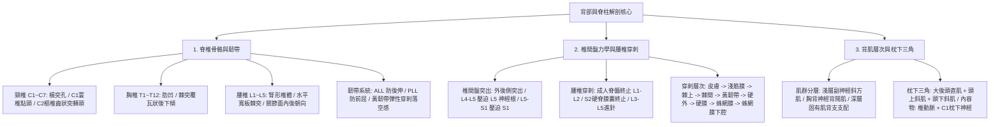

# 解剖學 第 01 章：背部與脊柱解剖

> **考綱歸屬**：人體與神經解剖學 ｜ 醫師專技高考一階段 醫學（一）Q01~Q30 核心考點

---

## 本章導讀與知識架構定位

人體背部與脊柱是支撐軀幹中軸、保護脊髓神經以及提供頭部與四肢肌群附著的力學核心。

考選部在此處出題極為規律，核心聚焦於：

1. 各段椎骨的獨特解剖特徵
2. 脊柱主要韌帶系統與力學功能
3. 椎間盤突出壓迫神經根的精確空間規則
4. 腰椎穿刺由淺至深的解剖層次順序
5. 深層枕下三角的邊界界定與神經血管分佈

---

# 主題 1.1：脊柱骨骼結構、各段椎骨特徵與韌帶系統

### 重點一：各段椎骨解剖特徵終極鑑別表（國考鑑別題必背）

| 脊椎分段 | 椎體形狀與特徵 | 椎孔形狀與大小 | 橫突特徵與孔道 | 棘突走向與形態 | 上下關節突關節面朝向 |
| :--- | :--- | :--- | :--- | :--- | :--- |
| **頸椎 (C1~C7)** | • 椎體較小 • 左右徑大於前後徑 • 具**鉤突 (Uncinate process)** | 較大 呈**三角形** | **具有「橫突孔」** • 穿行椎動脈（C1~C6） • **唯 C7 橫突孔無椎動脈** | • C2~C6 棘突較短且**末端分叉 (Bifid)** • C7 棘突最長不分叉（隆椎） | • 上關節面**朝後上方** • 下關節面**朝前下方** • 利於屈伸與旋轉 |
| **胸椎 (T1~T12)** | • 椎體中等 • 呈**心臟形 (Heart-shaped)** | 較小 呈**圓形** | 橫突末端具有**「橫突肋凹 (Costal facet)」** • 與肋骨小結節形成關節 | 棘突**長而向下大幅傾斜** • 彼此重疊如覆瓦狀 | • 上關節面**朝向後外側** • 下關節面**朝向前內側** • 利於旋轉，限制屈伸 |
| **腰椎 (L1~L5)** | • 椎體最大最厚重 • 呈**腎臟形 (Kidney-shaped)** | 中等大小 呈**三角形** | • 橫突細長 • 具**乳頭突 (Mammillary process)** 與副突 | 棘突呈**寬厚板狀，水平向後突出** • 適合腰椎穿刺進針 | • 上關節面**朝向內側與後方** • 下關節面**朝向外側與前方** • 咬合緊密，利於屈伸 |

---

### 重點二：特殊結構與韌帶體系

#### 1. 特殊頸椎結構

- **【寰椎 Atlas (C1)】**
    - **骨骼構造**：
        - **無椎體、無棘突**！
        - 由前弓、後弓及兩個外側塊（Lateral masses）構成。
    - **關節動力學**：
        - 上關節窩為橢圓形，與枕骨髁形成**寰枕關節（Atlanto-occipital joint）**。
        - 主司頭部**「點頭（Yes-joint）」**動作。

- **【樞椎 Axis (C2)】**
    - **骨骼構造**：
        - 椎體向上垂直伸出長指狀的**「齒狀突 (Dens / Odontoid process)」**。
    - **關節動力學**：
        - 齒狀突被寰椎橫韌帶緊密固定在寰椎前弓後方，形成**寰樞正中關節（Atlanto-axial joint）**。
        - 主司頭部**「搖頭轉動（No-joint）」**動作。

---

#### 2. 脊柱主要韌帶系統

- **【前縱韌帶 ALL (Anterior longitudinal ligament)】**
    - **解剖走向**：
        - 自枕骨基底部延伸至薦骨。
        - 緊貼椎體與椎間盤前緣。
    - **核心力學**：
        - **全身唯一能防止脊柱「過度後伸（Hyperextension）」**的堅韌韌帶。

- **【後縱韌帶 PLL (Posterior longitudinal ligament)】**
    - **解剖走向**：
        - 沿椎體與椎間盤後緣，走在椎管前壁內側。
    - **臨床病理**：
        - 向下延伸時逐漸變窄且薄弱。
        - **無法有效阻擋椎間盤向「外後側」突出**。
        - 主要功能為防止脊柱過度前屈。

- **【黃韌帶 Ligamentum flavum】**
    - **組織解剖**：
        - 連接相鄰椎弓板（Laminae）。
        - 富含黃色彈性纖維。
    - **穿刺特徵**：
        - 腰椎穿刺針穿透黃韌帶瞬間會有極具標誌性的**「落空感（Pop / Give-way）」**！

- **【棘間韌帶與棘上韌帶】**
    - **解剖分佈**：
        - 連接相鄰棘突。
    - **頸部特化**：
        - 棘上韌帶在頸部顯著增厚並向矢狀面擴展，形成**「項韌帶 (Nuchal ligament)」**。
        - 提供眾多頸背部淺深肌群附著。

---

# 主題 1.2：椎間盤力學、突出壓迫規則與腰椎穿刺層次

### 重點一：椎間盤組織解剖與壓迫模型

#### 1. 椎間盤組織結構

- **外層纖維環 (Annulus fibrosus)**：
    - 由多層交錯排列的同心圓膠原纖維軟骨板構成。
    - 專司抵抗脊柱旋轉與剪力應力。

- **中央髓核 (Nucleus pulposus)**：
    - 富含蛋白聚糖與水分的凝膠狀高彈性核心。
    - 負責吸收脊柱垂直方向之衝擊力。
    - **胚胎來源**：為胚胎時期**「脊索（Notochord）」**的退化殘存構造！

---

#### 2. 椎間盤突出（HIVD）空間壓迫神經根規則

- **好發位置**：
    - 由於後縱韌帶在中央較厚、外後側較薄弱。
    - 絕大多數椎間盤突出均發生在**「外後側（Posterolateral）」**。

- **神經根出管規律**：
    - **頸段（C1~C7）**：
        - 神經根自相應同名椎骨**「上方」**的椎間孔走出。
        - 例：C5 神經自 C4/C5 椎間孔穿出；C8 神經自 C7/T1 穿出。
    - **胸腰段（T1 以下）**：
        - 神經根自相應同名椎骨**「下方」**的椎間孔走出。
        - 例：L4 神經自 L4/L5 椎間孔穿出。

- **腰椎外後側突出壓迫原則**：
    - 腰段神經根在椎管內呈垂直下行形成馬尾。
    - **L4/L5 椎間盤外後側突出**：
        - 壓迫的是**「正在下行準備自 L5/S1 穿出的 L5 神經根」**（而非已走出的 L4 神經根）！
    - **L5/S1 椎間盤外後側突出**：
        - 壓迫的是**「S1 神經根」**。
        - 臨床表現為**阿基里斯腱反射（Achilles reflex）消失**、小腿後側與足外側感覺麻木。

---

### 重點二：腰椎穿刺（Lumbar Puncture）臨床解剖學

- **脊髓終止高度**：
    - 成人脊髓圓錐（Conus medullaris）終止於 **L1 與 L2 椎體下緣交界處**。
    - 新生兒約終止於 **L3** 高度。

- **蛛網膜下腔硬脊膜囊終止高度**：
    - 向下延續並終止於 **S2 脊椎骨高度**。

- **穿刺安全部位**：
    - 選在 **L3/L4 或 L4/L5 椎間隙**進針。
    - 此處椎管內僅有馬尾神經，懸浮於腦脊液中，針尖不易刺傷，安全性最高。
    - **體表定位標誌**：兩側髂嵴最高點連線（**Tuffier's line**），恰好橫跨 **L4 棘突或 L4/L5 間隙**。

- **腰椎穿刺針穿透層次順序（由淺至深，國考必考順序題）**：

    1. **皮膚（Skin）**
    2. **淺筋膜（Superficial fascia）**
    3. **棘上韌帶（Supraspinous ligament）**
    4. **棘間韌帶（Interspinous ligament）**
    5. **黃韌帶（Ligamentum flavum）** $\to$ *(穿透瞬間產生標誌性落空感！)*
    6. **硬脊膜外腔（Epidural space）** $\to$ *(內含硬脊膜外靜脈叢與脂肪組織)*
    7. **硬脊膜（Dura mater）**
    8. **蛛網膜（Arachnoid mater）**
    9. **蛛網膜下腔（Subarachnoid space）** $\to$ *(抽取腦脊液 CSF 的目標腔室！)*

    > ⚠️ **致命考點**：穿刺針**絕對不可穿透軟腦膜（Pia mater）**！軟腦膜緊貼脊髓表面，一旦刺穿即傷及中樞神經實質。

---

# 主題 1.3：背部淺深肌群與枕下三角解剖

### 重點一：背部肌群層次與神經支配

| 肌肉層次 | 代表性肌群 | 附著點與主要動作 | 支配神經（國考陷阱點） |
| :--- | :--- | :--- | :--- |
| **淺層（外來肌）** | **斜方肌 (Trapezius)** | 枕骨、項韌帶、胸椎棘突 $\to$ 鎖骨外側、肩峰、肩胛棘 • 上提、旋轉、後縮肩胛骨 | **第十一對腦神經：副神經 (CN XI)** *(本體感覺來自 C3/C4 頸神經)* |
| **淺層（外來肌）** | **背闊肌 (Latissimus dorsi)** | T7~L5 棘突、胸腰筋膜、髂嵴 $\to$ 肱骨結節間溝底 • **內收、內旋、後伸上臂**（引體向上肌） | **胸背神經 (Thoracodorsal nerve)** *(來自臂神經叢後索 C6~C8)* |
| **中層（外來肌）** | **提肩胛肌、大/小菱形肌** | C1~C4 橫突 / C7~T5 棘突 $\to$ 肩胛骨內側緣 • 上提與內收肩胛骨 | **肩胛背神經 (Dorsal scapular nerve)** *(來自 C5 腹側前支)* |
| **深層（固有肌群）** | **豎脊肌群 (Erector spinae)** *(由外至內：髂肋肌 $\to$ 最長肌 $\to$ 棘肌)* | 沿脊柱縱向排列 • 伸展脊柱、維持直立軀幹姿勢 | **所有脊神經的「後支 (Dorsal rami)」**！ *(背部固有肌均由脊神經後支支配，非前支)* |

---

### 重點二：枕下三角（Suboccipital Triangle）解剖

- **【枕下三角解剖邊界】**：
    - **上內側界**：大後頭直肌（Rectus capitis posterior major）。
    - **上外側界**：頭上斜肌（Obliquus capitis superior）。
    - **下外側界**：頭下斜肌（Obliquus capitis inferior）。
    - **底面（Floor）**：寰枕後膜與寰椎後弓。
    - **頂部（Roof）**：頭半棘肌。

- **【枕下三角內部關鍵內容物（國考必考）】**：
    1. **椎動脈（Vertebral artery）水平段**：
        - 自寰椎橫突孔穿出後，走在寰椎後弓上緣的椎動脈溝中。
        - 隨後穿透寰枕後膜經枕骨大孔進入顱內。
    2. **枕下神經（Suboccipital nerve）**：
        - **第一頸神經後支（C1 Dorsal ramus）**。
        - **純運動神經，完全無感覺皮支**！
        - 專責支配枕下三角各肌肉。
    3. **枕下靜脈叢（Suboccipital venous plexus）**。

    > ⚠️ **高頻易錯陷阱**：**枕大神經（Greater occipital nerve）為 C2 後支**，主要為皮感覺神經，不走在三角內部，而是繞過頭下斜肌下緣向上支配後枕部頭皮感覺！

---

## 考選部歷屆魔鬼陷阱與抽換標靶

!!! warning "高頻陷阱重點防護（考試最易混淆點）"

    ### 陷阱 1：各段脊椎形態特徵互換陷阱

    - **橫突孔（Transverse foramen）**：
        - 頸椎（C1~C7）獨一無二的專屬標記。
        - 椎動脈自 **C6** 橫突孔進入向上穿行至 C1。
        - **致命考點**：**C7 橫突孔僅有椎靜脈穿行，絕無椎動脈**！

    - **肋凹（Costal facets）**：
        - **胸椎（T1~T12）** 的專屬標記。
        - 腰椎與頸椎**絕對沒有**肋凹與橫突孔！

    - **典型腰椎關節突關節面朝向**：
        - **上關節面**：朝向**內側與後方**。
        - **下關節面**：朝向**外側與前方**。
        - 考選部極常將「內側/外側」與「前方/後方」互相抽換！

    ---

    ### 陷阱 2：腰椎穿刺深度層次陷阱

    - **穿刺針穿透層次順序**：
        - 黃韌帶 $\to$ 硬脊膜外腔 $\to$ 硬脊膜 $\to$ 蛛網膜 $\to$ 蛛網膜下腔（抽取 CSF）。
    - **刺穿體感**：
        - 穿透黃韌帶瞬間會有極具鑑別度的**「落空感（Give-way）」**。
    - **絕對禁區**：
        - 穿刺針**絕對不可穿過軟腦膜（Pia mater）**！
        - 軟腦膜緊貼脊髓表面，一旦刺穿即造成中樞神經實質損傷。

    ---

    ### 陷阱 3：枕下三角神經成分陷阱

    - **枕下神經（Suboccipital nerve）**：
        - 來源：**第一頸神經後支（C1 後支）**。
        - 性質：**純運動神經**，無表皮感覺支！
        - 分佈：走在**枕下三角內部**，專門支配枕下肌群。

    - **枕大神經（Greater occipital nerve）**：
        - 來源：**第二頸神經後支（C2 後支）**。
        - 性質：主要為**皮感覺神經**。
        - 分佈：走在**枕下三角外側**（繞過頭下斜肌下緣），支配後枕部頭皮感覺。
        - **易混淆點**：兩者節段（C1 vs C2）與功能（純運動 vs 皮感覺）切勿搞混！

---

## 實戰速記口訣與辨別公式

!!! tip "秒殺記憶口訣"

    ### 口訣 1：椎體形狀記憶法
    - **胸懷愛心**：胸椎椎體呈**心臟形**。
    - **腰纏萬貫如腎臟**：腰椎椎體最大最厚重，呈**腎臟形**。

    ---

    ### 口訣 2：背部豎脊肌由外至內排列
    - **口訣**：**「I Love Spine」**
    - **排列**：**I**liocostalis（髂肋肌，最外側） $\to$ **L**ongissimus（最長肌，中間） $\to$ **S**pinalis（棘肌，最內側）

    ---

    ### 口訣 3：腰椎外後側突出神經根壓迫
    - **口訣**：**「四五壓五、五一壓一」**
    - **解析**：
        - **L4/L5 椎間盤突出** $\to$ 壓迫正在下行的 **L5 神經根**。
        - **L5/S1 椎間盤突出** $\to$ 壓迫正在下行的 **S1 神經根**（阿基里斯腱反射消失）。

---

## 歷屆國考經典真題實戰解析

???+ question "【115 年 第一次 醫學（一） 第 18 題】典型腰椎下關節突關節面朝向"
    **典型腰椎下關節突（inferior articular process）的關節面朝向：**
    
    - (A) 前方與內側
    - (B) 後方與內側
    - (C) 後方與外側
    - (D) 前方與外側

    ??? success "查看【標準答案】與【逐項剖析】"
        **【正解】**：**(D)**

        **【空間力學與解剖剖析】**：
        典型腰椎（Lumbar vertebrae）的關節突排列在矢狀面（Sagittal plane）上：
        
        - **上關節突（Superior articular process）**：
            - 關節面呈凹面。
            - **朝向內側與後方（Medially and posteriorly）**。
            
        - **下關節突（Inferior articular process）**：
            - 關節面呈凸面。
            - **朝向前方與外側（Anterolaterally / 前方與外側）**。
        
        上位椎骨的下關節突與下位椎骨的上關節突互相嵌合咬合，此幾何排列極利於脊柱的屈曲與伸展動作，但嚴重限制腰椎旋轉。故下關節面朝向前方與外側，選 **(D)**。

---

???+ question "【113 年 第一次 醫學（一） 第 28 題】枕下三角解剖構造正誤辨析"
    **下列有關枕下三角（suboccipital triangle）的敘述，何者正確？**
    
    - (A) 三角的底（floor）為寰枕前膜（anterior atlanto-occipital membrane）
    - (B) 枕大神經（greater occipital nerve）在枕下三角內支配枕下肌群
    - (C) 椎動脈（vertebral artery）由枕下三角底部穿過
    - (D) 頭上斜肌（obliquus capitis superior）構成枕下三角的內側邊界

    ??? success "查看【標準答案】與【逐項剖析】"
        **【正解】**：**(C)**

        **【選項逐一診斷】**：
        - :x: **(A) 錯誤**：
            - 枕下三角的底是由**寰枕「後」膜（Posterior atlanto-occipital membrane）**與寰椎後弓構成，非前膜。
            
        - :x: **(B) 錯誤**：
            - 枕大神經（Greater occipital nerve）為 C2 脊神經後支，主要為皮感覺神經，不走在枕下三角內。
            - 三角內支配肌肉的是**枕下神經（C1 後支）**。
            
        - :white_check_mark: **(C) 正確**：
            - **椎動脈（Vertebral artery）**自頸椎橫突孔向上穿出後，水平彎曲橫過寰椎後弓上面的動脈溝，恰好走在枕下三角的底部，隨後穿透寰枕後膜進入顱內。
            
        - :x: **(D) 錯誤**：
            - 頭上斜肌構成枕下三角的**上「外」側界**。
            - 上內側界是由大後頭直肌構成。

---

???+ question "【113 年 第二次 醫學（一） 第 30 題】枕下三角內部穿行之神經辨識"
    **下列那一條神經出現在枕下三角內（suboccipital triangle）？**
    
    - (A) 枕下神經（suboccipital nerve）
    - (B) 枕大神經（greater occipital nerve）
    - (C) 枕小神經（lesser occipital nerve）
    - (D) 第三枕神經（third occipital nerve）

    ??? success "查看【標準答案】與【逐項剖析】"
        **【正解】**：**(A)**

        **【選項逐一診斷】**：
        - :white_check_mark: **(A) 正確**：
            - **枕下神經（Suboccipital nerve）是第一頸神經（C1）的後支**。
            - 它自寰椎後弓上方、椎動脈下方穿出，精確出現在**枕下三角內部**。
            - 發出運動分支支配構成該三角的頭後大直肌、頭上斜肌、頭下斜肌以及頭後小直肌。
            
        - :x: **(B) 錯誤**：
            - 枕大神經（C2 後支）從頭下斜肌下緣穿出，向上跨過枕下三角外表面，不走在三角內部。
            
        - :x: **(C) 錯誤**：
            - 枕小神經來自頸神經叢（C2 前支），沿胸鎖乳突肌後緣走行至頭皮。
            
        - :x: **(D) 錯誤**：
            - 第三枕神經來自 C3 脊神經後支。

---

???+ question "【110 年 第二次 醫學（一） 第 17 題】氣管與食道上端之脊椎骨定位"
    **氣管（trachea）及食道（esophagus）最上端，起自何脊椎骨高度？**
    
    - (A) C2
    - (B) C4
    - (C) C6
    - (D) T1

    ??? success "查看【標準答案】與【逐項剖析】"
        **【正解】**：**(C)**

        **【解剖標誌定位】**：
        **第六頸椎（C6）椎體下緣平面**是人體頭頸部極其關鍵的轉折解剖平面：
        
        1. 喉（Larynx）在此交界移行延伸為**氣管（Trachea）**。
        2. 下咽（Hypopharynx）在此環狀軟骨下緣移行延伸為**食道（Esophagus）**。
        3. 椎動脈（Vertebral artery）在此高度進入 C6 頸椎橫突孔。
        4. 頸交感神經幹的頸中神經節亦大致位於此平面。

---

???+ question "【111 年 第二次 醫學（一） 第 29 題】不同脊椎特徵由頭至尾排列順序"
    **下列甲、乙、丙三個椎骨，在脊柱由頭端往尾端的排列順序為何？**
    
    - 甲：具有橫突肋凹的椎骨
    - 乙：具有齒狀突的椎骨
    - 丙：棘突呈四方形水平向後的椎骨
    
    - (A) 甲 $\to$ 乙 $\to$ 丙
    - (B) 乙 $\to$ 丙 $\to$ 甲
    - (C) 丙 $\to$ 乙 $\to$ 甲
    - (D) 乙 $\to$ 甲 $\to$ 丙

    ??? success "查看【標準答案】與【逐項剖析】"
        **【正解】**：**(D)**

        **【椎骨特徵判定】**：
        - **乙：具有齒狀突（Dens）的椎骨** $\implies$ **樞椎（Axis, C2）**，位於頸段最上部。
        - **甲：具有橫突肋凹（Costal facet）的椎骨** $\implies$ **胸椎（Thoracic vertebrae, T1~T12）**，位於中段胸廓。
        - **丙：棘突呈寬大四方形且水平向後突出的椎骨** $\implies$ **腰椎（Lumbar vertebrae, L1~L5）**，位於下段腰部。
        
        因此，由頭端向尾端的正確解剖排列順序為 **乙 (C2) $\to$ 甲 (胸椎) $\to$ 丙 (腰椎)**，正選為 **(D)**。
