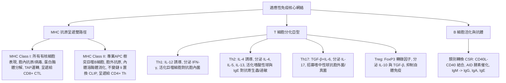

# 微生物與免疫學 第02章 基礎免疫學：體液與細胞適應性免疫、MHC與細胞激素

## 核心知識體系架構
適應性免疫（Adaptive Immunity）具備高度抗原專一性（Specificity）與免疫記憶性（Memory）。本章統整 MHC Class I 與 Class II 抗原呈遞雙軌路徑；T 細胞發育（胸腺陽性與陰性選擇）與 TCR 基因重組（$V(D)J$ 重排）；輔助性 T 細胞分化亞型（Th1, Th2, Th17, Treg, Tfh）與特異性細胞因子網絡；B 細胞發育、抗體類別轉換（Class Switch Recombination, CSR）與體細胞高頻突變（SHM）。

---

## 主題一：MHC Class I vs. MHC Class II 抗原加工與呈遞雙軌對比

### 1. MHC 結構、分佈與呈遞路徑精密矩陣
| 比較維度 | MHC Class I | MHC Class II |
| :--- | :--- | :--- |
| **分子結構組成** | **一條重鏈（$\alpha$ 鏈，由 HLA-A, B, C 編碼，含 $\alpha_1, \alpha_2, \alpha_3$）** 合併 **一條非多態性 $\beta_2$-微球蛋白（$\beta_2$-microglobulin，第 15 號染色體）** | **一條 $\alpha$ 鏈（$\alpha_1, \alpha_2$）** 與 **一條 $\beta$ 鏈（$\beta_1, \beta_2$）**（由 HLA-DP, DQ, DR 編碼） |
| **抗原結合裂隙（Peptide-binding cleft）** | 由 **$\alpha_1$ 與 $\alpha_2$ 結構域** 閉合構成，容納 **8 ~ 10 個胺基酸** 短胜肽 | 由 **$\alpha_1$ 與 $\beta_1$ 結構域** 開放兩端構成，容納 **13 ~ 25 個胺基酸** 較長胜肽 |
| **細胞分佈範圍** | **人體所有有核細胞（All nucleated cells）及血小板**（成熟無核紅血球完全不表現！） | **僅限專業抗原呈遞細胞（Professional APCs）：樹突細胞（DCs，最強！）、巨噬細胞、B 淋巴球** |
| **抗原來源與加工途徑** | **內源性抗原（Endogenous antigens）**（細胞質合成的病毒蛋白、胞內菌、腫瘤突變蛋白） | **外源性抗原（Exogenous antigens）**（經吞噬/胞飲攝入的胞外菌、真菌、可溶性抗原） |
| **抗原消化水解工廠** | 細胞質內的 **蛋白酶體（Proteasome）** 水解為胜肽短鏈 | 內體-溶酶體（Endosome-Lysosome）內之酸性蛋白酶水解 |
| **胜肽運載與裝載器** | 經 **TAP（抗原加工相關轉運體）** 主動泵入粗糙內質網（RER），裝載於剛組裝的 MHC I 上 | RER 內 MHC II 與 **不變鏈（Invariant chain, Ii）** 結合堵塞裂隙，進入溶酶體被消化保留 **CLIP**，經 **HLA-DM** 催化將 CLIP 卸下並換上外源胜肽！ |
| **呈遞受體與對接共受體** | 呈遞給 **CD8+ 細胞毒性 T 淋巴球（CTL）**；CD8 直接結合於 MHC I 的 **$\alpha_3$ 結構域** | 呈遞給 **CD4+ 輔助性 T 淋巴球（Th）**；CD4 直接結合於 MHC II 的 **$\beta_2$ 結構域** |

!!! tip "秒殺記憶口訣"

    **【MHC 乘法法則口訣：CD $\times$ MHC = 8】**
        - $CD4 \times MHC\ II = 8$
        - $CD8 \times MHC\ I = 8$

---

## 主題二：輔助性 T 細胞（CD4+ Helper T Cells）五大亞型

### 1. Th1, Th2, Th17, Treg 與 Tfh 免疫極化全景圖
| T 輔助細胞亞型 | 誘發分化之關鍵細胞因子 | 特異性主控轉錄因子（Master Regulator） | 特徵分泌之代表性細胞激素（Signature Cytokines） | 核心免疫防禦功能與相關病理 |
| :--- | :--- | :--- | :--- | :--- |
| **Th1 細胞** | **IL-12**（樹突細胞/巨噬細胞分泌）及 **IFN-$\gamma$** | **T-bet** | **IFN-$\gamma$、IL-2、TNF-$\alpha$** | **細胞介導免疫（Cell-mediated）**：IFN-$\gamma$ 強烈活化巨噬細胞，專司消滅**胞內病原體（結核分枝桿菌、李斯特菌、利什曼原蟲）**；介導 Type IV 延遲型過敏與肉芽腫。 |
| **Th2 細胞** | **IL-4** | **GATA-3** | **IL-4、IL-5、IL-13** | **體液與黏膜防禦**： - **IL-4**：誘導 B 細胞進行 **$IgE$ 類別轉換**。 - **IL-5**：活化並招募 **嗜酸性球（Eosinophils）**。 - **IL-13**：促進杯狀細胞分泌黏液與平滑肌收縮。 專門對抗**寄生蠕蟲（Helminths）**；介導氣喘與過敏性鼻炎。 |
| **Th17 細胞** | **TGF-$\beta$ 合併 IL-6**（維持依賴 IL-23） | **ROR$\gamma t$** | **IL-17（IL-17A/F）、IL-22** | **招募大量嗜中性球**：抵禦**胞外細菌（金黃色葡萄球菌）與真菌（念珠菌 Candida）**。過度活化參與乾癬、類風濕性關節炎及僵直性脊椎炎。 |
| **Treg（調節性 T 細胞）** | **TGF-$\beta$ 及 IL-2** | **FoxP3** | **IL-10、TGF-$\beta$** | **主動免疫抑制**：維持周邊自身免疫耐受，防止自體免疫疾病。**FoxP3 突變引發 IPEX 症候群**（幼童嚴重自體免疫腸病變、第 1 型糖尿病、濕疹）。表面標記為 **CD4+ CD25+ FoxP3+**。 |
| **Tfh（濾泡輔助 T 細胞）** | IL-6 | Bcl-6 | IL-21 | 進入淋巴濾泡生發中心，協助 B 細胞活化、體細胞高頻突變與親和力成熟。表面標記 CXCR5。 |

---

## 主題三：B 細胞活化與免疫球蛋白（IgG, IgA, IgM, IgE, IgD）

### 1. 免疫球蛋白五大同種型（Isotypes）生物學特性矩陣
| 抗體同種型 | 分子存在形式（單體 vs. 多聚體） | 血清含量佔比 | 半衰期 | 胎盤穿透性 | 補體古典途徑活化能力 | 核心特異功能與臨床考點 |
| :--- | :--- | :--- | :--- | :--- | :--- | :--- |
| **$IgG$** | **單體（Monomer）** | **最高（佔 75~80%）** | 最長（約 23 天） | **唯一能穿透胎盤之抗體！**（經滋養層 FcRn 主動轉運，保護新生兒前 6 個月） | 強（$IgG3 > IgG1 > IgG2$） | 次發性免疫應答之主力抗體；具強大調理作用（Opsonization）與 ADCC 殺傷。 |
| **$IgA$** | 血液中為單體；**外分泌液中為雙體（Dimer）**（含 **J 鏈** 與 **分泌成分 Secretory component**） | 次高（佔 10~15%） | 約 6 天 | 否 | 無（可活化替代途徑） | **黏膜免疫絕對主角**！大量存在於**初乳（Colostrum）、唾液、淚液、呼吸道及腸胃道分泌液**，阻止病原體黏附於黏膜上皮。分泌成分防止其被消化酶降解。 |
| **$IgM$** | B 細胞膜表面為單體（BCR）；**血清中為巨型五聚體（Pentamer）**（含 **J 鏈**，具 10 個抗原結合位） | 佔 5~10% | 約 5 天 | 否 | **最強（單一分子 IgM 即可活化 C1q！）** | **初次免疫應答（Primary response）最先產生的抗體**！宮內感染（TORCH）之特異確診標記（因分子量達 90 萬無法跨越胎盤）。 |
| **$IgE$** | 單體（Monomer） | 血清含量最低（$< 0.001\%$） | 最短（約 2 天） | 否 | 無 | 高親和力結合肥大細胞與嗜鹼性球表面 $Fc\epsilon RI$；介導 **Type I 立即型過敏反應** 與 **對抗寄生蟲感染**。 |
| **$IgD$** | 單體 | 微量 | 約 3 天 | 否 | 無 | 與 IgM 共同表現於**未接觸抗原的成熟初始 B 細胞（Naive B cells）表面**，作為抗原受體（BCR）。 |

---

## 歷屆國考核心真題解析

### 【國考經典真題實戰】
**【試題編號】111-第一次-med2-002**
> **題目**：培養下列何種微生物只能在含氮氣的操作箱中操作，或以厭氧系統培養才可生長？
- (A) 仙人掌桿菌（Bacillus cereus）
- (B) 破傷風桿菌（Clostridium tetani）
- (C) 金黃色葡萄球菌（Staphylococcus aureus）
- (D) 李斯特菌（Listeria monocytogenes）

> **標準答案**：`B`
> 
> **【考點深度解析與選項拆解】**：
- **(A) 選項分析**：仙人掌桿菌（Bacillus cereus）。核對免疫細胞表面分子標記（如 CD 分子）、抗體亞型特性或補體途徑活化順序，驗證其符合度。
- **(B) 選項分析**：破傷風桿菌（Clostridium tetani）。比對細胞激素（Cytokine）特異性功能、MHC 分子呈遞限制性或免疫缺陷致病基因，剖析誘答盲區。
- **(C) 選項分析**：金黃色葡萄球菌（Staphylococcus aureus）。檢驗中樞與周邊耐受機制（AIRE / FoxP3 Treg）或過敏反應型別，排除干擾選項。
- **(D) 選項分析**：李斯特菌（Listeria monocytogenes）。綜合抗原辨識受體重組（RAG1/2）或胞內殺菌活性氧生成，確認題幹命題之免疫學核心。
> **【國考核心解題金鑰】**：本題標準答案為 **(B)**。考生須融會貫通補體三條途徑 C3 轉化酶、Th1/Th2/Th17 細胞因子網絡及原發免疫缺陷病之特徵，即可秒殺奪冠。

---
### 【國考經典真題實戰】
**【試題編號】111-第一次-med2-003**
> **題目**：白喉桿菌（Corynebacterium diphtheriae）的白喉毒素的B次單元與宿主細胞接受器結合，接著A次單元進入細 胞，與細胞的那一個蛋白質結合，進而抑制蛋白質合成？
- (A) 核糖體（Ribosome）40S次單元（subunit）
- (B) 核糖體（Ribosome）60S次單元（subunit）
- (C) 延長因子（Elongation factor）-2（EF-2）
- (D) 延長因子（Elongation factor）-3（EF-3）

> **標準答案**：`C`
> 
> **【考點深度解析與選項拆解】**：
- **(A) 選項分析**：核糖體（Ribosome）40S次單元（subunit）。核對免疫細胞表面分子標記（如 CD 分子）、抗體亞型特性或補體途徑活化順序，驗證其符合度。
- **(B) 選項分析**：核糖體（Ribosome）60S次單元（subunit）。比對細胞激素（Cytokine）特異性功能、MHC 分子呈遞限制性或免疫缺陷致病基因，剖析誘答盲區。
- **(C) 選項分析**：延長因子（Elongation factor）-2（EF-2）。檢驗中樞與周邊耐受機制（AIRE / FoxP3 Treg）或過敏反應型別，排除干擾選項。
- **(D) 選項分析**：延長因子（Elongation factor）-3（EF-3）。綜合抗原辨識受體重組（RAG1/2）或胞內殺菌活性氧生成，確認題幹命題之免疫學核心。
> **【國考核心解題金鑰】**：本題標準答案為 **(C)**。考生須融會貫通補體三條途徑 C3 轉化酶、Th1/Th2/Th17 細胞因子網絡及原發免疫缺陷病之特徵，即可秒殺奪冠。

---
### 【國考經典真題實戰】
**【試題編號】111-第一次-med2-004**
> **題目**：下列何種抗生素不是經由抑制細菌蛋白質生合成，達到抑制細菌生長或殺菌之作用？
- (A) 卡納黴素（kanamycin）
- (B) 克林黴素（clindamycin）
- (C) 硝基甲嘧唑乙醇（metronidazole）
- (D) 四環素（tetracycline）

> **標準答案**：`C`
> 
> **【考點深度解析與選項拆解】**：
- **(A) 選項分析**：卡納黴素（kanamycin）。核對免疫細胞表面分子標記（如 CD 分子）、抗體亞型特性或補體途徑活化順序，驗證其符合度。
- **(B) 選項分析**：克林黴素（clindamycin）。比對細胞激素（Cytokine）特異性功能、MHC 分子呈遞限制性或免疫缺陷致病基因，剖析誘答盲區。
- **(C) 選項分析**：硝基甲嘧唑乙醇（metronidazole）。檢驗中樞與周邊耐受機制（AIRE / FoxP3 Treg）或過敏反應型別，排除干擾選項。
- **(D) 選項分析**：四環素（tetracycline）。綜合抗原辨識受體重組（RAG1/2）或胞內殺菌活性氧生成，確認題幹命題之免疫學核心。
> **【國考核心解題金鑰】**：本題標準答案為 **(C)**。考生須融會貫通補體三條途徑 C3 轉化酶、Th1/Th2/Th17 細胞因子網絡及原發免疫缺陷病之特徵，即可秒殺奪冠。