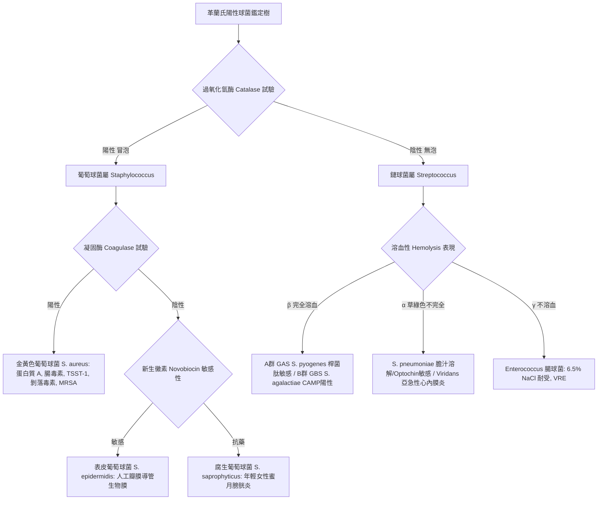

# 微生物與免疫學 第04章 細菌學總論與革蘭氏陽性球菌

## 核心知識體系架構
細菌學為微生物學核心。本章涵蓋細菌微細結構（胜肽聚醣細胞壁、革蘭陽性厚壁磷壁酸 vs. 革蘭陰性外膜 LPS 脂多醣內毒素 Lipid A）；外毒素（Exotoxins A-B 毒素）vs. 內毒素（Endotoxin）；葡萄球菌屬（Staphylococcus aureus 蛋白質 A、凝固酶陽性、TSST-1 超抗原 vs. S. epidermidis 生物膜 vs. S. saprophyticus 尿道感染）；以及鏈球菌屬（Streptococcus pyogenes GAS, S. agalactiae GBS, S. pneumoniae, Viridans group, Enterococcus）。

---

## 主題一：葡萄球菌屬（Staphylococcus）病原學精析

### 1. 金黃色葡萄球菌（Staphylococcus aureus）核心毒力因子
- **蛋白質 A（Protein A）**：細胞壁表面特異蛋白，**專一性結合 $IgG$ 抗體的 Fc 段**（顛倒結合！），使 IgG 的 Fab 抗原結合端朝外，**徹底阻斷吞噬細胞的 Fc 受體辨識，強力抗調理吞噬**！
- **凝固酶（Coagulase）**：使血漿纖維蛋白原轉化為不溶性纖維蛋白，在細菌周圍形成保護性網狀血凝塊防禦吞噬（**金黃色葡萄球菌為唯一凝固酶陽性葡萄球菌！**）。
- **三大特異外毒素**：
  1. **毒性休克症候群毒素-1（TSST-1）**：**超級抗原（Superantigen）**！直接非特異性跨越橋聯 MHC Class II 與 TCR 的 $V\beta$ 鏈，無需抗原加工呈遞即可**強行活化多達 20% 的全身 CD4+ T 細胞**，引發「細胞激素風暴（Cytokine Storm：TNF-$\alpha$, IL-1, IL-2 爆發）」，引發高燒、瀰漫性紅斑脫屑、低血壓休克多器官衰竭（典型病史：女性長時間置入高吸收性衛生棉條）。
  2. **表皮剝脫毒素（Exfoliatin A & B）**：絲胺酸蛋白酶，專一性切割表皮棘狀層細胞間的 **橋粒核心糖蛋白-1（Desmoglein-1）**，導致表皮大片鬆弛剝脫水泡，引發 **葡萄球菌燙傷樣皮膚症候群（SSSS）**，Nikolsky 徵陽性。
  3. **腸毒素（Enterotoxin A~E）**：耐熱耐胃蛋白酶（加熱 $100^\circ\text{C}$ 30 分鐘不被破壞），進食受污染含蛋奶美乃滋食物後 **1 ~ 6 小時內極速引發劇烈噁心嘔吐（毒素預先形成 Preformed toxin！）**。

---

## 主題二：鏈球菌屬（Streptococcus）與腸球菌屬鑑別

### 1. 鏈球菌三大溶血族群鑑定矩陣
| 溶血型態 | 代表菌種 | 關鍵生化鑑定特徵 | 主要致病毒力因子 | 典型臨床疾病與後遺症 |
| :--- | :--- | :--- | :--- | :--- |
| **$\beta$-溶血（完全溶血，培養基透明環）** | **化膿性鏈球菌 (S. pyogenes / A群 GAS)** | **桿菌肽（Bacitracin）敏感（A盤敏感）**；PYR 試驗陽性 | **M 蛋白（抗吞噬、分子擬態引發風濕熱）**；鏈球菌溶血素 O（ASO 效價升高）；致熱外毒素（猩紅熱草莓舌） | 咽喉炎、膿痂疹、蜂窩織炎、壞死性筋膜炎；**晚期併發症：風濕熱（僅繼發於咽喉炎）** vs. **急性腎絲球腎炎（PSGN，咽喉炎或皮膚感染皆可引發！）**。 |
| | **無乳鏈球菌 (S. agalactiae / B群 GBS)** | **桿菌肽抗藥**；**CAMP 試驗陽性**（與 S. aureus 劃線交界處產生典型箭頭狀擴大溶血）；馬尿酸水解陽性 | 多醣莢膜 | **新生兒腦膜炎、敗血症與肺炎第一位元兇！**（母體產道定殖，孕婦懷孕 35~37 週需常規篩檢預防性給予 Ampicillin）。 |
| **$\alpha$-溶血（草綠色不完全溶血）** | **肺炎鏈球菌 (S. pneumoniae / 肺炎雙球菌)** | **雙球狀矛尖形（Lancet-shaped）**；**Optochin 敏感（P盤敏感）**；**膽汁溶解試驗陽性（Bile soluble）**；莢膜腫脹試驗（Quellung）陽性 | **多醣莢膜（最主要毒力因子，84種以上血清型）**；IgA 蛋白酶 | **社區型肺炎第一位（大葉性肺炎、鐵鏽色痰）**；成人細菌性腦膜炎首位；中耳炎、鼻竇炎。 |
| | **草綠色鏈球菌群 (Viridans streptococci：S. mutans, S. mitis)** | **Optochin 抗藥**；**膽汁溶解陰性（不溶解）** | 合成細胞外多醣**右旋糖酐（Dextran）**，黏附牙齒與心臟纖維蛋白 | 口腔齲齒（蛀牙）；拔牙後細菌入血黏附於受損瓣膜，引起**亞急性感染性心內膜炎（SBE）**。 |
| **$\gamma$-溶血（不溶血）** | **糞腸球菌 (E. faecalis) 與屎腸球菌 (E. faecium)** | **能在 $40\%$ 膽鹽及 $6.5\%\ NaCl$ 高鹽環境中頑強生長**；膽汁七葉苷水解黑色 | 廣泛固有抗藥性 | 院內泌尿道感染、膽道感染、菌血症。**萬古黴素抗藥性腸球菌（VRE）** 為院內超級感染核心。 |

---

## 歷屆國考核心真題解析

### 【國考經典真題實戰】
**【試題編號】111-第一次-med2-022**
> **題目**：調理作用（opsonization）產生原因之一是因為吞噬細胞（phagocytic cell）表面上具有下列何種受體，以辨識 附著於病菌上的調理素（opsonin）？
- (A) Toll-like receptors
- (B) complement receptors
- (C) lectin-like receptors
- (D) chemokine receptors

> **標準答案**：`B`
> 
> **【考點深度解析與選項拆解】**：
- **(A) 選項分析**：Toll-like receptors。核對細菌染色型態（革蘭陽性/陰性、球菌/桿菌）、培養基特異成分或外毒素分子作用機制，確認其符合性。
- **(B) 選項分析**：complement receptors。審查細菌生化鑑定試驗（過氧化氫酶 Catalase、凝固酶 Coagulase、溶血性、膽汁溶解度），拆解考選部常設陷阱。
- **(C) 選項分析**：lectin-like receptors。辨析毒素胞內標靶（如 ADP-核糖基化 EF-2 或 Gs 蛋白、破壞 SNARE 蛋白），排除干擾選項。
- **(D) 選項分析**：chemokine receptors。綜合臨床症狀表現與傳染流行病學特徵，驗證題幹核心命題本旨。
> **【國考核心解題金鑰】**：本題精準鎖定標準答案 **(B)**。考生須精通葡萄球菌與鏈球菌鑑別流程、厭氧梭菌毒素機制及腸內桿菌抗原分型，即可秒殺奪冠。

---
### 【國考經典真題實戰】
**【試題編號】111-第一次-med2-023**
> **題目**：共濟失調微血管擴張症候群（ataxia-telangiectasia）會出現免疫系統異常，導致B細胞與 T細胞數量減少。主 要因為下列何種機轉所致？
- (A) V(D)J重組過程出現缺陷
- (B) 無法產生IgM抗體
- (C) MHC class I辨識產生缺陷
- (D) MHC class II辨識產生缺陷

> **標準答案**：`A`
> 
> **【考點深度解析與選項拆解】**：
- **(A) 選項分析**：V(D)J重組過程出現缺陷。核對細菌染色型態（革蘭陽性/陰性、球菌/桿菌）、培養基特異成分或外毒素分子作用機制，確認其符合性。
- **(B) 選項分析**：無法產生IgM抗體。審查細菌生化鑑定試驗（過氧化氫酶 Catalase、凝固酶 Coagulase、溶血性、膽汁溶解度），拆解考選部常設陷阱。
- **(C) 選項分析**：MHC class I辨識產生缺陷。辨析毒素胞內標靶（如 ADP-核糖基化 EF-2 或 Gs 蛋白、破壞 SNARE 蛋白），排除干擾選項。
- **(D) 選項分析**：MHC class II辨識產生缺陷。綜合臨床症狀表現與傳染流行病學特徵，驗證題幹核心命題本旨。
> **【國考核心解題金鑰】**：本題精準鎖定標準答案 **(A)**。考生須精通葡萄球菌與鏈球菌鑑別流程、厭氧梭菌毒素機制及腸內桿菌抗原分型，即可秒殺奪冠。

---
### 【國考經典真題實戰】
**【試題編號】111-第一次-med2-024**
> **題目**：B細胞抗原接受器的基因重組（gene rearrangement）對B細胞早期發育十分重要，有關B細胞抗原接受器也就 是免疫球蛋白（immunoglobulin）的基因重組，下列敘述何者錯誤？
- (A) 免疫球蛋白基因重組是發生在B細胞發育的早期，而且先從重鏈基因的D和J片段開始重組，接著才是V-DJ的 片段重組
- (B) 免疫球蛋白基因的輕鏈先從κ輕鏈基因做V及J片段的重組，如果兩個染色體都重組失敗才會做λ輕鏈基因的 重組
- (C) VDJ或VJ片段重組的交接位置所做出來的蛋白剛好就是在重鏈或輕鏈CDR1、CDR2及CDR3的位置，因此這 三個區域的胺基酸序列的歧異度最大，也是抗原的結合位
- (D) 當第一條染色體的免疫球蛋白基因的重鏈或輕鏈基因完成重組後，第二條染色體的免疫球蛋白基因就停止重 組，因此一個B細胞只會表現一種抗原受體，這種機制稱為對偶基因排除現象（allelic exclusion）

> **標準答案**：`C`
> 
> **【考點深度解析與選項拆解】**：
- **(A) 選項分析**：免疫球蛋白基因重組是發生在B細胞發育的早期，而且先從重鏈基因的D和J片段開始重組，接著才是V-DJ的 片段重組。核對細菌染色型態（革蘭陽性/陰性、球菌/桿菌）、培養基特異成分或外毒素分子作用機制，確認其符合性。
- **(B) 選項分析**：免疫球蛋白基因的輕鏈先從κ輕鏈基因做V及J片段的重組，如果兩個染色體都重組失敗才會做λ輕鏈基因的 重組。審查細菌生化鑑定試驗（過氧化氫酶 Catalase、凝固酶 Coagulase、溶血性、膽汁溶解度），拆解考選部常設陷阱。
- **(C) 選項分析**：VDJ或VJ片段重組的交接位置所做出來的蛋白剛好就是在重鏈或輕鏈CDR1、CDR2及CDR3的位置，因此這 三個區域的胺基酸序列的歧異度最大，也是抗原的結合位。辨析毒素胞內標靶（如 ADP-核糖基化 EF-2 或 Gs 蛋白、破壞 SNARE 蛋白），排除干擾選項。
- **(D) 選項分析**：當第一條染色體的免疫球蛋白基因的重鏈或輕鏈基因完成重組後，第二條染色體的免疫球蛋白基因就停止重 組，因此一個B細胞只會表現一種抗原受體，這種機制稱為對偶基因排除現象（allelic exclusion）。綜合臨床症狀表現與傳染流行病學特徵，驗證題幹核心命題本旨。
> **【國考核心解題金鑰】**：本題精準鎖定標準答案 **(C)**。考生須精通葡萄球菌與鏈球菌鑑別流程、厭氧梭菌毒素機制及腸內桿菌抗原分型，即可秒殺奪冠。