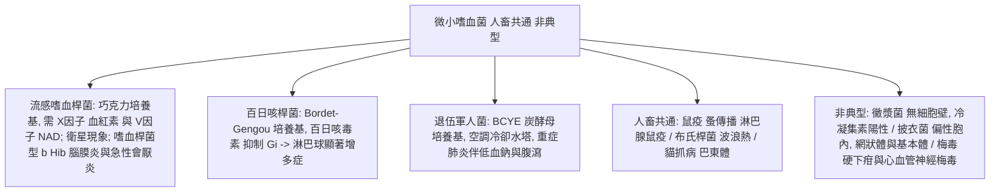

# 微生物與免疫學 第07章 人畜共通小桿菌、螺桿菌與非典型菌群

## 核心知識體系架構
本章匯集需特殊生長因子的微小桿菌（流感嗜血桿菌、百日咳桿菌、退伍軍人菌）；人畜共通傳染病（布氏桿菌、土倫病桿菌、鼠疫耶氏菌、巴東體）；幽門螺旋桿菌；非典型病原體（肺炎黴漿菌、披衣菌）；以及螺旋體（梅毒螺旋體、萊姆病伯氏疏螺旋體、瘦端螺旋體）。

---

## 主題一：流感嗜血桿菌、百日咳桿菌與退伍軍人菌

### 1. 三大特殊培養微小桿菌關鍵鑑別表
| 細菌名稱 | 特殊培養基需求與生長特性 | 主要毒力因子 | 典型臨床疾病與特徵表現 |
| :--- | :--- | :--- | :--- |
| **流感嗜血桿菌 (Haemophilus influenzae)** | 無法在一般血液培養基生長；必須在**巧克力培養基（加熱溶解紅血球釋放因子）** 培養，**嚴格需要兩大生長因子**： 1. **X 因子（Heads / 氯化血紅素 Hemin）** 2. **V 因子（Vitamin / $NAD^+$）** **衛星現象（Satellitism）**：在金黃色葡萄球菌菌落周圍長出較大菌落（S. aureus 分泌 V 因子供其生長）。 | **多醣莢膜（分為 a~f 型）**：以 **Hib（b 型）毒力最強**，由**聚核糖醇磷酸（PRP）** 組成；產生 IgA 蛋白酶。 | **小兒急性會厭炎（Acute epiglottitis）**（突發高熱、吸氣性哮鳴、流涎、X 光呈「拇指徵 Thumb sign」，需防窒息）；嬰幼兒化膿性腦膜炎、中耳炎。Hib 結合疫苗（PRP 結合破傷風類毒素）已大幅降低發病率。 |
| **百日咳桿菌 (Bordetella pertussis)** | 革蘭氏陰性小球桿菌。需使用富含馬血或馬鈴薯甘油的 **Bordet-Gengou 培養基** 或 **Regan-Lowe 培養基**。 | 1. **百日咳毒素（Pertussis Toxin）**：A-B 外毒素，**ADP-核糖基化抑制性 $G_i$ 蛋白**，阻斷 Gi 活性 $\to$ 胞內 **$cAMP\uparrow$** $\to$ 抑制趨化並引起**顯著白血球增多伴絕對淋巴球增多症（Lymphocytosis，高達數萬！）**。 2. 氣管細胞毒素（破壞纖毛）。 | **百日咳三大分期**：卡他期（傳染性最高） $\to$ 痙咳期（**陣發性連續劇烈咳嗽伴吸氣性高調「雞鳴樣吸氣吼聲 Whooping」**，伴隨咳嗽後嘔吐） $\to$ 恢復期。百日咳無細胞疫苗（aP）。 |
| **退伍軍人菌 (Legionella pneumophila)** | 革蘭氏陰性桿菌（常規革蘭氏染色著色極弱，銀染色最佳）。**絕對嚴格需要「富含 L-半胱胺酸（L-cysteine）與鐵離子」的 BCYE 緩衝炭酵母浸膏培養基**！自然界存在於水生環境（**大樓中央空調冷卻水塔、熱水管道、噴霧器**）。 | 胞內寄生於巨噬細胞中，阻止吞噬小泡與溶酶體融合。 | **退伍軍人病（Legionnaires' disease）**：重度非典型肺炎，好發於老年吸菸者；**臨床特徵四聯徵（國考必考！）**：高燒伴**相對心搏過緩（Pulse-temperature dissociation）**、**神經精神混亂頭痛**、**水瀉腹痛**，以及實驗室特徵性 **重度低血鈉（Hyponatremia）**！尿液抗原檢測（Urine antigen test）為快速確診首選。 |

---

## 主題二：非典型菌群（黴漿菌、披衣菌）與螺旋體

### 1. 肺炎黴漿菌（Mycoplasma pneumoniae）
- **無細胞壁特徵**：為可在無生命培養基獨立生長之最小游離微生物。**完全缺乏細胞壁（無胜肽聚醣）**，質膜內含有固醇（Sterols）維持穩定。**對所有作用於細胞壁的 $\beta$-內醯胺類抗生素天然抗藥**！首選巨環類（Macrolides）或四環黴素。
- **行走性肺炎（Walking pneumonia）**：好發於年輕人、軍隊、大學宿舍群聚。症狀頑固乾咳、低燒，胸部 X 光呈現雙側瀰漫間質性浸潤，其影像嚴重程度遠超過患者臨床表現。
- **冷凝集素試驗陽性（Cold agglutinins）**：患者體內產生針對人類紅血球表面 I 抗原的 **$IgM$ 自體抗體**，在 $4^\circ\text{C}$ 低溫下誘發紅血球凝集，可能合併一過性溶血性貧血。

### 2. 披衣菌屬（Chlamydia）之發育雙型態
- **偏性細胞內寄生（Obligate intracellular）**，無法自行合成 ATP（能量寄生）。
- **生命週期兩大形態轉換（國考必考！）**：
  1. **基本體（Elementary Body, EB）**：**具感染性（Enfectious）**，體積小、壁緻密，在細胞外穩定存活，負責尋找並感染宿主上皮細胞。
  2. **網狀體（Reticulate Body, RB）**：**具繁殖代謝活性（Replicating）**，體積大、無感染性，在細胞質吞噬泡內二分裂大量繁殖，隨後濃縮轉化為 EB 釋放。
- **砂眼披衣菌（C. trachomatis）血清型與疾病**：
  - **A, B, Ba, C 型**：引發 **砂眼（Trachoma）**，為全球非創傷性失明第一死因（濾泡性結膜炎導致眼瞼內翻倒睫摩擦角膜潰瘍）。
  - **D ~ K 型**：全球最常見之性傳染病（STI），引發非淋菌性尿道炎（NGU）、骨盆腔發炎（PID）、**輸卵管性不孕症與異位妊娠**；母嬰垂直傳播引起新生兒包涵體結膜炎與間質性肺炎。
  - **L1, L2, L3 型**：引發 **花柳性淋巴肉芽腫（LGV）**，腹股溝淋巴結無痛性化膿破潰形成瘻管。

---

## 歷屆國考核心真題解析

### 【國考經典真題實戰】
**【試題編號】111-第二次-第一階段-med2-025**
> **題目**：已開發國家中第一型過敏性疾病（如氣喘與季節性鼻炎等）的盛行率逐年升高，研究發現環境因子扮演重要 角色，下列那一項理論最能解釋這一個現象？
- (A) 群體免疫（herd immunity）
- (B) 衛生假說（hygiene hypothesis）
- (C) 連結辨識（linked recognition）
- (D) 正向篩選（positive selection）

> **標準答案**：`B`
> 
> **【考點深度解析與選項拆解】**：
- **(A) 選項分析**：群體免疫（herd immunity）。核對細菌染色型態（革蘭陽性/陰性、球菌/桿菌）、培養基特異成分或外毒素分子作用機制，確認其符合性。
- **(B) 選項分析**：衛生假說（hygiene hypothesis）。審查細菌生化鑑定試驗（過氧化氫酶 Catalase、凝固酶 Coagulase、溶血性、膽汁溶解度），拆解考選部常設陷阱。
- **(C) 選項分析**：連結辨識（linked recognition）。辨析毒素胞內標靶（如 ADP-核糖基化 EF-2 或 Gs 蛋白、破壞 SNARE 蛋白），排除干擾選項。
- **(D) 選項分析**：正向篩選（positive selection）。綜合臨床症狀表現與傳染流行病學特徵，驗證題幹核心命題本旨。
> **【國考核心解題金鑰】**：本題精準鎖定標準答案 **(B)**。考生須精通葡萄球菌與鏈球菌鑑別流程、厭氧梭菌毒素機制及腸內桿菌抗原分型，即可秒殺奪冠。

---
### 【國考經典真題實戰】
**【試題編號】111-第二次-第一階段-med2-026**
> **題目**：假設有種臨床藥物X，某群孩童經過多年使用治療相關症狀後，皆出現類似自體免疫疾病之副作用，例如： 脾臟及淋巴結腫大、出現自體抗體等，最近的研究顯示藥物X 可能藉由干擾某個分子的正常功能，而導致這 些副作用，請選出最不可能的分子？
- (A) CTLA-4
- (B) FasL
- (C) FoxP3
- (D) CD23

> **標準答案**：`D`
> 
> **【考點深度解析與選項拆解】**：
- **(A) 選項分析**：CTLA-4。核對細菌染色型態（革蘭陽性/陰性、球菌/桿菌）、培養基特異成分或外毒素分子作用機制，確認其符合性。
- **(B) 選項分析**：FasL。審查細菌生化鑑定試驗（過氧化氫酶 Catalase、凝固酶 Coagulase、溶血性、膽汁溶解度），拆解考選部常設陷阱。
- **(C) 選項分析**：FoxP3。辨析毒素胞內標靶（如 ADP-核糖基化 EF-2 或 Gs 蛋白、破壞 SNARE 蛋白），排除干擾選項。
- **(D) 選項分析**：CD23。綜合臨床症狀表現與傳染流行病學特徵，驗證題幹核心命題本旨。
> **【國考核心解題金鑰】**：本題精準鎖定標準答案 **(D)**。考生須精通葡萄球菌與鏈球菌鑑別流程、厭氧梭菌毒素機制及腸內桿菌抗原分型，即可秒殺奪冠。

---
### 【國考經典真題實戰】
**【試題編號】111-第二次-第一階段-med2-027**
> **題目**：預防子宮頸癌發生是用下列那一種血清型（serotype）的人類乳突病毒（human papilloma virus, HPV )疫苗？
- (A) HPV-1
- (B) HPV-4
- (C) HPV-8
- (D) HPV-16

> **標準答案**：`D`
> 
> **【考點深度解析與選項拆解】**：
- **(A) 選項分析**：HPV-1。核對細菌染色型態（革蘭陽性/陰性、球菌/桿菌）、培養基特異成分或外毒素分子作用機制，確認其符合性。
- **(B) 選項分析**：HPV-4。審查細菌生化鑑定試驗（過氧化氫酶 Catalase、凝固酶 Coagulase、溶血性、膽汁溶解度），拆解考選部常設陷阱。
- **(C) 選項分析**：HPV-8。辨析毒素胞內標靶（如 ADP-核糖基化 EF-2 或 Gs 蛋白、破壞 SNARE 蛋白），排除干擾選項。
- **(D) 選項分析**：HPV-16。綜合臨床症狀表現與傳染流行病學特徵，驗證題幹核心命題本旨。
> **【國考核心解題金鑰】**：本題精準鎖定標準答案 **(D)**。考生須精通葡萄球菌與鏈球菌鑑別流程、厭氧梭菌毒素機制及腸內桿菌抗原分型，即可秒殺奪冠。