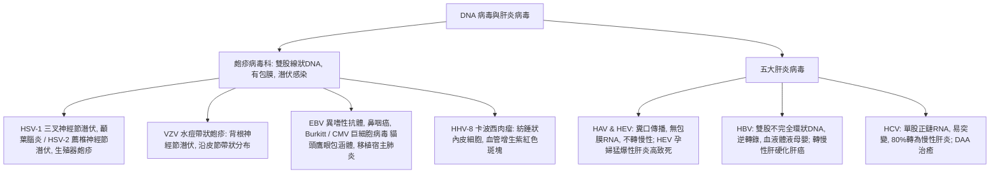

# 微生物與免疫學 第09章 醫用病毒學：DNA 病毒與肝炎病毒

## 核心知識體系架構
醫用病毒學涵蓋 DNA 病毒科（皰疹病毒科 Herpesviridae 八大成員、痘病毒 Poxvirus、腺病毒 Adenovirus、乳突病毒 Papillomavirus、細小病毒 Parvovirus B19）；以及五大肝炎病毒（HAV, HBV, HCV, HDV, HEV）之傳播途徑、慢性化機率與 B 型肝炎血清標記（Serology）解讀金鑰。

---

## 主題一：皰疹病毒科（Herpesviridae）八大成員潛伏部位與病理

### 1. 人類皰疹病毒（HHV-1 ~ HHV-8）精確對比矩陣
| 病毒名稱 | 病毒縮寫 | 初次感染疾病表徵 | 終身潛伏神經節或細胞位置 | 典型特徵組織病理學與臨床考點 |
| :--- | :--- | :--- | :--- | :--- |
| **單純皰疹病毒 1 型** | **HSV-1** | 皰疹性齒齦口腔炎、唇皰疹（Cold sores） | **三叉神經節（Trigeminal ganglion）** | **散發性致死性病毒性腦炎最常見病因**！專一性侵犯**單側顳葉（Temporal lobe坏死出血）**；Tzanck 抹片見多核巨細胞伴核內 **Cowdry A 型包涵體**。 |
| **單純皰疹病毒 2 型** | **HSV-2** | 疼痛性生殖器皰疹（Genital herpes） | **薦椎神經節（Sacral ganglia）** | 經性接觸或產道垂直感染；常引發無菌性腦膜炎。 |
| **水痘-帶狀皰疹病毒** | **VZV (HHV-3)** | 兒童水痘（全身離心性向心性水泡、紅斑、結痂同存） | **背根神經節（Dorsal root ganglia）** | 再活化引起**帶狀皰疹（Shingles）**：沿單側單一皮節（Dermatome）分佈之劇痛水泡，不越過身體中線；伴隨皰疹後神經痛（PHN）。 |
| **EB 病毒** | **EBV (HHV-4)** | **傳染性單核球增多症（Infectious Mononucleosis）** | **B 淋巴球（經 CD21 受體入胞）** | 臨床三聯徵：高燒、咽喉炎、**淋巴結腫大合併脾腫大（嚴禁劇烈運動以防脾破裂！）**。 **異嗜性抗體（Heterophile antibodies / Monospot 試驗）陽性**。 血液抹片見**非典型淋巴球（Atypical / Downey lymphocytes，實為活化的 CD8+ CTL！）**。 相關腫瘤：**伯基特淋巴瘤、鼻咽癌（NPC）、霍奇金淋巴瘤**。 |
| **巨細胞病毒** | **CMV (HHV-5)** | 免疫正常者輕度單核球增多症（**Monospot 試驗陰性！**） | 單核球、巨噬細胞及骨髓幹細胞 | **器官移植受者最危險病毒**（間質性肺炎、移植失敗）；HIV 患者視網膜炎（失明）；顯微鏡下見巨大細胞內核伴巨大深染之 **「貓頭鷹眼包涵體（Owl-eye intranuclear inclusions）」**。 |
| **人類皰疹病毒 6/7 型** | **HHV-6 / 7** | **嬰兒玫瑰疹（Roseola infantum / 猝發疹）** | T 淋巴球 | 幼兒持續 3~5 天極高燒，**高燒驟退時全身瞬間爆發斑丘疹（熱退疹出！）**。 |
| **人類皰疹病毒 8 型** | **HHV-8** | **卡波西肉瘤（Kaposi Sarcoma, KS）** | 內皮細胞、B 細胞 | 血管內皮多中心梭形細胞惡性增生，皮膚與胃腸道呈現紫紅色無痛斑塊結節；好發於愛滋病患。 |

---

## 主題二：B 型肝炎病毒（HBV）血清標記判定解密

### 1. 五大抗原抗體解讀金牌法則
- **HBsAg（表面抗原）**：血清中存在即代表**體內有活病毒感染（急性或慢性感染）**。持續超過 6 個月定義為慢性 B 型肝炎。
- **Anti-HBs / HBsAb（表面抗體）**：**保護性中和抗體**！代表**已具備免疫力（康復痊癒或成功施打疫苗）**。
- **HBeAg（e 抗原）**：病毒活躍複製與高傳染性之黃金指標！
- **Anti-HBe / HBeAb（e 抗體）**：血清轉換，代表病毒複製活性降低、傳染性下降。
- **Anti-HBc / HBcAb（核心抗體）**：
  - **IgM Anti-HBc**：**急性感染唯一可靠標記**！在 **「空窗期（Window Period：HBsAg 剛消失但 Anti-HBs 尚未出現）」** 期間，**IgM Anti-HBc 是體內能檢測到的唯一陽性標記**！
  - **IgG Anti-HBc**：代表曾經感染過（不論已痊癒還是轉為慢性，終身陽性）。**施打疫苗者體內絕對沒有 Anti-HBc**！

### 2. 國考最高頻「HBV 血清判讀對照表」
| 臨床狀態 | HBsAg | Anti-HBs | HBeAg | Anti-HBe | IgM Anti-HBc | IgG Anti-HBc |
| :--- | :--- | :--- | :--- | :--- | :--- | :--- |
| **急性 B 型肝炎（早期高傳染）** | **(+) 陽性** | (-) 陰性 | **(+) 陽性** | (-) 陰性 | **(+) 陽性** | (-) 陰性 |
| **急性感染之「空窗期 (Window Period)」** | **(-) 陰性** | **(-) 陰性** | (-) 陰性 | (+/-) | **(+) 陽性（唯一標記！）** | (-) 陰性 |
| **急性感染自然康復（終身免疫）** | (-) 陰性 | **(+) 陽性** | (-) 陰性 | (+) 陽性 | (-) 陰性 | **(+) 陽性** |
| **成功接種 B 肝疫苗（疫苗免疫）** | (-) 陰性 | **(+) 陽性** | (-) 陰性 | (-) 陰性 | (-) 陰性 | **(-) 陰性（無核心抗體！）** |
| **慢性 B 型肝炎（高複製傳染）** | **(+) 陽性** | (-) 陰性 | **(+) 陽性** | (-) 陰性 | (-) 陰性 | **(+) 陽性** |
| **慢性 B 型肝炎（低複製帶原）** | **(+) 陽性** | (-) 陰性 | (-) 陰性 | **(+) 陽性** | (-) 陰性 | **(+) 陽性** |

---

## 歷屆國考核心真題解析

### 【國考經典真題實戰】
**【試題編號】112-第一次-med2-018**
> **題目**：大部分的免疫細胞都是由骨髓中的造血幹細胞發育而來，這些免疫細胞又可以依據它們的發育源頭進一步分 成骨髓系（myeloid lineage）或淋巴系（lymphoid lineage），下列那一種細胞可以由骨髓系及淋巴系前驅細胞 產生？
- (A) 樹突細胞（dendritic cell）
- (B) 先天淋巴細胞（innate lymphoid cell, ILC）
- (C) 紅血球（red blood cell）
- (D) 巨噬細胞（macrophage）

> **標準答案**：`A`
> 
> **【考點深度解析與選項拆解】**：
- **(A) 選項分析**：樹突細胞（dendritic cell）。核對病毒核酸型別（DNA vs. RNA、單股/雙股）、包膜（Envelope）存在與否或真菌形態特徵，評估其正確性。
- **(B) 選項分析**：先天淋巴細胞（innate lymphoid cell, ILC）。比對肝炎血清標記（如 HBsAg, 抗-HBc IgM 空窗期判定）或 HIV 感染 CD4 門檻值，拆解考選部常設陷阱。
- **(C) 選項分析**：紅血球（red blood cell）。辨析抗原漂移（Drift）與抗原移型（Shift）之基因重組機制，排除混淆選項。
- **(D) 選項分析**：巨噬細胞（macrophage）。綜合特異性染色（抗酸性染色、印度墨水、KOH 鏡檢），確認題幹之核心命題考點。
> **【國考核心解題金鑰】**：本題精準選出標準答案 **(A)**。考生須融會貫通皰疹病毒科潛伏感染部位、B型肝炎五項抗原抗體解讀及流行性感冒基因重排，即可秒殺奪分。

---
### 【國考經典真題實戰】
**【試題編號】112-第一次-med2-019**
> **題目**：發炎通常是在局部感染或受傷初期所產生的免疫反應，有關發炎的敘述下列何者錯誤？
- (A) 產生發炎的目的是藉由免疫效應分子（immune effector molecule）的增加去攻擊病原菌並促進傷口的癒合
- (B) 發炎所伴隨的紅、腫、熱、痛是由病原菌在複製過程中所釋放的毒力因子（virulence factor）直接造成的結 果
- (C) 發炎會增加血管壁的通透性，使血液中的補體成分進入發炎組織中，促進宿主的免疫反應清除病原菌
- (D) 如果病原菌透過血液傳播至各個器官而引發全身性細菌感染或敗血症（sepsis）時，則會因過度發炎反應產 生大量TNF-α而導致敗血性休克（septic shock）

> **標準答案**：`B`
> 
> **【考點深度解析與選項拆解】**：
- **(A) 選項分析**：產生發炎的目的是藉由免疫效應分子（immune effector molecule）的增加去攻擊病原菌並促進傷口的癒合。核對病毒核酸型別（DNA vs. RNA、單股/雙股）、包膜（Envelope）存在與否或真菌形態特徵，評估其正確性。
- **(B) 選項分析**：發炎所伴隨的紅、腫、熱、痛是由病原菌在複製過程中所釋放的毒力因子（virulence factor）直接造成的結 果。比對肝炎血清標記（如 HBsAg, 抗-HBc IgM 空窗期判定）或 HIV 感染 CD4 門檻值，拆解考選部常設陷阱。
- **(C) 選項分析**：發炎會增加血管壁的通透性，使血液中的補體成分進入發炎組織中，促進宿主的免疫反應清除病原菌。辨析抗原漂移（Drift）與抗原移型（Shift）之基因重組機制，排除混淆選項。
- **(D) 選項分析**：如果病原菌透過血液傳播至各個器官而引發全身性細菌感染或敗血症（sepsis）時，則會因過度發炎反應產 生大量TNF-α而導致敗血性休克（septic shock）。綜合特異性染色（抗酸性染色、印度墨水、KOH 鏡檢），確認題幹之核心命題考點。
> **【國考核心解題金鑰】**：本題精準選出標準答案 **(B)**。考生須融會貫通皰疹病毒科潛伏感染部位、B型肝炎五項抗原抗體解讀及流行性感冒基因重排，即可秒殺奪分。

---
### 【國考經典真題實戰】
**【試題編號】112-第一次-med2-020**
> **題目**：下列何種蛋白與MHC class II分子的抗原呈獻過程有重要關聯？
- (A) Calnexin
- (B) Calreticulin
- (C) Invariant chain
- (D) Transporters associated with antigen processing（TAPs）

> **標準答案**：`C`
> 
> **【考點深度解析與選項拆解】**：
- **(A) 選項分析**：Calnexin。核對病毒核酸型別（DNA vs. RNA、單股/雙股）、包膜（Envelope）存在與否或真菌形態特徵，評估其正確性。
- **(B) 選項分析**：Calreticulin。比對肝炎血清標記（如 HBsAg, 抗-HBc IgM 空窗期判定）或 HIV 感染 CD4 門檻值，拆解考選部常設陷阱。
- **(C) 選項分析**：Invariant chain。辨析抗原漂移（Drift）與抗原移型（Shift）之基因重組機制，排除混淆選項。
- **(D) 選項分析**：Transporters associated with antigen processing（TAPs）。綜合特異性染色（抗酸性染色、印度墨水、KOH 鏡檢），確認題幹之核心命題考點。
> **【國考核心解題金鑰】**：本題精準選出標準答案 **(C)**。考生須融會貫通皰疹病毒科潛伏感染部位、B型肝炎五項抗原抗體解讀及流行性感冒基因重排，即可秒殺奪分。