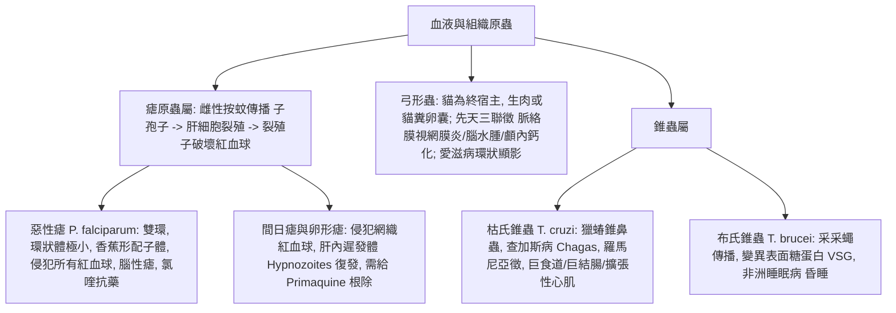

# 寄生蟲學 第02章 醫用原蟲學：血液與組織原蟲

## 核心知識體系架構
血液與組織原蟲為寄生蟲學最高分重點。涵蓋瘧原蟲屬（Plasmodium：惡性瘧、間日瘧、卵形瘧、三日瘧之生活史、紅內期 vs. 紅外期、遲發體 Hypnozoites、耐藥性與抗瘧藥選擇）；巴貝氏蟲（Babesia microti 馬爾他十字）；弓形蟲（Toxoplasma gondii 貓終宿主、先天感染三聯徵、愛滋病環狀顯影腦病變）；利什曼原蟲（Leishmania 白蛉傳播、黑熱病）；以及錐蟲屬（Trypanosoma 枯氏錐蟲美洲錐蟲病/Chagas 病 vs. 布氏錐蟲非洲睡眠病）。

---

## 主題一：瘧原蟲（Plasmodium）四大菌種生活史與顯微鑑別

### 1. 瘧疾生活史關鍵發育節點
1. **蚊體內有性生殖（Sporogony）**：**雌性按蚊（Female Anopheles mosquito）為終宿主（Definitive host）**！雌蚊叮咬人體吸血時，將具感染性的 **子孢子（Sporozoites）** 注入人體微血管。
2. **人體內無性裂殖（Schizogony，人為中間宿主 Intermediate host）**：
   - **紅血球外期（Exoerythrocytic stage，肝臟）**：子孢子於 30 分鐘內隨血流侵入肝實質細胞，經裂體增殖發育為成熟裂殖體，釋放成千上萬個裂殖子（Merozoites）入血。
     - **遲發體（休眠子 Hypnozoites）**：**僅存在於「間日瘧原蟲（P. vivax）」與「卵形瘧原蟲（P. ovale）」**！部分子孢子在肝細胞內進入休眠狀態，可在數月至數年後甦醒活化引發**瘧疾復發（Relapse）**！根除休眠子**必須專一性使用伯氨喹（Primaquine，用藥前需常規檢驗 G6PD 活性以防急性溶血！）**。
   - **紅血球內期（Erythrocytic stage）**：裂殖子侵犯紅血球 $\to$ 滋養體（環狀體 Ring form） $\to$ 裂殖體 $\to$ 紅血球破裂釋放裂殖子與瘧色素，引發**週期性寒顫、高燒與出汗三聯徵**！

### 2. 四大瘧原蟲顯微鏡鑑別與臨床特徵表
| 瘧原蟲種類 | 紅血球破裂發熱週期 | 侵犯紅血球偏好性 | 顯微鏡下薄血抹片關鍵特徵 | 臨床嚴重度與抗瘧用藥 |
| :--- | :--- | :--- | :--- | :--- |
| **惡性瘧原蟲 (P. falciparum)** | **不規則或每 36~48 小時** | **可侵犯「所有年齡期之紅血球（紅血球全殺）」**！原蟲血症密度極高 | 1. 一顆紅血球內常見**多個微小環狀體（Multiple ring forms）** 及貼邊滋養體（Accolé forms）。 2. 配子體呈特徵性 **「新月形 / 香蕉形（Crescent / Banana-shaped）」**！ 3. 外周血抹片中絕無晚期滋養體或裂殖體（因被隔離在深部微血管）。 | **最凶險、致死率最高之瘧疾**！感染紅血球表面表現 PfEMP1 黏附血管內皮，導致微血管阻塞缺血，引發致死性 **腦性瘧疾（Cerebral malaria）**、**黑水熱（Blackwater fever，急性血管內大溶血伴血紅素尿）**。全球多數對 Chloroquine 抗藥，首選 **青蒿素複方（ACT：Artemether-Lumefantrine）**。 |
| **間日瘧原蟲 (P. vivax)** | **每 48 小時（隔日發作，良性三日瘧）** | **僅侵犯幼嫩之「網織紅血球（Reticulocytes）」**（利用 Duffy 血型抗原受體入胞） | 被寄生紅血球明顯**腫大變形、蒼白**；胞質內見細小粉紅色之 **許氏點（Schüffner's dots）**；滋養體呈多形阿米巴樣。 | 肝內有休眠子，**極易復發**。治療需 **Chloroquine + Primaquine（根除肝內休眠子）**。 |
| **卵形瘧原蟲 (P. ovale)** | 每 48 小時 | 僅侵犯網織紅血球 | 被寄生紅血球呈**橢圓形、邊緣呈流蘇狀撕裂（Fringed / Fimbriated edges）**；見粗大詹森氏點（James's dots）。 | 肝內有休眠子，同樣需 **Primaquine** 根治。 |
| **三日瘧原蟲 (P. malariae)** | **每 72 小時（四日瘧 Quartan）** | **僅侵犯衰老成熟之老齡紅血球** | 紅血球大小正常；滋養體呈橫跨紅血球中央之 **「帶狀滋養體（Band forms）」**；成熟裂殖體呈精緻如花瓣的 **「花冠狀 / 菊花狀（Rosette pattern）」**。 | 慢性無症狀低度感染可持續數十年，可引發免疫複合物性腎病症候群。無休眠子。 |

---

## 主題二：剛地弓形蟲（Toxoplasma gondii）

### 1. 宿主生活史與傳染途徑
- **終宿主（Definitive host）**：**貓科動物（Felines）**！僅在貓腸道上皮細胞中進行有性生殖，隨貓糞排出傳染性 **卵囊（Oocysts）**。
- **中間宿主（Intermediate host）**：人、羊、豬、牛、鳥等所有溫血動物。
- **三大人類傳染途徑**：
  1. 誤食被貓糞卵囊污染的食物或未洗淨蔬菜、接觸貓砂。
  2. 進食**未完全煮熟的牛羊豬肉（肉中含有假囊/組織囊胞 Tissue cysts / 緩殖子 Bradyzoites）**。
  3. **母嬰垂直胎盤傳播**：孕婦於懷孕期間**初次急性感染**弓形蟲，速殖子（Tachyzoites）穿透胎盤感染胎兒。

### 2. 兩大高危臨床族群病變
- **先天性弓形蟲病（Congenital Toxoplasmosis）**：
  - **經典三聯徵（Classic Triad，國考必背！）**：
    1. **脈絡膜視網膜炎（Chorioretinitis）**：眼底黃斑部壞死性色素疤痕，視力喪失。
    2. **腦水腫（Hydrocephalus）**。
    3. **顱內瀰漫性鈣化（Intracranial calcifications）**（伴隨抽搐痙攣與智力障礙）。
- **愛滋病患（HIV/AIDS，CD4 $< 100$ cells/$\mu$L）腦弓形蟲病**：
  - 潛伏體內組織囊胞重新活化，造成多發性壞死性腦炎。
  - **腦部增強 MRI 顯像金特徵**：大腦基底核與皮質下白質見典型 **「多發性環狀顯影病灶（Multiple ring-enhancing lesions）」**！
  - 治療首選：**乙胺嘧啶（Pyrimethamine）+ 磺胺嘧啶（Sulfadiazine）**，常規加用 **Leucovorin（亞葉酸）** 救援骨髓抑制。

---

## 主題三：美洲錐蟲病（Chagas Disease）vs. 非洲睡眠病

### 1. 枯氏錐蟲（Trypanosoma cruzi）與查加斯病（Chagas Disease）
- **傳播媒介昆蟲**：**錐鼻蟲 / 獵蝽（Reduviid bug / "Kissing bug"）**。夜間叮咬面部皮膚吸血，並在叮咬傷口附近排便，感染性後循環錐鞭毛體（Metacyclic trypomastigotes）經搔抓揉入傷口或結膜黏膜。
- **急性期表現**：叮咬處紅腫無痛性硬結硬塊；若感染眼結膜引發特異性單側眼瞼無痛性紫紅色浮腫，稱為 **羅馬尼亞徵（Romaña's sign）**。
- **慢性期三大不可逆器官毀滅病變（數十年後）**：
  - 錐蟲在心肌與神經節內形成無鞭毛體（Amastigotes）破壞自主神經元：
    1. **擴張型心肌病變（Dilated Cardiomyopathy）**：心肌纖維化、心律不整、心尖室壁瘤（Apical aneurysm）、頑固心衰竭致死。
    2. **巨大食道症（Megaesophagus）**：食道肌層神經叢（Auerbach 神經叢）被徹底破壞，失去蠕動導致賁門失弛緩症（Achalasia）、吞嚥困難。
    3. **巨大結腸症（Megacolon）**：結腸自主神經節喪失，結腸極度擴張積糞穿孔。

---

## 歷屆國考核心真題解析

### 【國考經典真題實戰】
**【試題編號】112-第一次-med2-029**
> **題目**：下列有關棘頜口線蟲（Gnathostoma spinigerum）感染的敘述，何者錯誤？
- (A) 成蟲可寄生於貓的胃壁
- (B) 完成生活史需2個中間宿主
- (C) 感染人體後只侵犯皮下組織
- (D) 食入未熟帶蟲之淡水魚而被感染

> **標準答案**：`C`
> 
> **【考點深度解析與選項拆解】**：
- **(A) 選項分析**：成蟲可寄生於貓的胃壁。核對寄生蟲生活史感染型（Infective stage）與診斷型（Diagnostic stage）、中間宿主或終宿主歸屬，評估其正確性。
- **(B) 選項分析**：完成生活史需2個中間宿主。比對蟲卵顯微鏡特徵（如側刺/末端刺、卵蓋、受精卵厚壁）或滋養體形態，剖析命題陷阱。
- **(C) 選項分析**：感染人體後只侵犯皮下組織。檢驗臨床特徵病變（如阿米巴肝膿瘍、微小低色素貧血、巨球性貧血或象皮病），排除干擾選項。
- **(D) 選項分析**：食入未熟帶蟲之淡水魚而被感染。綜合首選驅蟲藥物（Praziquantel, Albendazole, Metronidazole, Primaquine），驗證題幹核心命題本旨。
> **【國考核心解題金鑰】**：本題精準鎖定標準答案 **(C)**。考生須融會貫通原蟲與蠕蟲之傳播媒介（螺類、蚊、黑蠅、采采蠅）、致病機制及典型蟲卵形態，即可秒殺奪冠。

---
### 【國考經典真題實戰】
**【試題編號】112-第一次-med2-030**
> **題目**：下列何種寄生蟲感染，最有可能造成一種咽喉型的病症（halzoun），導致咽喉劇烈疼痛、出血及呼吸困難？
- (A) 牛羊肝吸蟲（Fasciola hepatica）
- (B) 貓肝吸蟲（Opisthorchis felineus）
- (C) 槍狀肝吸蟲（Dicrocoelium dendriticum）
- (D) 泰國肝吸蟲（Opisthorchis viverrini）

> **標準答案**：`A`
> 
> **【考點深度解析與選項拆解】**：
- **(A) 選項分析**：牛羊肝吸蟲（Fasciola hepatica）。核對寄生蟲生活史感染型（Infective stage）與診斷型（Diagnostic stage）、中間宿主或終宿主歸屬，評估其正確性。
- **(B) 選項分析**：貓肝吸蟲（Opisthorchis felineus）。比對蟲卵顯微鏡特徵（如側刺/末端刺、卵蓋、受精卵厚壁）或滋養體形態，剖析命題陷阱。
- **(C) 選項分析**：槍狀肝吸蟲（Dicrocoelium dendriticum）。檢驗臨床特徵病變（如阿米巴肝膿瘍、微小低色素貧血、巨球性貧血或象皮病），排除干擾選項。
- **(D) 選項分析**：泰國肝吸蟲（Opisthorchis viverrini）。綜合首選驅蟲藥物（Praziquantel, Albendazole, Metronidazole, Primaquine），驗證題幹核心命題本旨。
> **【國考核心解題金鑰】**：本題精準鎖定標準答案 **(A)**。考生須融會貫通原蟲與蠕蟲之傳播媒介（螺類、蚊、黑蠅、采采蠅）、致病機制及典型蟲卵形態，即可秒殺奪冠。

---
### 【國考經典真題實戰】
**【試題編號】112-第一次-med2-031**
> **題目**：下列何種寄生蟲感染會導致人類肺部的病變？
- (A) 犬複殖器絛蟲（Dipylidium caninum）
- (B) 顆粒性包生絛蟲（Echinococcus granulosus）
- (C) 廣節裂頭絛蟲（Diphyllobothrium latum）
- (D) 短小包膜絛蟲（Hymenolepis nana）

> **標準答案**：`B`
> 
> **【考點深度解析與選項拆解】**：
- **(A) 選項分析**：犬複殖器絛蟲（Dipylidium caninum）。核對寄生蟲生活史感染型（Infective stage）與診斷型（Diagnostic stage）、中間宿主或終宿主歸屬，評估其正確性。
- **(B) 選項分析**：顆粒性包生絛蟲（Echinococcus granulosus）。比對蟲卵顯微鏡特徵（如側刺/末端刺、卵蓋、受精卵厚壁）或滋養體形態，剖析命題陷阱。
- **(C) 選項分析**：廣節裂頭絛蟲（Diphyllobothrium latum）。檢驗臨床特徵病變（如阿米巴肝膿瘍、微小低色素貧血、巨球性貧血或象皮病），排除干擾選項。
- **(D) 選項分析**：短小包膜絛蟲（Hymenolepis nana）。綜合首選驅蟲藥物（Praziquantel, Albendazole, Metronidazole, Primaquine），驗證題幹核心命題本旨。
> **【國考核心解題金鑰】**：本題精準鎖定標準答案 **(B)**。考生須融會貫通原蟲與蠕蟲之傳播媒介（螺類、蚊、黑蠅、采采蠅）、致病機制及典型蟲卵形態，即可秒殺奪冠。