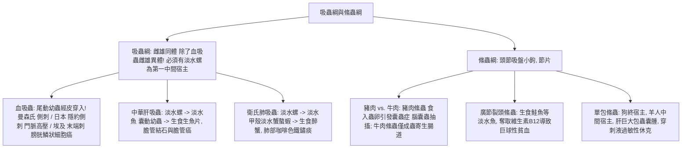

# 寄生蟲學 第03章 醫用蠕蟲學：吸蟲綱與絛蟲綱

## 核心知識體系架構
醫用蠕蟲學（Helminthology）之扁形動物門涵蓋吸蟲綱（Trematoda：血吸蟲、中華肝吸蟲、衛氏肺吸蟲；中間宿主淡水螺類）與絛蟲綱（Cestoda：豬肉絛蟲囊蟲症、牛肉絛蟲、廣節裂頭絛蟲維生素 B12 缺乏貧血、單包絛蟲包蟲囊袋）。

---

## 主題一：三大血吸蟲（Schistosoma）病理與蟲卵形態鑑別

### 1. 曼森氏 vs. 日本 vs. 埃及血吸蟲大對決
- **共性生物學特徵**：
  - 吸蟲中**唯一的「雌雄異體（Dioecious）」**！雄蟲腹面具有抱雌溝（Gynecophoral canal），雌蟲長條狀棲息於溝內合抱交配。
  - **唯一「不需食入、經由尾動幼蟲（Cercariae）直接穿透健康人體皮膚感染」之吸蟲**！
  - **蟲卵不具卵蓋（Operculum）**（其餘吸蟲卵均具卵蓋）。
- **三大血吸蟲精密對比表**：
| 血吸蟲種類 | 成蟲主要寄生解剖血管部位 | 蟲卵典型顯微形態（國考必考！） | 主要病理變化與晚期惡性後遺症 | 卵隨排泄物排出途徑 |
| :--- | :--- | :--- | :--- | :--- |
| **曼森氏血吸蟲 (Schistosoma mansoni)** | **腸繫膜下靜脈叢（Inferior mesenteric veins）** | **長橢圓形，具顯著銳利的「巨大側刺（Prominent lateral spine）」**！ | 蟲卵逆流沉積於肝臟門脈小分支周圍，形成肉芽腫與纖維化，呈典型 **「煙斗管樣肝纖維化（Symmers' pipestem fibrosis）」**、門脈高壓、巨脾症。 | 隨**糞便（Stool）** 排出 |
| **日本血吸蟲 (Schistosoma japonicum)** | **腸繫膜上靜脈叢（Superior mesenteric veins）** | 較圓，側壁具一個**微小不明顯的小側刺或小突起（Small inconspicuous knob/spine）** | 產卵量極大（為曼森氏的 10 倍！），更凶猛引發嚴重肉芽腫性結腸炎與重度煙斗管樣肝硬化。 | 隨**糞便（Stool）** 排出 |
| **埃及血吸蟲 (Schistosoma haematobium)** | **膀胱與骨盆腔靜脈叢（Vesical venous plexus）** | 橢圓形，**正頂端具有顯著銳利的「末端刺（Terminal spine）」**！ | 蟲卵沉積於膀胱黏膜下層，引發慢性潰瘍肉芽腫，典型臨床特徵為**終末無痛性肉眼血尿（Painless terminal hematuria）**！長期慢性發炎誘發膀胱 **「鱗狀細胞癌（Squamous Cell Carcinoma of Bladder，極罕見腺癌！）」**！ | 隨**尿液（Urine）** 排出 |

---

## 主題二：組織寄生絛蟲病（Cysticercosis & Hydatid Disease）

### 1. 豬肉絛蟲（Taenia solium）之兩種完全不同感染型態
- **型態一：腸道絛蟲病（Taeniasis）**：
  - **感染途徑**：進食**未煮熟含有囊尾幼蟲（Cysticercus cellulosae / 米豬肉）的豬肉**。
  - **致病機制**：囊尾幼蟲在人小腸內翻出頭節（具 4 個吸盤與雙排小鉤），發育成數公尺長之成蟲。成蟲寄生腸道，症狀輕微（消化不良、肛門排出節片）。
- **型態二：囊蟲症 / 囊尾幼蟲病（Cysticercosis，致命危險！）**：
  - **感染途徑**：**誤食了「豬肉絛蟲的蟲卵（Eggs）」**（自身自體體內逆蠕動反流、或糞口途徑污染食物）！
  - **致病機制**：人成為豬肉絛蟲的**中間宿主**！蟲卵在人胃內孵出六鉤蚴，穿透腸壁經血液循環播散至全身實質器官發育成囊尾幼蟲囊腫。
  - **神經囊蟲症（Neurocysticercosis, NCC）**：囊蟲寄生於大腦實質或腦室，囊腫退變死亡引發劇烈發炎水腫，為開發中國家**成人晚發型癲癇發作（Adult-onset Seizures）第一位病因**！頭部 CT/MRI 呈「靶眼徵（Swiss-cheese appearance / scolex in cyst）」。

### 2. 廣節裂頭絛蟲（Diphyllobothrium latum）
- **感染來源**：生食含有裂頭蚴之淡水魚（如鮭魚、鱒魚）。成蟲長達 10~15 公尺，寄生於迴腸。
- **特異致病機轉**：絛蟲成蟲具有極強之親和力，能**大量奪取腸腔內多達 80% 的維生素 $B_{12}$（Cobalamin）**！
- **特徵臨床表現**：導致宿主維生素 $B_{12}$ 嚴重缺乏，引發典型 **巨球性貧血（Megaloblastic anemia）伴隨亞急性脊髓聯合退化症（SCD）**！

---

## 歷屆國考核心真題解析

### 【國考經典真題實戰】
**【試題編號】113-第一次-med2-030**
> **題目**：人類感染下列何種寄生蟲，必須先經由心肺移行，才能到達小腸發育為成蟲？
- (A) 犬蛔蟲（Toxocara canis）
- (B) 海獸胃線蟲（Anisakis spp.）
- (C) 十二指腸鉤蟲（Ancylostoma duodenale）
- (D) 有棘頜口線蟲（Gnathostoma spinigerum）

> **標準答案**：`C`
> 
> **【考點深度解析與選項拆解】**：
- **(A) 選項分析**：犬蛔蟲（Toxocara canis）。核對寄生蟲生活史感染型（Infective stage）與診斷型（Diagnostic stage）、中間宿主或終宿主歸屬，評估其正確性。
- **(B) 選項分析**：海獸胃線蟲（Anisakis spp.）。比對蟲卵顯微鏡特徵（如側刺/末端刺、卵蓋、受精卵厚壁）或滋養體形態，剖析命題陷阱。
- **(C) 選項分析**：十二指腸鉤蟲（Ancylostoma duodenale）。檢驗臨床特徵病變（如阿米巴肝膿瘍、微小低色素貧血、巨球性貧血或象皮病），排除干擾選項。
- **(D) 選項分析**：有棘頜口線蟲（Gnathostoma spinigerum）。綜合首選驅蟲藥物（Praziquantel, Albendazole, Metronidazole, Primaquine），驗證題幹核心命題本旨。
> **【國考核心解題金鑰】**：本題精準鎖定標準答案 **(C)**。考生須融會貫通原蟲與蠕蟲之傳播媒介（螺類、蚊、黑蠅、采采蠅）、致病機制及典型蟲卵形態，即可秒殺奪冠。

---
### 【國考經典真題實戰】
**【試題編號】113-第一次-med2-031**
> **題目**：下列有關血吸蟲（blood flukes）之致病機制敘述，何者最適當？
- (A) 曼森血吸蟲（Schistosoma mansoni）成蟲主要寄生於人體之膀胱靜脈叢
- (B) 埃及血吸蟲（Schistosoma haematobium）成蟲主要寄生於人體之腸繫膜靜脈叢
- (C) 血吸蟲蟲卵經血流、異位陷入（ectopic trapped）腎臟而導致肉芽腫（granuloma）
- (D) 日本血吸蟲（Schistosoma japonicum）成蟲之每日產卵量（egg deposition）最多可超過3000 顆

> **標準答案**：`D`
> 
> **【考點深度解析與選項拆解】**：
- **(A) 選項分析**：曼森血吸蟲（Schistosoma mansoni）成蟲主要寄生於人體之膀胱靜脈叢。核對寄生蟲生活史感染型（Infective stage）與診斷型（Diagnostic stage）、中間宿主或終宿主歸屬，評估其正確性。
- **(B) 選項分析**：埃及血吸蟲（Schistosoma haematobium）成蟲主要寄生於人體之腸繫膜靜脈叢。比對蟲卵顯微鏡特徵（如側刺/末端刺、卵蓋、受精卵厚壁）或滋養體形態，剖析命題陷阱。
- **(C) 選項分析**：血吸蟲蟲卵經血流、異位陷入（ectopic trapped）腎臟而導致肉芽腫（granuloma）。檢驗臨床特徵病變（如阿米巴肝膿瘍、微小低色素貧血、巨球性貧血或象皮病），排除干擾選項。
- **(D) 選項分析**：日本血吸蟲（Schistosoma japonicum）成蟲之每日產卵量（egg deposition）最多可超過3000 顆。綜合首選驅蟲藥物（Praziquantel, Albendazole, Metronidazole, Primaquine），驗證題幹核心命題本旨。
> **【國考核心解題金鑰】**：本題精準鎖定標準答案 **(D)**。考生須融會貫通原蟲與蠕蟲之傳播媒介（螺類、蚊、黑蠅、采采蠅）、致病機制及典型蟲卵形態，即可秒殺奪冠。

---
### 【國考經典真題實戰】
**【試題編號】113-第一次-med2-032**
> **題目**：水生植物可當何種寄生蟲之中間宿主？ћ牛羊肝吸蟲（Fasciola hepatica） ќ薑片蟲（Fasciolopsis buski） ѝ中華肝吸蟲（Clonorchis sinensis） ў槍狀肝吸蟲（Dicrocoelium dendriticum）
- (A) ћќ
- (B) ѝў
- (C) ћѝ
- (D) ќў

> **標準答案**：`A`
> 
> **【考點深度解析與選項拆解】**：
- **(A) 選項分析**：ћќ。核對寄生蟲生活史感染型（Infective stage）與診斷型（Diagnostic stage）、中間宿主或終宿主歸屬，評估其正確性。
- **(B) 選項分析**：ѝў。比對蟲卵顯微鏡特徵（如側刺/末端刺、卵蓋、受精卵厚壁）或滋養體形態，剖析命題陷阱。
- **(C) 選項分析**：ћѝ。檢驗臨床特徵病變（如阿米巴肝膿瘍、微小低色素貧血、巨球性貧血或象皮病），排除干擾選項。
- **(D) 選項分析**：ќў。綜合首選驅蟲藥物（Praziquantel, Albendazole, Metronidazole, Primaquine），驗證題幹核心命題本旨。
> **【國考核心解題金鑰】**：本題精準鎖定標準答案 **(A)**。考生須融會貫通原蟲與蠕蟲之傳播媒介（螺類、蚊、黑蠅、采采蠅）、致病機制及典型蟲卵形態，即可秒殺奪冠。