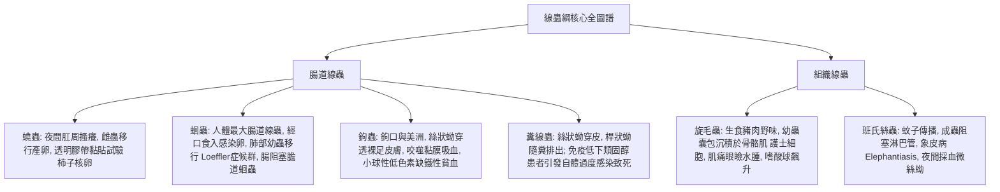

# 寄生蟲學 第04章 醫用蠕蟲學：線蟲綱與組織線蟲

## 核心知識體系架構
線蟲綱（Nematoda）為兩側對稱、圓柱形、雌雄異體之假體腔動物。涵蓋腸道線蟲（蟯蟲 Enterobius 膠帶黏貼、蛔蟲 Ascaris 腸道穿孔膽道蛔蟲症、鞭蟲 Trichuris 脫肛、十二指腸鉤蟲 Ancylostoma 缺鐵性貧血、糞線蟲 Strongyloides 體內自體感染）；以及組織線蟲（旋毛蟲 Trichinella 護士細胞、班氏絲蟲 Wuchereria 象皮病、麥地那龍線蟲、犬蛔蟲內臟幼蟲移行症 VLM）。

---

## 主題一：腸道線蟲感染途徑與臨床病徵大對決

### 1. 腸道五大線蟲傳染途徑、檢體與特徵卵鑑別
| 線蟲名稱 | 感染途徑與感染期（Infective stage） | 體內是否經「心-肺移行（Lung migration）」 | 顯微鏡下確診黃金檢體與蟲卵特徵 | 臨床特徵與致命併發症 |
| :--- | :--- | :--- | :--- | :--- |
| **蟯蟲 (Enterobius vermicularis)** | **食入含胚感染性蟲卵**（經手-口自身反覆感染、玩具、塵埃） | **否（無肺移行！）** | **清晨便前「肛周透明膠帶試驗（Scotch tape test）」**！常規糞便檢驗極難查見蟲卵！蟲卵呈**不對稱的平凸形（柿子核樣，一側扁平一側隆起）**。 | **夜間肛門周圍與會陰部劇烈奇癢（Pruritus ani）**（雌蟲夜間爬出肛門產卵並分泌黏液刺激所致）；失眠、小兒磨牙。全家需同時投藥（Mebendazole/Pyrantel pamoate）。 |
| **蛔蟲 (Ascaris lumbricoides)** | **食入受污染土壤蔬菜中之含蚴卵（Infective egg）** | **是（經小腸壁 $\to$ 門脈 $\to$ 心 $\to$ 肺泡 $\to$ 氣管 $\to$ 咽部吞入小腸）** | 糞便塗片查見受精卵：**寬橢圓形，外被一層凹凸不平粗糙的黃褐色蛋白質膜（Mammillated coat）**。人體最大腸道線蟲（長達 20~35 公分）。 | 1. 肺移行期：發熱、咳嗽、血痰、胸部游走性浸潤、嗜酸性球顯著升高之 **呂弗勒症候群（Löffler's syndrome）**。 2. 腸道成蟲：大量成蟲扭結引發**機械性腸阻塞**；成蟲鑽入膽道引發**膽道蛔蟲症（Biliary ascariasis，突發右上腹鑽頂樣劇痛）** 及急性胰臟炎。 |
| **十二指腸鉤蟲與美洲鉤蟲 (Hookworms)** | **感染性絲狀蚴（Filariform larvae）經裸露皮膚（如赤腳踩土）主動穿透人體**！ | **是（有心-肺移行）** | 糞便見蟲卵：橢圓形、卵殼極薄透明，內含 4~8 個卵裂球。 | 成蟲齒板或板齒咬嚼小腸黏膜微血管持續吸血，並分泌抗凝物質：引發**慢性失血性「小球性低色素缺鐵性貧血（Microcytic hypochromic iron deficiency anemia）」** 及嚴重低蛋白血症水腫。皮膚穿透處引發刺癢「地癢（Ground itch）」。 |
| **糞線蟲 (Strongyloides stercoralis)** | **絲狀蚴主動穿透皮膚** | **是（有心-肺移行）** | **糞便中查見的是「幼蟲（桿狀蚴 Rhabditiform larvae）」，極罕見查見蟲卵！** | **體內自體感染（Autoinfection）能力**：桿狀蚴在腸道內即可直接蛻皮變為具感染力的絲狀蚴穿透腸黏膜入血！在**長期使用類固醇免疫抑制患者體內引發致死性「過度感染症候群（Hyperinfection syndrome）」**，幼蟲瀰漫侵犯肺、腦引發革蘭陰性菌敗血性休克！治療首選 **伊維菌素（Ivermectin）**。 |
| **鞭蟲 (Trichuris trichiura)** | 食入含蚴蟲卵 | 否（無肺移行） | 蟲卵呈典型 **「紡錘形 / 美式橄欖球樣」，兩端具半透明隆起的蓋栓（Polar plugs）**。 | 成蟲前部纖細如鞭埋入盲腸大腸黏膜，重度感染小兒引發慢性黏液血便與**直腸脫垂（Rectal prolapse）**。 |

---

## 主題二：組織寄生線蟲（旋毛蟲與班氏絲蟲）

### 1. 旋毛蟲（Trichinella spiralis）
- **獨特生活史**：**成蟲與幼蟲寄生於「同一個宿主」體內**！
- **感染途徑**：進食**未經完全煮熟的含有囊包幼蟲（Encysted larvae）的豬肉或野生動物肉（熊肉、野豬肉）**。
- **組織病理與護士細胞**：
  - 幼蟲鑽入小腸黏膜發育為成蟲，交配後產出新生幼蟲。
  - 新生幼蟲穿入淋巴管入血，播散至全身**橫紋肌（骨骼肌：咬肌、膈肌、腓腸肌）** 內。
  - 幼蟲誘導骨骼肌細胞重編程失去橫紋，轉化為提供幼蟲營養的特異結構——**護士細胞（Nurse cell）**，形成石灰化纖維包囊。
- **特徵臨床三聯徵**：
  1. **劇烈骨骼肌疼痛與壓痛（Myalgia）**。
  2. **雙側眼眶周圍水腫（Periorbital edema）**。
  3. **外周血嗜酸性球極度飆升（Eosinophilia，常高達 20~50%！）**、甲下線狀出血。

### 2. 班氏絲蟲（Wuchereria bancrofti）
- **傳播媒介**：**蚊子（熱帶家蚊 Culex、斑蚊 Aedes）** 叮咬人體傳播感染性絲狀蚴。
- **寄生部位與致病**：成蟲寄生於人體**深部淋巴系統（腹股溝與睪丸精索淋巴管）**。成蟲分泌毒素與死亡引發反覆急性淋巴管炎與淋巴結炎，導致淋巴管完全阻塞纖維化。
- **晚期病理後遺症**：
  - **象皮病（Elephantiasis）**：下肢與陰囊淋巴液回流受阻，真皮結締組織重度肥厚纖維化、皮膚粗糙如大象皮。
  - **乳糜尿（Chyluria）**：腹膜後淋巴管破裂入泌尿道，尿液呈乳白色牛奶樣。
  - **鞘膜積液（Hydrocele）**。
- **確診採血黃金法則**：微絲蚴（Microfilariae）具有嚴格的 **「夜間週期性（Nocturnal periodicity）」**（白天躲在肺毛細血管，夜間 22:00 ~ 02:00 奔湧至外周血液！），**因此必須在「午夜深宵採血抹片鏡檢」才能抓到微絲蚴**！治療首選 **乙胺嗪（DEC / Diethylcarbamazine）**。

---

## 歷屆國考核心真題解析

### 【國考經典真題實戰】
**【試題編號】114-第一次-med2-031**
> **題目**：下列何種寄生蟲之蟲卵於小腸孵化後，可以藉由自體感染（autoinfection）方式重新感染同一宿 主？
- (A) 短小包膜絛蟲（Hymenolepis nana）
- (B) 縮小包膜絛蟲（Hymenolepis diminuta）
- (C) 顆粒性包生絛蟲（Echinococcus granulosus）
- (D) 犬複殖器絛蟲（Dipylidium caninum）

> **標準答案**：`A`
> 
> **【考點深度解析與選項拆解】**：
- **(A) 選項分析**：短小包膜絛蟲（Hymenolepis nana）。核對寄生蟲生活史感染型（Infective stage）與診斷型（Diagnostic stage）、中間宿主或終宿主歸屬，評估其正確性。
- **(B) 選項分析**：縮小包膜絛蟲（Hymenolepis diminuta）。比對蟲卵顯微鏡特徵（如側刺/末端刺、卵蓋、受精卵厚壁）或滋養體形態，剖析命題陷阱。
- **(C) 選項分析**：顆粒性包生絛蟲（Echinococcus granulosus）。檢驗臨床特徵病變（如阿米巴肝膿瘍、微小低色素貧血、巨球性貧血或象皮病），排除干擾選項。
- **(D) 選項分析**：犬複殖器絛蟲（Dipylidium caninum）。綜合首選驅蟲藥物（Praziquantel, Albendazole, Metronidazole, Primaquine），驗證題幹核心命題本旨。
> **【國考核心解題金鑰】**：本題精準鎖定標準答案 **(A)**。考生須融會貫通原蟲與蠕蟲之傳播媒介（螺類、蚊、黑蠅、采采蠅）、致病機制及典型蟲卵形態，即可秒殺奪冠。

---
### 【國考經典真題實戰】
**【試題編號】114-第一次-med2-032**
> **題目**：豬肉絛蟲（Taenia solium）比牛肉絛蟲（Taenia saginata）對人類造成的病變更為嚴重，最主要 原因是：
- (A) 前者的頭節具額嘴（rostellum）及小鉤，對腸黏膜的破壞較大
- (B) 前者吸收較多營養，導致宿主衰弱
- (C) 前者分泌的毒素（toxin）作用較強，造成宿主產生病變
- (D) 前者會造成人類的囊尾幼蟲症（human cysticercosis）

> **標準答案**：`D`
> 
> **【考點深度解析與選項拆解】**：
- **(A) 選項分析**：前者的頭節具額嘴（rostellum）及小鉤，對腸黏膜的破壞較大。核對寄生蟲生活史感染型（Infective stage）與診斷型（Diagnostic stage）、中間宿主或終宿主歸屬，評估其正確性。
- **(B) 選項分析**：前者吸收較多營養，導致宿主衰弱。比對蟲卵顯微鏡特徵（如側刺/末端刺、卵蓋、受精卵厚壁）或滋養體形態，剖析命題陷阱。
- **(C) 選項分析**：前者分泌的毒素（toxin）作用較強，造成宿主產生病變。檢驗臨床特徵病變（如阿米巴肝膿瘍、微小低色素貧血、巨球性貧血或象皮病），排除干擾選項。
- **(D) 選項分析**：前者會造成人類的囊尾幼蟲症（human cysticercosis）。綜合首選驅蟲藥物（Praziquantel, Albendazole, Metronidazole, Primaquine），驗證題幹核心命題本旨。
> **【國考核心解題金鑰】**：本題精準鎖定標準答案 **(D)**。考生須融會貫通原蟲與蠕蟲之傳播媒介（螺類、蚊、黑蠅、采采蠅）、致病機制及典型蟲卵形態，即可秒殺奪冠。

---
### 【國考經典真題實戰】
**【試題編號】114-第一次-med2-033**
> **題目**：有關枯西氏錐蟲（Trypanosoma cruzi）及其造成的疾病，下列敘述何者最為適當？
- (A) 當病媒椿象（triatoma bug）叮咬人類後，無鞭毛體（amastigote）會進入體內，藉由連續分裂方 式形成偽囊體（pseudocyst）後留在組織中
- (B) 患者會出現眼瞼浮腫、結膜腫大，臨床上稱為後頸淋巴結腫大（Winterbottom's sign）
- (C) 患者出現的巨食道症（megaesophagus）或是巨結腸症（megacolon）等症狀，係肇因於補體 （complement）攻擊神經節後的結果
- (D) 性行為與輸血均可傳播本疾病

> **標準答案**：`D`
> 
> **【考點深度解析與選項拆解】**：
- **(A) 選項分析**：當病媒椿象（triatoma bug）叮咬人類後，無鞭毛體（amastigote）會進入體內，藉由連續分裂方 式形成偽囊體（pseudocyst）後留在組織中。核對寄生蟲生活史感染型（Infective stage）與診斷型（Diagnostic stage）、中間宿主或終宿主歸屬，評估其正確性。
- **(B) 選項分析**：患者會出現眼瞼浮腫、結膜腫大，臨床上稱為後頸淋巴結腫大（Winterbottom's sign）。比對蟲卵顯微鏡特徵（如側刺/末端刺、卵蓋、受精卵厚壁）或滋養體形態，剖析命題陷阱。
- **(C) 選項分析**：患者出現的巨食道症（megaesophagus）或是巨結腸症（megacolon）等症狀，係肇因於補體 （complement）攻擊神經節後的結果。檢驗臨床特徵病變（如阿米巴肝膿瘍、微小低色素貧血、巨球性貧血或象皮病），排除干擾選項。
- **(D) 選項分析**：性行為與輸血均可傳播本疾病。綜合首選驅蟲藥物（Praziquantel, Albendazole, Metronidazole, Primaquine），驗證題幹核心命題本旨。
> **【國考核心解題金鑰】**：本題精準鎖定標準答案 **(D)**。考生須融會貫通原蟲與蠕蟲之傳播媒介（螺類、蚊、黑蠅、采采蠅）、致病機制及典型蟲卵形態，即可秒殺奪冠。