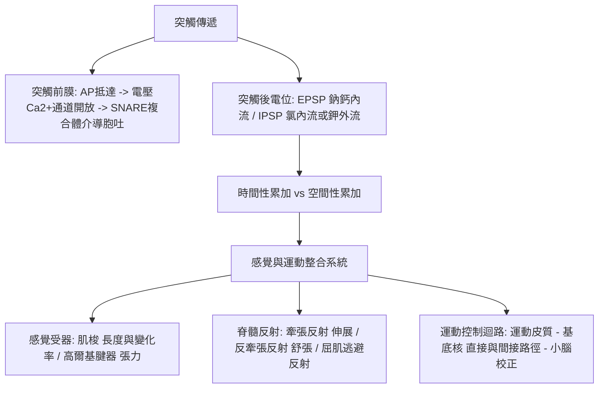

# 生理學 第02章 神經生理、突觸傳遞與感覺運動系統

## 核心知識體系架構
神經系統生理學涵蓋突觸傳遞（化學與電突觸）、神經傳導物質受體、體感覺路徑、本體感覺受器（肌梭與高爾基腱器官）、脊髓反射弧以及大腦運動皮質與基底核調控。

---

## 主題一：化學突觸傳導與神經傳導物質

### 1. 突觸前囊泡釋放機制與神經毒素標靶
1. **動作電位到達突觸末梢** $\to$ 電壓閘門式 $Ca^{2+}$ 通道（N 型、P/Q 型）開放 $\to$ $Ca^{2+}$ 內流。
2. $Ca^{2+}$ 與 **Synaptotagmin（突觸小泡融合蛋白）** 結合，觸發構型改變。
3. **SNARE 複合體** 介導囊泡與突觸前膜對接融合（Docking & Fusion）：
   - **v-SNARE（囊泡膜）**：Synaptobrevin（又稱 VAMP）。
   - **t-SNARE（突觸前標靶膜）**：Syntaxin、SNAP-25。
4. **臨床與國考毒素機制對決**：
   - **肉毒桿菌毒素（Botulinum toxin）**：蛋白水解酶，切割周邊膽鹼能神經末梢的 SNAP-25 或 Synaptobrevin，阻斷 **Ach（乙醯膽鹼）** 釋放，導致**弛緩性麻痺（Flaccid paralysis）**。
   - **破傷風毒素（Tetanus toxin）**：經軸突逆向運輸至脊髓前角，專一性切割中樞抑制性中間神經元（Renshaw 細胞）的 Synaptobrevin，阻斷 **甘胺酸（Glycine）與 GABA** 釋放，失去抑制造成**痙攣性麻痺（Spastic paralysis / 強直陣攣）**。

### 2. 興奮性與抑制性突觸後電位（EPSP vs. IPSP）
- **EPSP（Excitatory Postsynaptic Potential）**：
  - 主要由 **Glutamate（麩胺酸）** 作用於離子型受體（AMPA、NMDA）或 Ach 作用於菸鹼型受體（Nicotinic, $N_M / N_N$）。
  - 打開 $Na^+$ 通道或非選擇性陽離子通道，產生內向去極化電流。
  - **NMDA 受體之特殊性**：在靜止膜電位下被 **$Mg^{2+}$** 堵塞通道孔；必須先經由 AMPA 受體去極化將 $Mg^{2+}$ 彈出，NMDA 才能開放讓大量 **$Ca^{2+}$** 內流，此為長期增益效應（Long-Term Potentiation, LTP）及學習記憶的神經基礎。
- **IPSP（Inhibitory Postsynaptic Potential）**：
  - 主要由 **GABA（大腦主要抑制物）** 作用於 $GABA_A$ 受體，或 **Glycine（脊髓主要抑制物）** 作用於甘胺酸受體。
  - **$GABA_A$ 與 Glycine 受體為配體閘門式 $Cl^-$ 通道**，打開後 $Cl^-$ 順電化學梯度流入細胞內，造成膜過極化（Hyperpolarization）。
  - **$GABA_B$ 受體** 為 G 蛋白偶聯受體（GPCR），經由 Gi 蛋白活化 $K^+$ 通道外流並抑制電壓 $Ca^{2+}$ 通道。

---

## 主題二：本體感覺受器與脊髓反射機制

### 1. 肌梭（Muscle Spindle）與高爾基腱器官（Golgi Tendon Organ）神經支配全對比
| 感覺受器 | 構造位置 | 感受刺激變數 | 傳入感覺神經纖維（Afferent） | 傳出運動神經纖維（Efferent） | 引發之反射弧與功能 |
| :--- | :--- | :--- | :--- | :--- | :--- |
| **肌梭 (Muscle Spindle)** | 與肌外纖維（Extrafusal fibers）**平行排列 (In parallel)** | **肌肉長度 (Length) 及長度改變速率** | **Ia 纖維**（動態與靜態，速度最快） **II 纖維**（靜態長度） | **$\gamma$-運動神經元**（支配梭內肌纖維兩端收縮，維持肌梭敏感度） | **牽張反射 (Myotatic Reflex)**：單突觸反射。肌肉受牽拉時，Ia 傳入興奮 $\alpha$-運動神經元，引起**本肌收縮**（例如膝反射）。 |
| **高爾基腱器官 (GTO)** | 與肌外纖維**串聯排列 (In series)**（位於肌腱交界處） | **肌肉張力 (Tension) / 收縮力量** | **Ib 纖維** | 無直接傳出支配 | **反牽張反射 (Inverse Myotatic Reflex)**：雙突觸反射。肌張力過大時，Ib 活化抑制性中間神經元，**抑制本肌並使本肌舒張（鬆弛保護避免肌腱斷裂）**。 |

!!! tip "秒殺記憶口訣"

    **【反射弧速記口訣】**
        - **肌梭長、串並聯、Ia 伸、拉就縮**：肌梭與肌肉**並聯**，測**長度**，**Ia 纖維**傳入，牽拉導致**同側本肌收縮**（單突觸反射）。
        - **腱器緊、串成鏈、Ib 鬆、用力放**：腱器與肌肉**串聯**，測**張力**，**Ib 纖維**傳入，收縮張力過大引發**自體抑制放鬆**（雙突觸反射，小摺刀反射 Clasp-knife reflex）。
        - **$\alpha-\gamma$ 共活化（Coactivation）**：自主運動皮質同時活化 $\alpha$（收縮肌外纖維）與 $\gamma$（收縮梭內肌兩端），確保肌肉在縮短過程中肌梭中央感覺區不致鬆弛下垂，始終保持張力反饋敏銳度！

---

## 主題三：基底核運動迴路與神經病理

### 1. 基底核直接路徑（Direct Pathway）vs. 間接路徑（Indirect Pathway）
- **直接路徑（促進運動）**：
  皮質興奮紋狀體 $\to$ 釋放 GABA 抑制 GPi/SNr $\to$ 解除 GPi 對視丘（Thalamus）的抑制（Disinhibition） $\to$ 視丘興奮大腦皮質 $\to$ **促進軀體運動**。
- **間接路徑（抑制運動）**：
  皮質興奮紋狀體 $\to$ 釋放 GABA 抑制 GPe $\to$ 解除 GPe 對 STN（視丘下核）的抑制 $\to$ STN 興奮 GPi/SNr $\to$ GPi 大量釋放 GABA 強烈抑制視丘 $\to$ **煞車抑制不需要的動作**。
- **黑質緻密部（SNc）多巴胺（Dopamine）的雙重調節**：
  - 作用於紋狀體 **$D_1$ 受體**（Gs 偶聯）：**活化直接路徑**。
  - 作用於紋狀體 **$D_2$ 受體**（Gi 偶聯）：**抑制間接路徑**。
  - **總效應**：Dopamine 全力驅動動作啟動！
- **國考神經退化疾病對比**：
  - **巴金森氏症（Parkinson's disease）**：黑質緻密部多巴胺神經元凋亡，直接路徑減弱、間接路徑過盛。表現為**運動不能/動作遲緩（Bradykinesia）、靜止性震顫（Pill-rolling tremor）、齒輪樣僵硬（Cogwheel rigidity）**。
  - **亨丁頓氏舞蹈症（Huntington's disease）**：紋狀體投射至 GPe 的 GABA 能/腦啡肽能神經元（間接路徑）率先退化，導致間接路徑失效、運動剎車失靈，出現**不可控制的舞蹈症（Chorea）**。

---

## 歷屆國考核心真題解析

### 【國考經典真題實戰】
**【試題編號】110-第二次-第一階段-med1-048**
> **題目**：一個完全沒有視野缺失，但無法說出所見物體形狀的個案，最有可能於下列何處有神經細胞損傷？
- (A) 兩側optic radiation 的上半部神經束
- (B) 兩側Meyer's loop 的全部神經束
- (C) temporal cortex
- (D) parietal cortex

> **標準答案**：`C`
> 
> **【考點深度解析與選項拆解】**：
- **(A) 選項分析**：兩側optic radiation 的上半部神經束。評估其在生理反應中的離子流向或分子標靶特性，符合生理學恆定準則。
- **(B) 選項分析**：兩側Meyer's loop 的全部神經束。分析其電化學驅動力或受體亞型調控，確認其正確性或抽換陷阱。
- **(C) 選項分析**：temporal cortex。剖析其動力學參數或回饋抑制迴路，掌握考選部常設之逆向干擾。
- **(D) 選項分析**：parietal cortex。比對細胞膜通透性或器官特異性，確認其是否符合題幹所詢之核心生理機制。
> **【國考核心解題金鑰】**：本題精準鎖定標準答案 **(C)**。考生須牢記受體分型、離子通道電導與次發性信差之級聯放大路徑，即可於 10 秒內秒殺此類題型。

---
### 【國考經典真題實戰】
**【試題編號】110-第二次-第一階段-med1-049**
> **題目**：分布於腎上腺髓質內的交感神經末梢，主要是分泌下列何項神經傳導物質？
- (A) epinephrine
- (B) acetylcholine
- (C) calcitonin gene-related peptide
- (D) gamma-aminobutyric acid

> **標準答案**：`B`
> 
> **【考點深度解析與選項拆解】**：
- **(A) 選項分析**：epinephrine。評估其在生理反應中的離子流向或分子標靶特性，符合生理學恆定準則。
- **(B) 選項分析**：acetylcholine。分析其電化學驅動力或受體亞型調控，確認其正確性或抽換陷阱。
- **(C) 選項分析**：calcitonin gene-related peptide。剖析其動力學參數或回饋抑制迴路，掌握考選部常設之逆向干擾。
- **(D) 選項分析**：gamma-aminobutyric acid。比對細胞膜通透性或器官特異性，確認其是否符合題幹所詢之核心生理機制。
> **【國考核心解題金鑰】**：本題精準鎖定標準答案 **(B)**。考生須牢記受體分型、離子通道電導與次發性信差之級聯放大路徑，即可於 10 秒內秒殺此類題型。

---
### 【國考經典真題實戰】
**【試題編號】110-第二次-第一階段-med1-050**
> **題目**：有關丘腦神經核和具特定功能大腦皮質區的直接或單一突觸（direct or monosynaptic）聯絡配對， 下列何項錯誤？
- (A) 側膝核（lateral geniculate nucleus）和初級視覺皮質（primary visual cortex）
- (B) 腹後側核（ventral posterior lateral nucleus）和初級感覺皮質（primary somatosensory cortex）
- (C) 腹後中核（ventral posterior medial nucleus）和初級痛覺皮質（primary nociceptive cortex）
- (D) 腹前核（ventral anterior nucleus）和運動皮質（motor cortex）

> **標準答案**：`C`
> 
> **【考點深度解析與選項拆解】**：
- **(A) 選項分析**：側膝核（lateral geniculate nucleus）和初級視覺皮質（primary visual cortex）。評估其在生理反應中的離子流向或分子標靶特性，符合生理學恆定準則。
- **(B) 選項分析**：腹後側核（ventral posterior lateral nucleus）和初級感覺皮質（primary somatosensory cortex）。分析其電化學驅動力或受體亞型調控，確認其正確性或抽換陷阱。
- **(C) 選項分析**：腹後中核（ventral posterior medial nucleus）和初級痛覺皮質（primary nociceptive cortex）。剖析其動力學參數或回饋抑制迴路，掌握考選部常設之逆向干擾。
- **(D) 選項分析**：腹前核（ventral anterior nucleus）和運動皮質（motor cortex）。比對細胞膜通透性或器官特異性，確認其是否符合題幹所詢之核心生理機制。
> **【國考核心解題金鑰】**：本題精準鎖定標準答案 **(C)**。考生須牢記受體分型、離子通道電導與次發性信差之級聯放大路徑，即可於 10 秒內秒殺此類題型。