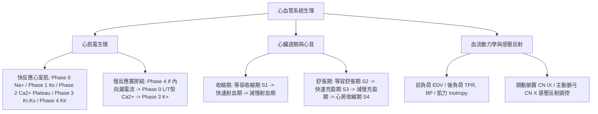

# 生理學 第03章 心血管電生理、心臟週期與血流動力學

## 核心知識體系架構
心血管生理學為國考重點大宗，整合心肌動作電位、特殊傳導系統自律性、心電圖導極、心室容積-壓力環（P-V loop）、心輸出量（CO）之調控因子（前負荷、後負荷、肌力）以及動脈感壓反射。



---

## 主題一：心肌動作電位（快反應細胞 vs. 慢反應細胞）

### 1. 心室心肌細胞（快反應）與竇房結起搏細胞（慢反應）電生理矩陣
| 動作電位分期 | 心室心肌 / 蒲金氏纖維（快反應 Working Myocytes） | 竇房結 / 房室結（慢反應 Pacemaker Cells） |
| :--- | :--- | :--- |
| **Phase 0（去極化）** | **電壓閘門式 $Na^+$ 通道（$Na_v1.5$）** 迅猛開放，大量 $Na^+$ 內流，斜率極陡（dV/dt 最大）。 | **電壓閘門式 L 型 $Ca^{2+}$ 通道（$Ca_v1.2$）** 開放，鈣離子內流。無快速鈉通道，去極化斜率平緩傳導慢。 |
| **Phase 1（初期快速再極化）** | $Na_v$ 快速去活化，伴隨一過性外向鉀電流（**$I_{to}$**）開放。 | **無 Phase 1**。 |
| **Phase 2（平原期 Plateau）** | **L 型 $Ca^{2+}$ 通道（$I_{Ca,L}$）內流與延遲整流鉀電流（$I_K$）外流** 達成精確動態平衡。此期維持 200 ms，提供充分時間引發 CICR 並杜絕心肌強直。 | **無 Phase 2**。 |
| **Phase 3（快速再極化）** | L 型 $Ca^{2+}$ 通道去活化，延遲整流鉀通道（**$I_{Kr}$ 與 $I_{Ks}$**）完全開放，大量 $K^+$ 外流使膜電位迅速復歸。 | L 型 $Ca^{2+}$ 通道關閉，電壓閘門式 $K^+$ 通道開放，鉀外流使細胞膜再極化至最大舒張電位（MDP $\approx -65\text{ mV}$）。 |
| **Phase 4（靜止期 / 自律性舒張去極化）** | 靜止膜電位穩定於 **$-90\text{ mV}$**（靠內向整流鉀通道 **$I_{K1}$** 錨定）。無自律性。 | **具自律性自發舒張期去極化**：<br>1. **趣味電流（Funny current, $I_f$）**：超極化活化之非選擇性陽離子通道（HCN 通道），$Na^+$ 內流。<br>2. **T 型 $Ca^{2+}$ 通道（$I_{Ca,T}$）** 接棒推升至閾值（$-40\text{ mV}$）。<br>3. 伴隨 $K^+$ 外流逐漸衰減。 |

!!! warning "高頻陷阱重點防護（考試最易混淆點）"

    **【考選部常考陷阱】**
    1. **自主神經對竇房結 Phase 4 的調控**：
        - **交感神經（$\beta_1$ 受體 - Gs - cAMP）**：直接結合並增加 HCN 通道開放機率，使 **$I_f$ 內向電流增加**，Phase 4 去極化斜率**變陡**，心跳加快（HR 增加）。
        - **副交感迷走神經（$M_2$ 受體 - Gi - 釋放 $G_{\beta\gamma}$）**：活化乙醯膽鹼敏感型鉀通道（**$I_{K,Ach}$**），增加 $K^+$ 外流使最大舒張電位更負（過極化），同時降低 cAMP 抑制 $I_f$ 與 $I_{Ca}$，Phase 4 斜率**變平緩**，心跳減慢。
    2. **自律性高低階梯**：竇房結（SA node, 60~100 bpm）> 房室結（AV node, 40~60 bpm）> 希氏束/蒲金氏纖維（His-Purkinje, 20~40 bpm）。傳導速度則以**蒲金氏纖維最快（2~4 m/s）**，**房室結最慢（0.05 m/s，造成 PR 間期之生理性房室傳導延遲）**！

---

## 主題二：心臟週期（Cardiac Cycle）與壓力容積環（P-V Loop）

### 1. 心臟週期七大時期關鍵事件流
1. **等容收縮期（Isovolumetric Contraction）**：心室開始收縮，室壓急遽升高超過房壓，**房室瓣（二尖瓣/三尖瓣）關閉產生第一心音（S1）**。此時半月瓣尚未開放，**心室容積不變且壓力暴增**。
2. **快速射血期（Rapid Ejection）**：室壓超過主動脈壓，**主動脈瓣（半月瓣）開啟**，血液迅猛噴入主動脈，心室容積急劇縮小，室壓與主動脈壓達全週期頂峰。
3. **減慢射血期（Reduced Ejection）**：心室肌開始再極化（T波），射血速度趨緩。
4. **等容舒張期（Isovolumetric Relaxation）**：心室開始舒張，室壓低於主動脈壓，**主動脈瓣關閉產生第二心音（S2）**。房室瓣尚未開啟，**心室容積維持於舒張末期最小容積（ESV），室壓斷崖式驟降**。
5. **快速充盈期（Rapid Ventricular Filling）**：室壓低於心房壓，二尖瓣被動推開，心房血液被動大量奔湧入心室（佔充盈量 70%）。**若心室順應性差或容量過負荷，此時血液撞擊室壁可產生第三心音（S3，心室奔馬律）**。
6. **減慢充盈期（Reduced Filling / Diastasis）**：充盈速度放慢。
7. **心房收縮期（Atrial Systole）**：P 波之後心房主動收縮，提供最後 20~30% 之心室充盈（Atrial kick）。**若心室肥厚過度僵硬（如高血壓心臟病），心房強烈收縮對抗高阻力心室可引發第四心音（S4，心房奔馬律，正常的 S4 絕不可能出現）**。

### 2. 左心室壓力容積環（Pressure-Volume Loop）四大轉角與位移判讀
- **四個關鍵點座標**：
  - **A 點（舒張末期容積 EDV）**：二尖瓣關閉（S1 產生，約 120 mL）。
  - **B 點**：主動脈瓣開啟（約 80 mmHg）。
  - **C 點**：收縮末期最高壓力點。
  - **D 點（收縮末期容積 ESV）**：主動脈瓣關閉（S2 產生，約 50 mL）。
  - **每搏輸出量（Stroke Volume, SV）$= EDV - ESV \approx 70\text{ mL}$**。射血分數（$EF = SV/EDV \approx 55\text{--}65\%$）。

```
左室壓 (mmHg)
  120 |          C ------ D
      |         /          \
   80 |        B            \
      |        |             \
    0 |________|______________A_____
               ESV(50)      EDV(120)  左室容積 (mL)
```

| 介入生理變數改變 | P-V Loop 圖形幾何變動 | 關鍵指標變化 |
| :--- | :--- | :--- |
| **增加前負荷 (Preload / 靜脈回流 $\uparrow$)** | **A 點向右平移**（EDV 增大），環向右拓寬。 | **SV 增加**，EF 正常或略增。遵守 Frank-Starling 機制。 |
| **增加後負荷 (Afterload / 總周邊阻力 TPR $\uparrow$)** | **整個環向上升高且縮窄**，B 點上移，D 點向右平移（ESV 增加）。 | **SV 減少**，ESV 增加，EF 下降。心臟需作更多等容壓力功。 |
| **增加心肌收縮力 (Inotropy / 交感興奮)** | **收縮末期壓力容積關係斜率（ESPVR）變陡**，D 點強烈向左平移（ESV 顯著減小）。 | **SV 大幅增加**，**EF 大幅上升**。 |

---

## 主題三：動脈感壓反射（Baroreceptor Reflex）與血流動力學

### 1. 頸動脈竇（Carotid Sinus）與主動脈弓（Aortic Arch）傳導路徑對照
- **頸動脈竇（Carotid Sinus）**：
  - 感受器位於內頸動脈基底膨大處。
  - 感覺傳入神經：**舌咽神經（CN IX，竇神經 Hering's nerve）**。
  - **對血壓上升與血壓下降皆極度敏銳**（工作範圍 60~180 mmHg）。
- **主動脈弓（Aortic Arch）**：
  - 感受器位於主動脈弓壁。
  - 感覺傳入神經：**迷走神經（CN X，主動脈降壓神經 Cyon's nerve）**。
  - **主要感受血壓升高之牽張刺激**，對血壓驟降之反應較遲鈍。
- **孤立束核（NTS）中樞整合迴路**：
  血壓上升 $\to$ 感受器牽張放電增加 $\to$ CN IX/X 傳入興奮延腦 **孤立束核（NTS）**：
  1. 興奮疑核（NA）與迷走神經背核 $\to$ **副交感輸出增加** $\to$ 心跳減慢（HR $\downarrow$）。
  2. 興奮尾側腹外側延腦（CVLM） $\to$ 抑制頭側腹外側延腦（RVLM）交感中樞 $\to$ **交感輸出減少** $\to$ 心肌收縮力下降、小動脈舒張（TPR $\downarrow$）、大靜脈舒張（靜脈回流 $\downarrow$） $\to$ 血壓迅速回降至基準線。

---

## 歷屆國考核心真題解析

### 【國考經典真題實戰】
**【試題編號】110-第二次-第一階段-med1-057**
> **題目**：若以一條繩線緊綁某根手指頭根部1～2 分鐘後，移除該繩線後會發現該手指因短暫血流增加而變 紅，這現象最主要是下列何種局部控制機制所致？
- (A) 主動性充血（active hyperemia）
- (B) 反應性充血（reactive hyperemia）
- (C) 肌原反應（myogenic responses）
- (D) 對傷害的反應（response to injury）

> **標準答案**：`B`
> 
> **【考點深度解析與選項拆解】**：
- **(A) 選項分析**：主動性充血（active hyperemia）。評估其在生理反應中的離子流向或分子標靶特性，符合生理學恆定準則。
- **(B) 選項分析**：反應性充血（reactive hyperemia）。分析其電化學驅動力或受體亞型調控，確認其正確性或抽換陷阱。
- **(C) 選項分析**：肌原反應（myogenic responses）。剖析其動力學參數或回饋抑制迴路，掌握考選部常設之逆向干擾。
- **(D) 選項分析**：對傷害的反應（response to injury）。比對細胞膜通透性或器官特異性，確認其是否符合題幹所詢之核心生理機制。
> **【國考核心解題金鑰】**：本題精準鎖定標準答案 **(B)**。考生須牢記受體分型、離子通道電導與次發性信差之級聯放大路徑，即可於 10 秒內秒殺此類題型。

---
### 【國考經典真題實戰】
**【試題編號】111-第一次-med1-049**
> **題目**：下列何者是參與引發睪丸下降至陰囊（testis descent）的重要因子，而此與精子生成能力密切相關？
- (A) 激活素（activin）
- (B) 雄性素（androgen）
- (C) 沃氏管退化因子（Wolffian duct regression factor）
- (D) 血管內皮生長因子（vascular endothelial growth factor）

> **標準答案**：`B`
> 
> **【考點深度解析與選項拆解】**：
- **(A) 選項分析**：激活素（activin）。評估其在生理反應中的離子流向或分子標靶特性，符合生理學恆定準則。
- **(B) 選項分析**：雄性素（androgen）。分析其電化學驅動力或受體亞型調控，確認其正確性或抽換陷阱。
- **(C) 選項分析**：沃氏管退化因子（Wolffian duct regression factor）。剖析其動力學參數或回饋抑制迴路，掌握考選部常設之逆向干擾。
- **(D) 選項分析**：血管內皮生長因子（vascular endothelial growth factor）。比對細胞膜通透性或器官特異性，確認其是否符合題幹所詢之核心生理機制。
> **【國考核心解題金鑰】**：本題精準鎖定標準答案 **(B)**。考生須牢記受體分型、離子通道電導與次發性信差之級聯放大路徑，即可於 10 秒內秒殺此類題型。

---
### 【國考經典真題實戰】
**【試題編號】111-第一次-med1-060**
> **題目**：在正常心臟週期的等容收縮（isovolumic contraction）期中，下列各腔室的壓力排列順序何者正確？
- (A) 主動脈的壓力（aortic pressure）＞左心室的壓力（left ventricular pressure）＞左心房的壓力（left atrial pressure）
- (B) 主動脈的壓力（aortic pressure）＞左心房的壓力（left atrial pressure）＞左心室的壓力（left ventricular pressure）
- (C) 左心室的壓力（left ventricular pressure）＞ 主動脈的壓力（aortic pressure）＞ 左心房的壓力（left atrial pressure）
- (D) 左心室的壓力（left ventricular pressure）＞左心房的壓力（left atrial pressure）＞ 主動脈的壓力（aortic pressure）

> **標準答案**：`A`
> 
> **【考點深度解析與選項拆解】**：
- **(A) 選項分析**：主動脈的壓力（aortic pressure）＞左心室的壓力（left ventricular pressure）＞左心房的壓力（left atrial pressure）。評估其在生理反應中的離子流向或分子標靶特性，符合生理學恆定準則。
- **(B) 選項分析**：主動脈的壓力（aortic pressure）＞左心房的壓力（left atrial pressure）＞左心室的壓力（left ventricular pressure）。分析其電化學驅動力或受體亞型調控，確認其正確性或抽換陷阱。
- **(C) 選項分析**：左心室的壓力（left ventricular pressure）＞ 主動脈的壓力（aortic pressure）＞ 左心房的壓力（left atrial pressure）。剖析其動力學參數或回饋抑制迴路，掌握考選部常設之逆向干擾。
- **(D) 選項分析**：左心室的壓力（left ventricular pressure）＞左心房的壓力（left atrial pressure）＞ 主動脈的壓力（aortic pressure）。比對細胞膜通透性或器官特異性，確認其是否符合題幹所詢之核心生理機制。
> **【國考核心解題金鑰】**：本題精準鎖定標準答案 **(A)**。考生須牢記受體分型、離子通道電導與次發性信差之級聯放大路徑，即可於 10 秒內秒殺此類題型。