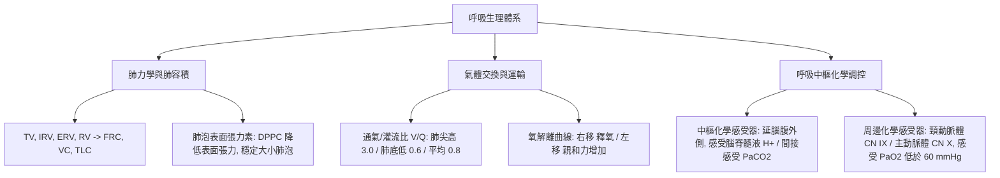

# 生理學 第04章 呼吸生理、肺通氣、氣體交換與化學調節

## 核心知識體系架構
呼吸生理學涵蓋肺容積與容量（Lung Volumes & Capacities）、肺力學（順應性、表面張力素、氣道阻力）、肺循環與通氣/灌流比（$V/Q$ ratio）、氧氣與二氧化碳之血液運輸（氧合血紅素解離曲線），以及呼吸中樞化學感受器調控。

---

## 主題一：肺容積、容量與肺力學

### 1. 肺容積（Volumes）與容量（Capacities）精析表
- **四大基本容積（互不重疊）**：
  1. **潮氣容積（Tidal Volume, TV $\approx 500\text{ mL}$）**：平靜呼吸時每次吸入或呼出的氣量。
  2. **吸氣儲備容積（Inspiratory Reserve Volume, IRV $\approx 3000\text{ mL}$）**：平靜吸氣末額外能吸入之最大氣量。
  3. **呼氣儲備容積（Expiratory Reserve Volume, ERV $\approx 1100\text{ mL}$）**：平靜呼氣末額外能呼出之最大氣量。
  4. **殘餘容積（Residual Volume, RV $\approx 1200\text{ mL}$）**：用力最大呼氣後仍殘留在肺內的氣量。**無法以一般肺量計（Spirometer）測得，必須依靠氦氣稀釋法或身體箱式體積描記儀（Body plethysmography）測量**。
- **四大複合容量（由兩個以上容積組成）**：
  - **吸氣容量（Inspiratory Capacity, IC）$= TV + IRV \approx 3500\text{ mL}$**。
  - **功能性殘氣量（Functional Residual Capacity, FRC）$= ERV + RV \approx 2300\text{ mL}$**：平靜呼氣末肺內氣量。此時**肺組織向內彈性回縮力與胸壁向外彈性回縮力達到大小相等、方向相反的精確平衡，肋膜腔內壓（Intrapleural pressure）約為 $-5\text{ cmH}_2\text{O}$**！含 RV 故無法由肺量計直接測量。
  - **肺活量（Vital Capacity, VC）$= TV + IRV + ERV \approx 4600\text{ mL}$**。
  - **肺總量（Total Lung Capacity, TLC）$= VC + RV \approx 5800\text{ mL}$**。

### 2. 阻塞性（Obstructive）vs. 限制性（Restrictive）肺疾患診斷矩陣
| 肺功能檢測指標 | 正常值 | 阻塞性通氣障礙（COPD、氣喘） | 限制性通氣障礙（特發性肺纖維化、脊柱後側凸） |
| :--- | :--- | :--- | :--- |
| **$FEV_1 / FVC$ 比值** | $> 70\text{--}80\%$ | **顯著下降（$< 70\%$，診斷核心指標）** | **正常或上升（$\ge 80\%$）** |
| **第一秒用力呼氣容積（$FEV_1$）** | $> 80\%$ 預測值 | 大幅下降（呼氣氣流受阻） | 下降（與 FVC 等比例下降） |
| **用力肺活量（FVC）** | $> 80\%$ 預測值 | 正常或輕度下降 | **顯著下降（$< 80\%$）** |
| **殘餘容積（RV）與 FRC** | 基準值 | **大幅增加**（空氣滯留 Air-trapping） | **顯著減少** |
| **肺總量（TLC）** | 基準值 | **增加**（肺過度充氣 Hyperinflation） | **顯著降低（$< 80\%$，診斷必要條件）** |

---

## 主題二：通氣/灌流比（$V/Q$ Ratio）與氧合血紅素解離曲線

### 1. 直立人體肺臟之 $V/Q$ 空間不均一性
- 直立時受重力梯度影響，肺尖（Zone 1）與肺底（Zone 3）之通氣量（$V$）與血流量（$Q$）皆呈「由上至下遞增」，但**血流量增加之斜率遠陡於通氣量**：
  - **肺尖（Apex）**：通氣量較小但血流量極匱乏，$V/Q \approx 3.0$（高 $V/Q$）。此處 $P_A O_2$ 最高（$\approx 130\text{ mmHg}$）、$P_A CO_2$ 最低（$\approx 28\text{ mmHg}$）。**結核分枝桿菌（M. tuberculosis）為絕對好氧菌，故最易在肺尖著床繁殖**！
  - **肺底（Base）**：通氣量大且血流量更充沛，$V/Q \approx 0.6$（低 $V/Q$）。此處 $P_A O_2$ 較低（$\approx 89\text{ mmHg}$）、$P_A CO_2$ 較高（$\approx 42\text{ mmHg}$）。
  - **全肺平均**：$V/Q \approx 0.8$。
- **極端病理狀況**：
  - **$V/Q = 0$（生理性分流 Shunt）**：氣道完全阻塞（如異物吸入、肺塌陷），有血流無通氣，吸純氧無法有效改善低血氧。
  - **$V/Q \to \infty$（死腔通氣 Dead space）**：肺血管完全阻塞（如急性肺栓塞 Pulmonary embolism），有通氣無血流，浪費換氣做功。

### 2. 氧合血紅素解離曲線（Oxygen-Hemoglobin Dissociation Curve）左右移調控
- **S 型曲線（Sigmoidal shape）**：源自血紅素（Hb）四聚體之**正同構異位協同效應（Positive cooperativity）**。$P_{50}$（血紅素飽和度達 50% 時之 $P O_2$）正常值約為 **$26.6\text{ mmHg}$**。
- **曲線右移（Right Shift）$\to$ 降低 Hb 與 $O_2$ 之親和力，促進組織微血管釋放氧氣**：
  - **$P CO_2$ 上升**（Bohr 效應）
  - **$[H^+]$ 上升 / pH 下降**（酸中毒）
  - **溫度上升（Temperature $\uparrow$）**
  - **2,3-BPG（2,3-DPG）上升**（慢性缺氧、高山適應、貧血）
- **曲線左移（Left Shift）$\to$ 增加 Hb 與 $O_2$ 之親和力，抓緊氧氣不易釋放至組織**：
  - $P CO_2$ 下降、pH 上升（鹼中毒）、溫度下降、2,3-BPG 下降。
  - **胎兒血紅素（HbF）**：由 $\alpha_2 \gamma_2$ 組成，對 2,3-BPG 親和力低，曲線強烈左移，以利於胎盤處自母體（HbA）奪取氧氣。
  - **一氧化碳中毒（CO 中毒）**：CO 與 Hb 之親和力為氧氣之 240 倍。不僅霸佔結合位，且使未受阻的氧結合位**曲線強烈左移**，組織嚴重窒息缺氧！

---

## 主題三：呼吸運動之神經與化學調節

### 1. 中樞化學感受器（Central Chemoreceptors）vs. 周邊化學感受器（Peripheral Chemoreceptors）
| 比較項目 | 中樞化學感受器（Central） | 周邊化學感受器（Peripheral） |
| :--- | :--- | :--- |
| **解剖位置** | 延腦腹外側表面（Ventral medulla） | **頸動脈體（Carotid body）** 與 **主動脈體（Aortic body）** |
| **感覺傳入神經** | 直接與延腦呼吸中樞突觸連結 | 頸動脈體經 **CN IX（舌咽神經）**；主動脈體經 **CN X（迷走神經）** |
| **主要刺激源** | **腦脊髓液（CSF）與腦組織間液中的 $[H^+]$** | **動脈血 $P_a O_2$ 顯著降低（$< 60\text{ mmHg}$）** |
| **對 $CO_2$ 之感應機制** | $CO_2$ 為脂溶性氣體，可輕易穿透血腦屏障（BBB），在 CSF 內經 CA 轉化為 $H^+ + HCO_3^-$，**$H^+$ 直接活化感受器**（中樞驅動佔正常平靜通氣之 70~80%）。 | 直接感受動脈血中的 $P_a CO_2$ 上升與動脈血 $[H^+]$ 增加（提供快速即時調節，佔 20~30%）。 |
| **對缺氧（Hypoxia）反應** | **無法感受缺氧**（重度缺氧甚至會中樞抑制呼吸）。 | **專司感受缺氧之唯一防線**！當 $P_a O_2 < 60\text{ mmHg}$ 時，I 型球細胞（Glomus cells）鉀通道關閉，引發密集放電驅動過度通氣。 |

---

## 歷屆國考核心真題解析

### 【國考經典真題實戰】
**【試題編號】110-第二次-第一階段-med1-060**
> **題目**：呼吸時，膈神經（phrenic nerve）的放電頻率（firing frequency）於何時增加？
- (A) 僅平靜吸氣（quiet inspiration）時增加，用力吸氣（forced inspiration）時不增加
- (B) 僅平靜呼氣（quiet expiration）時增加，用力呼氣（forced expiration）時不增加
- (C) 平靜吸氣與用力吸氣（forced inspiration）時皆增加
- (D) 平靜呼氣與用力呼氣（forced expiration）時皆增加 高 點 醫 護 【版權所有，翻印必究】 110高點醫護｜第二次醫師考試 ‧ 高分詳解 -- -- 8

> **標準答案**：`C`
> 
> **【考點深度解析與選項拆解】**：
- **(A) 選項分析**：僅平靜吸氣（quiet inspiration）時增加，用力吸氣（forced inspiration）時不增加。審視其在呼吸換氣力學、腎小管轉運或酸鹼恆定中之生理參數，精準定位其作用環節。
- **(B) 選項分析**：僅平靜呼氣（quiet expiration）時增加，用力呼氣（forced expiration）時不增加。比對離子通道電阻、分室滲透壓或化學感受器反射之代償極限，剖析考選部命題核心。
- **(C) 選項分析**：平靜吸氣與用力吸氣（forced inspiration）時皆增加。辨析各段腎小管特異性運輸蛋白或肺泡氣體交換分壓差，釐清易混淆之干擾項目。
- **(D) 選項分析**：平靜呼氣與用力呼氣（forced expiration）時皆增加 高 點 醫 護 【版權所有，翻印必究】 110高點醫護｜第二次醫師考試 ‧ 高分詳解 -- -- 8。綜合代償公式或化學平衡常數計算，確認題幹命題意圖與生理機制吻合度。
> **【國考核心解題金鑰】**：本題標準答案為 **(C)**。牢記腎小管各段利尿劑標靶阻斷效應與呼吸力學容積變動，即可秒殺奪分。

---
### 【國考經典真題實戰】
**【試題編號】110-第二次-第一階段-med1-061**
> **題目**：甲、乙兩試管內含有相同的正常人體血液，分別灌入氣體使得兩者血液之氧分壓（PO2）均為40 mmHg，甲試管內血液之二氧化碳分壓（PCO2）為40 mmHg，乙試管內血液之二氧化碳分壓為46 mmHg。下列敘述何者正確？
- (A) 甲、乙兩試管內血液之氧氣總含量（total oxygen content）相同
- (B) 甲試管內血漿（plasma）含有的氧氣量比乙試管更多
- (C) 乙試管內血液的血氧飽和度（blood O2 saturation or hemoglobin saturation）比甲試管更少
- (D) 乙試管內血液pH 值比甲試管更高

> **標準答案**：`C`
> 
> **【考點深度解析與選項拆解】**：
- **(A) 選項分析**：甲、乙兩試管內血液之氧氣總含量（total oxygen content）相同。審視其在呼吸換氣力學、腎小管轉運或酸鹼恆定中之生理參數，精準定位其作用環節。
- **(B) 選項分析**：甲試管內血漿（plasma）含有的氧氣量比乙試管更多。比對離子通道電阻、分室滲透壓或化學感受器反射之代償極限，剖析考選部命題核心。
- **(C) 選項分析**：乙試管內血液的血氧飽和度（blood O2 saturation or hemoglobin saturation）比甲試管更少。辨析各段腎小管特異性運輸蛋白或肺泡氣體交換分壓差，釐清易混淆之干擾項目。
- **(D) 選項分析**：乙試管內血液pH 值比甲試管更高。綜合代償公式或化學平衡常數計算，確認題幹命題意圖與生理機制吻合度。
> **【國考核心解題金鑰】**：本題標準答案為 **(C)**。牢記腎小管各段利尿劑標靶阻斷效應與呼吸力學容積變動，即可秒殺奪分。

---
### 【國考經典真題實戰】
**【試題編號】111-第二次-第一階段-med1-061**
> **題目**：健康者站立，在其肺容量等於功能肺餘容量（functional residual capacity）時開始吸氣（inspiration），此時吸 入的氣體最容易進入下列何區域的肺泡（alveolus）？
- (A) 肺底（base）處
- (B) 肺中段
- (C) 肺尖（apex）處
- (D) 平均分布於肺臟各處

> **標準答案**：`A`
> 
> **【考點深度解析與選項拆解】**：
- **(A) 選項分析**：肺底（base）處。審視其在呼吸換氣力學、腎小管轉運或酸鹼恆定中之生理參數，精準定位其作用環節。
- **(B) 選項分析**：肺中段。比對離子通道電阻、分室滲透壓或化學感受器反射之代償極限，剖析考選部命題核心。
- **(C) 選項分析**：肺尖（apex）處。辨析各段腎小管特異性運輸蛋白或肺泡氣體交換分壓差，釐清易混淆之干擾項目。
- **(D) 選項分析**：平均分布於肺臟各處。綜合代償公式或化學平衡常數計算，確認題幹命題意圖與生理機制吻合度。
> **【國考核心解題金鑰】**：本題標準答案為 **(A)**。牢記腎小管各段利尿劑標靶阻斷效應與呼吸力學容積變動，即可秒殺奪分。