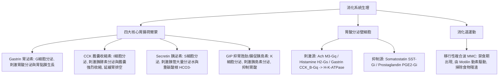

# 生理學 第07章 消化生理、消化道荷爾蒙分泌與蠕動

## 核心知識體系架構
消化系統生理學涵蓋胃腸道荷爾蒙（胃泌素、膽囊收縮素、胰泌素、GIP）、胃酸分泌之壁細胞受體級聯調控（Ach, Histamine, Gastrin vs. Somatostatin, Prostaglandin）、胰液與膽汁分泌調控，以及消化道運動（移行性複合波 MMC、分節運動與蠕動）。

---

## 主題一：四大核心胃腸荷爾蒙對比矩陣

### 1. 胃腸荷爾蒙分泌細胞、刺激物與生理效應
| 胃腸荷爾蒙 | 分泌細胞與分佈部位 | 主要釋放刺激因子 | 核心生理效應 | 抑制釋放因子 |
| :--- | :--- | :--- | :--- | :--- |
| **胃泌素 (Gastrin)** | **胃竇（Antrum）及十二指腸之 G 細胞** | 胜肽與小分子胺基酸、胃竇擴張、迷走神經刺激（經 **GRP** 釋放，非 Ach！） | 1. 強烈刺激壁細胞分泌胃酸（$HCl$）。 2. **促進胃黏膜營養生長（Trophic effect）**。 | 胃內高酸度（**$pH < 1.5\text{--}2.0$**）、生長抑素（**Somatostatin**）。 |
| **膽囊收縮素 (CCK)** | **十二指腸與空腸黏膜之 I 細胞** | 小腸腔內的**小分子胜肽/胺基酸**及**長鏈脂肪酸（Monoglycerides & Fatty acids）** | 1. 刺激**膽囊平滑肌強烈收縮**。 2. 舒張 **Oddi 氏括約肌**（使膽汁注入腸腔）。 3. 刺激胰臟腺泡細胞分泌**大量富含消化酵素之胰液**。 4. 抑制胃排空（延緩脂肪消化）。 | 胰蛋白酶反饋降解釋放因子。 |
| **胰泌素 (Secretin)** | **十二指腸黏膜之 S 細胞** | 十二指腸腔內 **$pH < 4.5$（胃酸酸性食糜進入小腸）** 及脂肪酸 | 1. 刺激胰臟導管細胞分泌**大量富含水與 $HCO_3^-$ 的鹼性胰液**（中和胃酸）。 2. 刺激膽管上皮分泌 $HCO_3^-$。 3. 抑制胃酸分泌與胃蠕動。 | 十二指腸中和至鹼性。 |
| **葡萄糖依賴性促胰島素胜肽 (GIP)** | **十二指腸與空腸之 K 細胞** | 口服葡萄糖、蛋白質、脂肪 | 1. **腸促胰島素效應（Incretin）**：在血糖升高前強烈預先刺激胰島 $\beta$ 細胞分泌**胰島素**（口服葡萄糖比靜脈注射引發更多胰島素釋放之主因！）。 2. 生理高劑量下抑制胃酸分泌。 | 禁食狀態。 |

!!! warning "高頻陷阱重點防護（考試最易混淆點）"

    **【考選部常考陷阱】**
        - **迷走神經刺激 G 細胞之傳導物質**：副交感迷走神經興奮時，刺激胃竇 G 細胞釋放 Gastrin 的神經傳導物質是 **胃泌素釋放胜肽（Gastrin-Releasing Peptide, GRP / Bombesin）**，**並非乙醯膽鹼（Ach）**！因此，給予抗膽鹼藥物（如阿托品 Atropine）無法完全阻斷迷走神經引發的胃泌素釋放！
        - **促泌素分泌胰液之成分差異**：**CCK 刺激分泌「富含酵素酶類（Enzymes）」的濃稠胰液**；**Secretin 刺激分泌「富含 $HCO_3^-$ 與水分」的清稀鹼性胰液**。

---

## 主題二：胃酸分泌機制與壁細胞受體調控

### 1. 壁細胞（Parietal Cell）胃酸生成之電化學轉運
1. 壁細胞內富含**碳酸酐酶（CA-II）**：$H_2O + CO_2 \rightleftharpoons H_2CO_3 \rightleftharpoons H^+ + HCO_3^-$。
2. **頂端膜（Apical membrane）之 $H^+/K^+$-ATPase（質子幫浦 Proton Pump）**：水解 ATP，將 $H^+$ 逆極高濃度差（一百萬倍濃度梯度）打入胃腔，同時將 $K^+$ 打入細胞內。
3. **基底側膜（Basolateral membrane）之 $Cl^-/HCO_3^-$ 交換體**：將細胞內生成的 $HCO_3^-$ 轉運至血液中，同時吸納 $Cl^-$。餐後大量胃酸分泌時，胃靜脈血液中 $HCO_3^-$ 濃度顯著升高，引起一過性全身血液偏鹼，稱為**餐後鹼潮（Postprandial Alkaline Tide）**！
4. $Cl^-$ 經頂端膜氯通道擴散至胃腔，與 $H^+$ 結合成鹽酸（$HCl$）。

### 2. 壁細胞三大興奮刺激途徑與兩大抑制途徑
- **三大興奮性受體（促進胃酸）**：
  1. **乙醯膽鹼（Ach）**：作用於 **$M_3$ 受體** $\to G_q$ 蛋白 $\to$ PLC $\to IP_3 / DAG \to$ 細胞內 $[Ca^{2+}]_i$ 上升 $\to$ 活化質子幫浦。
  2. **組織胺（Histamine）**：由胃黏膜腸嗜鉻樣細胞（ECL cells）釋放，作用於 **$H_2$ 受體** $\to G_s$ 蛋白 $\to$ 腺苷酸環化酶（AC） $\to$ **$cAMP$ 上升** $\to$ PKA 活化質子幫浦。
  3. **胃泌素（Gastrin）**：經血液循環作用於壁細胞之 **$CCK_B$ 受體** $\to G_q$ 蛋白 $\to [Ca^{2+}]_i$ 上升；同時 Gastrin 亦強烈活化 ECL 細胞釋放 Histamine（最主要放大途徑）。
  - **強烈協同增效效應（Potentiation）**：Histamine 透過 cAMP 與 Ach/Gastrin 透過 $Ca^{2+}$ 途徑具互補放大效應，故阻斷 $H_2$ 受體（如 Cimetidine）可同時大幅削弱 Ach 與 Gastrin 之促酸效應。
- **兩大抑制性受體（抑制胃酸）**：
  1. **生長抑素（Somatostatin, SST）**：由 D 細胞分泌，作用於 SST 受體 $\to G_i$ 蛋白 $\to$ 抑制 AC $\to cAMP \downarrow$。
  2. **前列腺素（Prostaglandin $PGE_2$）**：作用於 EP 受體 $\to G_i$ 蛋白 $\to cAMP \downarrow$；同時刺激胃表面黏液細胞分泌黏液與 $HCO_3^-$（保護黏膜屏障）。

---

## 主題三：消化道運動與移行性複合波（MMC）

### 1. 禁食期胃腸道清道夫：移行性運動複合波（MMC）
- **發生時期**：兩餐之間或禁食期間（Interdigestive state），每隔 90~120 分鐘循環一次。
- **生理功能**：產生強烈自胃向迴腸方向推進之收縮波，**清除胃腸道內殘存之不可消化固體殘渣、脫落上皮細胞並抑制迴腸細菌逆向過度生長**。
- **調控荷爾蒙**：由十二指腸與空腸 M 細胞分泌之 **動素（Motilin）** 所引發。進食後 MMC 立即終止，轉為消化期的蠕動（Peristalsis）與分節運動（Segmentation）。

---

## 歷屆國考核心真題解析

### 【國考經典真題實戰】
**【試題編號】110-第二次-第一階段-med1-062**
> **題目**：正常生理狀況下，下列何種器官所分泌的脂肪酵素（lipase）最少？
- (A) 口腔（mouth）
- (B) 小腸（small intestine）
- (C) 胰臟（pancreas）
- (D) 膽囊（gallbladder）

> **標準答案**：`D`
> 
> **【考點深度解析與選項拆解】**：
- **(A) 選項分析**：口腔（mouth）。對照內分泌荷爾蒙軸線、胃腸道神經傳導或感光細胞生物化學信號串聯，判定其正誤性。
- **(B) 選項分析**：小腸（small intestine）。檢驗其第二信差生成路徑、受體亞型偶聯或離子驅動方向，辨析考選部經典抽換標靶。
- **(C) 選項分析**：胰臟（pancreas）。評估負回饋閾值、轉運體親和力動力學或器官微環境特性，確認其是否符合生理恆定。
- **(D) 選項分析**：膽囊（gallbladder）。綜合反饋調節迴路或突觸釋放機制，比對題幹核心詢問重點。
> **【國考核心解題金鑰】**：本題標準答案為 **(D)**。牢記荷爾蒙第二信差歸類（cAMP vs. IP3）、GLUT轉運體組織專一性及視聽轉導離子流向，即可秒殺奪分。

---
### 【國考經典真題實戰】
**【試題編號】111-第一次-med1-065**
> **題目**：刺激下列何者，對於促進胃酸生成的效果最低？
- (A) D細胞（D cell）
- (B) 類腸嗜鉻細胞（enterochromaffin-like cell, ECL cell）
- (C) G細胞（G cell）
- (D) 迷走神經（vagus nerve）

> **標準答案**：`A`
> 
> **【考點深度解析與選項拆解】**：
- **(A) 選項分析**：D細胞（D cell）。對照內分泌荷爾蒙軸線、胃腸道神經傳導或感光細胞生物化學信號串聯，判定其正誤性。
- **(B) 選項分析**：類腸嗜鉻細胞（enterochromaffin-like cell, ECL cell）。檢驗其第二信差生成路徑、受體亞型偶聯或離子驅動方向，辨析考選部經典抽換標靶。
- **(C) 選項分析**：G細胞（G cell）。評估負回饋閾值、轉運體親和力動力學或器官微環境特性，確認其是否符合生理恆定。
- **(D) 選項分析**：迷走神經（vagus nerve）。綜合反饋調節迴路或突觸釋放機制，比對題幹核心詢問重點。
> **【國考核心解題金鑰】**：本題標準答案為 **(A)**。牢記荷爾蒙第二信差歸類（cAMP vs. IP3）、GLUT轉運體組織專一性及視聽轉導離子流向，即可秒殺奪分。

---
### 【國考經典真題實戰】
**【試題編號】112-第二次-第一階段-med1-064**
> **題目**：在一般正常生理狀態下，有關胃酸分
- (A) 受胃泌素釋放胜肽（gastrin releasing
- (B) 經氫氯離子共同轉運蛋白（H +-Cl - co
- (C) 受黏液素（mucin）直接抑制Gs 蛋白
- (D) 需有碳酸酐酵素（carbonic anhydrase

> **標準答案**：`D`
> 
> **【考點深度解析與選項拆解】**：
- **(A) 選項分析**：受胃泌素釋放胜肽（gastrin releasing。對照內分泌荷爾蒙軸線、胃腸道神經傳導或感光細胞生物化學信號串聯，判定其正誤性。
- **(B) 選項分析**：經氫氯離子共同轉運蛋白（H +-Cl - co。檢驗其第二信差生成路徑、受體亞型偶聯或離子驅動方向，辨析考選部經典抽換標靶。
- **(C) 選項分析**：受黏液素（mucin）直接抑制Gs 蛋白。評估負回饋閾值、轉運體親和力動力學或器官微環境特性，確認其是否符合生理恆定。
- **(D) 選項分析**：需有碳酸酐酵素（carbonic anhydrase。綜合反饋調節迴路或突觸釋放機制，比對題幹核心詢問重點。
> **【國考核心解題金鑰】**：本題標準答案為 **(D)**。牢記荷爾蒙第二信差歸類（cAMP vs. IP3）、GLUT轉運體組織專一性及視聽轉導離子流向，即可秒殺奪分。