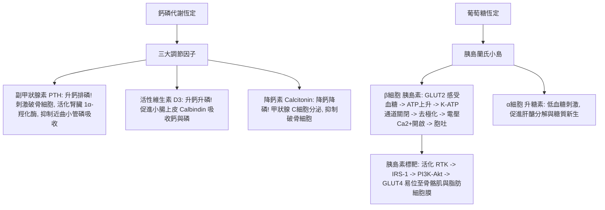

# 生理學 第09章 鈣磷代謝與胰島葡萄糖恆定

## 核心知識體系架構
鈣磷平衡與葡萄糖恆定為維持神經肌肉興奮性與能量代謝之關鍵。涵蓋副甲狀腺素（PTH）、降鈣素（Calcitonin）與活性維生素 $D_3$（$1,25-(OH)_2-D_3$）對骨骼、腎臟與腸道的三重交互調控；以及胰島細胞（$\alpha, \beta, \delta$）、胰島素分泌雙相反應、GLUT 轉運蛋白家族與升糖素拮抗機制。

---

## 主題一：副甲狀腺素（PTH）vs. 活性維生素 D3 vs. 降鈣素

### 1. 鈣磷調控荷爾蒙之器官靶點效應矩陣
| 調控荷爾蒙 | 分泌器官與細胞 | 骨骼作用（Bone） | 腎臟作用（Kidney） | 腸道作用（Intestine） | 最終血清濃度變動效應 |
| :--- | :--- | :--- | :--- | :--- | :--- |
| **副甲狀腺素 (PTH)** | 副甲狀腺主細胞（Chief cells），受細胞表面鈣敏感受體 **CaSR** 負調控 | 結合於**成骨細胞**之 PTH-R $\to$ 上調 **RANKL** $\to$ 活化破骨細胞前驅物上之 RANK $\to$ **促進骨質再吸收釋放鈣與磷**。 | 1. 刺激遠曲小管 **TRPV5** 促進 $Ca^{2+}$ 再吸收。 2. **抑制近曲小管 NPT2a，阻斷磷酸鹽再吸收（強烈促排磷！）**。 3. 活化近曲小管之 **$1\alpha$-羥化酶**。 | 無直接作用，**經由活化維生素 $D_3$ 間接大幅促進腸道吸收鈣**。 | **血清 $[Ca^{2+}] \uparrow$ 升高** **血清 $[\text{Phosphate}] \downarrow$ 下降** |
| **活性維生素 $D_3$ ($1,25-(OH)_2-D_3$)** | 皮膚（光化合成）$\to$ 肝臟（25-羥化）$\to$ **腎臟近曲小管（$1\alpha$-羥化）** | 協同 PTH 促進破骨細胞分化，同時提供骨骼礦質化所需之鈣磷原料。 | 促進遠端腎小管 $Ca^{2+}$ 與磷酸鹽之再吸收（弱於 PTH）。 | **核心主要作用靶點**！經核受體 VDR 誘導合成 **Calbindin-D28k** 及 TRPV6，**強烈吸收腸腔內之 $Ca^{2+}$ 與磷酸鹽**！ | **血清 $[Ca^{2+}] \uparrow$ 升高** **血清 $[\text{Phosphate}] \uparrow$ 升高** |
| **降鈣素 (Calcitonin)** | 甲狀腺濾泡旁細胞（Parafollicular / **C 細胞**），受高血鈣刺激釋放 | **直接結合破骨細胞**上之降鈣素受體 $\to$ 強烈抑制破骨細胞活性與骨質溶解。 | 抑制腎小管對 $Ca^{2+}$ 與磷酸鹽之再吸收，促進尿鈣與尿磷排泄。 | 無明顯直接作用。 | **血清 $[Ca^{2+}] \downarrow$ 降低** **血清 $[\text{Phosphate}] \downarrow$ 降低** |

!!! warning "高頻陷阱重點防護（考試最易混淆點）"

    **【考選部常考陷阱】**
        - **PTH 對成骨細胞 vs. 破骨細胞之直接受體分佈**：破骨細胞（Osteoclasts）表面**根本沒有 PTH 受體**！PTH 只能直接結合於**成骨細胞（Osteoblasts）**，刺激成骨細胞分泌 **RANKL** 與巨噬細胞集落刺激因子（M-CSF），RANKL 結合至破骨前驅細胞的 RANK 受體，才促使其融合成成熟破骨細胞！

---

## 主題二：胰島素分泌之分子感應機轉與 GLUT 轉運體

### 1. 胰島 $\beta$ 細胞刺激-分泌偶聯（Stimulus-Secretion Coupling）
1. 血液中葡萄糖經基底側膜 **GLUT2** 順濃度差促進性擴散進入 $\beta$ 細胞。
2. 葡萄糖經細胞內**葡萄糖激酶（Glucokinase, 血糖感應器）** 磷酸化為 G6P，進入醣解作用與檸檬酸循環，生成大量 **ATP**。
3. 細胞內 **$[ATP]/[ADP]$ 比值顯著升高** $\to$ 專一性結合併**關閉 ATP 敏感型鉀通道（$K_{ATP}$ channel，由 Kir6.2 與 SUR1 次單元組成）**。
4. $K^+$ 外流受阻 $\to$ 細胞膜產生**去極化（Depolarization）**。
5. 膜去極化觸發電壓閘門式 **L 型 $Ca^{2+}$ 通道開放** $\to Ca^{2+}$ 猛烈內流。
6. 細胞內高濃度 $[Ca^{2+}]_i$ 觸發儲存胰島素的囊泡與細胞膜對接融合，經胞吐作用（Exocytosis）釋放胰島素與 **C-胜肽（C-peptide）**。
- **磺醯尿素類降血糖藥（Sulfonylureas）**：如 Glipizide，直接阻斷 **$K_{ATP}$ 通道之 SUR1 次單元**，人為強行關閉鉀通道，引發去極化與鈣內流，促進胰島素分泌。

### 2. 葡萄糖轉運蛋白（GLUT 家族）分佈與胰島素相依性
| 轉運蛋白 | 主要組織器官分佈 | 運轉動力學特性 | 胰島素相依性（Insulin-dependent） |
| :--- | :--- | :--- | :--- |
| **GLUT1** | **紅血球（RBC）、血腦屏障內皮（BBB）**、胎盤、視網膜 | 基礎葡萄糖吸收，高親和力（$K_m$ 低） | **非胰島素相依**（低血糖下仍能供腦與紅血球用糖） |
| **GLUT2** | **肝臟肝細胞、胰島 $\beta$ 細胞、小腸黏膜基底側、腎近曲小管** | 雙向轉運，低親和力、高容量（**$K_m$ 極高**） | **非胰島素相依**（專職感受高血糖與雙向釋糖） |
| **GLUT3** | **神經元（Neurons）大腦實質** | 極高親和力（$K_m$ 最低） | **非胰島素相依**（優先保障大腦神經元獲取葡萄糖） |
| **GLUT4** | **骨骼肌（Skeletal Muscle）、心肌、脂肪組織（Adipose）** | 靜止時儲存於細胞內微囊泡，需受活化 | **絕對胰島素相依（唯一的胰島素相依 GLUT！）** Insulin 結合受體活化 Akt，促使 GLUT4 囊泡**易位（Translocation）並嵌入質膜**！ |
| **GLUT5** | **小腸上皮頂端膜、精子** | 專一性轉運**果糖（Fructose）**，不轉運葡萄糖 | **非胰島素相依** |

---

## 歷屆國考核心真題解析

### 【國考經典真題實戰】
**【試題編號】112-第一次-med1-069**
> **題目**：有關維生素D3（vitamin D3）的敘述，下列何者最為適當？
- (A) 又稱為25-hydroxycholecalciferol
- (B) 在肝臟製造合成
- (C) 維生素D3經1α-hydroxylase 作用，形成有活性的代謝產物
- (D) 維生素D3可由食物中攝取補充

> **標準答案**：`D`
> 
> **【考點深度解析與選項拆解】**：
- **(A) 選項分析**：又稱為25-hydroxycholecalciferol。對照內分泌荷爾蒙軸線、胃腸道神經傳導或感光細胞生物化學信號串聯，判定其正誤性。
- **(B) 選項分析**：在肝臟製造合成。檢驗其第二信差生成路徑、受體亞型偶聯或離子驅動方向，辨析考選部經典抽換標靶。
- **(C) 選項分析**：維生素D3經1α-hydroxylase 作用，形成有活性的代謝產物。評估負回饋閾值、轉運體親和力動力學或器官微環境特性，確認其是否符合生理恆定。
- **(D) 選項分析**：維生素D3可由食物中攝取補充。綜合反饋調節迴路或突觸釋放機制，比對題幹核心詢問重點。
> **【國考核心解題金鑰】**：本題標準答案為 **(D)**。牢記荷爾蒙第二信差歸類（cAMP vs. IP3）、GLUT轉運體組織專一性及視聽轉導離子流向，即可秒殺奪分。

---
### 【國考經典真題實戰】
**【試題編號】113-第一次-med1-057**
> **題目**：面對一位患有惡性貧血的患者，下列營養補充劑中，何者最適合用來改善症狀？
- (A) 維生素A
- (B) 維生素B12
- (C) 維生素D
- (D) 維生素K

> **標準答案**：`B`
> 
> **【考點深度解析與選項拆解】**：
- **(A) 選項分析**：維生素A。對照內分泌荷爾蒙軸線、胃腸道神經傳導或感光細胞生物化學信號串聯，判定其正誤性。
- **(B) 選項分析**：維生素B12。檢驗其第二信差生成路徑、受體亞型偶聯或離子驅動方向，辨析考選部經典抽換標靶。
- **(C) 選項分析**：維生素D。評估負回饋閾值、轉運體親和力動力學或器官微環境特性，確認其是否符合生理恆定。
- **(D) 選項分析**：維生素K。綜合反饋調節迴路或突觸釋放機制，比對題幹核心詢問重點。
> **【國考核心解題金鑰】**：本題標準答案為 **(B)**。牢記荷爾蒙第二信差歸類（cAMP vs. IP3）、GLUT轉運體組織專一性及視聽轉導離子流向，即可秒殺奪分。

---
### 【國考經典真題實戰】
**【試題編號】113-第二次-第一階段-med1-071**
> **題目**：下列何者促進血鈣濃度升高的能力最強？
- (A) calcitonin
- (B) parathyroid hormone
- (C) prolactin
- (D) oxytocin

> **標準答案**：`B`
> 
> **【考點深度解析與選項拆解】**：
- **(A) 選項分析**：calcitonin。對照內分泌荷爾蒙軸線、胃腸道神經傳導或感光細胞生物化學信號串聯，判定其正誤性。
- **(B) 選項分析**：parathyroid hormone。檢驗其第二信差生成路徑、受體亞型偶聯或離子驅動方向，辨析考選部經典抽換標靶。
- **(C) 選項分析**：prolactin。評估負回饋閾值、轉運體親和力動力學或器官微環境特性，確認其是否符合生理恆定。
- **(D) 選項分析**：oxytocin。綜合反饋調節迴路或突觸釋放機制，比對題幹核心詢問重點。
> **【國考核心解題金鑰】**：本題標準答案為 **(B)**。牢記荷爾蒙第二信差歸類（cAMP vs. IP3）、GLUT轉運體組織專一性及視聽轉導離子流向，即可秒殺奪分。