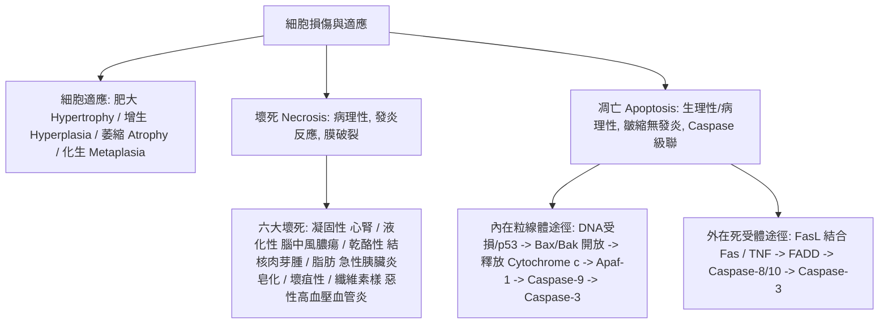

# 病理學 第01章 細胞損傷、壞死、凋亡與細胞適應

## 核心知識體系架構
病理學為臨床醫學之橋樑。本章奠定全身疾病之細胞病理基礎：細胞適應（肥大、增生、萎縮、化生）；可逆性損傷（細胞水腫、脂肪變性）vs. 不可逆性損傷（鈣超載、膜破裂、粒線體崩潰）；六大壞死型態（凝固性、液化性、乾酪性、脂肪、壞疽性、纖維素樣壞死）；以及細胞凋亡（Apoptosis）內在粒線體途徑與外在死受體途徑。

---

## 主題一：四大細胞適應（Cellular Adaptations）鑑別矩陣

### 1. 肥大、增生、萎縮與化生之病理特徵
| 適應型態 | 定義與細胞生物學機轉 | 生理性範例（Physiologic） | 病理性範例（Pathologic） | 癌變潛能（Malignant Potential） |
| :--- | :--- | :--- | :--- | :--- |
| **肥大 (Hypertrophy)** | **細胞體積增大**（蛋白質與細胞器合成增加）。通常見於**無分裂增生能力之永久細胞（Permanent cells）** | 懷孕時受動情素刺激之子宮平滑肌肥大；運動員骨骼肌增大 | 高血壓或主動脈瓣狹窄引發之**左心室同心性肥大（Left ventricular hypertrophy）** | 無 |
| **增生 (Hyperplasia)** | **細胞數目增多**（由幹細胞分裂驅動）。僅能發生於具分裂能力之細胞 | 懷孕或哺乳期乳腺小葉上皮增生；部分肝切除後殘存肝細胞代償性再生 | 長期動情素無對抗刺激之**子宮內膜增生（Endometrial hyperplasia）**；雄性素過量之**良性攝護腺增生（BPH）** | **有**（病理性增生若持續刺激易轉化為異生 Dysplasia 及癌症，但 BPH 不增加前列腺癌風險） |
| **萎縮 (Atrophy)** | **細胞體積縮小與數目減少**（蛋白質降解增加，泛素-蛋白酶體路徑與自噬體 Autophagy 活化） | 停經後子宮內膜萎縮；胚胎甲狀舌管退化 | 肢體骨折固定後的廢用性萎縮；神經去支配萎縮（脊髓灰質炎）；腦動脈粥狀硬化引起的腦萎縮 | 無 |
| **化生 (Metaplasia)** | 一種分化成熟的細胞型態被**另一種更能耐受逆境的分化成熟細胞型態所取代**（幹細胞重新編程 Reprogramming） | 無 | 1. **抽菸者氣道假複層纖毛柱狀上皮化生為複層鱗狀上皮（Squamous metaplasia）**。 2. **胃食道逆流（GERD）引起之 Barrett 食道：食道下段鱗狀上皮化生為胃腸道單層柱狀上皮（含杯狀細胞 Goblet cells）**。 | **高度癌變風險**！Barrett 食道顯著增加食道**腺癌（Adenocarcinoma）** 風險；氣道鱗狀化生易轉化為氣道**鱗狀細胞癌**！ |

---

## 主題二：六大壞死型態（Types of Necrosis）組織病理矩陣

### 1. 壞死型態、外觀病理與典型疾病對應表
| 壞死類型 | 顯微鏡下組織學病理特徵 | 肉眼（Gross）病理外觀 | 典型發生組織與代表性疾病 | 國考關鍵鑑別考點 |
| :--- | :--- | :--- | :--- | :--- |
| **凝固性壞死 (Coagulative Necrosis)** | 細胞輪廓骨架保留數天（**「幽靈細胞 Ghost cells」**），細胞核消失（核固縮、核碎裂、核溶解），細胞質嗜酸性增強 | 質地堅硬、灰白乾燥三角形梗塞灶 | **全身除中樞神經以外之所有實質器官缺血性梗塞（心肌梗塞、腎梗塞、脾梗塞）** | **蛋白質變性凝固佔優勢**，溶酶體水解被高熱或酸中毒抑制，細胞基本架構得以完整保留。 |
| **液化性壞死 (Liquefactive Necrosis)** | 組織被水解酶徹底消化溶解為液體黏稠物，細胞殘骸與嗜中性球形成膿液（Pus） | 軟化灶、囊腔（Cavity）、囊液 | 1. **大腦中樞神經系統缺血性中風梗塞（唯一例外！）**。 2. **細菌或真菌感染引發之局部化膿與腦/肝/肺膿瘍（Abscess）**。 | **水解酶消化佔絕對優勢**。大腦富含脂質與水分且缺乏纖維基質，微小神經膠細胞快速水解壞死腦組織。 |
| **乾酪性壞死 (Caseous Necrosis)** | 正常組織結構完全毀滅，呈現粉紅色無定形無結構之嗜酸性顆粒狀殘屑，周圍被上皮樣組織球與郎罕氏巨細胞包繞 | **豆腐渣樣、乾酪樣脆弱灰白色軟塊** | **結核桿菌感染（Mycobacterium tuberculosis / 肺結核、結核性淋巴結炎）**、全身性黴菌感染（組織胞漿菌） | 為凝固性壞死與液化性壞死的特殊複合形式，由結核菌細胞壁蠟質脂質（Cord factor）引起。 |
| **脂肪壞死 (Fat Necrosis)** | 壞死脂肪細胞邊緣模糊模糊，壞死區域內基質鈣鹽沉積，顯微鏡下呈現**藍紫色無定形顆粒沉著（皂化 Saponification）** | 白堊樣、白粉筆斑塊（Chalky white deposits） | **急性胰臟炎（Acute pancreatitis）**（活化脂肪酶水解腹膜後脂肪釋放游離脂肪酸，與 $Ca^{2+}$ 結合生成鈣皂）；**乳房外傷性脂肪壞死** | 常伴隨劇烈低血鈣（血鈣被大量消耗於皂化斑塊中，為重症急性胰臟炎不良預後指標！）。 |
| **纖維素樣壞死 (Fibrinoid Necrosis)** | 血管壁呈亮粉紅色、無結構均勻紅染樣變性，伴隨大量嗜中性球浸潤與紅血球外滲 | 血管壁脆弱、微小動脈瘤形成 | **惡性急進型高血壓（Malignant hypertension）**、**結節性多動脈炎（PAN）**、SLE、風濕熱阿少夫小體（Aschoff bodies） | **免疫複合物與血漿蛋白（纖維蛋白原 Fibrinogen）自受損血管內皮外滲並沉澱於血管中層**。 |
| **壞疽性壞死 (Gangrenous Necrosis)** | 肢端嚴重缺血引發之凝固性壞死（**乾性壞疽 Dry gangrene**）；若合併細菌腐敗感染液化則轉為 **濕性壞疽（Wet gangrene）** | 肢端發黑、皺縮乾癟或惡臭腫脹腐敗 | 糖尿病足、下肢周邊動脈阻塞疾病（PAOD）、腸扭轉腸壞疽 | 臨床外科常用術語，本質為多層組織凝固性壞死。 |

---

## 主題三：細胞凋亡（Apoptosis）分子調控機制

### 1. 內在粒線體途徑 vs. 外在死受體途徑大對決
- **內在途徑（Intrinsic / Mitochondrial Pathway，主要生理與應激途徑）**：
  1. DNA 嚴重受損、生長因子剝奪或內質網壓力 $\to$ 活化 **p53** 腫瘤抑制蛋白。
  2. p53 上調促凋亡 **BH3-only 蛋白（Puma, Noxa, Bim, Bid）**。
  3. 活化促凋亡效應蛋白 **Bax 與 Bak** $\to$ 在粒線體外膜形成通道，使粒線體膜通透性劇增（MOMP）。
  4. 粒線體釋放 **細胞色素 c（Cytochrome c）** 入細胞質。
  5. Cytochrome c 與 **Apaf-1（凋亡蛋白酶活化因子-1）** 及 dATP 結合成巨型輪狀 **凋亡體（Apoptosome）**。
  6. 凋亡體募聚並活化 **啟動型半胱天冬酶：Caspase-9**。
- **外在途徑（Extrinsic / Death Receptor-initiated Pathway）**：
  1. 細胞毒性 T 細胞（CTL）表面之 **FasL（CD95L）** 結合於標靶細胞表面之 **Fas 受體（CD95）**；或 TNF 結合於 TNFR1。
  2. 受體三聚體化，招募胞內轉接蛋白 **FADD（Fas-Associated Death Domain）**。
  3. FADD 募集並活化 **啟動型半胱天冬酶：Caspase-8 與 Caspase-10**。
- **共同執行終曲（Execution Phase）**：
  - 活化的 Caspase-9 或 Caspase-8 剪切並活化 **執行型半胱天冬酶：Caspase-3 與 Caspase-6, 7**！
  - Caspase-3 活化 CAD 內切核酸酶，將染色質 DNA 在核小體間隙精確切割為 **180~200 bp 的梯狀碎片（DNA Laddering，凋亡黃金標誌）**；細胞膜內翻將 **磷脂醯絲胺酸（Phosphatidylserine）** 暴露於細胞外表面，作為「Eat me」信號吸引巨噬細胞在**不引發任何急性發炎反應**下無聲吞噬清除！

---

## 歷屆國考核心真題解析

### 【國考經典真題實戰】
**【試題編號】111-第一次-med2-077**
> **題目**：胃食道逆流患者，於食道末端做切片檢查，發現良性柱狀上皮細胞，最可能為何種變化？
- (A) 異生（dysplasia）
- (B) 增生（hyperplasia）
- (C) 轉移（metastasis）
- (D) 化生（metaplasia）

> **標準答案**：`D`
> 
> **【考點深度解析與選項拆解】**：
- **(A) 選項分析**：異生（dysplasia）。核對細胞病理形態學變化（如嗜酸性增加、核碎裂或組織間質沉積），驗證其病理診斷符合性。
- **(B) 選項分析**：增生（hyperplasia）。比對發炎化學介質、自體抗體專一性或血栓形成 Virchow 三要素，剖析考選部常見陷阱。
- **(C) 選項分析**：轉移（metastasis）。辨析壞死亞型（凝固性 vs. 液化性）或過敏反應型別（Type I~IV），排除干擾選項。
- **(D) 選項分析**：化生（metaplasia）。綜合顯微鏡下特徵或器官代償極限，確認題幹命題之病理學核心機制。
> **【國考核心解題金鑰】**：本題精確選出 **(D)**。考生須精通細胞凋亡內在/外在路徑、六大壞死型態之組織學判讀及各型過敏反應分子媒介，即可秒殺破題。

---
### 【國考經典真題實戰】
**【試題編號】111-第一次-med2-082**
> **題目**：關於鼻腦白黴菌病（rhinocerebral mucormycosis）的敘述，下列何者正確？
- (A) 病菌產生外毒素傷害眼眶及腦部組織，是其快速造成這些感染部位壞死的最主要原因
- (B) 病菌的典型型態是菌絲體分節清楚，銳角分枝及較固定的寬度
- (C) 病菌屬雙態性真菌（dimorphic fungi），所以檢體送培養時需要特別告知實驗室需要延長培養時間
- (D) 易感因素（predisposing factors）包括嗜中性粒細胞低下（neutropenia）、使用類固醇與糖尿病等

> **標準答案**：`D`
> 
> **【考點深度解析與選項拆解】**：
- **(A) 選項分析**：病菌產生外毒素傷害眼眶及腦部組織，是其快速造成這些感染部位壞死的最主要原因。核對細胞病理形態學變化（如嗜酸性增加、核碎裂或組織間質沉積），驗證其病理診斷符合性。
- **(B) 選項分析**：病菌的典型型態是菌絲體分節清楚，銳角分枝及較固定的寬度。比對發炎化學介質、自體抗體專一性或血栓形成 Virchow 三要素，剖析考選部常見陷阱。
- **(C) 選項分析**：病菌屬雙態性真菌（dimorphic fungi），所以檢體送培養時需要特別告知實驗室需要延長培養時間。辨析壞死亞型（凝固性 vs. 液化性）或過敏反應型別（Type I~IV），排除干擾選項。
- **(D) 選項分析**：易感因素（predisposing factors）包括嗜中性粒細胞低下（neutropenia）、使用類固醇與糖尿病等。綜合顯微鏡下特徵或器官代償極限，確認題幹命題之病理學核心機制。
> **【國考核心解題金鑰】**：本題精確選出 **(D)**。考生須精通細胞凋亡內在/外在路徑、六大壞死型態之組織學判讀及各型過敏反應分子媒介，即可秒殺破題。

---
### 【國考經典真題實戰】
**【試題編號】111-第一次-med2-094**
> **題目**：酗酒的40歲男性，酒後因上腹痛且反射到後背來急診，病人血清消化酶（amylase）及脂肪酶（lipase）升高， 且有低血鈣情形，則病人最有可能出現下列何種病理變化？
- (A) 胰臟出血性壞死
- (B) 心臟廣泛性壞死
- (C) 胃潰瘍穿孔
- (D) 肝臟大塊性壞死

> **標準答案**：`A`
> 
> **【考點深度解析與選項拆解】**：
- **(A) 選項分析**：胰臟出血性壞死。核對細胞病理形態學變化（如嗜酸性增加、核碎裂或組織間質沉積），驗證其病理診斷符合性。
- **(B) 選項分析**：心臟廣泛性壞死。比對發炎化學介質、自體抗體專一性或血栓形成 Virchow 三要素，剖析考選部常見陷阱。
- **(C) 選項分析**：胃潰瘍穿孔。辨析壞死亞型（凝固性 vs. 液化性）或過敏反應型別（Type I~IV），排除干擾選項。
- **(D) 選項分析**：肝臟大塊性壞死。綜合顯微鏡下特徵或器官代償極限，確認題幹命題之病理學核心機制。
> **【國考核心解題金鑰】**：本題精確選出 **(A)**。考生須精通細胞凋亡內在/外在路徑、六大壞死型態之組織學判讀及各型過敏反應分子媒介，即可秒殺破題。