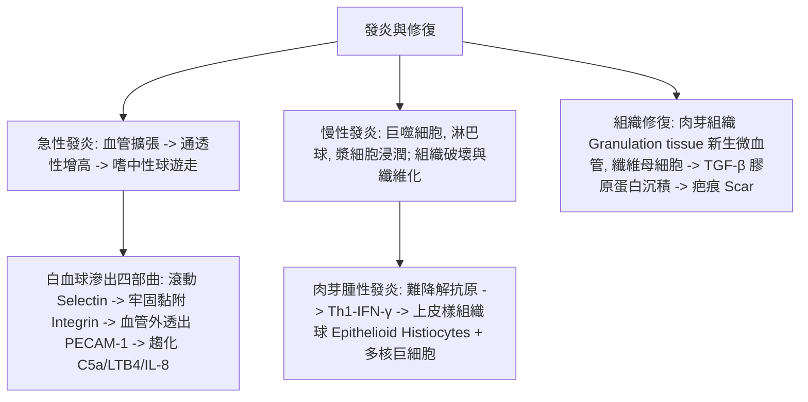

# 病理學 第02章 急性與慢性發炎、組織修復與肉芽腫

## 核心知識體系架構
發炎反應為機體對抗感染與損傷之防衛武器。本章涵蓋急性發炎（血管口徑與通透性改變、嗜中性球白血球遊走四部曲：滾動、牢固黏附、透出、趨化）；發炎化學介質（組織胺、前列腺素、白三烯素、補體 C3a/C5a）；慢性發炎特徵；肉芽腫性發炎（Granulomatous Inflammation）之免疫病理；以及組織修復（肉芽組織形成與疤痕癒合）。

---

## 主題一：急性發炎白血球遊走渗出（Leukocyte Extravasation）四部曲

### 1. 血管內皮與嗜中性球分子黏附分子精準矩陣
| 遊走步驟階段 | 白血球表面受體分子 | 血管內皮細胞表面配體分子 | 調控介質因子 | 遺傳缺損疾病與國考考點 |
| :--- | :--- | :--- | :--- | :--- |
| **1. 滾動 (Rolling)** | **Sialyl-Lewis X 寡糖**、L-Selectin | **E-Selectin**（內皮）、**P-Selectin**（儲存於內皮 **Weibel-Palade 小體** 及血小板 $\alpha$ 顆粒） | 組織胺、凝血酶促使 P-selectin 快速外翻質膜；TNF-$\alpha$、IL-1 誘導 E-selectin 合成 | **白血球黏附缺乏症 2 型（LAD-2）**：岩藻糖轉運缺陷，缺乏 Sialyl-Lewis X，白血球無法滾動。 |
| **2. 牢固黏附 (Firm Adhesion)** | **整合素（$\beta_2$-Integrins：LFA-1 [CD11a/CD18], Mac-1 [CD11b/CD18]）** | **ICAM-1（CD54）**、VCAM-1 | 趨化因子活化白血球，使低親和力 Integrin 變構為高親和力狀態；TNF/IL-1 上調 ICAM-1 | **白血球黏附缺乏症 1 型（LAD-1）**：體染色體隱性遺傳 **CD18（$\beta_2$ 整合素次單元）突變**！白血球無法牢固黏附。 臨床特徵：**臍帶脫落嚴重延遲（$> 30$ 天）**、反覆壞死性皮膚黏膜感染、**感染病灶完全沒有膿液（Absent pus）**、血液中白血球極度增高。 |
| **3. 透出 (Transmigration / Diapedesis)** | **PECAM-1（CD31）** | **PECAM-1（CD31）** | 嗜中性球經內皮細胞間隙擠出血管外 | CD31 同型二聚體相互作用。 |
| **4. 趨化 (Chemotaxis)** | G 蛋白偶聯趨化受體 | 組織間隙化學趨化梯度 | **四大最強趨化因子（國考必考！）**： 1. **$C5a$**（補體裂解產物） 2. **$LTB_4$**（白三烯素 $B_4$） 3. **$IL-8$（CXCL8）** 4. **細菌甲醯胜肽（$fMLP$）** | 嗜中性球順濃度梯度向感染壞死核心阿米巴樣前進。 |

---

## 主題二：發炎化學介質（Chemical Mediators）速記

### 1. 關鍵發炎介質來源與特異功能
- **組織胺（Histamine）**：儲存於肥大細胞、嗜鹼性球顆粒中。受物理刺激、IgE（Type I 過敏）或補體 **$C3a, C5a$（過敏毒素 Anaphylatoxins）** 刺激釋放。**瞬時引起小動脈擴張及微血管後小靜脈內皮收縮（增加血管通透性，引起水腫）**。
- **花生四烯酸代謝產物（類二十烷酸 Eicosanoids）**：
  - **環氧化酶途徑（COX）**：
    - **$PGE_2$**：致熱（作用於下視丘）、致痛（敏化痛覺受器）、小動脈擴張。
    - **$PGI_2$（前列環素）**：血管擴張、強烈抑制血小板凝集。
    - **$TXA_2$（血栓素）**：血小板合成，強烈收縮血管、促進血小板凝集。
  - **脂氧化酶途徑（5-LOX）**：
    - **$LTB_4$**：最強嗜中性球趨化因子及活化劑。
    - **$LTC_4, LTD_4, LTE_4$（原稱慢反應過敏物質 SRS-A）**：極強之支氣管痙攣收縮劑（強度為組織胺 1000 倍！）及增加微血管通透性。

---

## 主題三：肉芽腫性發炎（Granulomatous Inflammation）病理學

### 1. 肉芽腫免疫形成機轉與組成要素
- **定義**：一種特殊形態之慢性發炎，機體面對**難以被嗜中性球或巨噬細胞消化清除的抗原或異物**時所啟動的延遲型第四型過敏反應（Type IV Hypersensitivity）。
- **細胞級聯對話核心**：
  1. 巨噬細胞吞噬難降解抗原，呈遞給抗原特異性 CD4+ T 細胞。
  2. 巨噬細胞釋放 **IL-12**，誘導 CD4+ T 細胞分化為 **Th1 細胞**。
  3. Th1 細胞分泌核心細胞因子：**干擾素-$\gamma$（IFN-$\gamma$）** 及 **TNF-$\alpha$**。
  4. **IFN-$\gamma$ 強烈活化巨噬細胞**，使其變形為具強大分泌與殺菌能力之 **上皮樣組織球（Epithelioid Histiocytes，肉芽腫之絕對必備診斷核心！）**。
  5. 多個上皮樣細胞互相融合，形成巨大多核巨細胞（**郎罕氏巨細胞 Langhans giant cells**，核呈馬蹄形或花環狀排列於周邊）。
  6. **TNF-$\alpha$** 負責維持肉芽腫之結構完整（使用抗 TNF 藥物如 Infliximab 會瓦解肉芽腫，導致潛伏結核病猛烈復發！）。
- **肉芽腫分類鑑別**：
  - **乾酪性肉芽腫（Caseating）**：中央有乾酪樣壞死（粉紅無定形殘屑）。見於：**結核病（TB）**、貓抓病（化膿性肉芽腫）、深層真菌感染。
  - **非乾酪性肉芽腫（Non-caseating）**：中央無壞死。見於：**類肉瘤病（Sarcoidosis，雙側肺門淋巴結腫大、非乾酪肉芽腫）**、克隆氏症（Crohn's disease）、異物肉芽腫（手術縫線、鈹中毒 Berylliosis）。

---

## 歷屆國考核心真題解析

### 【國考經典真題實戰】
**【試題編號】111-第一次-med2-076**
> **題目**：產生interleukin-17的T淋巴球缺乏，此狀況與下列何種病灶最有關？
- (A) 很多嗜中性白血球（neutrophils）浸潤的炎症
- (B) 尋常型天皰瘡（pemphigus vulgaris）
- (C) 類天皰瘡（bullous pemphigoid）
- (D) 冷膿瘍（cold abscess）

> **標準答案**：`D`
> 
> **【考點深度解析與選項拆解】**：
- **(A) 選項分析**：很多嗜中性白血球（neutrophils）浸潤的炎症。核對細胞病理形態學變化（如嗜酸性增加、核碎裂或組織間質沉積），驗證其病理診斷符合性。
- **(B) 選項分析**：尋常型天皰瘡（pemphigus vulgaris）。比對發炎化學介質、自體抗體專一性或血栓形成 Virchow 三要素，剖析考選部常見陷阱。
- **(C) 選項分析**：類天皰瘡（bullous pemphigoid）。辨析壞死亞型（凝固性 vs. 液化性）或過敏反應型別（Type I~IV），排除干擾選項。
- **(D) 選項分析**：冷膿瘍（cold abscess）。綜合顯微鏡下特徵或器官代償極限，確認題幹命題之病理學核心機制。
> **【國考核心解題金鑰】**：本題精確選出 **(D)**。考生須精通細胞凋亡內在/外在路徑、六大壞死型態之組織學判讀及各型過敏反應分子媒介，即可秒殺破題。

---
### 【國考經典真題實戰】
**【試題編號】111-第一次-med2-093**
> **題目**：關於炎症性腸病（inflammatory bowel disease）之敘述，何者錯誤？
- (A) 克隆氏症（Crohn disease）又稱區域性腸炎（regional enteritis）
- (B) 克隆氏症（Crohn disease）為全壁性發炎
- (C) 跳躍式病灶（skip lesion）為潰瘍性結腸炎（ulcerative colitis）的特徵
- (D) 潰瘍性結腸炎（ulcerative colitis）病人罹患大腸癌的機會比正常人高

> **標準答案**：`C`
> 
> **【考點深度解析與選項拆解】**：
- **(A) 選項分析**：克隆氏症（Crohn disease）又稱區域性腸炎（regional enteritis）。核對細胞病理形態學變化（如嗜酸性增加、核碎裂或組織間質沉積），驗證其病理診斷符合性。
- **(B) 選項分析**：克隆氏症（Crohn disease）為全壁性發炎。比對發炎化學介質、自體抗體專一性或血栓形成 Virchow 三要素，剖析考選部常見陷阱。
- **(C) 選項分析**：跳躍式病灶（skip lesion）為潰瘍性結腸炎（ulcerative colitis）的特徵。辨析壞死亞型（凝固性 vs. 液化性）或過敏反應型別（Type I~IV），排除干擾選項。
- **(D) 選項分析**：潰瘍性結腸炎（ulcerative colitis）病人罹患大腸癌的機會比正常人高。綜合顯微鏡下特徵或器官代償極限，確認題幹命題之病理學核心機制。
> **【國考核心解題金鑰】**：本題精確選出 **(C)**。考生須精通細胞凋亡內在/外在路徑、六大壞死型態之組織學判讀及各型過敏反應分子媒介，即可秒殺破題。

---
### 【國考經典真題實戰】
**【試題編號】111-第二次-第一階段-med2-076**
> **題目**：下列何者之典型病理變化，最不可能是肉芽腫性發炎（granulomatous inflammation）？
- (A) 痳瘋（leprosy）
- (B) 類肉瘤（sarcoidosis）
- (C) 潰瘍性大腸炎（ulcerative colitis）
- (D) 結核（tuberculosis）

> **標準答案**：`C`
> 
> **【考點深度解析與選項拆解】**：
- **(A) 選項分析**：痳瘋（leprosy）。核對細胞病理形態學變化（如嗜酸性增加、核碎裂或組織間質沉積），驗證其病理診斷符合性。
- **(B) 選項分析**：類肉瘤（sarcoidosis）。比對發炎化學介質、自體抗體專一性或血栓形成 Virchow 三要素，剖析考選部常見陷阱。
- **(C) 選項分析**：潰瘍性大腸炎（ulcerative colitis）。辨析壞死亞型（凝固性 vs. 液化性）或過敏反應型別（Type I~IV），排除干擾選項。
- **(D) 選項分析**：結核（tuberculosis）。綜合顯微鏡下特徵或器官代償極限，確認題幹命題之病理學核心機制。
> **【國考核心解題金鑰】**：本題精確選出 **(C)**。考生須精通細胞凋亡內在/外在路徑、六大壞死型態之組織學判讀及各型過敏反應分子媒介，即可秒殺破題。