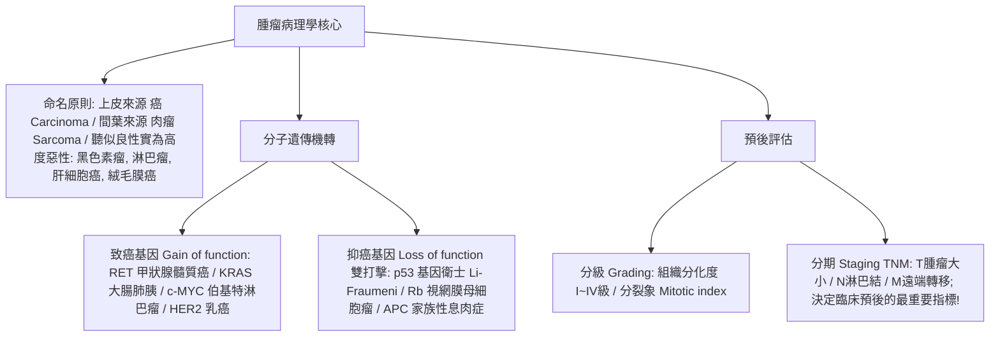

# 病理學 第05章 腫瘤病理學：分子機轉、命名與分期

## 核心知識體系架構
腫瘤學為國考病理最高頻單元。涵蓋良性 vs. 惡性腫瘤命名法則（癌 Carcinoma、肉瘤 Sarcoma、畸胎瘤 Teratoma、造釉細胞瘤等名詞特例）；癌症核心標誌（Hallmarks of Cancer）；原致癌基因（Proto-oncogenes）活化與抑癌基因（Tumor Suppressor Genes）雙重打擊學說（Knudson's Two-hit Hypothesis，p53, Rb, APC, BRCA1/2）；微小核糖核酸與表觀遺傳；腫瘤標記（Tumor Markers）；以及分級（Grading）vs. 分期（Staging TNM）。

---

## 主題一：腫瘤命名學與名詞陷阱大破解

### 1. 考選部「聽似良性、實為高度惡性」魔鬼名詞鑑別矩陣
| 醫學名詞 | 組織學來源與本質 | 生物學行為（良性 vs. 惡性） | 國考關鍵鑑別考點 |
| :--- | :--- | :--- | :--- |
| **黑色素瘤 (Melanoma)** | 神經脊來源之黑色素細胞 | **極度惡性（Malignant）** | 絕非良性痣！易早期血行轉移與淋巴轉移，BRAF V600E 突變常見。 |
| **淋巴瘤 (Lymphoma)** | 淋巴造血組織（B 或 T 淋巴球） | **絕對惡性（Malignant）** | 無良性淋巴瘤！包括霍奇金氏與非霍奇金氏淋巴瘤。 |
| **精原細胞瘤 (Seminoma)** | 睪丸生殖細胞（Germ cells） | **高度惡性（Malignant）** | 對放射線治療高度敏感，預後極佳。女性對應物為無性細胞瘤（Dysgerminoma）。 |
| **間皮瘤 (Mesothelioma)** | 胸膜、腹膜間皮細胞 | **高度惡性（Malignant）** | 與長期**石綿（Asbestos）暴露**具高度專一相關性。 |
| **肝細胞癌 (Hepatoma)** | 肝實質肝細胞 | **惡性（HCC）** | 舊稱 Hepatoma 易誤認為良性，實為肝細胞惡性腫瘤。 |
| **星狀膠質瘤 (Astrocytoma)** | 中樞神經星狀膠細胞 | **惡性（Grade II~IV）** | 第 IV 級膠質母細胞瘤（Glioblastoma multiforme, GBM）為最凶險腦瘤。 |
| **骨髓瘤 (Multiple Myeloma)** | 骨髓終末分化之漿細胞（Plasma cells） | **高度惡性（Malignant）** | 骨質溶骨性打孔病變（Punched-out lesions）、Bence-Jones 蛋白尿。 |
| **畸胎瘤 (Teratoma)** | 全能生殖細胞（含三胚層組織） | **成熟型為良性；未成熟型為惡性** | 卵巢成熟囊性畸胎瘤（皮樣囊腫 Dermoid cyst）多為良性；睪丸畸胎瘤在成人多為惡性！ |
| **錯構瘤 (Hamartoma)** | 該器官正常固有組織的**紊亂無序過度增生** | **完全良性（Benign）** | **非真正腫瘤**！肺錯構瘤（含軟骨、脂肪與上皮，X 光呈現「爆米花樣鈣化」）。 |
| **迷離瘤 (Choristoma)** | 正常組織出現在**異常解剖部位（異位組織 Heterotopia）** | **完全良性（Benign）** | **非真正腫瘤**！例如十二指腸黏膜下出現正常的胰臟組織（異位胰臟）。 |

---

## 主題二：致癌基因（Oncogenes）vs. 抑癌基因（TSGs）分子遺傳學

### 1. 核心原致癌基因（Proto-oncogenes：Gain-of-Function 顯性）
- **生長因子受體與酪胺酸激酶**：
  - **$RET$**：受體酪胺酸激酶，點突變見於 **MEN 2A、MEN 2B 及家族性甲狀腺髓質癌（MTC）**。
  - **$ERBB2$（$HER2/neu$）**：受體酪胺酸激酶基因放大，見於 **20% 侵襲性乳癌**及部分胃癌。
  - **$KIT$（$c-Kit$）**：幹細胞生長因子受體，見於 **胃腸道基質瘤（GIST）**（Imatinib 標靶）。
- **細胞內信號傳導蛋白**：
  - **$KRAS$**：GTPase 信號開關，點突變喪失水解 GTP 能力，持續發出增殖信號。見於 **大腸癌、胰臟腺癌（$> 90\%$）、肺腺癌**。
  - **$BRAF$**：絲胺酸/蘇胺酸激酶，**V600E 突變** 見於 **黑色素瘤、甲狀腺乳突癌（PTC）、毛細胞白血病**。
- **核內轉錄因子與抗凋亡蛋白**：
  - **$c-MYC$**：核轉錄因子，**$t(8;14)$ 染色體易位** 將 c-MYC 移至 IgH 增強子旁，見於 **伯基特淋巴瘤（Burkitt lymphoma）**。
  - **$N-MYC$**：基因放大見於 **神經母細胞瘤（Neuroblastoma）**，為重要不良預後指標。
  - **$BCL-2$**：粒線體抗凋亡蛋白，**$t(14;18)$ 染色體易位** 導致 BCL-2 過度表現阻斷凋亡，見於 **濾泡型淋巴瘤（Follicular lymphoma）**。

### 2. 抑癌基因（Tumor Suppressor Genes：Loss-of-Function 隱性雙打擊）
- **$TP53$（編碼 p53 蛋白，「基因組守護者 Guardian of the Genome」）**：
  - 當 DNA 受損時，p53 活化上調 **p21（CDK 抑制劑）** 使細胞週期停滯於 **G1/S 期檢查點** 進行修復；若 DNA 修復失敗，則誘導 Bax/Puma 啟動細胞凋亡。
  - **超過 50% 的人類惡性腫瘤存在 TP53 突變**！
  - **Li-Fraumeni 症候群**：體染色體顯性遺傳單一胚系 TP53 突變，青年期多發肉瘤、乳癌、腦瘤、白血病及腎上腺皮質癌。
- **$RB1$（編碼 Rb 蛋白，「細胞週期主閘門 Governor of the Cell Cycle」）**：
  - 抑制轉錄因子 **E2F**。未磷酸化（低磷酸化）之活性 Rb 緊密結合併鎖死 E2F，阻止細胞進入 S 期；當 Cyclin D-CDK4/6 將 Rb 磷酸化過後，E2F 釋放，細胞跨越 G1/S 檢查點。
  - 雙等位基因失活見於 **視網膜母細胞瘤（Retinoblastoma）** 及骨肉瘤（Osteosarcoma）。
  - **病毒致癌蛋白滅活機轉**：**高危險型 HPV 16/18 之 E6 蛋白促進 p53 泛素化降解**；**E7 蛋白結合併抑制 Rb**！

---

## 主題三：臨床高頻腫瘤標記（Tumor Markers）精準速查表

| 腫瘤標記物 | 臨床特異性腫瘤關聯 | 臨床非腫瘤良性狀況升高峰值 | 主要臨床價值 |
| :--- | :--- | :--- | :--- |
| **$\alpha$-胎兒蛋白 (AFP)** | **肝細胞癌（HCC）、睪丸卵黃囊瘤（Yolk sac tumor / 內胚竇瘤）** | 懷孕、肝炎、肝硬化 | 肝癌高危險群篩檢、睪丸非精原細胞瘤療效監測 |
| **癌胚抗原 (CEA)** | **大腸直腸癌（Colorectal cancer）**、胰臟癌、胃癌、乳癌 | 重度抽菸者、潰瘍性結腸炎、肝硬化 | **不適用於初篩**！專門用於術後復發監測與轉移追蹤 |
| **CA-125** | **卵巢表面上皮癌（漿液性卵巢癌 Serous carcinoma）** | 子宮內膜異位症、骨盆腔發炎、懷孕、腹水 | 停經後卵巢腫塊評估與術後復發監控 |
| **CA 19-9** | **胰臟腺癌（Pancreatic adenocarcinoma）**、膽道癌 | 膽汁鬱積、膽管炎、胰臟炎 | 胰臟癌診斷與預後評估（Lewis 抗原陰性者不表現） |
| **PSA（前列腺特異抗原）** | **前列腺腺癌（Prostate adenocarcinoma）** | 良性攝護腺肥大（BPH）、前列腺炎、直腸指檢後 | 前列腺癌篩檢與根治術後復發監控（游離 PSA 比率低提示惡性） |
| **hCG（人絨毛膜促性腺素）** | **妊娠絨毛膜癌（Choriocarcinoma）、葡萄胎、睪丸胚胎癌** | 懷孕 | 滋養層細胞腫瘤之絕對診斷與治癒指標 |

---

## 歷屆國考核心真題解析

### 【國考經典真題實戰】
**【試題編號】111-第一次-med2-078**
> **題目**：下列何種染色體／基因異常變化，常見於大部分的Ewing sarcoma family tumors（ESFT），並可據此作為分子 診斷ESFT？
- (A) trisomy 22
- (B) (11;22)(q24;q12) translocation
- (C) 1p19q co-deletion
- (D) N-MYC amplification

> **標準答案**：`B`
> 
> **【考點深度解析與選項拆解】**：
- **(A) 選項分析**：trisomy 22。核對腫瘤免疫組化染色（IHC）、心肌梗塞時序病理變化或胃腸道發炎組織切片特徵，審定其符合度。
- **(B) 選項分析**：(11;22)(q24;q12) translocation。審查致癌基因（Oncogene）與抑癌基因（TSG）突變模式、或克隆氏症與潰瘍性結腸炎之病變深度，剖析誘答陷阱。
- **(C) 選項分析**：1p19q co-deletion。檢驗微細組織學標誌（如印戒細胞、Aschoff小體、Charcot-Leyden結晶），排除干擾選項。
- **(D) 選項分析**：N-MYC amplification。綜合腫瘤TNM分期或併發症時間窗口，驗證題幹核心命題本意。
> **【國考核心解題金鑰】**：本題精準鎖定標準答案 **(B)**。考生須融會貫通心肌梗塞 24小時至2週之顯微鏡與破裂併發症演進、肺癌與胃腸道腫瘤之分子病理標誌，即可十拿九穩。

---
### 【國考經典真題實戰】
**【試題編號】111-第一次-med2-079**
> **題目**：7歲小男孩平時健康，最近因不小心跌倒，右腿呈現瘀傷疼痛。X光檢查發現右側遠端股骨（distal femur）有 一約0.3公分、偏離中軸且呈多葉狀（eccentric and lobulated）、放射線通透（radiolucency）之疑似腫瘤病 灶。根據上述，該病人最可能罹患的疾病是：
- (A) fibrous cortical defect
- (B) fibrous dysplasia
- (C) giant cell tumor
- (D) chondrosarcoma

> **標準答案**：`A`
> 
> **【考點深度解析與選項拆解】**：
- **(A) 選項分析**：fibrous cortical defect。核對腫瘤免疫組化染色（IHC）、心肌梗塞時序病理變化或胃腸道發炎組織切片特徵，審定其符合度。
- **(B) 選項分析**：fibrous dysplasia。審查致癌基因（Oncogene）與抑癌基因（TSG）突變模式、或克隆氏症與潰瘍性結腸炎之病變深度，剖析誘答陷阱。
- **(C) 選項分析**：giant cell tumor。檢驗微細組織學標誌（如印戒細胞、Aschoff小體、Charcot-Leyden結晶），排除干擾選項。
- **(D) 選項分析**：chondrosarcoma。綜合腫瘤TNM分期或併發症時間窗口，驗證題幹核心命題本意。
> **【國考核心解題金鑰】**：本題精準鎖定標準答案 **(A)**。考生須融會貫通心肌梗塞 24小時至2週之顯微鏡與破裂併發症演進、肺癌與胃腸道腫瘤之分子病理標誌，即可十拿九穩。

---
### 【國考經典真題實戰】
**【試題編號】111-第一次-med2-083**
> **題目**：遺傳性的視網膜母細胞瘤（familial retinoblastoma）之病患，最常繼發下列那一種惡性腫瘤？
- (A) Leukemia
- (B) Lymphoma
- (C) Osteosarcoma
- (D) Hepatoblastoma

> **標準答案**：`C`
> 
> **【考點深度解析與選項拆解】**：
- **(A) 選項分析**：Leukemia。核對腫瘤免疫組化染色（IHC）、心肌梗塞時序病理變化或胃腸道發炎組織切片特徵，審定其符合度。
- **(B) 選項分析**：Lymphoma。審查致癌基因（Oncogene）與抑癌基因（TSG）突變模式、或克隆氏症與潰瘍性結腸炎之病變深度，剖析誘答陷阱。
- **(C) 選項分析**：Osteosarcoma。檢驗微細組織學標誌（如印戒細胞、Aschoff小體、Charcot-Leyden結晶），排除干擾選項。
- **(D) 選項分析**：Hepatoblastoma。綜合腫瘤TNM分期或併發症時間窗口，驗證題幹核心命題本意。
> **【國考核心解題金鑰】**：本題精準鎖定標準答案 **(C)**。考生須融會貫通心肌梗塞 24小時至2週之顯微鏡與破裂併發症演進、肺癌與胃腸道腫瘤之分子病理標誌，即可十拿九穩。