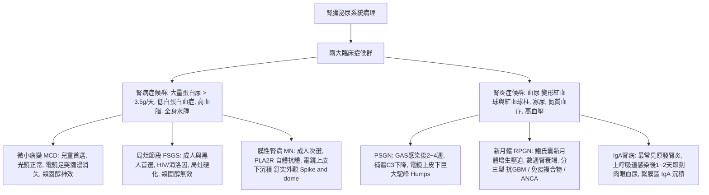

# 病理學 第09章 腎臟與泌尿生殖病理學：腎絲球腎炎與腫瘤

## 核心知識體系架構
腎臟與泌尿生殖病理為國考經典硬核考點。涵蓋腎病症候群（Nephrotic syndrome：微小病變 MCD、局灶節段性硬化 FSGS、膜性腎病 MN）vs. 腎炎症候群（Nephritic syndrome：鏈球菌感染後 PSGN、急進性新月體 RPGN、IgA 腎病 Berger's disease、膜增生性 MPGN）；電鏡與免疫螢光沉積部位鑑別；以及腎細胞癌（RCC）、膀胱尿路上皮癌與前列腺腺癌。

---

## 主題一：腎病症候群 vs. 腎炎症候群病理全圖譜

### 1. 核心腎絲球疾患顯微鏡（LM）、電鏡（EM）與免疫螢光（IF）三合一鑑別矩陣
| 疾病名稱 | 臨床症候群與好發族群 | 光學顯微鏡（LM）病理表現 | 電鏡（EM）超微結構關鍵特徵 | 免疫螢光（IF）沉積模式 | 臨床特點與預後 |
| :--- | :--- | :--- | :--- | :--- | :--- |
| **微小病變腎病 (MCD / Minimal Change Disease)** | **兒童腎病症候群最常見（佔 90%）** | **光鏡完全正常（看似正常）**；近曲小管上皮細胞含脂質小滴（類脂性腎病） | **足細胞足突瀰漫性融合與消失（Effacement of foot processes）** | **陰性（無免疫複合物沉積）** | **高選擇性蛋白尿（主要為白蛋白）**。對皮質類固醇治療反應極神速（神藥 Response $> 90\%$），不留後遺症。 |
| **局灶節段性腎絲球硬化 (FSGS)** | **成人與非裔黑人腎病症候群最常見**；HIV 感染、海洛因成癮、重度肥胖 | **部分（局灶 Focal）腎絲球的部分毛細血管網（節段 Segmental）發生硬化與透明變性** | 足突廣泛融合與消失；足細胞自基底膜剝離 | 通常陰性；硬化區可見非特異性 IgM 與 C3 陷縮沉著 | **非選擇性蛋白尿**。對類固醇反應極差，50% 於 10 年內進展至終末期腎衰竭；換腎後極易高頻復發！ |
| **膜性腎病 (Membranous Nephropathy, MN)** | 白人成人腎病症候群最常見；**85% 為抗原原發性（抗 PLA2R 抗體）**；次發於 HBV/HCV、SLE（Class V）、實體腫瘤 | 毛細血管壁廣泛均勻瀰漫性增厚 | **上皮下（Subepithelial）電子緻密物沉積**，基底膜向外突出包繞沉積物，銀染色呈 **「釘突樣（Spike and dome pattern）」** | **顆粒狀（Granular）** 沿 GBM 沉積 IgG 與 C3 | 易合併腎靜脈血栓形成（RVTs，因大量尿中流失抗凝血酶 III）。對類固醇反應差。 |
| **急性鏈球菌感染後腎炎 (PSGN)** | **兒童腎炎症候群最常見**；A 群鏈球菌咽喉炎或膿痂疹感染後 2~4 週 | 腎絲球瀰漫性增大、細胞過度增生（內皮細胞與繫膜細胞增生，大量嗜中性球浸潤） | **上皮下（Subepithelial）巨大「駝峰狀」沉積物（Subepithelial Humps）** | **粗大顆粒狀（Lumpy-bumpy / Starry-sky）** 沿毛細血管壁與繫膜區沉積 IgG, IgM, C3 | 典型症狀：**可樂色或茶色血尿（Tea-colored urine）**、眼眶周圍水腫、血清補體 **$C3$ 大幅下降**，ASO 效價升高。兒童 $> 95\%$ 完全自癒康復。 |
| **急進性新月體腎炎 (RPGN)** | 暴發性腎炎症候群，數週至數月內進展至無尿性急性腎衰竭 | **鮑氏囊腔內形成典型「新月體（Crescents）」**（由增生的壁層上皮細胞與巨噬細胞構成，伴隨纖維蛋白 Fibrin 滲出沉積） | 基底膜嚴重斷裂穿孔 | **分三大免疫亞型（國考必考！）**： 1. **Type I（抗 GBM 抗體型）**：**線性（Linear）沉積 IgG/C3**（如 Goodpasture 症候群，肺出血+腎炎）。 2. **Type II（免疫複合物型）**：**顆粒狀（Granular）沉積**（SLE, PSGN 惡化）。 3. **Type III（微免疫/無沉積 Pauci-immune）**：**IF 陰性！血清 ANCA 陽性**（肉芽腫性多血管炎 GPA 為 c-ANCA/PR3；微小多血管炎 MPA 為 p-ANCA/MPO）。 | 預後凶險，需緊急給予大劑量皮質類固醇、環磷醯胺合併血漿置換！ |
| **IgA 腎病 (Berger's Disease)** | **全世界最常見之原發性腎絲球腎炎**；好發於兒童與青年男性 | 繫膜細胞與基質局灶或瀰漫性增生 | **繫膜區（Mesangial）電子緻密物大量沉積** | **繫膜區專一性粗顆粒狀 IgA（及 C3）強烈沉積** | **臨床金特徵：在上呼吸道或腸胃道黏膜感染當天或 1~2 天內，突發無痛性肉眼可見血尿（Synpharyngitic hematuria，潛伏期極短！不同於 PSGN 的數週延遲）**。反覆發作。 |

---

## 主題二：泌尿生殖系腫瘤病理學

### 1. 腎細胞癌（Renal Cell Carcinoma, RCC）
- **亮細胞型腎細胞癌（Clear Cell RCC，佔 70~80% 最常見）**：
  - 起源：**近曲小管（Proximal convoluted tubule）上皮**。
  - 分子遺傳學：第 3 號染色體短臂（$3p$）缺失，導致 **$VHL$ 抑癌基因突變失活** $\to$ 缺氧誘導因子 HIF-1$\alpha$ 無法被泛素化降解 $\to$ 大量轉錄 VEGF 與 PDGF 促進血管狂暴增生。
  - 顯微病理：細胞質清亮透明（富含大量甘油三酯與肝醣，石蠟切片中被溶劑洗脫），間質微血管網極其豐富。
  - **侵襲轉移特徵**：**極具血行侵襲傾向，直接侵犯腎靜脈形成瘤栓（Tumor thrombus），並沿下腔靜脈（IVC）向上蔓延直達右心房**！
  - 典型副腫瘤分泌：**紅血球生成素（EPO $\to$ 次發性紅血球增多症）**、PTHrP（高血鈣）、腎素（高血壓）。

### 2. 前列腺腺癌（Prostate Adenocarcinoma）
- **發生解剖分區**：**70~80% 好發於前列腺「周邊帶（Peripheral zone）」**（良性攝護腺增生 BPH 則好發於圍繞尿道的「移行帶 Transition zone」）。因此前列腺癌早期無排尿障礙，**直腸指檢（DRE）可輕易觸摸到後葉堅硬結節**。
- **組織病理與 Gleason 評分系統**：
  - 顯微鏡下失去正常基底細胞層（p63 染色陰性），腺體排列擁擠、核仁異常肥大突出。
  - **Gleason 評分**：完全依據**腺體結構架構異型度分級（1~5 分）**，取主要分型與次要分型分數相加（例如 $3 + 4 = 7$ 分），為評估前列腺癌侵襲性與預後的最核心指標！
- **骨轉移特徵**：極易經 Batson 脊椎靜脈叢血行轉移至腰椎骨與骨盆骨，呈現典型 **成骨性/造骨性骨轉移（Osteoblastic / Osteosclerotic bone metastases）**，血清鹼性磷酸酶（ALP）顯著升高。

---

## 歷屆國考核心真題解析

### 【國考經典真題實戰】
**【試題編號】111-第二次-第一階段-med2-094**
> **題目**：65 歲男病人呈現嚴重的蛋白尿。腎臟切片檢查顯示腎絲球病變中並無免疫複合體或補體沉積。根據本題圖示 及病人臨床表現，下列腎病中何者是最可能的病理診斷？
- (A) membranous nephropathy
- (B) diabetic glomerulopathy
- (C) minimal change nephropathy
- (D) IgA nephropathy

> **標準答案**：`B`
> 
> **【考點深度解析與選項拆解】**：
- **(A) 選項分析**：membranous nephropathy。核對腎絲球光鏡/電鏡特徵、淋巴造血免疫組化分型或神經內分泌病理標記，評定其診斷相符性。
- **(B) 選項分析**：diabetic glomerulopathy。審查染色體特異性易位標誌、基因突變靶點或微細包涵體結構，剖析考選部經典誘答陷阱。
- **(C) 選項分析**：minimal change nephropathy。檢驗臨床症候群歸屬（如腎病 vs. 腎炎、Hodgkin vs. Non-Hodgkin），排除混淆選項。
- **(D) 選項分析**：IgA nephropathy。綜合顯微鏡下典型特徵（如孤兒安妮眼、砂粒體、Auer小體），確認題幹之核心命題意旨。
> **【國考核心解題金鑰】**：本題標準答案為 **(B)**。考生須牢記腎絲球沉積物部位（上皮下 vs. 內皮下）、白血病/淋巴瘤染色體標記及甲狀腺乳突癌核特徵，即可秒殺奪冠。

---
### 【國考經典真題實戰】
**【試題編號】112-第一次-med2-093**
> **題目**：有關腎臟微小病變（minimal-change disease）之特徵，下列敘述何者最適當？
- (A) 最主要的病理變化為腎小球中的壁上皮細胞（parietal epithelial cells）的足突消失
- (B) 腎小球的基底膜變厚
- (C) 近側腎小管上皮有脂質沉積
- (D) 在人類此疾病已證實與血管新生因子（angiopoietin-like 1）有密切關係

> **標準答案**：`C`
> 
> **【考點深度解析與選項拆解】**：
- **(A) 選項分析**：最主要的病理變化為腎小球中的壁上皮細胞（parietal epithelial cells）的足突消失。核對腎絲球光鏡/電鏡特徵、淋巴造血免疫組化分型或神經內分泌病理標記，評定其診斷相符性。
- **(B) 選項分析**：腎小球的基底膜變厚。審查染色體特異性易位標誌、基因突變靶點或微細包涵體結構，剖析考選部經典誘答陷阱。
- **(C) 選項分析**：近側腎小管上皮有脂質沉積。檢驗臨床症候群歸屬（如腎病 vs. 腎炎、Hodgkin vs. Non-Hodgkin），排除混淆選項。
- **(D) 選項分析**：在人類此疾病已證實與血管新生因子（angiopoietin-like 1）有密切關係。綜合顯微鏡下典型特徵（如孤兒安妮眼、砂粒體、Auer小體），確認題幹之核心命題意旨。
> **【國考核心解題金鑰】**：本題標準答案為 **(C)**。考生須牢記腎絲球沉積物部位（上皮下 vs. 內皮下）、白血病/淋巴瘤染色體標記及甲狀腺乳突癌核特徵，即可秒殺奪冠。

---
### 【國考經典真題實戰】
**【試題編號】113-第一次-med2-084**
> **題目**：下列何種疾病最可能藉由抑制前列腺素E2（prostaglandin E2）來治療？
- (A) 開放動脈導管（patent ductus arteriosus）
- (B) 心房中膈缺損（atrial septal defect）
- (C) 心室中膈缺損（ventricular septal defect）
- (D) 主動脈閉鎖（aortic atresia）

> **標準答案**：`A`
> 
> **【考點深度解析與選項拆解】**：
- **(A) 選項分析**：開放動脈導管（patent ductus arteriosus）。核對腎絲球光鏡/電鏡特徵、淋巴造血免疫組化分型或神經內分泌病理標記，評定其診斷相符性。
- **(B) 選項分析**：心房中膈缺損（atrial septal defect）。審查染色體特異性易位標誌、基因突變靶點或微細包涵體結構，剖析考選部經典誘答陷阱。
- **(C) 選項分析**：心室中膈缺損（ventricular septal defect）。檢驗臨床症候群歸屬（如腎病 vs. 腎炎、Hodgkin vs. Non-Hodgkin），排除混淆選項。
- **(D) 選項分析**：主動脈閉鎖（aortic atresia）。綜合顯微鏡下典型特徵（如孤兒安妮眼、砂粒體、Auer小體），確認題幹之核心命題意旨。
> **【國考核心解題金鑰】**：本題標準答案為 **(A)**。考生須牢記腎絲球沉積物部位（上皮下 vs. 內皮下）、白血病/淋巴瘤染色體標記及甲狀腺乳突癌核特徵，即可秒殺奪冠。