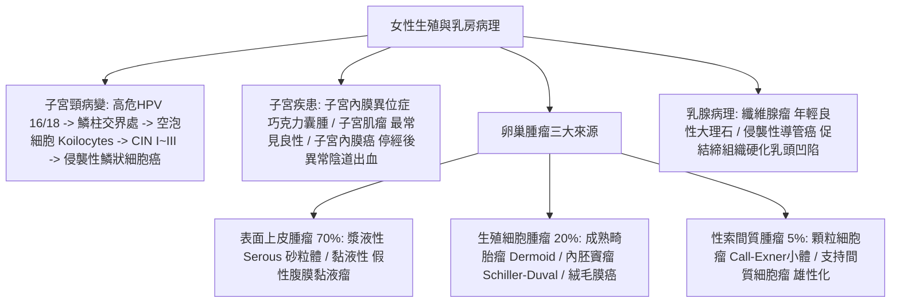

# 病理學 第10章 女性生殖與乳房病理學：子宮、卵巢與乳癌

## 核心知識體系架構
女性生殖與乳腺病理涵蓋子宮頸癌前病變（CIN / SIL）與高危險型 HPV（16, 18）；子宮內膜異位症（Chocolate cyst）與子宮內膜癌；卵巢腫瘤三大來源（表面上皮-間質腫瘤、生殖細胞腫瘤、性索-間質腫瘤）；以及乳腺良惡性病變（纖維腺瘤、葉狀腫瘤、乳腺導管原位癌 DCIS、侵襲性乳腺癌分子分型 Luminal A/B, HER2+, TNBC）。

---

## 主題一：子宮頸癌（Cervical Cancer）與 HPV 病毒病理學

### 1. 致病機轉與細胞病理學特徵
- **高危險型 HPV（High-risk HPV Types 16 & 18，佔 70%）**：
  - 感染子宮頸外口之 **鱗狀-柱狀上皮交界處（Squamocolumnar Junction / 轉型區 Transformation zone）**。
  - **核心致癌蛋白**：
    - **E6 蛋白**：專一性結合併促進 **p53 抑癌蛋白** 泛素化蛋白酶體水解，阻斷細胞凋亡。
    - **E7 蛋白**：結合併抑制 **Rb 抑癌蛋白**，游離轉錄因子 E2F，驅動細胞週期無序進入 S 期。
- **宮頸抹片特徵細胞學診斷：空泡細胞（Koilocytes）**：
  - 顯微鏡下可見複層鱗狀上皮細胞之**細胞核增大、深染、核膜皺縮如葡萄乾，胞核周圍出現界限清楚之巨大透明空暈（Perinuclear halo）**，為 HPV 病毒感染之絕對特徵性細胞病理標誌！
- **子宮頸上皮內贅瘤（CIN）分級**：
  - **CIN I（低度病變 LSIL）**：異型不典型增生細胞局限於上皮層下 **$1/3$**，多數（60%）可自發消退。
  - **CIN II（高度病變 HSIL）**：累及上皮層下 **$2/3$**。
  - **CIN III（高度病變 HSIL / 原位癌 CIS）**：異常未分化細胞佔據上皮層 **超過 $2/3$ 直至全層**，基底膜完整。需進行圓錐切除（LEEP/Cone biopsy）以防浸潤穿透基底膜發展為侵襲性鱗狀細胞癌。

---

## 主題二：卵巢腫瘤三大來源分類精萃

### 1. 卵巢腫瘤組織起源與特異組織學標誌矩陣
| 組織發生分類 | 腫瘤名稱 | 顯微鏡下特徵病理構造 | 腫瘤標記物與內分泌特徵 | 臨床特點與生物學行為 |
| :--- | :--- | :--- | :--- | :--- |
| **表面上皮-間質腫瘤 (65~70%)** | **漿液性囊腺癌 (Serous Carcinoma)** | 乳突狀分支生長、同心圓層狀鈣化小球——**砂粒體（Psammoma bodies）** | **CA-125 顯著升高**；常伴隨 **$BRCA1/BRCA2$ 突變** 及 **$TP53$ 突變** | 最常見之惡性卵巢癌（佔 50%），雙側累及多見，早期經腹膜廣泛種植轉移。 |
| | **黏液性囊腺瘤/癌 (Mucinous)** | 多房性巨大囊腔，內壁襯以富含中性黏蛋白的單層柱狀上皮（含杯狀細胞） | 腫瘤破裂可引發**腹膜假黏液瘤（Pseudomyxoma peritonei / 凝膠腹腔）** | 囊腫體積常極為龐大（可重達數十公斤）。常需排除闌尾原發黏液腺癌轉移！ |
| **生殖細胞腫瘤 (15~20%)** | **成熟囊性畸胎瘤 (Dermoid Cyst)** | 囊內含有毛髮、皮脂、牙齒、軟骨、骨骼及甲狀腺組織（全三胚層組織） | 若甲狀腺組織佔優勢稱為**卵巢甲狀腺腫（Struma ovarii）**，可分泌甲狀腺素引發甲狀腺毒症！ | 青年女性最常見之卵巢腫瘤，**良性**。偶可發生惡性轉化（以皮膚成分轉化為鱗狀細胞癌最常見）。 |
| | **無性細胞瘤 (Dysgerminoma)** | 細胞巨大、多角形、胞質富含肝醣透明清亮，被**富含淋巴球浸潤的纖維間質小梁分隔** | **LDH 升高**、hCG 微量升高 | 睪丸精原細胞瘤之女性對應物，年輕女性惡性生殖細胞瘤最常見。對放療極度敏感。 |
| | **內胚竇瘤 (Yolk Sac Tumor / 卵黃囊瘤)** | **席-杜氏小體（Schiller-Duval Bodies）**：中心為一根毛細血管，外被單層立方形腫瘤細胞包繞，外周環繞空腔，宛如腎小球樣結構！ | **$\alpha$-胎兒蛋白（AFP）極度升高**！胞質內外見 PAS 陽性透明小球 | 兒童與年輕女性高度惡性腫瘤，生長極速。 |
| **性索-間質腫瘤 (5~10%)** | **顆粒細胞瘤 (Granulosa Cell Tumor)** | **考-艾氏小體（Call-Exner Bodies）**：腫瘤細胞呈濾泡樣排列，圍繞嗜酸性粉染中心物；細胞核具縱行深溝，呈 **「咖啡豆樣核（Coffee-bean nuclei）」** | **大量分泌動情素（Estrogen）**！引起幼女**性早熟**、成人子宮內膜增生過度、停經後異常陰道出血及乳腺增生 | 低度惡性潛能，有晚期復發傾向（術後 10~20 年）。可伴發子宮內膜腺癌。 |
| | **支持-間質細胞瘤 (Sertoli-Leydig Tumor)** | 類似睪丸小管構造，間質見 Reinke 結晶 | **大量分泌雄性素（Androgens / 睪固酮）** | 引發女性男性化（多毛、聲音低沉、陰蒂肥大、閉經乳腺萎縮）。 |

---

## 主題三：乳腺癌（Breast Carcinoma）病理學

### 1. 侵襲性乳腺癌組織學亞型與分子分類
- **侵襲性導管癌（Invasive Ductal Carcinoma, IDC，佔 70~80% 最常見）**：
  - 顯微鏡下癌細胞呈巢狀、索狀排列，伴隨劇烈之促纖維基質增生反應（Desmoplasia），**腫瘤質地堅硬如石、邊緣不規則**。
  - 牽拉 Cooper 懸韌帶引起**皮膚局部凹陷（Dimpling）**；阻塞真皮真皮淋巴管引發淋巴水腫，呈現典型 **「橘皮樣外觀（Peau d'orange）」**；侵犯大導管引起乳頭回縮。
- **侵襲性小葉癌（Invasive Lobular Carcinoma, ILC，佔 10~15%）**：
  - **分子病理：$CDH1$ 基因突變缺陷，導致 E-cadherin 蛋白完全喪失**！
  - 顯微鏡下癌細胞缺乏黏附力，成單行無分支排列，呈典型 **「單行雁隊樣排列（Indian file pattern）」**，同心圓環繞正常導管。多中心性與**雙側乳房同時累及（Bilateral）機率極高**！
- **四種分子免疫組化分型（IHC）與臨床預後**：
  1. **Luminal A 型**：$ER(+), PR(+), HER2(-)$，Ki-67 低。預後最好，對荷爾蒙治療（Tamoxifen/芳香酶抑制劑）反應極佳。
  2. **Luminal B 型**：$ER(+), PR(+), HER2(-/+)$，Ki-67 高。侵襲性較高。
  3. **HER2 過度表現型**：$ER(-), PR(-), HER2(3+)$。侵襲性強，對抗 HER2 標靶單株抗體（Trastuzumab / Herceptin）具神效。
  4. **三陰性乳癌（Triple-Negative Breast Cancer, TNBC）**：$ER(-), PR(-), HER2(-)$。好發於年輕女性及 **$BRCA1$ 突變攜帶者**。侵襲性最高、內臟與腦轉移早、預後最差，對荷爾蒙與標靶治療均無效，僅能依靠常規化療。

---

## 歷屆國考核心真題解析

### 【國考經典真題實戰】
**【試題編號】114-第一次-med2-097**
> **題目**：完全性葡萄胎（complete hydatidiform mole）最常見的染色體核型為：
- (A) 46,XX
- (B) 69,XXY
- (C) 69,XXX
- (D) 92,XXXY

> **標準答案**：`A`
> 
> **【考點深度解析與選項拆解】**：
- **(A) 選項分析**：46,XX。核對腎絲球光鏡/電鏡特徵、淋巴造血免疫組化分型或神經內分泌病理標記，評定其診斷相符性。
- **(B) 選項分析**：69,XXY。審查染色體特異性易位標誌、基因突變靶點或微細包涵體結構，剖析考選部經典誘答陷阱。
- **(C) 選項分析**：69,XXX。檢驗臨床症候群歸屬（如腎病 vs. 腎炎、Hodgkin vs. Non-Hodgkin），排除混淆選項。
- **(D) 選項分析**：92,XXXY。綜合顯微鏡下典型特徵（如孤兒安妮眼、砂粒體、Auer小體），確認題幹之核心命題意旨。
> **【國考核心解題金鑰】**：本題標準答案為 **(A)**。考生須牢記腎絲球沉積物部位（上皮下 vs. 內皮下）、白血病/淋巴瘤染色體標記及甲狀腺乳突癌核特徵，即可秒殺奪冠。