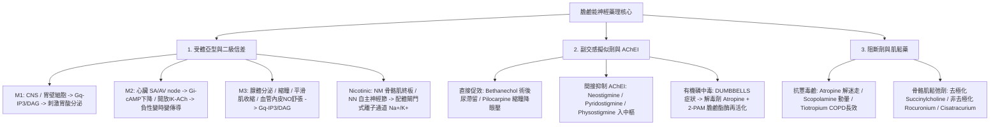

# 藥理學 第01章 自主神經藥理學：膽鹼能擬似與阻斷劑

> **考綱歸屬**：基礎與臨床藥理學 ｜ 醫師專技高考一階段 醫學（二）Q41~Q65 核心考點

---

## 本章導讀與知識架構定位

自主神經系統（ANS）為基礎與臨床藥理學奠基之石。膽鹼能神經系統涵蓋乙醯膽鹼（ACh）之合成、儲存、釋放與降解；蕈毒鹼型受體（$M_1, M_2, M_3$）與菸鹼型受體（$N_M, N_N$）；直接/間接作用之副交感擬似劑（Cholinomimetics）；抗膽鹼酯酶劑（AChEI）與重症肌無力（Myasthenia Gravis）應用；以及阿托品類抗蕈毒鹼藥物（Antimuscarinics）與神經肌肉阻斷劑（NMBAs）。

### 本章三大核心主題：
1. **主題 1.1：膽鹼能受體亞型與第二信差分佈全覽**（$M_1 \sim M_3$ 受體與 $G_q/G_i$ 偶聯、菸鹼型受體離子通道機轉）
2. **主題 1.2：抗膽鹼酯酶抑制劑（AChEI）與重症肌無力診治**（Edrophonium 鑑別試驗、三級胺 vs 四級銨 BBB 穿透性、有機磷中毒解毒機制）
3. **主題 1.3：神經肌肉阻斷劑（NMBAs）機轉與惡性高熱**（去極化 vs 非去極化阻斷、Phase I/II 特徵、Cisatracurium 自發消除、Dantrolene 解毒）

---

# 主題 1.1：膽鹼能受體亞型與第二信差分佈全覽

### 重點一：核心高頻速查矩陣

#### 1. 蕈毒鹼（Muscarinic）與菸鹼（Nicotinic）受體精準對照表

| 受體類型 | G 蛋白偶聯 / 傳導機轉 | 主要組織分佈 | 典型促效生理效應 | 專一性拮抗劑 / 臨床備註 |
| :--- | :--- | :--- | :--- | :--- |
| **$M_1$ 受體** | **$G_q$** • 活化 PLC $\to IP_3/DAG \to Ca^{2+}\uparrow$ | 中樞神經系統、胃壁細胞、自主神經節 | • 促進大腦認知功能 • 刺激胃酸分泌 | **Pirenzepine** • 選擇性 $M_1$ 阻斷劑，曾用於治療消化性潰瘍 |
| **$M_2$ 受體** | **$G_i$** • 抑制 AC $\to cAMP\downarrow$ • 開放 $I_{K,Ach}$ 鉀通道 | **心臟竇房結（SA node）** **房室結（AV node）**、心房肌 | • **負性變時（心跳減慢 HR $\downarrow$）** • **負性變傳導（AV 傳導延遲）** • 輕度負性變力 | **Atropine** • 非選擇性阻斷，解除迷走神經抑制使心跳加快，用於治療竇性心搏過緩 |
| **$M_3$ 受體** | **$G_q$** • 活化 PLC $\to IP_3/DAG \to Ca^{2+}\uparrow$ | • 外分泌腺體 • 瞳孔括約肌與睫狀肌 • 支氣管/胃腸/膀胱平滑肌 • 血管內皮細胞 | 1. **腺體分泌 $\uparrow$**（唾液、汗水、淚液） 2. **縮瞳（Miosis）**與睫狀肌收縮（調節痙攣，拉開小梁網降低眼壓） 3. 支氣管收縮、腸道蠕動 $\uparrow$、逼尿肌收縮 4. **血管內皮釋放 NO $\to$ 平滑肌舒張** | • **Darifenacin, Solifenacin**（選擇性 $M_3$ 阻斷劑，治療膀胱過動症 OAB） • **Ipratropium, Tiotropium**（吸入劑型，治療氣喘與 COPD） |
| **$N_M$ 受體** | **配體閘門式離子通道** • $Na^+/K^+$ 內向流動去極化 | **神經肌肉交界處（NMJ）** • 骨骼肌運動終板 | 骨骼肌終板去極化（EPP），引發動作電位與骨骼肌收縮 | • **Rocuronium, Tubocurarine**（非去極化阻斷） • **Succinylcholine**（去極化阻斷） |
| **$N_N$ 受體** | **配體閘門式離子通道** • $Na^+/K^+$ 內向流動去極化 | • 自主神經節（交感與副交感） • 腎上腺髓質嗜鉻細胞 | • 刺激節後神經元去極化興奮 • 促進腎上腺髓質釋放兒茶酚胺（Epi / NE） | **Hexamethonium, Mecamylamine** • 神經節阻斷劑（降血壓研究用） |

---

# 主題 1.2：抗膽鹼酯酶抑制劑（AChEI）與重症肌無力診治

### 重點一：乙醯膽鹼酯酶抑制劑家族大對決

- **【短效診斷劑：Edrophonium（Tensilon）】**
  - **化學結構**：四級銨化合物，與 AChE 催化中心**非共價靜電結合**，作用極短（5~15 分鐘）。
  - **Tensilon 試驗**：鑑別重症肌無力患者之兩大危象：
    - **肌無力危象（Myasthenic crisis，藥量不足）**：給予 Edrophonium 後肌力**顯著改善** $\to$ 處置需**增加** AChEI 劑量。
    - **膽鹼能危象（Cholinergic crisis，藥量過量）**：給予後肌力**惡化甚至呼吸麻痺** $\to$ 處置需**立即停用** AChEI 並給予 Atropine。

- **【中長效治療劑：三級胺 vs 四級銨 BBB 穿透對決】**
  - **新斯的明（Neostigmine）**：
    - **四級銨（不穿過血腦屏障 BBB）**。
    - 雙重機轉：除抑制 AChE 外，**還能直接促效骨骼肌 $N_M$ 受體**！
    - 臨床適應症：重症肌無力對症治療、逆轉非去極化肌肉鬆弛劑（術後拮抗 Tubocurarine）及術後腸麻痺/尿滯留。
  - **吡斯的明（Pyridostigmine）**：
    - **四級銨（不穿透 BBB）**。
    - 特性：口服吸收佳、半衰期較 Neostigmine 長（4~6 小時），為**重症肌無力長期口服維持治療之首選藥物**！
  - **毒扁豆鹼（Physostigmine）**：
    - **三級胺（脂溶性極高，能輕易穿透 BBB 進入中樞）**！
    - 臨床唯一首選：**阿托品中毒（Atropine overdose）及抗膽鹼藥物中樞毒性之特異性解毒劑**（絕不可用於重症肌無力！）。

- **【中樞退化治療：阿茲海默症 AChEI】**
  - 代表藥物：**Donepezil, Rivastigmine, Galantamine**。
  - 機轉：高脂溶性穿透 BBB，提升大腦皮質基底核乙醯膽鹼濃度，延緩輕中度失智症認知衰退。

---

### 重點二：有機磷酸酯中毒與急救雙搭檔

- **中毒機制**：
  - 農藥（Parathion, Malathion）或神經毒氣（Sarin）與 AChE 絲胺酸殘基形成共價結合磷酸化複合物。
  - **老化現象（Aging）**：若未在數小時內給予解毒劑，酵素-毒物鍵結將斷裂脫烷基化形成永久不可逆鍵結，無法挽救。
- **臨床中毒表徵（DUMBBELLS 口訣）**：
  - **D**iarrhea（腹瀉）
  - **U**rination（多尿）
  - **M**iosis（針尖樣縮瞳）
  - **B**ronchospasm & Bronchorrhea（支氣管痙攣與大量水樣分泌物，主要死因！）
  - **B**radycardia（嚴重心搏過緩）
  - **E**mesis（嘔吐）
  - **L**acrimation（流淚）
  - **L**ethargy（嗜睡抽搐）
  - **S**alivation & Sweating（流涎與大汗淋漓）
- **黃金急救雙搭檔**：
  1. **Atropine**：競爭性阻斷 $M$ 受體，強力逆轉心搏過緩、支氣管痙攣與肺水腫（注意：對 $N_M$ 骨骼肌麻痺**完全無效**！）。
  2. **Pralidoxime（2-PAM）**：**膽鹼酯酶再活化劑**。強親核基團，搶奪有機磷中的磷酸基，恢復酵素活性；必須在「老化前」給予，能有效恢復骨骼肌 $N_M$ 受體肌力！

---

# 主題 1.3：神經肌肉阻斷劑（NMBAs：去極化 vs. 非去極化）

### 重點一：骨骼肌鬆弛劑機轉與特性大對比

| 比較項目 | 去極化神經肌肉阻斷劑（Depolarizing） | 非去極化神經肌肉阻斷劑（Nondepolarizing） |
| :--- | :--- | :--- |
| **代表藥物** | **琥珀膽鹼（Succinylcholine, SCh）** | **筒箭毒鹼（Tubocurarine）、羅庫溴銨（Rocuronium）、順阿曲庫銨（Cisatracurium）** |
| **作用機制** | 與 $N_M$ 結合促發持續去極化，不易被 AChE 水解，導致受體脫敏（Desensitization） | 與 ACh 競爭骨骼肌終板 $N_M$ 受體之**競爭性拮抗劑（Competitive antagonist）** |
| **肌肉震顫（Fasciculations）** | **有**（起效前出現短暫短肌纖維震顫） | **無**（平滑進行性肌肉弛緩） |
| **Phase I 阻斷特性** | 持續去極化，**給予 AChEI（Neostigmine）會「加重延長阻斷」**！ | 競爭性阻斷，**給予 AChEI（Neostigmine）能「完全逆轉拮抗阻斷」**！ |
| **Phase II 阻斷特性** | 長時間或高劑量給予後，膜再極化但受體脫敏（表現似非去極化阻斷，此時可被 AChEI 逆轉） | 不適用 |
| **代謝途徑** | 由血漿中之**偽膽鹼酯酶（Pseudocholinesterase / BChE）** 極速水解（作用僅 5~10 分鐘） | 肝腎代謝；**Cisatracurium 經自發性 Hofmann 消除（不依賴肝腎功能，肝腎衰竭首選）** |
| **致命不良反應** | 1. **高血鉀（Hyperkalemia）**：燒傷、廣泛神經創傷患者禁用 2. **惡性高熱（Malignant Hyperthermia）**：合併吸入麻醉劑誘發 RyR1 突變大量放鈣，**解毒劑為 Dantrolene**！ 3. 胃內壓與眼內壓升高 | 組織胺釋放引發低血壓與支氣管痙攣（Tubocurarine 最顯著；Vecuronium, Cisatracurium 幾無此副作用） |

---

## 考選部歷屆魔鬼陷阱與抽換標靶

!!! warning "高頻陷阱重點防護（考試最易混淆點）"

    ### 陷阱 1：三級胺與四級銨 AChEI 抽換陷阱

    - **Physostigmine（毒扁豆鹼）**：
        - **三級胺類**，脂溶性極高，輕易穿透血腦屏障（BBB）。
        - 臨床唯一首選：**Atropine 中樞中毒特異解毒劑**。
        - **致命陷阱**：考選部極常將其混入重症肌無力（MG）選項作為錯誤誘答！

    - **Pyridostigmine 與 Neostigmine**：
        - **四級銨鹽**，帶恆定正電荷，**不入中樞神經（不穿透 BBB）**。
        - 專門作用於周邊 NMJ，為重症肌無力（MG）治療藥物。

    ---

    ### 陷阱 2：Succinylcholine Phase I 阻斷處置禁忌

    - **絕對禁忌**：
        - 當病患處於 SCh Phase I 阻斷時，**絕對禁止給予 Neostigmine 試圖逆轉**！
    - **致死機轉**：
        - Neostigmine 抑制假性膽鹼酯酶，反而阻礙 SCh 水解。
        - 造成致死性呼吸肌麻痺時間大幅延長！

    ---

    ### 陷阱 3：有機磷解毒劑作用分工陷阱

    - **Atropine（阿托品）**：
        - **僅能競爭性拮抗 M 受體**。
        - 能挽救心搏過緩、氣道分泌與肺水腫。
        - **致命限制**：對骨骼肌 $N_M$ 受體麻痺**完全無效**！

    - **Pralidoxime（2-PAM）**：
        - **膽鹼酯酶再活化劑**。
        - 必須在酵素「老化（Aging）前」給予。
        - 專責搶救骨骼肌呼吸肌無力與癱瘓！

---

## 實戰速記口訣與辨別公式

!!! tip "秒殺記憶口訣"

    ### 口訣 1：有機磷中毒副交感症狀
    - **口訣**：**「DUMBBELLS」**
    - **解析**：
        - **D**iarrhea（腹瀉）
        - **U**rination（多尿）
        - **M**iosis（針尖縮瞳）
        - **B**ronchospasm（氣道痙攣）
        - **B**radycardia（心搏過緩）
        - **E**mesis（嘔吐）
        - **L**acrimation（流淚）
        - **L**ethargy（嗜睡抽搐）
        - **S**alivation（唾液狂流）

    ---

    ### 口訣 2：三級胺入腦記憶法
    - **口訣**：**「Physostigmine 身體（Physical）入腦中（CNS），專救阿托品」**

    ---

    ### 口訣 3：惡性高熱解毒口訣
    - **口訣**：**「Succinylcholine 惹高熱，快打 Dantrolene 關鈣門（RyR1 阻斷）」**

---

## 歷屆國考經典真題實戰解析

???+ question "【111 年 第一次 醫學（二） 第 67 題】重症肌無力禁用之膽鹼酯酶抑制劑"
    **下列膽鹼酯酶抑制劑（cholinesterase inhibitors），何者不適合用於治療重症肌無力（myasthenia gravis）？**
    
    - (A) pyridostigmine
    - (B) physostigmine
    - (C) neostigmine
    - (D) ambenonium

    ??? success "查看【標準答案】與【逐項剖析】"
        **【正解】**：**(B)**

        **【破題核心思維】**：
        重症肌無力（MG）是周邊神經肌肉交界處（NMJ）的自體免疫疾病，治療需使用**不穿透血腦屏障（BBB）的四級銨類**以避免嚴重中樞膽鹼能毒性。
        
        **【選項逐一診斷】**：
        - :x: **(A) pyridostigmine**：四級銨鹽，不穿透 BBB，為 MG 長期維持治療之首選口服藥物。
        - :white_check_mark: **(B) physostigmine（正選）**：**三級胺類（具高脂溶性）**，可輕易穿透血腦屏障進入 CNS，主要用於阿托品（Atropine）等抗膽鹼藥物中樞中毒之特異解毒劑，**絕不可用於治療 MG**！
        - :x: **(C) neostigmine**：四級銨鹽，除抑制 AChE 外還具直接促效 $N_M$ 受體功能，適用於術後逆轉肌鬆劑及急性重症。
        - :x: **(D) ambenonium**：四級銨類長效 AChEI，亦可用於 MG 輔助治療。

---

???+ question "【111 年 第一次 醫學（二） 第 69 題】慢性阻塞性肺病長效型抗蕈毒鹼藥物"
    **下列用於治療慢性阻塞性肺病（COPD）病人的藥物中，何者是屬於 muscarinic receptor antagonists，而且是長效型？**
    
    - (A) atropine
    - (B) ipratropium
    - (C) tiotropium
    - (D) formoterol

    ??? success "查看【標準答案】與【逐項剖析】"
        **【正解】**：**(C)**

        **【破題核心思維】**：
        COPD 氣道痙攣首選吸入性抗膽鹼藥物（LAMA），藉由選擇性阻斷支氣管平滑肌 $M_3$ 受體以達到持久性氣道舒張。
        
        **【選項逐一診斷】**：
        - :x: **(A) atropine**：非選擇性蕈毒鹼受體阻斷劑，作用時間短且全身性副作用顯著，非吸入維持製劑。
        - :x: **(B) ipratropium**：短效型抗蕈毒鹼吸入劑（**SAMA**），作用時間僅約 4~6 小時，需每日多次給藥，主要用於急性發作。
        - :white_check_mark: **(C) tiotropium（正選）**：**長效型抗蕈毒鹼吸入劑（LAMA）**，與 $M_1/M_3$ 受體解離速度極慢，作用時間超過 24 小時，每日僅需吸入一次，為 COPD 長期維持治療之第一線基石藥物！
        - :x: **(D) formoterol**：長效型 $\beta_2$ 促效劑（**LABA**），機轉為活化 adenylyl cyclase 增加 cAMP，並非抗蕈毒鹼拮抗劑。

---

???+ question "【111 年 第二次 醫學（二） 第 67 題】急性腦損傷壓力性潰瘍胃出血之首選藥物"
    **急性腦損傷的病人常會發生壓力性潰瘍（stress ulcer，即 Cushing ulcer），以致出現胃出血或胃痛等症狀，此時應優先考慮給與下列何種藥物，以快速改善病人胃痛或出血症狀？**
    
    - (A) pantoprazole
    - (B) ketoprofen
    - (C) pilocarpine
    - (D) meclizine

    ??? success "查看【標準答案】與【逐項剖析】"
        **【正解】**：**(A)**

        **【破題核心思維】**：
        顱內壓增高或急性腦損傷會過度刺激迷走神經核（Vagal stimulation），導致胃壁細胞乙醯膽鹼大量釋放刺激 $M_1/M_3$ 受體引發嚴重胃酸暴分泌，形成 **Cushing 潰瘍**。首選強效抑酸劑阻斷最終胃酸分泌通路。
        
        **【選項逐一診斷】**：
        - :white_check_mark: **(A) pantoprazole（正選）**：**質子泵抑制劑（PPI）**，不可逆抑制胃壁細胞分泌面之 $H^+/K^+$-ATPase 幫浦，強效迅速提升胃內 pH 值促進止血與黏膜修復，為臨床重症壓力性潰瘍預防與急性止血之第一首選！
        - :x: **(B) ketoprofen**：非類固醇抗發炎藥（NSAID），抑制 COX-1 減少胃黏膜保護性前列腺素（$PGE_2$）合成，會嚴重惡化胃潰瘍並引發致死性大出血，絕對禁用！
        - :x: **(C) pilocarpine**：非選擇性膽鹼受體促效劑（副交感擬似劑），反而會加劇胃酸分泌與胃腸蠕動，加重病情。
        - :x: **(D) meclizine**：第一代 $H_1$ 受體阻斷劑，主要用於前庭眩暈與動暈症止吐，無抑制胃酸分泌之藥理效果。