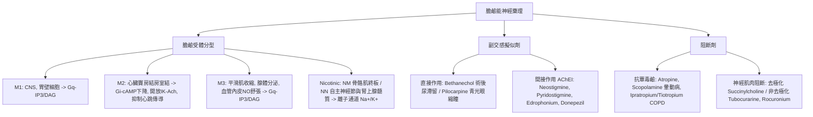

# 藥理學 第01章 自主神經藥理學：膽鹼能擬似與阻斷劑

## 核心知識體系架構
自主神經系統（ANS）為藥理學奠基之石。膽鹼能神經系統涵蓋乙醯膽鹼（Ach）之合成、儲存、釋放與降解；蕈毒鹼型受體（$M_1, M_2, M_3$）與菸鹼型受體（$N_M, N_N$）；直接/間接作用之副交感擬似劑（Cholinomimetics）；抗膽鹼酯酶劑（AChEI）與重症肌無力應用；以及阿托品類抗蕈毒鹼藥物（Antimuscarinics）與神經肌肉阻斷劑（NMBAs）。

---

## 主題一：膽鹼能受體亞型與第二信差分佈全覽

### 1. 蕈毒鹼（Muscarinic）與菸鹼（Nicotinic）受體精準矩陣
| 受體類型 | G 蛋白偶聯 / 傳導機轉 | 主要組織分佈 | 典型促效生理效應 | 專一性拮抗劑 / 臨床備註 |
| :--- | :--- | :--- | :--- | :--- |
| **$M_1$ 受體** | **$G_q$**（活化 PLC $\to IP_3/DAG \to Ca^{2+}\uparrow$） | 中樞神經系統、胃壁細胞、自主神經節 | 促進認知、刺激胃酸分泌 | **Pirenzepine**（選擇性 $M_1$ 阻斷劑，曾用於治療消化性潰瘍） |
| **$M_2$ 受體** | **$G_i$**（抑制 AC $\to cAMP\downarrow$；開放 $I_{K,Ach}$） | **心臟竇房結（SA node）、房室結（AV node）**、心房肌 | **負性變時（HR $\downarrow$）、負性變傳導（AV 傳導延遲）**、微弱負性變力 | **Atropine**（非選擇性阻斷，解除迷走抑制使心跳加快，用於竇性心搏過緩） |
| **$M_3$ 受體** | **$G_q$**（活化 PLC $\to IP_3/DAG \to Ca^{2+}\uparrow$） | **外分泌腺體、瞳孔括約肌、睫狀肌、支氣管/胃腸/膀胱平滑肌、血管內皮** | 1. 腺體分泌 $\uparrow$（唾液、汗水、淚液）。 2. 瞳孔括約肌收縮（**縮瞳 Miosis**）與睫狀肌收縮（**調節痙攣，適應近視**，拉開小梁網降眼壓）。 3. 支氣管收縮、腸道蠕動 $\uparrow$、逼尿肌收縮。 4. **血管內皮釋放 NO $\to$ 平滑肌舒張**。 | **Darifenacin, Solifenacin**（選擇性 $M_3$ 阻斷劑，治療膀胱過動症 OAB）；**Ipratropium**（治療氣喘與 COPD） |
| **$N_M$ 受體** | **配體閘門式離子通道**（$Na^+/K^+$ 內向去極化） | **神經肌肉交界處（NMJ）骨骼肌終板** | 骨骼肌終板去極化（EPP），引發骨骼肌收縮 | **Tubocurarine, Rocuronium**（非去極化阻斷）；**Succinylcholine**（去極化阻斷） |
| **$N_N$ 受體** | **配體閘門式離子通道**（$Na^+/K^+$ 內向去極化） | **自主神經節（交感與副交感神經節）、腎上腺髓質嗜鉻細胞** | 神經節節後神經元去極化興奮；促進腎上腺髓質釋放兒茶酚胺（Epi/NE） | **Hexamethonium, Mecamylamine**（神經節阻斷劑） |

---

## 主題二：抗膽鹼酯酶抑制劑（AChEI）與重症肌無力診斷治療

### 1. 乙醯膽鹼酯酶抑制劑家族大對決
- **短效診斷劑：Edrophonium（Tensilon）**
  - 四級銨化合物，與 AChE 催化中心**非共價靜電結合**，作用極短（5~15 分鐘）。
  - **Tensilon 試驗**：鑑別重症肌無力患者之「肌無力危象（Myasthenic crisis，藥量不足）」vs.「膽鹼能危象（Cholinergic crisis，藥量過量）」：
    - 給予 Edrophonium 後肌力**顯著改善** $\to$ **肌無力危象**（需增加 AChEI 劑量）。
    - 肌力**惡化甚至呼吸肌麻痺** $\to$ **膽鹼能危象**（需立即停用 AChEI 並給予 Atropine）。
- **中長效治療劑：Neostigmine vs. Pyridostigmine vs. Physostigmine**
  - **新斯的明（Neostigmine）**：**四級銨（不穿過血腦屏障 BBB）**。除抑制 AChE 外，**還能直接促效骨骼肌 $N_M$ 受體**！用於治療重症肌無力、逆轉非去極化肌肉鬆弛劑（術後拮抗 Tubocurarine）及術後腸麻痺/尿滯留。
  - **吡斯的明（Pyridostigmine）**：四級銨（不穿透 BBB），口服吸收佳、半衰期較 Neostigmine 長（4~6 小時），為**重症肌無力長期口服維持治療之首選**！
  - **毒扁豆鹼（Physostigmine）**：**三級胺（脂溶性高，能輕易穿透 BBB 進入 CNS）**！專一性用於**阿托品中毒（Atropine overdose）及抗膽鹼藥物中樞毒性之首選解毒劑**！
- **阿茲海默症中樞 AChEI：Donepezil, Rivastigmine, Galantamine**
  - 高脂溶性穿透 BBB，提升大腦皮質基底核膽鹼能活性，延緩認知衰退。
- **不可逆有機磷酸酯（Organophosphates：農藥 Parathion/Malathion、神經毒氣 Sarin）中毒與解毒**：
  - 共價結合 AChE 絲胺酸殘基形成磷酸化複合物，若未及時處理將發生「**老化（Aging）**」，形成永久性不可逆共價鍵。
  - **中毒症狀（DUMBBELLS 口訣）**：**D**iarrhea, **U**rination, **M**iosis, **B**ronchospasm, **B**radycardia, **E**mesis, **L**acrimation, **L**ethargy, **S**alivation。
  - **黃金解毒雙搭檔**：
    1. **Atropine**：競爭性阻斷 $M$ 受體，挽救心跳與肺水腫（對 $N$ 受體骨骼肌麻痺無效！）。
    2. **Pralidoxime（2-PAM）**：**膽鹼酯酶再活化劑**。強親核基團，搶奪有機磷酸酯中的磷酸基，必須在「老化前」儘早給予，能有效恢復骨骼肌 $N_M$ 受體功能！

---

## 主題三：神經肌肉阻斷劑（NMBAs：去極化 vs. 非去極化）

### 1. 骨骼肌鬆弛劑機轉與特性大對比
| 比較項目 | 去極化神經肌肉阻斷劑（Depolarizing） | 非去極化神經肌肉阻斷劑（Nondepolarizing） |
| :--- | :--- | :--- |
| **代表藥物** | **琥珀膽鹼（Succinylcholine, SCh）** | **筒箭毒鹼（Tubocurarine）、羅庫溴銨（Rocuronium）、順阿曲庫銨（Cisatracurium）** |
| **作用機制** | 與 $N_M$ 結合促發持續去極化，不易被 AChE 水解，受體脫敏（Desensitization）。 | 與 Ach 競爭骨骼肌終板 $N_M$ 受體之**競爭性拮抗劑（Competitive antagonist）**。 |
| **肌肉震顫（Fasciculations）** | **有**（起效前出現短暫短肌纖維震顫） | **無**（平滑進行性肌肉弛緩） |
| **Phase I 阻斷特性** | 持續去極化，**給予 AChEI（Neostigmine）會「加重延長阻斷」**！ | 競爭性阻斷，**給予 AChEI（Neostigmine）能「完全逆轉拮抗阻斷」**！ |
| **Phase II 阻斷特性** | 長時間或高劑量給予後，膜再極化但受體脫敏（表現似非去極化阻斷，此時可被 AChEI 逆轉）。 | 不適用。 |
| **代謝途徑** | 由血漿中之**偽膽鹼酯酶（Pseudocholinesterase / BChE）** 極速水解（作用 5~10 分鐘）。 | 肝腎代謝；**Cisatracurium 經自發性 Hofmann 消除（不依賴肝腎功能，器官衰竭首選）**。 |
| **致命不良反應** | 1. **高血鉀（Hyperkalemia）**：燒傷、廣泛神經創傷患者禁用。 2. **惡性高熱（Malignant Hyperthermia）**：合併吸入麻醉劑（Halothane）誘發 RyR1 突變者大量放鈣，**解毒劑為 Dantrolene**！ 3. 胃內壓升高與眼內壓升高。 | 組織胺釋放引發低血壓與支氣管痙攣（Tubocurarine 最顯著；Vecuronium, Cisatracurium 幾無此副作用）。 |

---

## 歷屆國考核心真題解析

### 【國考經典真題實戰】
**【試題編號】111-第一次-med2-067**
> **題目**：下列膽鹼酯酶抑制劑（cholinesterase inhibitors）， 何者不適合用於治療重症肌無力（myasthenia gravis）？
- (A) pyridostigmine
- (B) physostigmine
- (C) neostigmine
- (D) ambenonium

> **標準答案**：`B`
> 
> **【考點深度解析與選項拆解】**：
- **(A) 選項分析**：pyridostigmine。評估其受體亞型專一性、訊息傳遞路徑或臨床適應症，符合藥理學藥理作用機轉。
- **(B) 選項分析**：physostigmine。比對化學結構特異性、代謝酶（CYP）催化或受體親和力，分析考選部典型誘答陷阱。
- **(C) 選項分析**：neostigmine。辨析常見副作用（如姿位性低血壓、反射性心搏過速或電解質失衡），釐清藥物交互作用。
- **(D) 選項分析**：ambenonium。核對臨床解毒對策或首選適應症，驗證題幹核心命題旨趣。
> **【國考核心解題金鑰】**：本題精準鎖定標準答案 **(B)**。考生須精熟受體亞型分佈（M1~M3, N, α1, α2, β1~β3）與其偶聯之 G 蛋白（Gs, Gi, Gq），即可在考場瞬間破題。

---
### 【國考經典真題實戰】
**【試題編號】111-第一次-med2-069**
> **題目**：下列用於治療慢性阻塞性肺病（COPD）病人的藥物中，何者是屬於muscarinic receptor antagonists，而且是長 效型？
- (A) atropine
- (B) ipratropium
- (C) tiotropium
- (D) formoterol

> **標準答案**：`C`
> 
> **【考點深度解析與選項拆解】**：
- **(A) 選項分析**：atropine。評估其受體亞型專一性、訊息傳遞路徑或臨床適應症，符合藥理學藥理作用機轉。
- **(B) 選項分析**：ipratropium。比對化學結構特異性、代謝酶（CYP）催化或受體親和力，分析考選部典型誘答陷阱。
- **(C) 選項分析**：tiotropium。辨析常見副作用（如姿位性低血壓、反射性心搏過速或電解質失衡），釐清藥物交互作用。
- **(D) 選項分析**：formoterol。核對臨床解毒對策或首選適應症，驗證題幹核心命題旨趣。
> **【國考核心解題金鑰】**：本題精準鎖定標準答案 **(C)**。考生須精熟受體亞型分佈（M1~M3, N, α1, α2, β1~β3）與其偶聯之 G 蛋白（Gs, Gi, Gq），即可在考場瞬間破題。

---
### 【國考經典真題實戰】
**【試題編號】111-第二次-第一階段-med2-067**
> **題目**：急性腦損傷的病人常會發生壓力性潰瘍（stress ulcer），以致出現胃出血或胃痛等症狀，此時應優先考慮給與 下列何種藥物，以快速改善病人胃痛或出血症狀？
- (A) pantoprazole
- (B) ketoprofen
- (C) pilocarpine
- (D) meclizine

> **標準答案**：`A`
> 
> **【考點深度解析與選項拆解】**：
- **(A) 選項分析**：pantoprazole。評估其受體亞型專一性、訊息傳遞路徑或臨床適應症，符合藥理學藥理作用機轉。
- **(B) 選項分析**：ketoprofen。比對化學結構特異性、代謝酶（CYP）催化或受體親和力，分析考選部典型誘答陷阱。
- **(C) 選項分析**：pilocarpine。辨析常見副作用（如姿位性低血壓、反射性心搏過速或電解質失衡），釐清藥物交互作用。
- **(D) 選項分析**：meclizine。核對臨床解毒對策或首選適應症，驗證題幹核心命題旨趣。
> **【國考核心解題金鑰】**：本題精準鎖定標準答案 **(A)**。考生須精熟受體亞型分佈（M1~M3, N, α1, α2, β1~β3）與其偶聯之 G 蛋白（Gs, Gi, Gq），即可在考場瞬間破題。