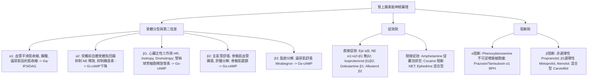

# 藥理學 第02章 自主神經藥理學：腎上腺素能促效與阻斷劑

## 核心知識體系架構
腎上腺素能（Adrenergic）神經系統涵蓋兒茶酚胺（Dopamine $\to$ NE $\to$ Epinephrine）之生合成途徑、酪胺酸羥化酶限速步驟、VMAT-2 囊泡儲存、NET 突觸再攝取；腎上腺素受體分型（$\alpha_1, \alpha_2, \beta_1, \beta_2, \beta_3$）；直接與間接促效劑；以及臨床廣泛應用之 $\alpha$ 阻斷劑與 $\beta$ 阻斷劑（$\beta$-blockers）。

---

## 主題一：腎上腺素能受體分類與兒茶酚胺血流動力學效應

### 1. 腎上腺素受體次型精密對比表
| 受體亞型 | G 蛋白偶聯 | 主要器官組織分佈 | 活化後關鍵生理效應 | 專一性促效劑範例 | 專一性拮抗劑範例 |
| :--- | :--- | :--- | :--- | :--- | :--- |
| **$\alpha_1$ 受體** | **$G_q$** ($IP_3/DAG \to Ca^{2+}\uparrow$) | 血管平滑肌、瞳孔開肌、膀胱頸與前列腺平滑肌 | 血管強烈收縮（BP $\uparrow$）、散瞳（Mydriasis）、尿道括約肌收縮 | **Phenylephrine**（去鼻塞、散瞳） | **Prazosin, Doxazosin, Tamsulosin**（治療高血壓與攝護腺肥大 BPH） |
| **$\alpha_2$ 受體** | **$G_i$** ($cAMP\downarrow$) | **突觸前神經末梢（自體受體）**、中樞血管運動中樞、胰島 $\beta$ 細胞 | **負回饋抑制突觸前 NE 釋放**、降低中樞交感輸出、抑制胰島素分泌 | **Clonidine, $\alpha$-Methyldopa**（中樞型降壓藥） | **Yohimbine** |
| **$\beta_1$ 受體** | **$G_s$** ($cAMP\uparrow \to PKA$) | **心臟（心肌細胞、竇房結、房室結）**、腎臟近腎絲球細胞（JG cells） | 心跳加快（HR $\uparrow$）、心肌收縮力增強、AV 傳導加快；**促進腎素（Renin）釋放** | **Dobutamine**（急救心因性休克） | **Metoprolol, Atenolol, Bisoprolol, Esmolol**（心血管一線降壓與抗心律不整） |
| **$\beta_2$ 受體** | **$G_s$** ($cAMP\uparrow \to PKA$) | **支氣管平滑肌、骨骼肌血管床**、肝臟、骨骼肌、子宮 | **支氣管強烈舒張**、骨骼肌血管擴張（舒張壓 DBP $\downarrow$）、肝醣分解（血糖 $\uparrow$）、骨骼肌震顫、安胎（子宮舒張） | **Albuterol, Salmeterol**（氣喘支氣管擴張劑）；**Terbutaline, Ritodrine**（安胎） | **Propranolol, Timolol**（非選擇性阻斷，氣喘患者絕對禁用！） |
| **$\beta_3$ 受體** | **$G_s$** ($cAMP\uparrow \to PKA$) | 脂肪組織、**膀胱逼尿肌** | 刺激脂肪分解（Lipolysis）；**舒張膀胱逼尿肌（放鬆膀胱增加儲尿量）** | **Mirabegron**（治療膀胱過動症 OAB） | 尚無主要臨床用藥 |

### 2. 兒茶酚胺三大天王（Epi vs. NE vs. Isoproterenol）血流動力學大對決
- **腎上腺素（Epinephrine）**：
  - 低劑量偏向 **$\beta$ 受體**（$\beta_2$ 血管舒張致 DBP 下降，$\beta_1$ 刺激心臟使 SBP 上降，總周邊阻力 TPR 下降，HR 上升）。
  - 高劑量全面活化 **$\alpha_1$ 受體**（血管劇烈收縮，SBP 與 DBP 皆飆升，TPR 大增）。
  - **Dale 氏血管舒張反轉現象（Vasomotor Reversal of Dale）**：預先給予 $\alpha$ 阻斷劑（如 Phentolamine），再給予大劑量 Epinephrine，原有的縮血管升壓反應完全被逆轉為純粹的 **$\beta_2$ 血管舒張與血壓驟降**！
- **正腎上腺素（Norepinephrine）**：
  - 強烈活化 **$\alpha_1, \alpha_2$**，對 **$\beta_1$** 有效，但**對 $\beta_2$ 幾無促效作用**！
  - **總周邊阻力（TPR）暴增**，收縮壓（SBP）與舒張壓（DBP）同步劇烈升高。
  - **反射性心搏過緩（Reflex Bradycardia）**：極高血壓觸發頸動脈竇感壓反射，迷走神經興奮壓倒 $\beta_1$ 直接刺激，導致**最終心跳反而減慢（HR $\downarrow$）**！休克急救升壓首選。
- **異丙腎上腺素（Isoproterenol）**：
  - 純粹活化 **$\beta_1 + \beta_2$**，對 $\alpha$ 受體無作用。
  - $\beta_1$ 使心臟狂飆（HR $\uparrow\uparrow$），$\beta_2$ 使全身骨骼肌血管極度擴張（TPR $\downarrow\downarrow$，DBP 斷崖式暴跌），平均動脈壓 MAP 下降。

---

## 主題二：$\alpha$ 阻斷劑與嗜鉻細胞瘤

### 1. $\alpha$ 阻斷劑藥物特性與適應症
- **酚苄明（Phenoxybenzamine）**：**不可逆共價結合** 之非選擇性 $\alpha_1 + \alpha_2$ 阻斷劑。作用時間極長（長達數日）。為**嗜鉻細胞瘤（Pheochromocytoma）手術前控制惡性高血壓之首選先導藥物**（必須先阻斷 $\alpha$ 徹底控制血壓，之後才能謹慎加上 $\beta$ 阻斷劑以防心搏過速；若單獨先給 $\beta$ 阻斷劑將導致嚴重的 $\alpha_1$ 血管收縮危機！）。
- **酚妥拉明（Phentolamine）**：可逆競爭性非選擇性 $\alpha_1 + \alpha_2$ 阻斷劑。用於嗜鉻細胞瘤手術中血壓驟升控制，或逆轉局部注射去甲腎上腺素外滲導致的缺血性皮膚壞死。
- **選擇性 $\alpha_1$ 阻斷劑：Prazosin, Terazosin, Doxazosin, Tamsulosin**
  - **首劑效應（First-dose phenomenon）**：服藥初期易引起嚴重姿位性低血壓（Orthostatic hypotension）甚至暈厥，建議睡前服用。
  - **坦索羅辛（Tamsulosin）**：選擇性阻斷前列腺與膀胱頸之 **$\alpha_{1A}$ 受體**，對血管 $\alpha_{1B}$ 影響小，幾無低血壓副作用，為良性攝護腺肥大（BPH）緩解排尿困難首選藥！副作用為虹膜鬆弛症候群（IFIS）與逆行性射精。

---

## 主題三：$\beta$ 受體阻斷劑（$\beta$-blockers）分類精析

### 1. 三代 $\beta$ 阻斷劑特性與禁忌矩陣
| 世代分類 | 藥物名稱 | 受體選擇性 | 內在擬交感活性（ISA） | 膜穩定作用（MSA） | 附加血管擴張機制 | 臨床關鍵考點 |
| :--- | :--- | :--- | :--- | :--- | :--- | :--- |
| **第一代（非選擇性）** | **Propranolol** | $\beta_1 + \beta_2$ | 無 | 強（局麻作用） | 無 | 脂溶性高易入 CNS（抗焦慮、甲狀腺毒症首選、偏頭痛預防）。**氣喘、COPD、周邊血管病變絕對禁用！** |
| | **Timolol** | $\beta_1 + \beta_2$ | 無 | 無 | 無 | 眼藥水滴劑，抑制睫狀體房水生成，治療隅角開放性青光眼。 |
| | **Pindolol** | $\beta_1 + \beta_2$ | **有（部分促效 ISA）** | 有 | 無 | 較不易引起靜止期心跳過緩，適合心搏偏慢之高血壓患者。 |
| **第二代（心臟心肌選擇性）** | **Metoprolol, Atenolol, Bisoprolol** | **選擇性 $\beta_1$** | 無 | 弱/無 | 無 | 高血壓、冠心症首選。對氣管 $\beta_2$ 影響較小，但高劑量下選擇性喪失，氣喘者仍須慎用。 |
| | **Esmolol** | **選擇性 $\beta_1$** | 無 | 無 | 無 | **極短效（半衰期約 9 分鐘）**，被紅血球內酯酶快速水解，用於急性主動脈剝離或手術中室上速急救。 |
| **第三代（具血管擴張活性）** | **Carvedilol, Labetalol** | **$\beta_1 + \beta_2 + \alpha_1$ 阻斷** | 無 | 有 | **阻斷 $\alpha_1$ 擴張血管** | **Carvedilol** 具抗氧化功效，為慢性心衰竭（HFrEF）證實降低死亡率三大神藥之一；**Labetalol** 為妊娠高血壓急症首選！ |
| | **Nebivolol** | **高選擇性 $\beta_1$** | 無 | 無 | **活化內皮釋放 NO 擴張血管** | 降壓效果極佳，抗勃起功能障礙副作用低。 |

---

## 歷屆國考核心真題解析

### 【國考經典真題實戰】
**【試題編號】111-第一次-med2-066**
> **題目**：下列交感受體拮抗劑（adrenoceptor antagonist）中，何者具有最明顯的alpha受體（alpha-receptor）阻斷作用？
- (A) atenolol
- (B) labetalol
- (C) propranolol
- (D) pindolol

> **標準答案**：`B`
> 
> **【考點深度解析與選項拆解】**：
- **(A) 選項分析**：atenolol。評估其受體亞型專一性、訊息傳遞路徑或臨床適應症，符合藥理學藥理作用機轉。
- **(B) 選項分析**：labetalol。比對化學結構特異性、代謝酶（CYP）催化或受體親和力，分析考選部典型誘答陷阱。
- **(C) 選項分析**：propranolol。辨析常見副作用（如姿位性低血壓、反射性心搏過速或電解質失衡），釐清藥物交互作用。
- **(D) 選項分析**：pindolol。核對臨床解毒對策或首選適應症，驗證題幹核心命題旨趣。
> **【國考核心解題金鑰】**：本題精準鎖定標準答案 **(B)**。考生須精熟受體亞型分佈（M1~M3, N, α1, α2, β1~β3）與其偶聯之 G 蛋白（Gs, Gi, Gq），即可在考場瞬間破題。

---
### 【國考經典真題實戰】
**【試題編號】111-第二次-第一階段-med2-058**
> **題目**：有關治療血脂異常（dyslipidemia）藥物之作用及機制敘述，下列何者錯誤？
- (A) atrovastatin：抑制HMG-CoA reductase
- (B) fenofibrate：增加lipoprotein lipase 活性
- (C) colestipol：減少膽酸的吸收
- (D) niacin：活化peroxisome proliferator-activated receptor alpha

> **標準答案**：`D`
> 
> **【考點深度解析與選項拆解】**：
- **(A) 選項分析**：atrovastatin：抑制HMG-CoA reductase。評估其受體亞型專一性、訊息傳遞路徑或臨床適應症，符合藥理學藥理作用機轉。
- **(B) 選項分析**：fenofibrate：增加lipoprotein lipase 活性。比對化學結構特異性、代謝酶（CYP）催化或受體親和力，分析考選部典型誘答陷阱。
- **(C) 選項分析**：colestipol：減少膽酸的吸收。辨析常見副作用（如姿位性低血壓、反射性心搏過速或電解質失衡），釐清藥物交互作用。
- **(D) 選項分析**：niacin：活化peroxisome proliferator-activated receptor alpha。核對臨床解毒對策或首選適應症，驗證題幹核心命題旨趣。
> **【國考核心解題金鑰】**：本題精準鎖定標準答案 **(D)**。考生須精熟受體亞型分佈（M1~M3, N, α1, α2, β1~β3）與其偶聯之 G 蛋白（Gs, Gi, Gq），即可在考場瞬間破題。

---
### 【國考經典真題實戰】
**【試題編號】111-第二次-第一階段-med2-062**
> **題目**：下列抗心律不整藥物中，何者不具有抑制交感神經的作用？
- (A) amiodarone
- (B) esmolol
- (C) lidocaine
- (D) sotalol

> **標準答案**：`C`
> 
> **【考點深度解析與選項拆解】**：
- **(A) 選項分析**：amiodarone。評估其受體亞型專一性、訊息傳遞路徑或臨床適應症，符合藥理學藥理作用機轉。
- **(B) 選項分析**：esmolol。比對化學結構特異性、代謝酶（CYP）催化或受體親和力，分析考選部典型誘答陷阱。
- **(C) 選項分析**：lidocaine。辨析常見副作用（如姿位性低血壓、反射性心搏過速或電解質失衡），釐清藥物交互作用。
- **(D) 選項分析**：sotalol。核對臨床解毒對策或首選適應症，驗證題幹核心命題旨趣。
> **【國考核心解題金鑰】**：本題精準鎖定標準答案 **(C)**。考生須精熟受體亞型分佈（M1~M3, N, α1, α2, β1~β3）與其偶聯之 G 蛋白（Gs, Gi, Gq），即可在考場瞬間破題。