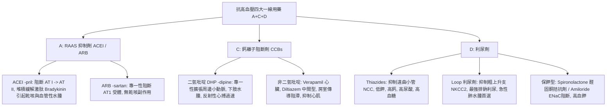

# 藥理學 第03章 心血管藥理學：抗高血壓、利尿劑與血管擴張劑

## 核心知識體系架構
高血壓藥物治療為臨床處方與國考高分核心，涵蓋 RAAS 系統抑制劑（ACEI, ARB, 直接腎素抑制劑 Aliskiren）、鈣離子通道阻斷劑（DHP 類 vs. 非 DHP 類 CCB）、各大腎小管利尿劑（Thiazides, Loop, 保鉀型），以及直接血管擴張劑（Hydralazine, Minoxidil, Nitroprusside）。

---

## 主題一：RAAS 系統抑制劑（ACEI vs. ARB）精細鑑別

### 1. 作用機轉與不良反應大對照表
| 藥物類別 | 作用分子標靶 | Angiotensin II 濃度 | 緩激肽（Bradykinin）濃度 | 核心適應症 | 國考特徵副作用與禁忌 |
| :--- | :--- | :--- | :--- | :--- | :--- |
| **ACEI（血管升壓素轉化酶抑制劑）** Captopril, Enalapril, Lisinopril, Ramipril | 抑制血管升壓素轉化酶（ACE / 激肽酶 II） | **顯著下降** | **顯著升高**（ACE 負責降解緩激肽，受抑後累積） | 1. 糖尿病腎病變首選（降低出球小動脈阻力，降低腎絲球內壓，減少蛋白尿）。 2. 慢性心衰竭（HFrEF）證實降低死亡率。 3. 心肌梗塞後左心室重塑預防。 | 1. **頑固性乾咳（Dry cough，5~20%）**：緩激肽與 $PGE_2$ 累積刺激肺部。 2. **血管神經性水腫（Angioedema）**：罕見但具致命性。 3. **高血鉀（Hyperkalemia）**。 4. **孕婦絕對禁用（致畸胎性，胎兒腎發育不全）**！ 5. **雙側腎動脈狹窄禁用**。 |
| **ARB（AT1 受體阻斷劑）** Losartan, Valsartan, Candesartan | 競爭性阻斷血管平滑肌與腎上腺上之 **$AT_1$ 受體** | **反饋性升高**（解除負回饋） | **不變**（不抑制激肽酶 II） | 功效等同 ACEI，專門用於**無法耐受 ACEI 乾咳副作用之首選替代用藥**。 | 無緩激肽相關之乾咳與極低血管性水腫風險。其餘副作用（高血鉀、**孕婦禁用**、雙側腎動脈狹窄禁用）與 ACEI 相同。 |

---

## 主題二：鈣離子通道阻斷劑（CCBs：DHP vs. Non-DHP）

### 1. 二氫吡啶類（Dihydropyridines）vs. 非二氫吡啶類全解析
- **二氫吡啶類（DHP 類，以 -dipine 結尾）**：
  - 代表藥：**Amlodipine, Nifedipine, Felodipine**。
  - **血管選擇性極高（Vascular-selective）**：高度阻斷周邊小動脈平滑肌之 L 型電壓鈣通道（$Ca_v1.2$），強烈擴張小動脈降低總周邊阻力（TPR）。
  - 對心臟傳導與心肌收縮幾無直接抑制作用。
  - **典型副作用**：小動脈擴張引起微血管靜水壓升高導致 **周邊足踝水腫（Peripheral pedal edema）**、顏面潮紅、頭痛；短效劑型（如短效 Nifedipine 膠囊）血管擴張過速會引起劇烈 **反射性心搏過速（Reflex tachycardia）** 诱發心絞痛，現已被長效劑型取代。
- **非二氫吡啶類（Non-DHP 類）**：
  - **維拉帕米（Verapamil）**：**心臟選擇性最高（Cardiac-selective）**！強力抑制心臟竇房結與房室結傳導，負性變力極強。**心房顫動（Afib）心室速率控制首選**。副作用為**便秘（Constipation，20%）**、房室傳導阻滯、加重心衰竭（**HFrEF 患者絕對禁用！**）。
  - **地爾硫䓬（Diltiazem）**：中度血管擴張與中度心臟抑制之平衡型，常用於穩定型心絞痛與高血壓。

---

## 主題三：直接血管擴張劑與急症降壓藥

### 1. 血管擴張劑之作用靶點與反饋調控
- **肼屈嗪（Hydralazine）**：
  - 選擇性**擴張小動脈（Arteriolar dilator）**，對靜脈無效。
  - 適用於**重度妊娠高血壓（與 Methyldopa, Labetalol 並列孕婦安全降壓藥）**。
  - 典型副作用：強烈反射性交感興奮（心跳快、水鈉滯留）；經肝臟 N-乙醯轉移酶（NAT2）代謝，慢乙醯化者易誘發 **藥物型紅斑性狼瘡（Drug-induced Lupus, 特異性抗組蛋白抗體 Anti-histone antibody 陽性）**！
- **硝普鈉（Sodium Nitroprusside, SNP）**：
  - 同時**極度均衡擴張小動脈與大靜脈**，急遽降低心臟前負荷與後負荷。
  - 靜脈滴注起效秒級，為**高血壓危象（Hypertensive emergency）之終極搶救藥**。
  - **氰化物中毒（Cyanide toxicity）**：SNP 分子含 5 個氰基，體內代謝釋放 $CN^-$，若長時間或大劑量輸注會引發乳酸中毒。解毒劑為 **硫代硫酸鈉（Sodium thiosulfate）** 促進尿硫氰酸鹽排泄，或 **羥鈷胺（Hydroxocobalamin）** 結合成無毒維生素 B12。

---

## 歷屆國考核心真題解析

### 【國考經典真題實戰】
**【試題編號】111-第一次-med2-063**
> **題目**：下列有關chlorothiazide利尿劑的敘述，何者錯誤？
- (A) 可抑制鈉和氯離子再吸收
- (B) 可用於原發性高鈣尿（idiopathic hypercalciuria）
- (C) 會引起高血糖
- (D) 會引起高血鉀

> **標準答案**：`D`
> 
> **【考點深度解析與選項拆解】**：
- **(A) 選項分析**：可抑制鈉和氯離子再吸收。評估其受體亞型專一性、訊息傳遞路徑或臨床適應症，符合藥理學藥理作用機轉。
- **(B) 選項分析**：可用於原發性高鈣尿（idiopathic hypercalciuria）。比對化學結構特異性、代謝酶（CYP）催化或受體親和力，分析考選部典型誘答陷阱。
- **(C) 選項分析**：會引起高血糖。辨析常見副作用（如姿位性低血壓、反射性心搏過速或電解質失衡），釐清藥物交互作用。
- **(D) 選項分析**：會引起高血鉀。核對臨床解毒對策或首選適應症，驗證題幹核心命題旨趣。
> **【國考核心解題金鑰】**：本題精準鎖定標準答案 **(D)**。考生須精熟受體亞型分佈（M1~M3, N, α1, α2, β1~β3）與其偶聯之 G 蛋白（Gs, Gi, Gq），即可在考場瞬間破題。

---
### 【國考經典真題實戰】
**【試題編號】111-第二次-第一階段-med2-060**
> **題目**：蔡小姐因為下肢無力被送到醫院急診，發現有高血壓與低血鉀的情況；進一步檢查後診斷為腎上腺腫瘤造成 的原發性高醛固酮症 （primary aldosteronism）。在接受手術之前，下列何種藥物較能改善她的症狀？
- (A) prednisolone
- (B) spironolactone
- (C) furosemide
- (D) dexamethasone

> **標準答案**：`B`
> 
> **【考點深度解析與選項拆解】**：
- **(A) 選項分析**：prednisolone。評估其受體亞型專一性、訊息傳遞路徑或臨床適應症，符合藥理學藥理作用機轉。
- **(B) 選項分析**：spironolactone。比對化學結構特異性、代謝酶（CYP）催化或受體親和力，分析考選部典型誘答陷阱。
- **(C) 選項分析**：furosemide。辨析常見副作用（如姿位性低血壓、反射性心搏過速或電解質失衡），釐清藥物交互作用。
- **(D) 選項分析**：dexamethasone。核對臨床解毒對策或首選適應症，驗證題幹核心命題旨趣。
> **【國考核心解題金鑰】**：本題精準鎖定標準答案 **(B)**。考生須精熟受體亞型分佈（M1~M3, N, α1, α2, β1~β3）與其偶聯之 G 蛋白（Gs, Gi, Gq），即可在考場瞬間破題。

---
### 【國考經典真題實戰】
**【試題編號】111-第二次-第一階段-med2-061**
> **題目**：酗酒且患有第二型糖尿病的病人應避免使用metformin 治療，因為metformin 和酒精一起使用很容易造成：
- (A) 肥胖
- (B) 乳酸中毒
- (C) 低血糖
- (D) 高血壓

> **標準答案**：`B`
> 
> **【考點深度解析與選項拆解】**：
- **(A) 選項分析**：肥胖。評估其受體亞型專一性、訊息傳遞路徑或臨床適應症，符合藥理學藥理作用機轉。
- **(B) 選項分析**：乳酸中毒。比對化學結構特異性、代謝酶（CYP）催化或受體親和力，分析考選部典型誘答陷阱。
- **(C) 選項分析**：低血糖。辨析常見副作用（如姿位性低血壓、反射性心搏過速或電解質失衡），釐清藥物交互作用。
- **(D) 選項分析**：高血壓。核對臨床解毒對策或首選適應症，驗證題幹核心命題旨趣。
> **【國考核心解題金鑰】**：本題精準鎖定標準答案 **(B)**。考生須精熟受體亞型分佈（M1~M3, N, α1, α2, β1~β3）與其偶聯之 G 蛋白（Gs, Gi, Gq），即可在考場瞬間破題。