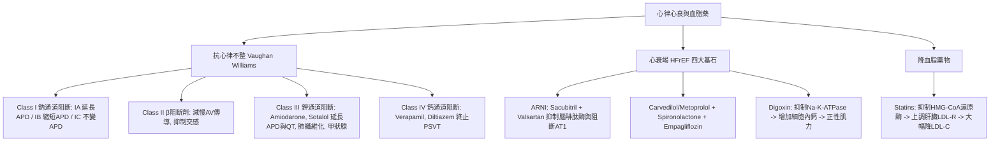

# 藥理學 第04章 心血管藥理學：抗心律不整、抗心衰竭與降血脂藥

## 核心知識體系架構
本章匯集心血管藥理三大重鎮：Vaughan Williams 抗心律不整藥物分類系統（Class I~IV）；收縮性心衰竭（HFrEF）四大基石神藥（ARNI, Beta-blocker, MRA, SGLT2i）與毛地黃（Digoxin）；以及降血脂藥物（Statins, Ezetimibe, PCSK9 抑制劑, Fibrates）。

---

## 主題一：Vaughan Williams 抗心律不整藥物四類全圖譜

### 1. 抗心律不整藥物電生理特性與代表藥物矩陣
| 藥物分類 | 主要電生理作用機制 | 動作電位時程（APD）與 QT 間期 | 典型代表藥物 | 臨床首選適應症與國考特徵副作用 |
| :--- | :--- | :--- | :--- | :--- |
| **Class IA** | **中度阻斷快速鈉通道（$Na_v$）**，同時阻斷延遲整流鉀通道（$I_K$） | **延長（$\uparrow$ APD / $\uparrow$ QT）** | **Quinidine, Procainamide, Disopyramide** | - **Quinidine**：引起金雞納中毒（Cinchonism：耳鳴、頭痛）、血小板低下。 - **Procainamide**：引發藥物型紅斑狼瘡（SLE-like syndrome）。 - **皆可能誘發 Torsades de Pointes（TdP 心室頻脈）**！ |
| **Class IB** | **輕度阻斷快速鈉通道**，專一性結合**失活態（Inactivated state）**，促鉀外流 | **縮短（$\downarrow$ APD / $\downarrow$ QT）** | **Lidocaine, Mexiletine** | **缺血性心肌梗塞後引發之急性心室心律不整（Ventricular Arrhythmias）首選**！對心房心律不整完全無效。CNS 神經毒性（抽搐、發抖）。 |
| **Class IC** | **重度強力阻斷快速鈉通道（解離最慢）**，極度減慢 Phase 0 去極化傳導（QRS 大幅增寬） | **不變（APD 不變）** | **Flecainide, Propafenone** | 結構正常心臟之陣發性心房顫動（Afib）首選。**CAST 臨床試驗證實：心肌梗塞後或缺血性結構性心臟病患者絕對禁用（促心律不整死亡率增高！）**。 |
| **Class II** | **$\beta$ 受體阻斷劑**，抑制 SA/AV 結 Phase 4 去極化斜率，減慢房室傳導 | 延長 PR 間期 | **Metoprolol, Esmolol, Propranolol** | 陣發性室上性心搏過速（PSVT）預防、心室速率控制。 |
| **Class III** | **阻斷鉀通道（$I_{Kr}$ / $I_{Ks}$）**，大幅延遲心室再極化 | **顯著延長（$\uparrow\uparrow$ APD / $\uparrow\uparrow$ QT）** | **Amiodarone, Dronedarone, Sotalol, Ibutilide** | - **Amiodarone（胺碘酮）**：廣效全能型心律不整藥（心房/心室皆有效）。含碘化物。 國考必背五大器官毒性：**肺纖維化（Pulmonary fibrosis，最致命！）**、**甲狀腺機能亢進或低下**、肝毒性、角膜微沉積沉著、**皮膚藍灰色沉著**。 |
| **Class IV** | **非二氫吡啶類鈣通道阻斷劑（L 型 $Ca^{2+}$）**，延緩 AV 結傳導 | 顯著延長 PR 間期 | **Verapamil, Diltiazem** | 終止急性 PSVT 首選，心房顫動速率控制。 |
| **其他類別** | **腺苷（Adenosine）** | 活化 $A_1$ 受體 $\to$ 活化鉀通道過極化，阻斷 AV 結傳導 | **極短半衰期（$< 10$ 秒）** | **急性終止發作中 PSVT 之第一線黃金急救藥物**！受 Theophylline 競爭性抑制。 |

---

## 主題二：慢性收縮性心衰竭（HFrEF）四大基石神藥

### 1. 證實降低死亡率（Mortality Reduction）的四大核心藥物支柱
1. **血管加壓素受體-腦啡肽酶抑制劑（ARNI：Sacubitril / Valsartan）**：
   - **雙重機轉**：Sacubitril 前驅藥物抑制**腦啡肽酶（Neprilysin）**，阻斷利尿鈉胜肽（ANP, BNP, CNP）與緩激肽降解，大幅促進排鈉利尿擴血管；協同 Valsartan 阻斷 $AT_1$ 受體。
   - **絕對禁忌轉換期**：若由 ACEI 轉換至 ARNI，**必須停用 ACEI 滿 36 小時以上（Washout period）**，以防腦啡肽酶抑制劑與 ACE 雙重阻斷緩激肽降解而誘發致命性血管神經性水腫！
2. **特定的 $\beta$ 受體阻斷劑**：
   - 全世界僅 **Carvedilol、Bisoprolol、Metoprolol succinate（長效型）** 三種經大型臨床試驗證實可降低 HFrEF 死亡率。
3. **礦物質皮質素受體拮抗劑（MRA）**：
   - **Spironolactone、Eplerenone**，阻斷心肌間質纖維化。
4. **SGLT2 抑制劑（Empagliflozin, Dapagliflozin）**：
   - 降低心臟前後負荷、改善心肌能量代謝，不論是否合併糖尿病均顯著降低心血管死亡與心衰住院率。

### 2. 毛地黃（Digoxin）作用機轉與中毒解讀
- **強心正性變力機轉**：抑制細胞膜上的 **$Na^+/K^+$-ATPase** $\to [Na^+]_i$ 上升 $\to$ 削弱 $Na^+/Ca^{2+}$ 反向交換體（NCX）外排驅動力 $\to [Ca^{2+}]_i$ 在心肌細胞肌漿網大量積聚 $\to$ 收縮期釋放更多鈣 $\to$ **收縮力強勁增強**。
- **神經副交感擬似效應**：興奮迷走神經背核，減慢 AV 結傳導（負性變傳導），常用於合併心房顫動的心衰竭患者控制心室率。
- **毛地黃中毒危險因子與處置**：
  - **低血鉀（Hypokalemia，如合用 Loop 利尿劑）**：$K^+$ 與 Digoxin 競爭結合 $Na^+/K^+$-ATPase 上的結合位，低血鉀使 Digoxin 結合率暴增，極易誘發致命中毒！
  - **中毒心電圖特徵**：ST 段呈湯匙狀下沉（Salvador Dali mustache sign）、頻發性心室早期收縮（PVC）、雙向性心室頻脈。
  - **特異解毒劑**：**毛地黃特異性抗原結合片段（Digoxin Immune Fab / DigiFab）**；若合併低血鉀則積極補充鉀與鎂。

---

## 主題三：降血脂藥物（Lipid-Lowering Agents）分類

### 1. 降血脂五大機制矩陣
| 藥物類別 | 代表藥物 | 作用分子機轉 | LDL-C | HDL-C | TG | 國考必背關鍵考點與副作用 |
| :--- | :--- | :--- | :--- | :--- | :--- | :--- |
| **他汀類 (Statins)** | **Atorvastatin, Rosuvastatin, Simvastatin** | 競爭性抑制膽固醇合成限速酶 **HMG-CoA 還原酶** $\to$ 肝內膽固醇耗竭 $\to$ **代償性大量上調肝細胞表面 LDL 受體（LDL-R）** $\to$ 清除血中 LDL | **$\downarrow\downarrow\downarrow$ (20~60%)** | $\uparrow$ (5~10%) | $\downarrow$ (10~30%) | **ASCVD 防治第一線基石神藥**。主要副作用為**肝指數升、肌痛與橫紋肌溶解症（Rhabdomyolysis）**；合用 Fibrates 或 CYP3A4 抑制劑時肌毒性風險劇增。**孕婦絕對禁用！** |
| **膽固醇吸收抑制劑** | **Ezetimibe** | 專一性阻斷小腸刷狀緣 **NPC1L1 轉運蛋白**，阻斷飲食中膽固醇吸收 | $\downarrow$ (15~20%) | $\uparrow$ 微弱 | $\downarrow$ 微弱 | 常與 Statin 聯用發揮協同降 LDL 效果。副作用罕見，耐受性極佳。 |
| **PCSK9 抑制劑** | **Evolocumab, Alirocumab** | 單株抗體結合並抑制 PCSK9 $\to$ **防止 LDL-R 被溶酶體分解** $\to$ LDL 受體持續循環回質膜 | **$\downarrow\downarrow\downarrow\downarrow$ (50~70%)** | $\uparrow$ (5~10%) | $\downarrow$ | 皮下注射單株抗體，降 LDL 力量最強大。注射部位局部反應。 |
| **纖維酸衍生物 (Fibrates)** | **Gemfibrozil, Fenofibrate** | 活化核受體 **PPAR-$\alpha$** $\to$ 刺激脂蛋白脂酶（LPL）活性，促進富含 TG 之 VLDL 分解 | $\downarrow$ 或 $\leftrightarrow$ | **$\uparrow\uparrow$ (10~20%)** | **$\downarrow\downarrow\downarrow$ (30~50%)** | **重度高三酸甘油酯血症（TG $> 500\text{ mg/dL}$）預防急性胰臟炎之首選**！若需合用 Statin，**Fenofibrate 安全性遠高於 Gemfibrozil**。 |
| **菸鹼酸 (Niacin / Vitamin B3)** | **Niacin** | 抑制脂肪組織之荷爾蒙敏感性脂解酶（HSL），減少游離脂肪酸釋入肝臟 | $\downarrow$ (15~25%) | **$\uparrow\uparrow\uparrow$ (20~35%)** | $\downarrow\downarrow$ (20~50%) | **提升 HDL 最強**。典型副作用為前列腺素介導的**皮膚強烈潮紅發癢（Flushing，可用 Aspirin 預防）**、高尿酸血症與高血糖。 |

---

## 歷屆國考核心真題解析

### 【國考經典真題實戰】
**【試題編號】111-第一次-med2-059**
> **題目**：下列降血脂藥物何者藉由活化PPAR-α而促進細胞lipoprotein lipase（LPL）及apoA表現，以提高脂肪酸在骨骼 肌及肝臟的氧化反應，進而降低血中VLDL含量？
- (A) gemfibrozil
- (B) simvastatin
- (C) colestipol
- (D) ezetimibe

> **標準答案**：`A`
> 
> **【考點深度解析與選項拆解】**：
- **(A) 選項分析**：gemfibrozil。評估其受體亞型專一性、訊息傳遞路徑或臨床適應症，符合藥理學藥理作用機轉。
- **(B) 選項分析**：simvastatin。比對化學結構特異性、代謝酶（CYP）催化或受體親和力，分析考選部典型誘答陷阱。
- **(C) 選項分析**：colestipol。辨析常見副作用（如姿位性低血壓、反射性心搏過速或電解質失衡），釐清藥物交互作用。
- **(D) 選項分析**：ezetimibe。核對臨床解毒對策或首選適應症，驗證題幹核心命題旨趣。
> **【國考核心解題金鑰】**：本題精準鎖定標準答案 **(A)**。考生須精熟受體亞型分佈（M1~M3, N, α1, α2, β1~β3）與其偶聯之 G 蛋白（Gs, Gi, Gq），即可在考場瞬間破題。

---
### 【國考經典真題實戰】
**【試題編號】111-第一次-med2-064**
> **題目**：下列抗心律不整藥物，何者不抑制Na+ channel作用？
- (A) adenosine
- (B) amiodarone
- (C) flecainide
- (D) mexiletine

> **標準答案**：`A`
> 
> **【考點深度解析與選項拆解】**：
- **(A) 選項分析**：adenosine。評估其受體亞型專一性、訊息傳遞路徑或臨床適應症，符合藥理學藥理作用機轉。
- **(B) 選項分析**：amiodarone。比對化學結構特異性、代謝酶（CYP）催化或受體親和力，分析考選部典型誘答陷阱。
- **(C) 選項分析**：flecainide。辨析常見副作用（如姿位性低血壓、反射性心搏過速或電解質失衡），釐清藥物交互作用。
- **(D) 選項分析**：mexiletine。核對臨床解毒對策或首選適應症，驗證題幹核心命題旨趣。
> **【國考核心解題金鑰】**：本題精準鎖定標準答案 **(A)**。考生須精熟受體亞型分佈（M1~M3, N, α1, α2, β1~β3）與其偶聯之 G 蛋白（Gs, Gi, Gq），即可在考場瞬間破題。

---
### 【國考經典真題實戰】
**【試題編號】111-第一次-med2-065**
> **題目**：下列關於nicorandil的敘述，何者錯誤？
- (A) 可使nitric oxide釋放
- (B) 可使sodium channel打開
- (C) 可降低細胞內鈣離子濃度
- (D) 可用於治療心絞痛

> **標準答案**：`B`
> 
> **【考點深度解析與選項拆解】**：
- **(A) 選項分析**：可使nitric oxide釋放。評估其受體亞型專一性、訊息傳遞路徑或臨床適應症，符合藥理學藥理作用機轉。
- **(B) 選項分析**：可使sodium channel打開。比對化學結構特異性、代謝酶（CYP）催化或受體親和力，分析考選部典型誘答陷阱。
- **(C) 選項分析**：可降低細胞內鈣離子濃度。辨析常見副作用（如姿位性低血壓、反射性心搏過速或電解質失衡），釐清藥物交互作用。
- **(D) 選項分析**：可用於治療心絞痛。核對臨床解毒對策或首選適應症，驗證題幹核心命題旨趣。
> **【國考核心解題金鑰】**：本題精準鎖定標準答案 **(B)**。考生須精熟受體亞型分佈（M1~M3, N, α1, α2, β1~β3）與其偶聯之 G 蛋白（Gs, Gi, Gq），即可在考場瞬間破題。