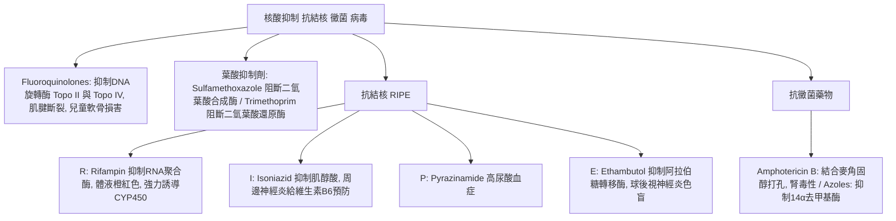

# 藥理學 第08章 抗生素藥理學：核酸抑制、抗結核、抗黴菌與抗病毒

## 核心知識體系架構
本章匯集化療感染藥物四大關鍵領域：核酸合成抑制劑（喹諾酮類 Fluoroquinolones、葉酸拮抗磺胺類 Sulfonamides/Trimethoprim）；第一線抗結核黃金四聯組合（RIPE：Rifampin, Isoniazid, Pyrazinamide, Ethambutol）；抗黴菌藥物（Amphotericin B, Azoles, Echinocandins, Terbinafine）；以及抗病毒藥物（抗疱疹 Acyclovir, 抗流感 Oseltamivir, 抗愛滋 HAART 雞尾酒療法）。

---

## 主題一：喹諾酮類（Fluoroquinolones）與葉酸拮抗劑

### 1. 氟喹諾酮類（Fluoroquinolones：Ciprofloxacin, Levofloxacin, Moxifloxacin）
- **作用機轉**：
  - 革蘭氏陰性菌（G-）：專一性抑制 **細菌 DNA 旋轉酶（DNA Gyrase / Topoisomerase II）**，阻斷 DNA 複製超螺旋解開。
  - 革蘭氏陽性菌（G+）：主要抑制 **拓撲異構酶 IV（Topoisomerase IV）**，阻止複製後染色體分離。
- **臨床分代特色**：
  - **Ciprofloxacin**：抗革蘭氏陰性桿菌（包括綠膿桿菌）極強，常用於複雜性泌尿道感染與炭疽病（Anthrax）。
  - **Levofloxacin / Moxifloxacin**：兼具優異肺炎鏈球菌及非典型病原活性，被譽為**「呼吸道喹諾酮（Respiratory Quinolones）」**。Moxifloxacin 不經腎臟排泄，不可用於治療泌尿道感染。
- **三大國考黑框特徵毒性**：
  1. **肌腱炎與肌腱斷裂（Tendinitis & Tendon rupture，尤以阿基里斯腱 Achilles tendon 最常受害）**，高齡與使用類固醇者風險更高。
  2. **損害幼年動物關節軟骨發育（孕婦及 18 歲以下兒童原則上禁用！）**。
  3. **心臟 QT 間期延長（誘發 TdP 心律不整）**。同四環黴素，金屬離子阻礙其吸收。

### 2. 磺胺類與甲氧苄啶（TMP-SMX / Bactrim）雙重阻斷機轉
- **雙重協同阻斷葉酸途徑**：
  - **磺胺甲惡唑（Sulfamethoxazole, SMX）**：與 PABA 結構類似，競爭性抑制 **二氫葉酸合成酶（Dihydropteroate synthase）**。
  - **甲氧苄啶（Trimethoprim, TMP）**：專一性競爭抑制 **細菌二氫葉酸還原酶（DHFR）**。
  - 單用為抑菌，兩者合用轉變為強效**殺菌型（Bactericidal）**！
- **臨床適應症**：**肺囊蟲肺炎（PCP / P. jirovecii）之第一線預防與治療首選神藥**；諾卡氏菌（Nocardia）感染首選。
- **國考特徵毒性**：
  - **新生兒核黃疸（Kernicterus）**：磺胺類競爭性置換血漿白蛋白上的膽紅素，游離膽紅素穿透 BBB 沉積於腦基底核（新生兒與臨產孕婦禁用）。
  - **過敏反應**：史蒂芬強生症候群（SJS/TEN）。
  - G6PD 缺乏者誘發**急性溶血性貧血**。

---

## 主題二：抗結核四大基石（RIPE 方案）

### 1. 第一線抗結核藥物（R-I-P-E）分子機轉與毒性矩陣
| 藥物代號 | 藥物名稱 | 作用分子標靶機轉 | 臨床特點 | 國考必背特徵副作用與處置對策 |
| :--- | :--- | :--- | :--- | :--- |
| **R** | **利福平（Rifampin）** | 結合並抑制細菌之 **DNA 依賴性 RNA 聚合酶**，阻斷 mRNA 轉錄 | 強效殺菌劑，能消滅細胞內外及乾酪性病灶內結核菌 | 1. **體液呈無害性橘紅色/橙紅色（紅眼淚、紅尿、汗水染色）**。 2. **極強之肝臟 CYP450 酵素誘導劑**（使口服避孕藥、Warfarin、HIV 蛋白酶抑制劑失效）。 |
| **I** | **異煙肼（Isoniazid, INH）** | 前驅藥經結核菌 **KatG 過氧化氫酶活化**，抑制 **肌醇酸（Mycolic acid）** 合成破壞細胞壁 | 殺菌型，單用用於潛伏性結核感染（LTBI）治療首選 | 1. **周邊神經病變（Peripheral neuropathy）**：促使維生素 B6（Pyridoxine）從尿液排出，**常規合併補充 Vitamin B6 即可預防**！ 2. 肝毒性（與年齡相關，慢乙醯化者易神經炎，快乙醯化者易肝毒）。 |
| **P** | **吡嗪醯胺（Pyrazinamide, PZA）** | 在酸性環境下被轉化為吡嗪酸（POA），破壞膜電位 | 酸性細胞內（巨噬細胞吞噬溶酶體內）殺滅緩慢生長結核菌之王牌 | 1. **高尿酸血症（Hyperuricemia）**：抑制尿酸排泄，可能誘發急性痛風發作。 2. 四藥中**肝毒性最強**！ |
| **E** | **乙胺丁醇（Ethambutol, EMB）** | 阻斷 **阿拉伯糖轉移酶（Arabinosyl transferase）**，破壞阿拉伯半乳聚醣細胞壁合成 | **唯一純抑菌型（Bacteriostatic）第一線抗結核藥**！ | **球後視神經炎（Retrobulbar Optic Neuritis）**：視力減退、**紅綠色盲（Red-green color blindness）**。需定期檢驗視力視野，幼童不易配合者慎用。 |

---

## 主題三：抗黴菌與抗病毒藥物精萃

### 1. 抗黴菌藥物分子靶點分類
- **兩性黴素 B（Amphotericin B）**：直接結合黴菌細胞膜上的 **麥角固醇（Ergosterol）**，形成孔隙使細胞膜通透性增加，電解質流失。**重症全身黴菌感染終極王牌**。惡名昭彰毒性：**輸注反應（寒顫發高燒 Shake and bake）** 及 **嚴重腎毒性（低血鉀、低血鎂、貧血）**，微脂體劑型（Liposomal AmpB）可顯著減輕毒性。
- **唑類抗黴菌藥（Azoles：Fluconazole, Voriconazole, Itraconazole）**：抑制 **$14\alpha$-去甲基酶（CYP51）**，阻斷羊毛固醇轉化為麥角固醇。**Voriconazole 為侵襲性麴菌病（Aspergillosis）首選**（特徵副作用：短暫視覺障礙、視物變形）。Fluconazole 為隱球菌腦膜炎維持治療首選。
- **棘白黴素類（Echinocandins：Caspofungin, Micafungin）**：抑制 **$\beta-(1,3)$-D-葡聚醣合成酶**，破壞細胞壁。治療念珠菌血症與難治性麴菌病。

### 2. 抗病毒藥物三大代表
- **阿昔洛韋（Acyclovir）**：
  - 專一性由 HSV/VZV 病毒之 **胸苷激酶（Thymidine kinase, TK）進行第一步單磷酸化**，再由宿主酵素轉為三磷酸形式，抑制病毒 DNA 聚合酶並終止鏈延伸。
  - **高度安全性**：未感染之正常細胞無病毒 TK，不會活化藥物。副作用：IV 給藥可能引發結晶性腎病變（Crystalline nephropathy，充分輸液可預防）。
- **奧司他韋（Oseltamivir / 克流感 Tamiflu）**：
  - 專一性競爭抑制 **A 型與 B 型流感病毒的神經氨酸酶（Neuraminidase）**，阻止新生病毒顆粒從感染宿主細胞表面出芽釋放。**發病 48 小時內投藥效果最佳**。
- **愛滋病雞尾酒療法（HAART）**：至少聯合三種抗反轉錄病毒藥物（通常為 2 NRTIs + 1 INSTI 整合酶抑制劑）。**Zidovudine（AZT）** 阻斷逆轉錄酶，特徵副作用為骨髓抑制貧血。

---

## 歷屆國考核心真題解析

### 【國考經典真題實戰】
**【試題編號】111-第一次-med2-056**
> **題目**：下列何種藥物對於細菌之dihydrofolic acid reductase具有專一性的高親和力？
- (A) sulfamethoxazole
- (B) trimethoprim
- (C) pyrimethamine
- (D) methotrexate

> **標準答案**：`B`
> 
> **【考點深度解析與選項拆解】**：
- **(A) 選項分析**：sulfamethoxazole。對照中樞受體調控、抗生素抗菌光譜或抗結核抗病毒之分子標靶，驗證其正誤性。
- **(B) 選項分析**：trimethoprim。審查細胞壁生合成阻斷、核糖體 30S/50S 次單元抑制或 CYP450 酵素誘導/抑制特性，拆解命題陷阱。
- **(C) 選項分析**：pyrimethamine。檢驗臨床特異性不良反應（如椎體外系反應 EPS、紅人症候群、視神經炎或骨髓抑制），確認干擾選項。
- **(D) 選項分析**：methotrexate。綜合抗癲癇發作型態或抗黴菌作用機轉，比對題幹之核心考查重點。
> **【國考核心解題金鑰】**：本題精確選出 **(B)**。考生須融會貫通 GABA 受體異位調節、抗生素核糖體標靶與第一線抗結核 RIPE 之副作用，即可十拿九穩。

---
### 【國考經典真題實戰】
**【試題編號】112-第一次-med2-052**
> **題目**：關於rifampin產生的作用，下列敘述何者錯誤？
- (A) 抗藥性產生可能是結合到DNA聚合酶的能力降低
- (B) 於開放性肺結核病，必須與isoniazid併用，以預防抗藥性的發生
- (C) 會加速methadone或anticoagulants排除，是因為能誘發細胞色素P450（cytochrome P450）
- (D) 與其他rifamycin類的藥物會有交叉抗藥性（cross-resistance）產生

> **標準答案**：`A`
> 
> **【考點深度解析與選項拆解】**：
- **(A) 選項分析**：抗藥性產生可能是結合到DNA聚合酶的能力降低。對照中樞受體調控、抗生素抗菌光譜或抗結核抗病毒之分子標靶，驗證其正誤性。
- **(B) 選項分析**：於開放性肺結核病，必須與isoniazid併用，以預防抗藥性的發生。審查細胞壁生合成阻斷、核糖體 30S/50S 次單元抑制或 CYP450 酵素誘導/抑制特性，拆解命題陷阱。
- **(C) 選項分析**：會加速methadone或anticoagulants排除，是因為能誘發細胞色素P450（cytochrome P450）。檢驗臨床特異性不良反應（如椎體外系反應 EPS、紅人症候群、視神經炎或骨髓抑制），確認干擾選項。
- **(D) 選項分析**：與其他rifamycin類的藥物會有交叉抗藥性（cross-resistance）產生。綜合抗癲癇發作型態或抗黴菌作用機轉，比對題幹之核心考查重點。
> **【國考核心解題金鑰】**：本題精確選出 **(A)**。考生須融會貫通 GABA 受體異位調節、抗生素核糖體標靶與第一線抗結核 RIPE 之副作用，即可十拿九穩。

---
### 【國考經典真題實戰】
**【試題編號】113-第二次-第一階段-med2-052**
> **題目**：下列關於trimethoprim與sulfamethoxazole（TMP-SMZ）之敘述，何者正確？
- (A) 皆能抑制二氫蝶酸合成酶（dihydropteroate synthase）以阻斷DNA合成
- (B) TMP：SMZ=1：5配方是因為TMP脂溶性較高
- (C) 可使用在泌尿道感染，但無法用於治療肺囊蟲肺炎（P jirovecii pneumonia）
- (D) TMP-SMZ藥物的多數副作用主要來自於TMP

> **標準答案**：`B`
> 
> **【考點深度解析與選項拆解】**：
- **(A) 選項分析**：皆能抑制二氫蝶酸合成酶（dihydropteroate synthase）以阻斷DNA合成。對照中樞受體調控、抗生素抗菌光譜或抗結核抗病毒之分子標靶，驗證其正誤性。
- **(B) 選項分析**：TMP：SMZ=1：5配方是因為TMP脂溶性較高。審查細胞壁生合成阻斷、核糖體 30S/50S 次單元抑制或 CYP450 酵素誘導/抑制特性，拆解命題陷阱。
- **(C) 選項分析**：可使用在泌尿道感染，但無法用於治療肺囊蟲肺炎（P jirovecii pneumonia）。檢驗臨床特異性不良反應（如椎體外系反應 EPS、紅人症候群、視神經炎或骨髓抑制），確認干擾選項。
- **(D) 選項分析**：TMP-SMZ藥物的多數副作用主要來自於TMP。綜合抗癲癇發作型態或抗黴菌作用機轉，比對題幹之核心考查重點。
> **【國考核心解題金鑰】**：本題精確選出 **(B)**。考生須融會貫通 GABA 受體異位調節、抗生素核糖體標靶與第一線抗結核 RIPE 之副作用，即可十拿九穩。