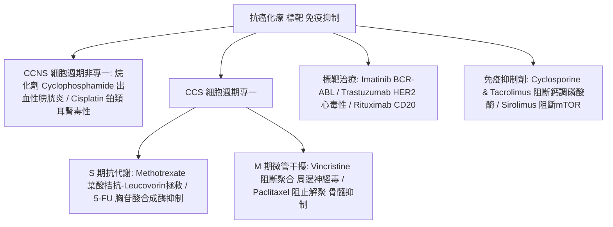

# 藥理學 第09章 抗腫瘤化療、標靶藥物與免疫調節抑制劑

## 核心知識體系架構
腫瘤與免疫藥理學為國考大熱門，涵蓋細胞週期非專一性（CCNS：烷化劑、鉑類、抗腫瘤抗生素）與細胞週期專一性（CCS：S期抗代謝藥、M期微管抑制劑）；分子標靶藥物（酪胺酸激酶抑制劑 TKIs、單株抗體 mAbs）；以及器官移植與自體免疫之免疫抑制劑（鈣調磷酸酶抑制劑、mTOR 抑制劑、抗代謝物）。

---

## 主題一：傳統化療藥物之器官特異性毒性與防護解毒劑

### 1. 國考必背「化療毒性與救援劑（Antidote/Rescue）」黃金配對矩陣
| 化療藥物類別 | 代表藥物 | 作用分子機轉 | 國考特徵致命毒性 | 專一性防護劑 / 解毒劑 / 救援劑 |
| :--- | :--- | :--- | :--- | :--- |
| **氮芥烷化劑** | **環磷醯胺（Cyclophosphamide）** | 於鳥嘌呤 $N^7$ 位形成 DNA 股間交聯 | 代謝產物**丙烯醛（Acrolein）** 濃縮於膀胱，引發**致死性出血性膀胱炎（Hemorrhagic cystitis）** | **美司鈉（MESNA）**：含強親核性硫醇基（-SH），於尿中直接中和 Acrolein；搭配大量輸液。 |
| **鉑類配合物** | **順鉑（Cisplatin）** | 結合於 DNA 鏈內形成雙加合物，破壞雙螺旋 | **嚴重腎毒性（急性腎小管壞死 ATN）**、周邊神經耳毒性、重度致吐 | **阿米福汀（Amifostine）**（游離基清除劑減輕腎毒性）；積極靜脈輸液維持高尿量。 |
| **葉酸抗代謝藥** | **甲氨蝶呤（Methotrexate, MTX）** | 競爭性強烈抑制 **二氫葉酸還原酶（DHFR）**，阻斷 dTMP 與嘌呤合成 | **嚴重骨髓抑制**、口腔黏膜炎潰瘍、肝纖維化、腎小管沉澱結晶 | **亞葉酸鈣（Leucovorin / 5-甲醯四氫葉酸）**：直接繞過受阻的 DHFR，提供活性四氫葉酸救援正常造血細胞（**Leucovorin Rescue**）！ |
| **嘧啶抗代謝藥** | **5-氟尿嘧啶（5-FU）** | 活化為 5-dUMP，與葉酸形成共價複合物抑制 **胸苷酸合成酶（Thymidylate synthase）** | 骨髓抑制、手足症候群（Hand-foot syndrome） | **Leucovorin 增效**（與 MTX 反向！Leucovorin 增強 5-FU 與胸苷酸合成酶之結合）；**Uridine 救急解毒**。 |
| **蒽環抗腫瘤抗生素** | **多柔比星（Doxorubicin / 阿黴素 Adriamycin）** | 嵌合於 DNA 鹼基間，抑制拓撲異構酶 II，並產生活性氧自由基（ROS） | **蓄積性擴張型心肌病變（Cardiotoxicity / 充血性心衰竭）** | **右雷佐生（Dexrazoxane）**：鐵離子螯合劑，阻止鐵與 Doxorubicin 複合物生成心毒性自由基。 |
| **植物鹼微管抑制** | **長春新鹼（Vincristine）** | 結合微管蛋白 Tubulin，**阻斷微管聚合（Inhibit polymerization）**，滯留於中期 | **周邊神經病變（Peripheral neuropathy：手指麻木麻痺、腸麻痺麻痺性腸阻塞）**，骨髓抑制極輕 | 嚴格維持腸道通暢；**絕對嚴禁鞘內注射（Intrathecal injection，致死性腦水腫腦壞死！）**。 |
| **紫杉醇類** | **太平洋紫杉醇（Paclitaxel）** | 超穩定微管結構，**阻止微管解聚（Prevent depolymerization）**，細胞無法分裂 | **重度骨髓抑制**（嗜中性球低下）、過敏性休克（溶劑聚氧乙烯蓖麻油誘發，給藥前需預處理類固醇與抗組織胺） | G-CSF 白血球生長因子支持。 |
| **抗腫瘤抗生素** | **博來黴素（Bleomycin）** | 螯合鐵離子產生自由基，誘發 DNA 單股與雙股斷裂 | **肺纖維化（Pulmonary fibrosis，高濃度吸氧會加重毒性！）**、皮膚色素過度沉積；無骨髓抑制 | 治療期間定期監測肺功能 DLCO。 |

---

## 主題二：標靶治療藥物（Targeted Therapy）

### 1. 酪胺酸激酶抑制劑（TKIs）與單株抗體（mAbs）
- **伊馬替尼（Imatinib / Gleevec）**：
  - 專一性小分子抑制 **BCR-ABL 融合酪胺酸激酶**，亦抑制 c-Kit 與 PDGFR。
  - **慢性骨髓性白血病（CML，$t(9;22)$ 費城染色體）及胃腸道基質瘤（GIST）首選神藥**。
- **曲妥珠單抗（Trastuzumab / Herceptin）**：
  - 人源化單株抗體，專一性拮抗 **HER2/neu（ErbB2）受體** 細胞外結構域。
  - **HER2 陽性侵襲性乳癌首選**。
  - **特徵毒性：擴張性心肌病變（Cardiotoxicity）**，臨床表現為無症狀 LVEF 下降（多數可逆），**嚴禁與 Doxorubicin 合用**以防嚴重加重心臟衰竭！
- **利妥昔單抗（Rituximab）**：
  - 抗 **CD20 單株抗體**，透過 ADCC 及補體依賴性細胞毒性（CDC）清除 B 細胞。
  - 治療 **彌漫大 B 細胞淋巴瘤（DLBCL）及重度類風濕性關節炎**。用藥前必須常規篩檢 B 型肝炎以防猛爆性肝炎復發。

---

## 主題三：器官移植免疫抑制劑（Immunosuppressive Agents）

### 1. 鈣調磷酸酶抑制劑（CNIs）vs. mTOR 抑制劑
- **環孢素（Cyclosporine）vs. 他克莫司（Tacrolimus / FK506）**：
  - **分子機制**：
    - Cyclosporine 結合細胞質內之 **親環素（Cyclophilin）**。
    - Tacrolimus 結合細胞質內之 **FKBP-12**。
    - 兩者複合物皆能專一性**抑制鈣調磷酸酶（Calcineurin / 磷酸酶）** $\to$ 阻止轉錄因子 NFAT 去磷酸化 $\to$ NFAT 無法入核 $\to$ **完全阻斷白介素-2（IL-2）之轉錄與 T 細胞活化增殖**！
  - **器官移植抗急性排斥第一線基石用藥**。
  - **特徵副作用**：**腎毒性（Nephrotoxicity，入球小動脈收縮，兩者皆具）**、神經毒性、高血壓、高血鉀。**Cyclosporine 特有：牙齦增生（Gingival hyperplasia）與多毛症（Hirsutism）**；Tacrolimus 無牙齦增生但高血糖糖尿病風險較高。
- **西羅莫司（Sirolimus / 雷帕黴素 Rapamycin）**：
  - 亦結合於 FKBP-12，但複合物**不抑制 Calcineurin**，而是專一性**抑制 mTOR 激酶（哺乳類雷帕黴素標靶）** $\to$ 阻斷 IL-2 受體下游信號傳導。
  - **最大優勢：幾乎沒有腎毒性（Kidney-sparing！）**，常用於腎功能受損之移植患者。特徵副作用：高血脂（高膽固醇、高甘油三酯）、骨髓抑制（貧血、血小板低下）、傷口癒合不良。

---

## 歷屆國考核心真題解析

### 【國考經典真題實戰】
**【試題編號】111-第一次-med2-055**
> **題目**：關於化療藥busulfan之敘述，下列何者錯誤？
- (A) 作用於DNA而抑制癌細胞增生與複製
- (B) 與cyclophosphamide同屬於烷化劑（alkylating agent），常用於治療乳癌
- (C) glutathione S-transferase活性增加時易引起抗藥性
- (D) 常見副作用為噁心、嘔吐

> **標準答案**：`B`
> 
> **【考點深度解析與選項拆解】**：
- **(A) 選項分析**：作用於DNA而抑制癌細胞增生與複製。核對抗腫瘤標靶受體、降血糖酵素抑制、抗痛風發炎或藥物動力學參數公式，確認其藥理學機轉。
- **(B) 選項分析**：與cyclophosphamide同屬於烷化劑（alkylating agent），常用於治療乳癌。檢視特徵性器官毒性（如心臟毒性、出血性膀胱炎、乳酸中毒或特定解毒劑），剖析考選部高頻命題陷阱。
- **(C) 選項分析**：glutathione S-transferase活性增加時易引起抗藥性。評估競爭性與非競爭性拮抗曲線位移、零級與一級消除速率，釐清易混淆概念。
- **(D) 選項分析**：常見副作用為噁心、嘔吐。比對臨床適應症或器官特異性代謝酵素，驗證題幹核心考查重點。
> **【國考核心解題金鑰】**：本題精準鎖定標準答案 **(B)**。考生須牢記化療毒性防護劑對應關係（如 Cyclophosphamide 對 MESNA、MTX 對 Leucovorin）、糖尿病口服新藥與重金屬解毒劑，即可秒殺奪冠。

---
### 【國考經典真題實戰】
**【試題編號】111-第一次-med2-061**
> **題目**：下列何種藥物的主要作用受體不位在細胞膜上，而是在細胞內部？
- (A) erlotinib
- (B) metoclopramide
- (C) prednisolone
- (D) diphenhydramine

> **標準答案**：`C`
> 
> **【考點深度解析與選項拆解】**：
- **(A) 選項分析**：erlotinib。核對抗腫瘤標靶受體、降血糖酵素抑制、抗痛風發炎或藥物動力學參數公式，確認其藥理學機轉。
- **(B) 選項分析**：metoclopramide。檢視特徵性器官毒性（如心臟毒性、出血性膀胱炎、乳酸中毒或特定解毒劑），剖析考選部高頻命題陷阱。
- **(C) 選項分析**：prednisolone。評估競爭性與非競爭性拮抗曲線位移、零級與一級消除速率，釐清易混淆概念。
- **(D) 選項分析**：diphenhydramine。比對臨床適應症或器官特異性代謝酵素，驗證題幹核心考查重點。
> **【國考核心解題金鑰】**：本題精準鎖定標準答案 **(C)**。考生須牢記化療毒性防護劑對應關係（如 Cyclophosphamide 對 MESNA、MTX 對 Leucovorin）、糖尿病口服新藥與重金屬解毒劑，即可秒殺奪冠。

---
### 【國考經典真題實戰】
**【試題編號】111-第二次-第一階段-med2-053**
> **題目**：下列何者為抗微小管藥物（anti-microtubule drug），可抑制癌細胞分裂而產生抗癌作用？
- (A) capecitabine
- (B) cabazitaxel
- (C) cladribine
- (D) chlorambucil

> **標準答案**：`B`
> 
> **【考點深度解析與選項拆解】**：
- **(A) 選項分析**：capecitabine。核對抗腫瘤標靶受體、降血糖酵素抑制、抗痛風發炎或藥物動力學參數公式，確認其藥理學機轉。
- **(B) 選項分析**：cabazitaxel。檢視特徵性器官毒性（如心臟毒性、出血性膀胱炎、乳酸中毒或特定解毒劑），剖析考選部高頻命題陷阱。
- **(C) 選項分析**：cladribine。評估競爭性與非競爭性拮抗曲線位移、零級與一級消除速率，釐清易混淆概念。
- **(D) 選項分析**：chlorambucil。比對臨床適應症或器官特異性代謝酵素，驗證題幹核心考查重點。
> **【國考核心解題金鑰】**：本題精準鎖定標準答案 **(B)**。考生須牢記化療毒性防護劑對應關係（如 Cyclophosphamide 對 MESNA、MTX 對 Leucovorin）、糖尿病口服新藥與重金屬解毒劑，即可秒殺奪冠。