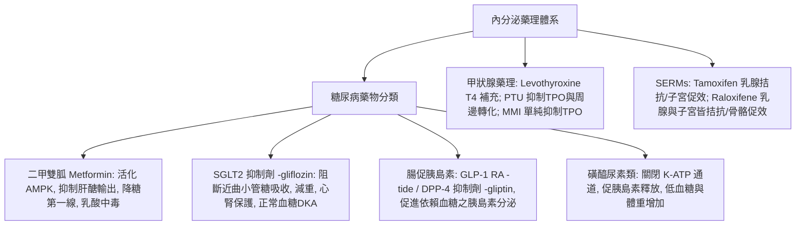

# 藥理學 第10章 內分泌藥理學：糖尿病、甲狀腺與皮質類固醇

## 核心知識體系架構
內分泌藥理涵蓋糖尿病口服降血糖藥（Biguanides, SGLT2i, GLP-1RA, DPP-4i, Sulfonylureas, TZDs）與胰島素製劑；抗甲狀腺藥物與甲狀腺素補充；全身性皮質類固醇之抗發炎免疫抑制與 HPA 軸抑制撤退症候群；以及性荷爾蒙調節劑（SERMs, 芳香酶抑制劑）。

---

## 主題一：口服降血糖藥物（OADs）機轉與心腎保護

### 1. 六大類降血糖藥物精準考點對比表
| 藥物分類 | 代表藥物 | 作用分子機轉 | 低血糖風險 | 體重變動 | 國考必背關鍵考點與致命禁忌 |
| :--- | :--- | :--- | :--- | :--- | :--- |
| **雙胍類 (Biguanides)** | **二甲雙胍（Metformin）** | 活化 **AMPK 蛋白激酶** $\to$ 抑制肝臟糖質新生；增加周邊組織胰島素敏感度 | **極低（不刺激胰島素）** | **輕度減輕或持平** | **第 2 型糖尿病終身第一線首選神藥**。 致命禁忌：**乳酸中毒（Lactic acidosis）**！在 eGFR $< 30\text{ mL/min}$、嚴重肝衰竭、敗血休克或接受含碘顯影劑檢查時**必須停藥**！ |
| **SGLT2 抑制劑** | **Empagliflozin, Dapagliflozin** | 專一性阻斷腎臟近曲小管 **SGLT2 轉運蛋白**，促進尿中葡萄糖排泄（約 70g/天） | **極低** | **顯著減輕** (2~3 kg) | **ASCVD、心衰竭（HFrEF/HFpEF）及慢性腎臟病（CKD）證實降低死亡率首選神藥**！ 特徵副作用：**生殖泌尿道真菌感染（念珠菌陰道炎/龜頭炎）**、**正常血糖性糖尿病酮酸中毒（Euglycemic DKA）**。 |
| **GLP-1 受體促效劑 (GLP-1 RA)** | **Semaglutide, Liraglutide, Dulaglutide** | 活化 GLP-1 受體 $\to$ **葡萄糖濃度依賴性刺激胰島素分泌**、抑制升糖素、延緩胃排空、中樞抑制食慾 | **極低** | **大幅減輕** (最強減肥藥) | **ASCVD 與肥胖首選**。注射劑型為主（Semaglutide 有口服劑型）。 黑框警告：**甲狀腺髓質癌（MTC）或第 2 型多發性內分泌腫瘤（MEN2）個人或家族史者禁用**！急性胰臟炎風險。 |
| **DPP-4 抑制劑** | **Sitagliptin, Linagliptin** | 競爭性抑制 DPP-4 酵素，**延長內生性 GLP-1 與 GIP 的半衰期** | **極低** | 持平 | 口服耐受性極佳，幾乎無低血糖或胃腸副作用。**Linagliptin 經膽道排泄，嚴重腎功能不全者無需調整劑量**！ |
| **磺醯尿素類 (Sulfonylureas)** | **Glipizide, Glimepiride, Glyburide** | 專一性結合併關閉 $\beta$ 細胞的 **$K_{ATP}$ 通道（SUR1）** $\to$ 去極化 $\to$ 刺激胰島素持續胞吐 | **極高（低血糖首因）** | **增加** (1~3 kg) | 老年人易引發長效型致死性低血糖。**Glyburide（Glibenclamide）代謝產物具活性且經腎排泄，腎衰竭禁用**！ |
| **噻唑烷二酮類 (TZDs)** | **Pioglitazone, Rosiglitazone** | 結合併活化核受體 **PPAR-$\gamma$**，上調 GLUT4 與脂聯素，改善胰島素阻抗 | **極低** | **顯著增加** | 特徵副作用：**液體滯留與下肢水腫（心衰竭 NYHA Class III/IV 絕對禁用！）**、骨質疏鬆與病理性骨折。 |

---

## 主題二：性荷爾蒙調節劑（SERMs 與芳香酶抑制劑）

### 1. 選擇性動情素受體調節劑（SERMs）組織特異性大對決
- **他莫昔芬（Tamoxifen）**：
  - **乳腺組織**：**動情素受體拮抗劑（Antagonist）** $\to$ 治療與預防 ER 陽性乳癌。
  - **骨骼組織**：**促效劑（Agonist）** $\to$ 預防停經後骨質疏鬆。
  - **子宮內膜**：**微弱促效劑（Partial Agonist）** $\to$ **長期使用刺激子宮內膜增生，顯著增加子宮內膜癌（Endometrial cancer）風險**！
  - 增加深層靜脈血栓（DVT）與肺栓塞風險；引發熱潮紅。
- **雷洛昔芬（Raloxifene）**：
  - **乳腺組織**：**拮抗劑（Antagonist）** $\to$ 降低乳癌風險。
  - **骨骼組織**：**促效劑（Agonist）** $\to$ **停經後骨質疏鬆症第一線預防與治療首選**！
  - **子宮內膜**：**拮抗劑（Antagonist！）** $\to$ **完全不刺激子宮內膜，絕對不增加子宮內膜癌風險**！
- **芳香酶抑制劑（Aromatase Inhibitors：Anastrozole, Letrozole, Exemestane）**：
  - 阻斷周邊脂肪組織中之 **芳香酶（CYP19A1）**，徹底阻斷雄烯二酮轉化為動情素。
  - **停經後婦女 ER 陽性晚期乳癌之第一線荷爾蒙治療首選**！骨質流失與骨折風險高。

---

## 歷屆國考核心真題解析

### 【國考經典真題實戰】
**【試題編號】111-第一次-med2-060**
> **題目**：王先生因甲狀腺癌接受手術切除後，出現倦怠、嗜睡、水腫等現象。在醫院抽血檢查發現有甲狀腺機能低下 （hypothyroidism）的情況，並有上呼吸道感染造成的輕微發燒與咳嗽。依據上述情形，他比較不適合使用下 列那一種藥物？
- (A) levothyroxine
- (B) dextromethorphan
- (C) methimazole
- (D) acetaminophen

> **標準答案**：`C`
> 
> **【考點深度解析與選項拆解】**：
- **(A) 選項分析**：levothyroxine。核對抗腫瘤標靶受體、降血糖酵素抑制、抗痛風發炎或藥物動力學參數公式，確認其藥理學機轉。
- **(B) 選項分析**：dextromethorphan。檢視特徵性器官毒性（如心臟毒性、出血性膀胱炎、乳酸中毒或特定解毒劑），剖析考選部高頻命題陷阱。
- **(C) 選項分析**：methimazole。評估競爭性與非競爭性拮抗曲線位移、零級與一級消除速率，釐清易混淆概念。
- **(D) 選項分析**：acetaminophen。比對臨床適應症或器官特異性代謝酵素，驗證題幹核心考查重點。
> **【國考核心解題金鑰】**：本題精準鎖定標準答案 **(C)**。考生須牢記化療毒性防護劑對應關係（如 Cyclophosphamide 對 MESNA、MTX 對 Leucovorin）、糖尿病口服新藥與重金屬解毒劑，即可秒殺奪冠。

---
### 【國考經典真題實戰】
**【試題編號】111-第二次-第一階段-med2-059**
> **題目**：下列何種狀況比較不適合用octreotide 治療？
- (A) 胃泌素瘤
- (B) 食道靜脈瘤出血
- (C) 急性便秘
- (D) 胰島素瘤

> **標準答案**：`C`
> 
> **【考點深度解析與選項拆解】**：
- **(A) 選項分析**：胃泌素瘤。核對抗腫瘤標靶受體、降血糖酵素抑制、抗痛風發炎或藥物動力學參數公式，確認其藥理學機轉。
- **(B) 選項分析**：食道靜脈瘤出血。檢視特徵性器官毒性（如心臟毒性、出血性膀胱炎、乳酸中毒或特定解毒劑），剖析考選部高頻命題陷阱。
- **(C) 選項分析**：急性便秘。評估競爭性與非競爭性拮抗曲線位移、零級與一級消除速率，釐清易混淆概念。
- **(D) 選項分析**：胰島素瘤。比對臨床適應症或器官特異性代謝酵素，驗證題幹核心考查重點。
> **【國考核心解題金鑰】**：本題精準鎖定標準答案 **(C)**。考生須牢記化療毒性防護劑對應關係（如 Cyclophosphamide 對 MESNA、MTX 對 Leucovorin）、糖尿病口服新藥與重金屬解毒劑，即可秒殺奪冠。

---
### 【國考經典真題實戰】
**【試題編號】112-第一次-med2-068**
> **題目**：使用吸入型皮質類固醇仍無法有效控制氣喘時，最適合併用下列何種藥物以預防氣喘發作？
- (A) ephedrine
- (B) formoterol
- (C) roflumilast
- (D) zileuton

> **標準答案**：`B`
> 
> **【考點深度解析與選項拆解】**：
- **(A) 選項分析**：ephedrine。核對抗腫瘤標靶受體、降血糖酵素抑制、抗痛風發炎或藥物動力學參數公式，確認其藥理學機轉。
- **(B) 選項分析**：formoterol。檢視特徵性器官毒性（如心臟毒性、出血性膀胱炎、乳酸中毒或特定解毒劑），剖析考選部高頻命題陷阱。
- **(C) 選項分析**：roflumilast。評估競爭性與非競爭性拮抗曲線位移、零級與一級消除速率，釐清易混淆概念。
- **(D) 選項分析**：zileuton。比對臨床適應症或器官特異性代謝酵素，驗證題幹核心考查重點。
> **【國考核心解題金鑰】**：本題精準鎖定標準答案 **(B)**。考生須牢記化療毒性防護劑對應關係（如 Cyclophosphamide 對 MESNA、MTX 對 Leucovorin）、糖尿病口服新藥與重金屬解毒劑，即可秒殺奪冠。