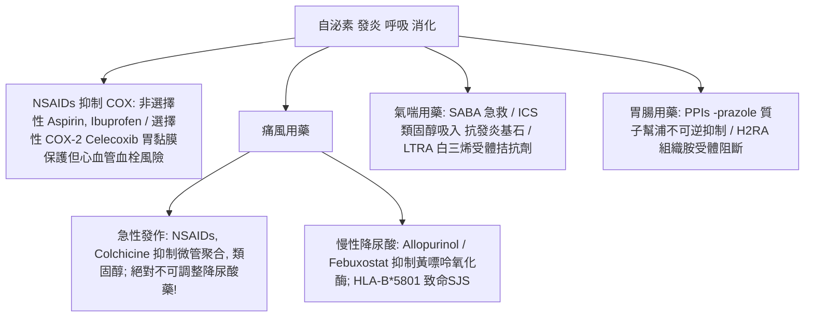

# 藥理學 第11章 自泌素、呼吸、消化、抗痛風與抗發炎藥理學

## 核心知識體系架構
本章匯總自泌素（組織胺、前列腺素、白三烯素）；非類固醇抗發炎藥（NSAIDs 與選擇性 COX-2 抑制劑 Celecoxib）；痛風急性發作與慢性降尿酸治療策略；氣喘階梯式呼吸用藥；以及消化性潰瘍胃酸抑制劑。

---

## 主題一：NSAIDs 分類、機轉與阿斯匹靈特異毒性

### 1. 非選擇性 NSAIDs vs. 選擇性 COX-2 抑制劑（Celecoxib）
- **環氧化酶雙異構酶（COX-1 vs. COX-2）**：
  - **COX-1（結構型 Constitutive）**：廣泛表現於全身，合成 $PGE_2$ 與 $PGI_2$ 保護胃黏膜屏障、維持腎小管血流，並在血小板合成 **$TXA_2$（促進血小板凝集與血管收縮）**。
  - **COX-2（誘導型 Inducible）**：由發炎細胞因子（IL-1, TNF-$\alpha$）在發炎組織中誘導表現，合成致炎前列腺素介導紅腫熱痛。在血管內皮細胞持續表現合成 **$PGI_2$（前列腺素前列環素，強烈抑制血小板凝集並擴張血管）**。
- **阿斯匹靈（Aspirin / 乙醯水楊酸 ASA）**：
  - **唯一不可逆性（Irreversible）共價乙醯化 COX-1 與 COX-2 的 NSAID**！
  - **低劑量抗血小板（81~100 mg/day）**：血小板無細胞核無法重新合成蛋白質，其 COX-1 被不可逆破壞後終身喪失生成 $TXA_2$ 之能力（持續 7~10 天血小板生命週期）。內皮細胞有核可再生 COX-2 生成 $PGI_2$。
  - **雷氏症候群（Reye's syndrome）**：兒童或青少年患病毒感染（水痘、流感）時若服用 Aspirin，可能引發猛爆性肝衰竭合併急性腦病變與脂肪肝（致死率高達 30%）。**兒童病毒發燒絕對禁用 Aspirin（首選 Acetaminophen）**！
- **選擇性 COX-2 抑制劑：塞來昔布（Celecoxib）**：
  - 專一性抑制 COX-2，不抑制 COX-1。**胃腸道潰瘍與出血風險顯著低於傳統 NSAIDs**。
  - **心血管血栓黑框警告**：抑制血管內皮生成抗凝的 $PGI_2$，但未抑制血小板生成促凝的 $TXA_2$，打破平衡導致心肌梗塞與中風風險升高！磺胺過敏者禁用。

---

## 主題二：痛風（Gout）藥理：急性發作 vs. 慢性降尿酸

### 1. 急性關節炎發作與慢性降尿酸兩階段處方策略
| 治療階段 | 推薦第一線首選藥物 | 作用分子機轉 | 國考必背關鍵考點與致命禁忌 |
| :--- | :--- | :--- | :--- |
| **急性痛風發作（Acute Flare）** | **高劑量 NSAIDs**（Indomethacin, Naproxen） 或 **秋水仙素（Colchicine）** 或 **全身性類固醇** | **秋水仙素（Colchicine）**：結合於微管蛋白（Tubulin）阻斷微管聚合，抑制嗜中性球趨化、遊走與吞噬尿酸結晶 | **急性期黃金鐵律：絕對不可隨意開始或停用降尿酸藥物（Allopurinol）！**（尿酸波動會撕裂痛風石晶體導致滑膜發炎劇烈惡化）。 Colchicine 特徵毒性：腹部絞痛、嚴重腹瀉、骨髓抑制。 |
| **慢性痛風降尿酸（Chronic / Intercritical）** | **別嘌醇（Allopurinol）** 或 **非布司他（Febuxostat）** | 專一性競爭性抑制 **黃嘌呤氧化酶（Xanthine Oxidase）**，阻斷次黃嘌呤與黃嘌呤轉化為尿酸 | **Allopurinol 致命過敏性重症（DRESS / SJS/TEN）**：**HLA-B*5801 基因陽性者（台灣漢人族群頻率高達 15~20%）風險極高**！衛福部健保規定用藥前**必須常規檢測 HLA-B*5801 基因**！ Febuxostat 為非嘌呤選擇性 XO 抑制劑，適合 HLA-B*5801 陽性或腎功能不全者。 |
| **促尿酸排泄劑** | **苯溴馬隆（Benzbromarone）、丙磺舒（Probenecid）** | 抑制腎近曲小管頂端膜之 **URAT1 轉運體**，阻斷尿酸再吸收，增加尿中排泄 | 僅適用於「腎臟排泄低下型」且**無腎結石之患者**；需大量飲水並鹼化尿液，嚴重腎結石或重度腎衰竭者禁用。 |

---

## 主題三：氣喘（Asthma）階梯式吸入用藥

### 1. 氣喘四大關鍵藥物類別
- **吸入型皮質類固醇（ICS：Fluticasone, Budesonide）**：
  - **持續性氣喘抗發炎之基石與第一線黃金治療**。局部吸入直達氣道，全身副作用極低。
  - 特徵局部副作用：**口腔念珠菌鵝口瘡（Oral candidiasis）** 與聲音嘶啞（Dysphonia）。**預防對策：使用吸藥輔助艙（Spacer）並在吸入後徹底以清水漱口吐出**。
- **長效 $\beta_2$ 促效劑（LABA：Salmeterol, Formoterol）**：
  - 舒張支氣管，維持 12 小時以上。**氣喘治療中絕對嚴禁單獨使用 LABA（Monotherapy）**！單用 LABA 無抗發炎作用且會掩蓋病情，大幅增加氣喘急性發作致死率；**必須強制與 ICS 複方合用**！
- **短效 $\beta_2$ 促效劑（SABA：Albuterol）**：急性氣喘發作呼吸困難之**第一線急救舒緩藥**。
- **白三烯素受體拮抗劑（LTRA：Montelukast, Zafirlukast）**：
  - 專一性阻斷 **$CysLT_1$ 受體**，特別適合用於**阿斯匹靈誘發型氣喘（Aspirin-exacerbated respiratory disease, AERD）** 及伴隨過敏性鼻炎之氣喘病患。

---

## 歷屆國考核心真題解析

### 【國考經典真題實戰】
**【試題編號】111-第一次-med2-053**
> **題目**：下列用於免疫調節及抗發炎藥物，何者的作用機轉非經由阻斷介白素（interleukin）功能？
- (A) canakinumab
- (B)\betanercept
- (C) tocilizumab
- (D) ustekinumab

> **標準答案**：`B`
> 
> **【考點深度解析與選項拆解】**：
- **(A) 選項分析**：canakinumab。核對抗腫瘤標靶受體、降血糖酵素抑制、抗痛風發炎或藥物動力學參數公式，確認其藥理學機轉。
- **(B) 選項分析**：etanercept。檢視特徵性器官毒性（如心臟毒性、出血性膀胱炎、乳酸中毒或特定解毒劑），剖析考選部高頻命題陷阱。
- **(C) 選項分析**：tocilizumab。評估競爭性與非競爭性拮抗曲線位移、零級與一級消除速率，釐清易混淆概念。
- **(D) 選項分析**：ustekinumab。比對臨床適應症或器官特異性代謝酵素，驗證題幹核心考查重點。
> **【國考核心解題金鑰】**：本題精準鎖定標準答案 **(B)**。考生須牢記化療毒性防護劑對應關係（如 Cyclophosphamide 對 MESNA、MTX 對 Leucovorin）、糖尿病口服新藥與重金屬解毒劑，即可秒殺奪冠。

---
### 【國考經典真題實戰】
**【試題編號】111-第一次-med2-068**
> **題目**：下列何種治療氣喘藥物可與病人血中IgE形成複合體，由肝臟吞噬細胞清除？
- (A) mepolizumab
- (B) tocilizumab
- (C) omalizumab
- (D) efalizumab

> **標準答案**：`C`
> 
> **【考點深度解析與選項拆解】**：
- **(A) 選項分析**：mepolizumab。核對抗腫瘤標靶受體、降血糖酵素抑制、抗痛風發炎或藥物動力學參數公式，確認其藥理學機轉。
- **(B) 選項分析**：tocilizumab。檢視特徵性器官毒性（如心臟毒性、出血性膀胱炎、乳酸中毒或特定解毒劑），剖析考選部高頻命題陷阱。
- **(C) 選項分析**：omalizumab。評估競爭性與非競爭性拮抗曲線位移、零級與一級消除速率，釐清易混淆概念。
- **(D) 選項分析**：efalizumab。比對臨床適應症或器官特異性代謝酵素，驗證題幹核心考查重點。
> **【國考核心解題金鑰】**：本題精準鎖定標準答案 **(C)**。考生須牢記化療毒性防護劑對應關係（如 Cyclophosphamide 對 MESNA、MTX 對 Leucovorin）、糖尿病口服新藥與重金屬解毒劑，即可秒殺奪冠。

---
### 【國考經典真題實戰】
**【試題編號】111-第一次-med2-070**
> **題目**：下列何種抗噁心嘔吐藥物最適合用於懷孕的婦女，其作用機轉是透過拮抗H1 receptor？
- (A) ondansetron
- (B) ranitidine
- (C) tiprolisant
- (D) Diclegis

> **標準答案**：`D`
> 
> **【考點深度解析與選項拆解】**：
- **(A) 選項分析**：ondansetron。核對抗腫瘤標靶受體、降血糖酵素抑制、抗痛風發炎或藥物動力學參數公式，確認其藥理學機轉。
- **(B) 選項分析**：ranitidine。檢視特徵性器官毒性（如心臟毒性、出血性膀胱炎、乳酸中毒或特定解毒劑），剖析考選部高頻命題陷阱。
- **(C) 選項分析**：tiprolisant。評估競爭性與非競爭性拮抗曲線位移、零級與一級消除速率，釐清易混淆概念。
- **(D) 選項分析**：Diclegis。比對臨床適應症或器官特異性代謝酵素，驗證題幹核心考查重點。
> **【國考核心解題金鑰】**：本題精準鎖定標準答案 **(D)**。考生須牢記化療毒性防護劑對應關係（如 Cyclophosphamide 對 MESNA、MTX 對 Leucovorin）、糖尿病口服新藥與重金屬解毒劑，即可秒殺奪冠。