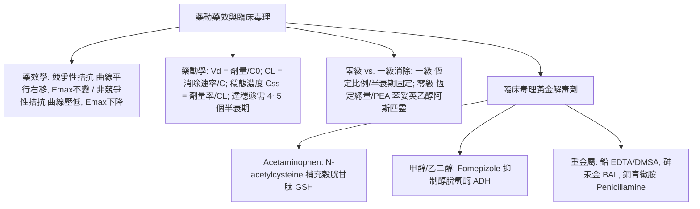

# 藥理學 第12章 毒理學、臨床解毒劑與藥動藥效動力學

## 核心知識體系架構
本章統整藥理學基本計量法則與臨床毒理學救急大成：藥效動力學（促效劑、部分促效劑、競爭性 vs. 非競爭性拮抗劑、受體儲備備用現象）；藥物代謝動力學（分佈體積 Vd、清除率 CL、半衰期、一級 vs. 零級消除動力學、生體利用率、CYP450 酵素誘導與抑制）；以及常見臨床中毒之專一性解毒劑（Antidotes）。

---

## 主題一：藥效動力學（Pharmacodynamics）基本曲線位移

### 1. 促效劑與拮抗劑量效曲線特徵對照矩陣
| 藥物受體交互作用型態 | 效價強度（Potency / $EC_{50}$）變動 | 最大效能（Efficacy / $E_{max}$）變動 | 量效曲線（Dose-Response Curve）幾何特徵 | 典型範例 |
| :--- | :--- | :--- | :--- | :--- |
| **完全促效劑 (Full Agonist)** | 基準值 | 100%（基準值） | 典型 S 型曲線 | 嗎啡（Morphine）於 $\mu$ 受體 |
| **部分促效劑 (Partial Agonist)** | 可高可低 | **顯著下降（$< 100\%$）** | 曲線頂部被壓低，無法達 100% 效能。在完全促效劑存在下表現為**競爭性拮抗**！ | **Buprenorphine**、Pindolol |
| **競爭性拮抗劑 (Competitive Antagonist)** | **效價下降（$EC_{50}$ 變大）** | **完全不變（$E_{max}$ 維持 100%）** | **曲線呈平行向右位移（Parallel shift to the right）**。只要給予極高濃度促效劑即可完全克服阻斷！ | **Atropine** vs. Ach；**Prazosin** vs. NE；**Naloxone** vs. Morphine |
| **非競爭性拮抗劑 (Non-competitive Antagonist)** | 效價通常不變 | **最大效能顯著下降（$E_{max} \downarrow$）** | **曲線被不可逆垂直壓低（Emax 降低）**，無法藉由增加促效劑濃度來克服！ | **Phenoxybenzamine**（不可逆阻斷 $\alpha$）；Ketamine |

---

## 主題二：藥物代謝動力學（Pharmacokinetics）核心方程式

### 1. 國考必背四大計算公式
1. **分佈體積（Volume of Distribution, $V_d$）**：
   $$V_d = \frac{\text{體內藥物總量 (Amount of drug in body)}}{\text{血漿藥物濃度 (Plasma drug concentration, } C_p)}$$
   - $V_d$ 極小（4~8 L，限於血漿）：大分子、高血漿蛋白結合率（如 Warfarin, Heparin）。
   - $V_d$ 極大（$> 1000\text{ L}$，遠超人體體重）：高脂溶性、深層組織脂肪/肌肉蓄積（如 Chloroquine, Digoxin）。血液透析無法清除。
2. **清除率（Clearance, $CL$）**：
   $$CL = \frac{\text{藥物消除速率 (Rate of elimination)}}{C_p} = k_e \times V_d$$
3. **半衰期（Half-life, $t_{1/2}$）**：
   $$t_{1/2} = \frac{0.693 \times V_d}{CL}$$
   - **重要臨床法則**：持續恆速給藥下，**達到 90% 穩態血中濃度（Steady-state concentration, $C_{ss}$）需要 3.3 個半衰期；達到 95% 以上穩態需要 4 至 5 個半衰期**！停止給藥後，體內藥物徹底清除亦需 4~5 個半衰期。
4. **維持劑量（Maintenance Dose, MD）與首劑負荷量（Loading Dose, LD）**：
   $$\text{Loading Dose} = \frac{C_{target} \times V_d}{F} \qquad \text{Maintenance Dose Rate} = \frac{C_{target} \times CL}{F}$$
   （$F$ 為口服生體利用率 Bioavailability，靜脈注射時 $F = 1$）。

### 2. 零級消除（Zero-order）vs. 一級消除（First-order）
- **一級消除動力學（First-order kinetics，絕大多數藥物）**：
  - **恆定比例消除**（單位時間內消除固定百分比，如每半衰期消除 50%）。
  - 消除速率與血漿濃度成正比；半衰期（$t_{1/2}$）為常數，不隨劑量改變。
- **零級消除動力學（Zero-order kinetics / 容量飽和動力學）**：
  - **恆定總量消除**（代謝酵素全數飽和，單位時間內僅能消除固定毫克數）。
  - **無固定半衰期**！當劑量微幅增加，血中濃度將呈現不成比例之指數型狂飆，極易中毒！
  - **國考三大零級消除神藥（口訣：PEA 豌豆）**：**P**henytoin（苯妥英）、**E**thanol（酒精）、**A**spirin（高劑量阿斯匹靈）。

---

## 主題三：臨床中毒常見物質與特異解毒劑（Antidotes）全覽

### 1. 國考最高頻毒物與解毒劑黃金總表
| 中毒物質 / 毒性藥物 | 臨床特徵表現 | 專一性首選解毒劑（Antidote） | 解毒分子機制 |
| :--- | :--- | :--- | :--- |
| **乙醯胺酚 (Acetaminophen / APAP)** | 48~72 小時猛爆性肝壞死、黃疸、AST/ALT 破萬 | **N-乙醯半胱胺酸（N-acetylcysteine, NAC）** | 補充細胞內耗竭的 **穀胱甘肽（GSH）**，解毒有毒中間代謝物 NAPQI |
| **甲醇 (Methanol) 與乙二醇 (Ethylene glycol)** | 嚴重高陰離子間隙酸中毒；甲醇致視神經水腫失明；乙二醇產草酸致急性腎衰竭 | **甲吡唑（Fomepizole）**（或口服/IV 高濃度乙醇 Ethanol） | 專一性競爭抑制 **醇脫氫酶（Alcohol dehydrogenase, ADH）**，阻斷其轉化為有毒甲酸/乙醇酸 |
| **一氧化碳 (CO)** | 櫻桃紅皮膚黏膜（罕見）、頭痛昏迷、乳酸中毒 | **100% 高濃度常壓氧** 或 **高壓氧艙（Hyperbaric $O_2$）** | 大幅縮短碳氧血紅素（HbCO）半衰期（由 300 分鐘縮短至 20 分鐘） |
| **氰化物 (Cyanide)** | 抑制粒線體細胞色素氧化酶，動靜脈血氧差縮小，重度乳酸中毒 | **羥鈷胺（Hydroxocobalamin）** 或 **亞硝酸鈉（$NaNO_2$）+ 硫代硫酸鈉（$Na_2S_2O_3$）** | 羥鈷胺直接結合生成無毒維生素 B12；亞硝酸鈉氧化血紅素生成高鐵血紅素搶奪氰基，硫代硫酸鈉提供硫基由硫氰酸酶轉化排泄 |
| **鉛中毒 (Lead toxicity)** | 腹絞痛、貧血伴嗜鹼性點彩紅血球（Basophilic stippling）、腕下垂橈神經麻痺 | 兒童：**DMSA（琥珀酸二巰）** 成人重症：**EDTA 鈣鈉（$CaNa_2\text{-EDTA}$）** 合併 **二巰基丙醇（BAL）** | 重金屬螯合劑，促進金屬水溶性經尿排出 |
| **砷中毒 (Arsenic) / 汞中毒 (Mercury)** | 蒜臭味呼氣、嚴重出血性腹瀉、多發性神經病變 | **二巰基丙醇（BAL / Dimercaprol）** 或 **DMSA** | 提供雙硫醇基（-SH）螯合重金屬 |
| **銅中毒 / 威爾森氏症 (Wilson's disease)** | 肝硬化、基底核退化震顫、角膜 KF 環（Kayser-Fleischer rings） | **青黴胺（Penicillamine）** 或 **曲恩汀（Trientine）** | 銅離子螯合劑 |
| **抗凝血藥 Warfarin 中毒** | INR 顯著延長、全身黏膜皮下嚴重出血 | 急性嚴重：**凝血胸原複合物（4F-PCC）** 次緊急：**維生素 K1（Phytonadione）** | 補充依賴維生素 K 之凝血因子 II, VII, IX, X |
| **肝素（Heparin）過量出血** | aPTT 顯著延長 | **硫酸魚精蛋白（Protamine sulfate）** | 帶高度強正電荷胜肽，與帶強負電荷的肝素分子形成化學中和複合物 |
| **$\beta$ 阻斷劑（$\beta$-blocker）中毒** | 嚴重竇性心搏過緩、低血壓、心因性休克 | **升糖素（Glucagon）** | 繞過被阻斷的 $\beta$ 受體，直接活化心肌細胞之 Gs-AC，提升 intracellular cAMP 恢復心跳！ |

---

## 歷屆國考核心真題解析

### 【國考經典真題實戰】
**【試題編號】111-第二次-第一階段-med2-051**
> **題目**：Warfarin 在人體內的代謝主要受到下列那兩種基因的多型性變異（polymorphism）影響？
- (A) CYP2C19 和VKORC1（vitamin K epoxide reductase complex subunit 1）
- (B) CYP2C9 和VKORC1
- (C) CYP2D6 和VKORC1
- (D) CYP2B6 和CYP2C19

> **標準答案**：`B`
> 
> **【考點深度解析與選項拆解】**：
- **(A) 選項分析**：CYP2C19 和VKORC1（vitamin K epoxide reductase complex subunit 1）。核對抗腫瘤標靶受體、降血糖酵素抑制、抗痛風發炎或藥物動力學參數公式，確認其藥理學機轉。
- **(B) 選項分析**：CYP2C9 和VKORC1。檢視特徵性器官毒性（如心臟毒性、出血性膀胱炎、乳酸中毒或特定解毒劑），剖析考選部高頻命題陷阱。
- **(C) 選項分析**：CYP2D6 和VKORC1。評估競爭性與非競爭性拮抗曲線位移、零級與一級消除速率，釐清易混淆概念。
- **(D) 選項分析**：CYP2B6 和CYP2C19。比對臨床適應症或器官特異性代謝酵素，驗證題幹核心考查重點。
> **【國考核心解題金鑰】**：本題精準鎖定標準答案 **(B)**。考生須牢記化療毒性防護劑對應關係（如 Cyclophosphamide 對 MESNA、MTX 對 Leucovorin）、糖尿病口服新藥與重金屬解毒劑，即可秒殺奪冠。

---
### 【國考經典真題實戰】
**【試題編號】111-第二次-第一階段-med2-066**
> **題目**：下列藥物中，何者對M3蕈毒性受體（M3 muscarinic receptor）的選擇性最高，因有較長半衰期，故一天只需服 藥一次即可用於治療成人尿失禁（urinary incontinence）？
- (A) darifenacin
- (B) tolterodine
- (C) oxybutynin
- (D) trospium

> **標準答案**：`A`
> 
> **【考點深度解析與選項拆解】**：
- **(A) 選項分析**：darifenacin。核對抗腫瘤標靶受體、降血糖酵素抑制、抗痛風發炎或藥物動力學參數公式，確認其藥理學機轉。
- **(B) 選項分析**：tolterodine。檢視特徵性器官毒性（如心臟毒性、出血性膀胱炎、乳酸中毒或特定解毒劑），剖析考選部高頻命題陷阱。
- **(C) 選項分析**：oxybutynin。評估競爭性與非競爭性拮抗曲線位移、零級與一級消除速率，釐清易混淆概念。
- **(D) 選項分析**：trospium。比對臨床適應症或器官特異性代謝酵素，驗證題幹核心考查重點。
> **【國考核心解題金鑰】**：本題精準鎖定標準答案 **(A)**。考生須牢記化療毒性防護劑對應關係（如 Cyclophosphamide 對 MESNA、MTX 對 Leucovorin）、糖尿病口服新藥與重金屬解毒劑，即可秒殺奪冠。

---
### 【國考經典真題實戰】
**【試題編號】111-第二次-第一階段-med2-069**
> **題目**：下列何種藥物對冷所引起的蕁麻疹（cold-induced urticaria）及類癌瘤（carcinoid tumor）的平滑肌症狀，具有改 善的作用？
- (A) ketanserin
- (B) ritanserin
- (C) cyproheptadine
- (D) ondansetron

> **標準答案**：`C`
> 
> **【考點深度解析與選項拆解】**：
- **(A) 選項分析**：ketanserin。核對抗腫瘤標靶受體、降血糖酵素抑制、抗痛風發炎或藥物動力學參數公式，確認其藥理學機轉。
- **(B) 選項分析**：ritanserin。檢視特徵性器官毒性（如心臟毒性、出血性膀胱炎、乳酸中毒或特定解毒劑），剖析考選部高頻命題陷阱。
- **(C) 選項分析**：cyproheptadine。評估競爭性與非競爭性拮抗曲線位移、零級與一級消除速率，釐清易混淆概念。
- **(D) 選項分析**：ondansetron。比對臨床適應症或器官特異性代謝酵素，驗證題幹核心考查重點。
> **【國考核心解題金鑰】**：本題精準鎖定標準答案 **(C)**。考生須牢記化療毒性防護劑對應關係（如 Cyclophosphamide 對 MESNA、MTX 對 Leucovorin）、糖尿病口服新藥與重金屬解毒劑，即可秒殺奪冠。