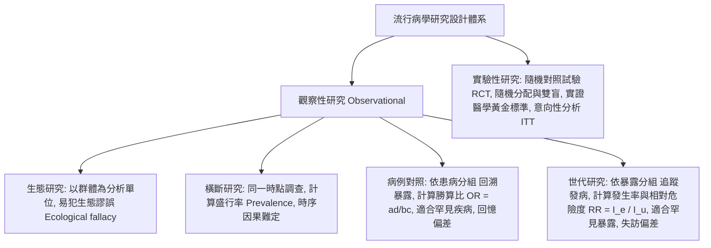

# 公共衛生學 第02章 流行病學：研究設計、因果推論與偏差控制

## 核心知識體系架構
流行病學（Epidemiology）探討人群疾病分佈與決定因素。本章涵蓋描述流行病學（人、時、地三維）；分析流行病學研究設計金字塔（生態研究、橫斷研究、病例對照研究、世代研究、隨機對照試驗 RCT）；量化危險指標（勝算比 OR、相對危險度 RR、歸因危險度 AR）；三大系統性偏差（選擇偏差 Selection bias、資訊偏差 Information bias、干擾 Confounding）；以及 Bradford Hill 因果推論準則。

---

## 主題一：觀察性流行病學研究設計四大天王精細比較

### 1. 橫斷研究 vs. 病例對照研究 vs. 世代研究矩陣
| 研究設計維度 | 橫斷研究（Cross-sectional） | 病例對照研究（Case-control） | 世代研究（Cohort Study） | 隨機對照試驗（RCT） |
| :--- | :--- | :--- | :--- | :--- |
| **研究對象分組依據** | 單一時點抽取代表性樣本人群 | **依據「是否患病（Disease status）」分組**（病例組 vs. 對照組） | **依據「是否暴露（Exposure status）」分組**（暴露組 vs. 非暴露組） | **隨機分配（Randomization）** 介入組 vs. 對照組 |
| **時間時序軸** | 同一時間截面同時測量暴露與疾病 | **由現在回溯過去（Retrospective）** 追溯暴露史 | **由現在向前追蹤至未來（Prospective）**（亦有回溯型世代） | 前瞻性追蹤干預結果 |
| **可計算的流行病學指標** | **盛行率（Prevalence）**、盛行勝算比 | **僅能計算「勝算比（Odds Ratio, OR）」**！無法計算發生率 | **直接計算「發生率（Incidence）」**、**相對危險度（RR）**、歸因危險度（AR） | 相對危險度（RR）、**絕對風險降低（ARR）**、**需治療人數（NNT）** |
| **核心優勢特點** | 快速、省時、低成本，提供假說 | **研究「罕見疾病（Rare diseases，如骨肉瘤）」之唯一首選**！潛伏期長疾病首選，省錢迅速。 | **研究「罕見暴露（Rare exposures，如化學工廠特定毒物）」之首選**！可同時觀察單一暴露的多種疾病結局，時序確定。 | **因果推論實證等級最高**！消除干擾因子，證明因果關係之黃金標準。 |
| **主要弱點與特異偏差** | 無法確立時序先後（雞生蛋或蛋生雞難辨） | **回憶偏差（Recall bias）**、**選擇偏差（Berkson 偏差）**；無法直接計量發病率。 | 耗時、極昂貴、失訪率高（**失訪偏差 Loss to follow-up**）；不適用於罕見疾病。 | 倫理限制、昂貴、外部真實性（External validity）可能受限。 |

---

## 主題二：流行病學量化關聯性指標計算

### 1. 二分表（2x2 Contingency Table）與經典指標公式
| 暴露狀況 | 患病（Disease +） | 未患病（Disease -） | 合計 |
| :--- | :--- | :--- | :--- |
| **有暴露 (Exposure +)** | $a$（暴露患病） | $b$（暴露未患病） | $a + b$ |
| **無暴露 (Exposure -)** | $c$（非暴露患病） | $d$（非暴露未患病） | $c + d$ |

1. **勝算比（Odds Ratio, OR，病例對照研究專用）**：
   $$OR = \frac{\text{病例組暴露勝算}}{\text{對照組暴露勝算}} = \frac{a/c}{b/d} = \frac{a \times d}{b \times c}$$
   - **罕見疾病假說（Rare Disease Assumption）**：當疾病發生率極低（$< 5\%$）時，$a \ll b$ 且 $c \ll d$，此時 **$OR \approx RR$**（勝算比可近似於相對危險度）！
2. **相對危險度（Relative Risk / Risk Ratio, RR，世代研究專用）**：
   $$RR = \frac{\text{暴露組發病率 } (I_e)}{\text{非暴露組發病率 } (I_u)} = \frac{a / (a + b)}{c / (c + d)}$$
   - $RR = 1$：暴露與疾病無關。
   - $RR > 1$：該暴露為危險因子（Risk factor）。
   - $RR < 1$：該暴露為保護因子（Protective factor）。
3. **歸因危險度（Attributable Risk, AR / Risk Difference, RD）**：
   $$AR = I_e - I_u = \frac{a}{a+b} - \frac{c}{c+d}$$
   - 代表**因該暴露而額外增加的疾病發生率**。若消除該暴露，暴露組人群可減少之疾病絕對數額。
4. **需治療人數（Number Needed to Treat, NNT）**：
   $$ARR = \text{對照組事件率} - \text{治療組事件率} \qquad NNT = \frac{1}{ARR}$$
   - 代表**為了預防 1 例不良臨床結局事件發生，需要接受治療的病患總人數**。NNT 愈小代表治療效益愈佳！

---

## 主題三：流行病學三大偏差（Bias）與控制對策

### 1. 偏差分類、實例與消除手段
- **選擇偏差（Selection Bias）**：
  - **伯克森偏差（Berkson's Bias / 入院率偏差）**：以住院病人為研究對象時，由於不同疾病同時存在導致住院機率不同，人為造成暴露與疾病的虛假關聯。
  - **健康工人效應（Healthy Worker Effect）**：以職場在職在工人為研究對象，由於重病者已被淘汰離職，工作人群總死亡率顯著低於一般大眾人群。
  - **無應答偏差（Non-response Bias）**。
- **資訊偏差（Information / Measurement Bias）**：
  - **回憶偏差（Recall Bias）**：患病個體（如產下畸胎的母親）往往比未患病對照組更窮盡心思回憶過去的可能不良暴露，導致暴露報告過度高估。
  - **霍桑效應（Hawthorne Effect）**：研究對象意識到自己正在被觀察記錄時，自覺改變行為。
- **干擾（Confounding）之鑑定與控制**：
  - **干擾因子（Confounder）三大必要條件**：
    1. 必須是疾病的獨立危險因子。
    2. 必須與暴露因子存在關聯。
    3. **絕對不能是「暴露至疾病的中間因果鏈（Intermediate step）」**！
  - **控制干擾因子四大手段**：
    - 研究設計階段：**隨機分配（Randomization，唯一能同時控制已知與未知干擾因子！）**、配對（Matching）、限制（Restriction）。
    - 資料分析階段：**分層分析（Stratification，如 Mantel-Haenszel）**、多變量迴歸調整（Multivariate Regression）。

---

## 歷屆國考核心真題解析

### 【國考經典真題實戰】
**【試題編號】111-第一次-med2-050**
> **題目**：下列活動那一項不屬於執行日常生活活動（activities of daily living, ADLs）測量項目？
- (A) 洗澡
- (B) 穿衣
- (C) 洗衣
- (D) 進食

> **標準答案**：`C`
> 
> **【考點深度解析與選項拆解】**：
- **(A) 選項分析**：洗澡。核對統計檢定方法適用前提、流行病學研究設計因果關聯或篩檢試驗指標公式，驗證其正確性。
- **(B) 選項分析**：穿衣。審查第一型/第二型錯誤、勝算比（OR）與相對危險度（RR）之計算或盛行率對預測值之影響，拆解命題陷阱。
- **(C) 選項分析**：洗衣。辨析偏差（Bias）型態（如回憶偏差、伯克森偏差）或干擾因子控制對策，排除干擾選項。
- **(D) 選項分析**：進食。綜合統計顯著性（p值與信賴區間）或篩檢效益評估，確認題幹命題之公衛流行病學核心。
> **【國考核心解題金鑰】**：本題精準鎖定標準答案 **(C)**。考生須牢記二分表（2x2 table）計算公式、研究設計偏差歸類及統計假設檢定選用原則，即可秒殺奪冠。

---
### 【國考經典真題實戰】
**【試題編號】111-第二次-第一階段-med2-035**
> **題目**：下列何時期之恙蟎屬（Leptotrombidium spp.）為人類感染恙蟲病（tsutsugamushi disease）之主要媒介？
- (A) 幼蟎（larvae）
- (B) 稚（若）蟎（nymph）
- (C) 雌蟎（female）
- (D) 雄蟎（male）

> **標準答案**：`A`
> 
> **【考點深度解析與選項拆解】**：
- **(A) 選項分析**：幼蟎（larvae）。核對統計檢定方法適用前提、流行病學研究設計因果關聯或篩檢試驗指標公式，驗證其正確性。
- **(B) 選項分析**：稚（若）蟎（nymph）。審查第一型/第二型錯誤、勝算比（OR）與相對危險度（RR）之計算或盛行率對預測值之影響，拆解命題陷阱。
- **(C) 選項分析**：雌蟎（female）。辨析偏差（Bias）型態（如回憶偏差、伯克森偏差）或干擾因子控制對策，排除干擾選項。
- **(D) 選項分析**：雄蟎（male）。綜合統計顯著性（p值與信賴區間）或篩檢效益評估，確認題幹命題之公衛流行病學核心。
> **【國考核心解題金鑰】**：本題精準鎖定標準答案 **(A)**。考生須牢記二分表（2x2 table）計算公式、研究設計偏差歸類及統計假設檢定選用原則，即可秒殺奪冠。

---
### 【國考經典真題實戰】
**【試題編號】111-第二次-第一階段-med2-036**
> **題目**：若欲探討「是否吸菸」與「肺功能是否正常」兩者是不是有相關，下列敘述何者最不恰當？
- (A) 可以利用卡方檢定來檢定兩者之間是否有相關性
- (B) 可以利用檢定勝算比值（odds ratio）是否為1 來檢定兩者之間是否有相關性
- (C) 可以建立檢定勝算比值（odds ratio）的95%信賴區間，並據以檢定兩者之間是否有相關性
- (D) 卡方檢定的檢定統計量越大，表示計算出來的檢定勝算比值（odds ratio）越大

> **標準答案**：`D`
> 
> **【考點深度解析與選項拆解】**：
- **(A) 選項分析**：可以利用卡方檢定來檢定兩者之間是否有相關性。核對統計檢定方法適用前提、流行病學研究設計因果關聯或篩檢試驗指標公式，驗證其正確性。
- **(B) 選項分析**：可以利用檢定勝算比值（odds ratio）是否為1 來檢定兩者之間是否有相關性。審查第一型/第二型錯誤、勝算比（OR）與相對危險度（RR）之計算或盛行率對預測值之影響，拆解命題陷阱。
- **(C) 選項分析**：可以建立檢定勝算比值（odds ratio）的95%信賴區間，並據以檢定兩者之間是否有相關性。辨析偏差（Bias）型態（如回憶偏差、伯克森偏差）或干擾因子控制對策，排除干擾選項。
- **(D) 選項分析**：卡方檢定的檢定統計量越大，表示計算出來的檢定勝算比值（odds ratio）越大。綜合統計顯著性（p值與信賴區間）或篩檢效益評估，確認題幹命題之公衛流行病學核心。
> **【國考核心解題金鑰】**：本題精準鎖定標準答案 **(D)**。考生須牢記二分表（2x2 table）計算公式、研究設計偏差歸類及統計假設檢定選用原則，即可秒殺奪冠。