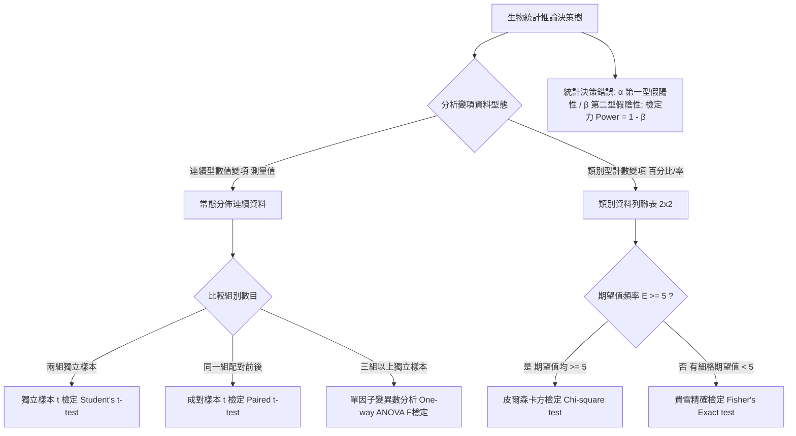

# 公共衛生學 第01章 生物統計學：假設檢定與推論統計

## 核心知識體系架構
生物統計學（Biostatistics）為量化醫學實證之基石。本章涵蓋描述統計（集中量數 Mean, Median, Mode vs. 變異量數 Variance, SD, SE, IQR）；常態分佈（68-95-99.7 法則）；假設檢定原理（虛無假設 $H_0$、對立假設 $H_1$、第一型錯誤 $\alpha$、第二型錯誤 $\beta$、檢定力 $1-\beta$、p 值解讀）；推論統計檢定方法選擇決策樹（t 檢定、ANOVA、卡方檢定、Fisher 精確檢定）；以及相關性與回歸分析（Pearson, Spearman, 線性與邏輯斯迴歸）。

---

## 主題一：假設檢定核心原理與第一型/第二型錯誤

### 1. 虛無假設決策與統計錯誤矩陣
| 統計檢定推論決策 | 真實世界真相：$H_0$ 為真（兩組無差異） | 真實世界真相：$H_0$ 為偽（兩組真有顯著差異） |
| :--- | :--- | :--- |
| **拒絕 $H_0$（判定有顯著差異）** | **【第一型錯誤（Type I Error, $\alpha$）】** **「偽陽性（False Positive）」**！原本無效卻宣稱有效。 顯著水準通常設定為 $\alpha = 0.05$。 | **【正確決策（Correct Decision）】** **統計檢定力（Statistical Power）$= 1 - \beta$**！ 真實有效且正確檢驗出顯著差異之機率（通常要求 $\ge 80\%$）。 |
| **接受 $H_0$ / 無法拒絕 $H_0$** | **【正確決策（Correct Decision）】** 信心水準（Confidence Level）$= 1 - \alpha$（通常為 $95\%$）。 | **【第二型錯誤（Type II Error, $\beta$）】** **「偽陰性（False Negative）」**！真實有效卻錯失未能發現。 通常設定為 $\beta = 0.20$。 |

!!! tip "秒殺記憶口訣"

    **【提升統計檢定力（Power $= 1 - \beta$）之四大途徑】**
    1. **擴大樣本數（Increase Sample Size, $N\uparrow$）**：最直接有效的工程方法！樣本數愈大，標準誤愈小，檢定力愈強。
    2. **效應值增大（Larger Effect Size）**：兩組真實差異愈懸殊，愈容易檢出。
    3. **放寬顯著水準（Increase $\alpha$）**：若將 $\alpha$ 由 0.01 放寬至 0.05，$\beta$ 隨之縮小，檢定力提升（但偽陽性風險上升）。
    4. **降低測量變異性（Decrease Variance / $\sigma\downarrow$）**：提高測量精密準確度。

---

## 主題二：臨床統計檢定方法選擇決策總覽

### 1. 國考統計檢定選用黃金對照表
| 研究問題與自變項（X）型態 | 依變項（Y）型態 | 適用之統計檢定方法 | 檢定統計量 | 國考關鍵判定考點 |
| :--- | :--- | :--- | :--- | :--- |
| **比較單一樣本平均值 vs. 母體已知平均值** | 單一連續型變項 | **單樣本 t 檢定 (One-sample t-test)** | $t$ 分佈 | 例如：檢定某班醫學生平均身高是否顯著高於全國平均。 |
| **比較「兩組獨立樣本」之平均值**（如：新藥組 vs. 安慰劑組之血壓降幅） | 類別變項（2 組）$\to$ 連續型變項（常態） | **獨立雙樣本 t 檢定 (Two-sample Student's t-test)** | $t$ 分佈 | 需滿足常態性與變異數同質性；若不符常態改用無母數 **曼-惠特尼 U 檢定（Mann-Whitney U）**。 |
| **比較「同一組對象前後兩次測量」**（如：同一批病人服藥前 vs. 服藥後血壓） | 配對/重複測量（2 次）$\to$ 連續型變項 | **成對樣本 t 檢定 (Paired t-test)** | $t$ 分佈 | 消除了個體間固有差異，檢定力高於獨立 t 檢定；無母數替代為 **Wilcoxon 符號符號等級檢定**。 |
| **比較「三組或以上獨立樣本」之平均值**（如：A藥 vs. B藥 vs. 安慰劑） | 類別變項（$\ge 3$ 組）$\to$ 連續型變項 | **單因子變異數分析 (One-way ANOVA)** | **$F$ 分佈**（組間變異 / 組內變異） | **絕對不可直接做多次兩兩 t 檢定（會引發第一型錯誤 $\alpha$ 膨脹！）**；ANOVA 顯著後需進行**事後多重比較（Post-hoc test：Tukey, Bonferroni）**；無母數替代為 **Kruskal-Wallis 檢定**。 |
| **比較「兩組或多組之百分比/比率」**（如：抽菸者 vs. 不抽菸者之肺癌發生率） | 類別變項 $\to$ 類別變項（2x2 列聯表） | **皮爾森卡方檢定 (Chi-square test, $\chi^2$)** | $\chi^2$ 分佈 | 適用於所有細格之**期望值（Expected frequency）均 $\ge 5$**。自由度 $df = (r-1)(c-1)$。 |
| **列聯表中有細格期望值太小** | 2x2 列聯表（有細格期望值 $< 5$） | **費雪精確檢定 (Fisher's Exact test)** | 超幾何分佈 | 樣本數小或期望次數過小時，卡方檢定失效，必須使用 Fisher 精確檢定直接計算機率。 |
| **分析兩個連續變項間之線性關聯強度** | 連續變項 vs. 連續變項 | **皮爾森相關係數 (Pearson correlation, $r$)** | $r \in [-1, +1]$ | $r = +1$ 完全正相關；$r = -1$ 完全負相關；$r = 0$ 無線性相關（但可能有非線性相關！）。無母數為 **Spearman 等級相關**。 |
| **以一個或多個自變項預測連續型結果** | 連續/類別自變項 $\to$ **連續型依變項** | **線性迴歸 (Linear Regression)** | 最小平方法（OLS） | 決定係數 $R^2$ 代表依變項總變異被模型解釋之百分比。 |
| **以自變項預測二元勝算結果（患病 vs. 未患病）** | 連續/類別自變項 $\to$ **二元類別依變項（0/1）** | **邏輯斯迴歸 (Logistic Regression)** | 迴歸係數 $\beta \to e^\beta = \mathbf{OR}$ | 迴歸係數取指數即為控制其他變項後的**調整後勝算比（Adjusted Odds Ratio, AOR）**！ |

---

## 歷屆國考核心真題解析

### 【國考經典真題實戰】
**【試題編號】111-第一次-med2-035**
> **題目**：下列有關鼠蚤（Xenopsylla cheopis）傳播之鼠疫（plague）敘述，何者錯誤？
- (A) 人類感染初期會呈現腋窩（axilla）腫大之腺鼠疫（bubonic plague）
- (B) 人類感染後期呈現人傳播人之肺鼠疫（pneumonic plague）
- (C) 感染性鼠蚤藉由嘔吐作用（vomiting）污染叮咬傷口而感染人類
- (D) 主要致病原為鼠疫桿菌（Yersinia pestis），屬於格蘭氏陰性菌

> **標準答案**：`C`
> 
> **【考點深度解析與選項拆解】**：
- **(A) 選項分析**：人類感染初期會呈現腋窩（axilla）腫大之腺鼠疫（bubonic plague）。核對統計檢定方法適用前提、流行病學研究設計因果關聯或篩檢試驗指標公式，驗證其正確性。
- **(B) 選項分析**：人類感染後期呈現人傳播人之肺鼠疫（pneumonic plague）。審查第一型/第二型錯誤、勝算比（OR）與相對危險度（RR）之計算或盛行率對預測值之影響，拆解命題陷阱。
- **(C) 選項分析**：感染性鼠蚤藉由嘔吐作用（vomiting）污染叮咬傷口而感染人類。辨析偏差（Bias）型態（如回憶偏差、伯克森偏差）或干擾因子控制對策，排除干擾選項。
- **(D) 選項分析**：主要致病原為鼠疫桿菌（Yersinia pestis），屬於格蘭氏陰性菌。綜合統計顯著性（p值與信賴區間）或篩檢效益評估，確認題幹命題之公衛流行病學核心。
> **【國考核心解題金鑰】**：本題精準鎖定標準答案 **(C)**。考生須牢記二分表（2x2 table）計算公式、研究設計偏差歸類及統計假設檢定選用原則，即可秒殺奪冠。

---
### 【國考經典真題實戰】
**【試題編號】111-第一次-med2-036**
> **題目**：如果要在顯著水準為α的情況下，利用變異數分析來檢定三組資料，下列何者最恰當？
- (A) 必須假設三組資料來源的三個母體的變異數皆相等
- (B) 如果要利用兩兩比較的t檢定來代替變異數分析，必須將每個t檢定的顯著水準改成α/6
- (C) 此變異數分析的檢定統計量會服從t分配
- (D) 此變異數分析也可利用迴歸分析來取代，只要加入一個解釋變數，定義數值1、2、3代表三組，再檢定該解 釋變數是否顯著即可

> **標準答案**：`A`
> 
> **【考點深度解析與選項拆解】**：
- **(A) 選項分析**：必須假設三組資料來源的三個母體的變異數皆相等。核對統計檢定方法適用前提、流行病學研究設計因果關聯或篩檢試驗指標公式，驗證其正確性。
- **(B) 選項分析**：如果要利用兩兩比較的t檢定來代替變異數分析，必須將每個t檢定的顯著水準改成α/6。審查第一型/第二型錯誤、勝算比（OR）與相對危險度（RR）之計算或盛行率對預測值之影響，拆解命題陷阱。
- **(C) 選項分析**：此變異數分析的檢定統計量會服從t分配。辨析偏差（Bias）型態（如回憶偏差、伯克森偏差）或干擾因子控制對策，排除干擾選項。
- **(D) 選項分析**：此變異數分析也可利用迴歸分析來取代，只要加入一個解釋變數，定義數值1、2、3代表三組，再檢定該解 釋變數是否顯著即可。綜合統計顯著性（p值與信賴區間）或篩檢效益評估，確認題幹命題之公衛流行病學核心。
> **【國考核心解題金鑰】**：本題精準鎖定標準答案 **(A)**。考生須牢記二分表（2x2 table）計算公式、研究設計偏差歸類及統計假設檢定選用原則，即可秒殺奪冠。

---
### 【國考經典真題實戰】
**【試題編號】111-第一次-med2-037**
> **題目**：下列有關簡單線性迴歸（simple linear regression）分析中，依變項（dependent variable）Y與自變項 （independent variable）X的敘述，何者最不恰當？
- (A) 探討的是X與Y之間是否有線性關係
- (B) 依變項Y通常為常態分布
- (C) 結果可以說明X與Y之間的線性因果關係
- (D) 只處理單一個自變項

> **標準答案**：`C`
> 
> **【考點深度解析與選項拆解】**：
- **(A) 選項分析**：探討的是X與Y之間是否有線性關係。核對統計檢定方法適用前提、流行病學研究設計因果關聯或篩檢試驗指標公式，驗證其正確性。
- **(B) 選項分析**：依變項Y通常為常態分布。審查第一型/第二型錯誤、勝算比（OR）與相對危險度（RR）之計算或盛行率對預測值之影響，拆解命題陷阱。
- **(C) 選項分析**：結果可以說明X與Y之間的線性因果關係。辨析偏差（Bias）型態（如回憶偏差、伯克森偏差）或干擾因子控制對策，排除干擾選項。
- **(D) 選項分析**：只處理單一個自變項。綜合統計顯著性（p值與信賴區間）或篩檢效益評估，確認題幹命題之公衛流行病學核心。
> **【國考核心解題金鑰】**：本題精準鎖定標準答案 **(C)**。考生須牢記二分表（2x2 table）計算公式、研究設計偏差歸類及統計假設檢定選用原則，即可秒殺奪冠。
