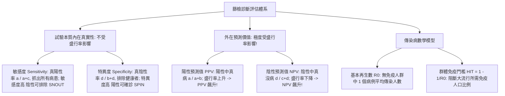

# 公共衛生學 第03章 篩檢與診斷試驗評估、疾病監測與爆發調查

## 核心知識體系架構
篩檢與診斷試驗為臨床實證醫學量化評價病患之核心工具。涵蓋 2x2 表四大指標（敏感度 Sensitivity, 特異度 Specificity, 陽性預測值 PPV, 陰性預測值 NPV）；疾病盛行率（Prevalence）對預測值之劇烈槓桿影響；陽性/陰性似然比（LR+, LR-）；受試者操作特徵曲線（ROC 曲線 AUC）；篩檢特有時間偏差（領先時間偏差 Lead-time bias vs. 長度偏差 Length-time bias）；傳染病監測指標；以及基本再生數（$R_0$）與群體免疫門檻（Herd Immunity Threshold）。

---

## 主題一：篩檢試驗四大指標與盛行率效應

### 1. 診斷二分表核心公式定義
| 試驗檢測結果 | 黃金標準確診：有病（Disease +） | 黃金標準確診：無病（Disease -） | 合計 |
| :--- | :--- | :--- | :--- |
| **檢驗陽性 (Test +)** | **$a$（真陽性 True Positive, TP）** | **$b$（偽陽性 False Positive, FP）** | $a + b$ |
| **檢驗陰性 (Test -)** | **$c$（偽陰性 False Negative, FN）** | **$d$（真陰性 True Negative, TN）** | $c + d$ |
| **合計** | $a + c$（所有患病者） | $b + d$（所有無病者） | 全體受檢者 $N$ |

1. **敏感度（Sensitivity, $Sn$）**：
   $$Sn = \frac{TP}{TP + FN} = \frac{a}{a + c}$$
   - 在所有**真有病的人中，被試驗正確檢出為陽性的百分比**。
   - **高敏感度試驗特徵（口訣：SnNOut）**：高敏感度試驗極少漏診（偽陰性極低），若檢驗結果為**陰性（Negative）**，即可**高度排除診斷（Rule Out）**！適合做為**初階大規模第一線疾病篩檢工具**。
2. **特異度（Specificity, $Sp$）**：
   $$Sp = \frac{TN}{TN + FP} = \frac{d}{b + d}$$
   - 在所有**真沒病的人中，被試驗正確排除為陰性的百分比**。
   - **高特異度試驗特徵（口訣：SpPIn）**：高特異度試驗極少誤診（偽陽性極低），若檢驗結果為**陽性（Positive）**，即可**高度確診（Rule In）**！適合做為第二線**確診證實工具（Confirmation test）**。
3. **陽性預測值（Positive Predictive Value, PPV）與陰性預測值（NPV）**：
   $$PPV = \frac{TP}{TP + FP} = \frac{a}{a + b} \qquad NPV = \frac{TN}{TN + FN} = \frac{d}{c + d}$$

### 2. 盛行率（Prevalence）對預測值之劇烈影響法則（國考必考！）
- **敏感度（Sn）與特異度（Sp）是試驗的「內在固定特徵（Intrinsic properties）」，絕對不會隨著被檢驗人群的疾病盛行率高低而改變**！
- **陽性預測值（PPV）與陰性預測值（NPV）則強烈依賴「疾病盛行率（Prevalence）」**：
  - **當疾病盛行率上升（Prevalence $\uparrow$）**：
    - **陽性預測值（PPV）大幅飆升（$\uparrow\uparrow$）**！
    - **陰性預測值（NPV）微幅下降（$\downarrow$）**。
  - **當疾病盛行率極低（Prevalence $\downarrow$，如在一般健康無症狀大眾進行罕見疾病篩檢）**：
    - 儘管試驗特異度高達 99%，**由於絕大多數陽性結果都是假陽性，陽性預測值（PPV）將極度低落（可能低於 10%！）**！

---

## 主題二：陽性與陰性似然比（Likelihood Ratios）與 ROC 曲線

### 1. 似然比（LR）計算與臨床優勢
- **陽性似然比（Positive Likelihood Ratio, LR+）**：
  $$LR+ = \frac{\text{真陽性率}}{\text{偽陽性率}} = \frac{Sensitivity}{1 - Specificity}$$
  - $LR+ > 10$ 代表該陽性結果極具臨床診斷價值，能大幅推升驗後機率。
- **陰性似然比（Negative Likelihood Ratio, LR-）**：
  $$LR- = \frac{\text{偽陰性率}}{\text{真陰性率}} = \frac{1 - Sensitivity}{Specificity}$$
  - $LR- < 0.1$ 代表該陰性結果極具排除診斷價值。
- **貝氏定理臨床應用**：$\text{驗後勝算 (Post-test Odds)} = \text{驗前勝算 (Pre-test Odds)} \times LR$。

### 2. 受試者操作特徵曲線（ROC 曲線）與最佳切點選擇
- **ROC 曲線座標軸**：
  - **縱軸（Y 軸）**：**敏感度（Sensitivity / 真陽性率）**。
  - **橫軸（X 軸）**：**$1 - \text{特異度}$（1 - Specificity / 偽陽性率）**。
- **曲線下面積（Area Under the Curve, AUC）**：
  - $AUC = 0.5$：對角線，代表完全隨機猜測，毫無診斷價值。
  - $AUC = 1.0$：完美診斷試驗。$AUC > 0.8$ 代表優異診斷準確度。
- **切點（Cutoff value）位移法則**：
  - 若將診斷切點向左移動（標準變嚴苛，減少陽性判定）：特異度上升、假陽性下降，但敏感度下降。
  - 若將診斷切點向右移動（標準放寬，增加陽性判定）：敏感度上升，但特異度下降、假陽性增加。

---

## 主題三：群體免疫（Herd Immunity）與基本再生數（$R_0$）

### 1. 傳染病流行病學數學模型
- **基本再生數（Basic Reproduction Number, $R_0$）**：在完全沒有免疫力且無任何防護措施的易感人群中，**單一感染者在其傳染期內平均能夠傳染的原發二代病例數**。
  - $R_0 < 1$：疾病傳播將自發終止衰退消失。
  - $R_0 = 1$：疾病維持地方性流行（Endemic）。
  - $R_0 > 1$：疾病將引發指數型爆發大流行（Epidemic / Pandemic）。
- **群體免疫門檻（Herd Immunity Threshold, HIT）**：
  $$HIT = 1 - \frac{1}{R_0}$$
  - 代表阻斷傳染病在人群中持續擴散所**必須具備免疫力（經自然感染或疫苗接種）的最小人口百分比**！
  - 範例：麻疹（Measles）具備人類最高傳染力之一（$R_0 \approx 15\text{--}18$），其群體免疫門檻為：
    $$HIT = 1 - \frac{1}{18} \approx 94.4\%$$
    因此麻疹疫苗覆蓋率必須維持在 $95\%$ 以上方能杜絕社區爆發！

---

## 歷屆國考核心真題解析

### 【國考經典真題實戰】
**【試題編號】111-第二次-第一階段-med2-049**
> **題目**：下列何項為健保傳統論量計酬支付方式的主要缺點？
- (A) 醫療提供者容易減少必要的醫療服務
- (B) 費用的給付不容易反映病人的複雜度
- (C) 缺乏節約的誘因
- (D) 易被醫療提供者接受

> **標準答案**：`C`
> 
> **【考點深度解析與選項拆解】**：
- **(A) 選項分析**：醫療提供者容易減少必要的醫療服務。核對統計檢定方法適用前提、流行病學研究設計因果關聯或篩檢試驗指標公式，驗證其正確性。
- **(B) 選項分析**：費用的給付不容易反映病人的複雜度。審查第一型/第二型錯誤、勝算比（OR）與相對危險度（RR）之計算或盛行率對預測值之影響，拆解命題陷阱。
- **(C) 選項分析**：缺乏節約的誘因。辨析偏差（Bias）型態（如回憶偏差、伯克森偏差）或干擾因子控制對策，排除干擾選項。
- **(D) 選項分析**：易被醫療提供者接受。綜合統計顯著性（p值與信賴區間）或篩檢效益評估，確認題幹命題之公衛流行病學核心。
> **【國考核心解題金鑰】**：本題精準鎖定標準答案 **(C)**。考生須牢記二分表（2x2 table）計算公式、研究設計偏差歸類及統計假設檢定選用原則，即可秒殺奪冠。

---
### 【國考經典真題實戰】
**【試題編號】111-第二次-第一階段-med2-050**
> **題目**：民眾出入醫院時戴外科口罩自我保護，此時戴口罩對下列那一種傳染途徑的預防最有效？
- (A) 血液傳染
- (B) 蟲媒傳染
- (C) 懸浮氣膠傳染
- (D) 食入污染的水或食物傳染

> **標準答案**：`C`
> 
> **【考點深度解析與選項拆解】**：
- **(A) 選項分析**：血液傳染。核對統計檢定方法適用前提、流行病學研究設計因果關聯或篩檢試驗指標公式，驗證其正確性。
- **(B) 選項分析**：蟲媒傳染。審查第一型/第二型錯誤、勝算比（OR）與相對危險度（RR）之計算或盛行率對預測值之影響，拆解命題陷阱。
- **(C) 選項分析**：懸浮氣膠傳染。辨析偏差（Bias）型態（如回憶偏差、伯克森偏差）或干擾因子控制對策，排除干擾選項。
- **(D) 選項分析**：食入污染的水或食物傳染。綜合統計顯著性（p值與信賴區間）或篩檢效益評估，確認題幹命題之公衛流行病學核心。
> **【國考核心解題金鑰】**：本題精準鎖定標準答案 **(C)**。考生須牢記二分表（2x2 table）計算公式、研究設計偏差歸類及統計假設檢定選用原則，即可秒殺奪冠。

---
### 【國考經典真題實戰】
**【試題編號】112-第一次-med2-035**
> **題目**：下列何者為曾經流行於臺澎金馬及中國南方地區之班氏絲蟲（Wuchereria bancrofti）的主要傳播病媒？
- (A) 埃及斑蚊（Aedes aegypti）
- (B) 白線斑蚊（Aedes albopictus）
- (C) 熱帶家蚊（Culex quinquefasciatus / C. fatigans）
- (D) 微小瘧蚊（Anopheles minimus）

> **標準答案**：`C`
> 
> **【考點深度解析與選項拆解】**：
- **(A) 選項分析**：埃及斑蚊（Aedes aegypti）。核對統計檢定方法適用前提、流行病學研究設計因果關聯或篩檢試驗指標公式，驗證其正確性。
- **(B) 選項分析**：白線斑蚊（Aedes albopictus）。審查第一型/第二型錯誤、勝算比（OR）與相對危險度（RR）之計算或盛行率對預測值之影響，拆解命題陷阱。
- **(C) 選項分析**：熱帶家蚊（Culex quinquefasciatus / C. fatigans）。辨析偏差（Bias）型態（如回憶偏差、伯克森偏差）或干擾因子控制對策，排除干擾選項。
- **(D) 選項分析**：微小瘧蚊（Anopheles minimus）。綜合統計顯著性（p值與信賴區間）或篩檢效益評估，確認題幹命題之公衛流行病學核心。
> **【國考核心解題金鑰】**：本題精準鎖定標準答案 **(C)**。考生須牢記二分表（2x2 table）計算公式、研究設計偏差歸類及統計假設檢定選用原則，即可秒殺奪冠。
