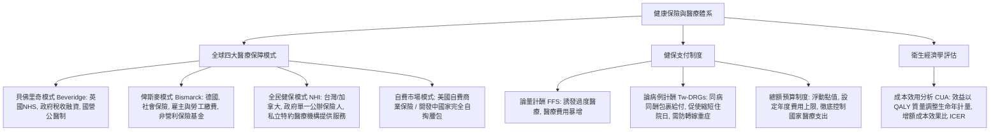

# 公共衛生學 第04章 健康保險、醫療體系與衛生政策

## 核心知識體系架構
健康體系與衛生經濟學為醫學二公衛必考焦點。涵蓋全球四大醫療體系模型（Beveridge, Bismarck, NHI, Out-of-pocket）；台灣全民健康保險（NHI：單一保險人 Single-payer、強制投保、保費計繳與補充保費）；醫事服務機構支付制度（論量計酬 FFS、論病例計酬 DRGs、論人計酬 Capitation、總額預算支付制度 Global Budget）；部分負擔機制；以及衛生經濟學評估（CEA, CUA, CBA）。

---

## 主題一：全球四大醫療體系模式與台灣全民健保

### 1. 全球主要醫療體系融資與提供者對照表
| 體系模式名稱 | 資金融資來源（Financing） | 醫療服務提供者（Providers） | 代表國家 | 核心特徵與面臨挑戰 |
| :--- | :--- | :--- | :--- | :--- |
| **貝佛里奇模式 (Beveridge Model)** | **政府一般稅收（General Tax）** | **政府公立醫院與受薪公醫（國營化）** | 英國（NHS）、紐西蘭、北歐國家 | 醫療為全民基本人權，就醫免費或極低自付；但面臨**專科就醫與手術排隊等待時間過長（Long waiting lists）** 之嚴重挑戰。 |
| **俾斯麥模式 (Bismarck Model)** | **法定社會保險費（薪資扣除，雇主與受雇者共同分擔）** | 私立與公立醫療院所並存（私立為主） | 德國、法國、日本、瑞士 | 互助共濟，由眾多非營利「疾病基金（Sickness funds）」運作；嚴格管制醫療服務價格。 |
| **全民健康保險模式 (National Health Insurance, NHI)** | **政府統一經辦之社會保險費（單一保險人 Single-payer）** | **私立醫療院所為主（特約機制）** | **台灣（Taiwan NHI）**、加拿大 | **集各家之大成**：兼具俾斯麥的私立特約醫療活力，與貝佛里奇的單一公辦管理效率。**行政管理成本極低（$< 1.5\%$）**，就醫自由度極高（無轉診強制障礙）；但面臨財務收支失衡與醫事人員過勞。 |
| **自費市場模式 (Out-of-Pocket Model)** | **個人自掏腰包或私人商業保險** | 私立營利/非營利市場化 | 開發中國家、美國未納保人群 | 貧富差距導致醫療不平等，「因病致貧、因病返貧」。 |

---

## 主題二：台灣全民健康保險（Taiwan NHI）核心制度

### 1. 單一保險人與強制納保
- **單一保險人（Single-payer）**：由衛生福利部中央健康保險署（NHIA）統一公辦，具備強大市場單一買方力量（Monopsony），能有效抑制藥價與檢查費用。
- **全民強制納保（Universal & Compulsory）**：具有中華民國國籍在台設籍滿 6 個月、或在台領有居留證明文件者，一律強制納保。
- **二代健保保費雙軌架構**：
  1. **一般保費**：以經常性薪資為基礎，由受雇者、雇主與政府按法定比例共同分擔。
  2. **補充保費（補充保險費）**：針對六項非經常性薪資所得（高額獎金超過 4 個月、兼職薪資所得、執行業務收入、股利所得、利息所得、租金收入）單獨扣取補充保費，擴大費基以維護社會公平。

### 2. 醫療機構支付制度四大模式比較
- **論量計酬（Fee-for-Service, FFS）**：
  - 依照實際提供的醫療服務項目與藥品逐項申報費用。
  - **最大弊端：誘發醫療提供者產生「誘導性需求（Supplier-induced demand）」**，多開藥、多做高階檢查、延長住院日，促使總體醫療支出失控暴增。
- **論病例計酬 / 診斷關聯群（Tw-DRGs）**：
  - 將住院病患依主要診斷、手術處置、年齡、合併症與併發症分為同一組別，**實施「同病同酬、打包定額支付」**！
  - **制度優點**：促使醫院主動精簡無效流程、減少不必要藥物檢查、**縮短平均住院天數（ALOS）**、降低院內感染。
  - **防範弊端**：需防範醫院拒收重症病患（挑病人 Cream-skimming）、提早強制出院（Dumping）、分段住院或將併發症轉嫁門診。
- **總額預算支付制度（Global Budget System）**：
  - **台灣健保財務控管之定海神針（1998年起陸續實施牙醫、中醫、西醫基層、醫院四部門總額）**！
  - **浮動點值（Floating Point Value）機制**：
    - 每年由健保會預先協商訂定下年度全國各部門的「醫療支出總額預算上限（宏觀固定 Cap）」。
    - 醫療院所每提供一項服務獲得對應「點數」，年度結算時：
      $$\text{每點支付金額（點值）} = \frac{\text{該部門年度核定總預算}}{\text{全體院所申報之總點數}}$$
    - 若全體院所衝量導致總點數暴增，**點值將自動被稀釋貶值（例如 1 點 $< 1$ 元，跌至 0.8~0.9 元）**，由全體醫療機構共同承擔財務風險，**百分之百確保國家健保總支出絕不超出年度預算！**

---

## 主題三：衛生經濟學評估方法（Health Economic Evaluation）

### 1. 三大藥物經濟學分析方法矩陣
| 分析方法 | 成本測量單位（Costs） | 健康效益評估單位（Outcomes） | 核心計算決策指標 | 臨床最佳應用情境 |
| :--- | :--- | :--- | :--- | :--- |
| **成本效果分析 (Cost-Effectiveness, CEA)** | 貨幣單位（新台幣、美元） | **天然臨床客觀指標**（如：降低之收縮壓 mmHg、延長之存活年數 LYG、治癒人數） | **增額成本效果比 (ICER)**： $ICER = \frac{\Delta \text{Cost}}{\Delta \text{Effect}} = \frac{C_A - C_B}{E_A - E_B}$ | 比較具有**相同臨床結局標的**的兩項干預（如：兩種不同降血壓藥物的降壓幅度比較）。 |
| **成本效用分析 (Cost-Utility Analysis, CUA)** | 貨幣單位 | **質量調整生命年 (QALY)** 或 **失能調整生命年 (DALY)**（同時兼顧「存活年數」與「健康相關生活品質」） | **每多獲得一個 QALY 所需之增額成本**（$\Delta \text{Cost} / \Delta \text{QALY}$） | **跨不同學科、不同疾病領域間資源配置首選**！（如：比較化療新藥 vs. 關節置換手術哪個更值得健保給付）。 |
| **成本效益分析 (Cost-Benefit Analysis, CBA)** | 貨幣單位 | **完全轉化為「貨幣單位（新台幣元）」計量**（利用願意支付意願 WTP 評估） | **淨效益 (Net Benefit)** $= \text{效益} - \text{成本}$ **效益成本比 (BCR)** $= \text{效益} / \text{成本}$ | 評估公共衛生大規模基礎建設計畫（如水質加氟、全面篩檢計畫）。 |

---

## 歷屆國考核心真題解析

### 【國考經典真題實戰】
**【試題編號】112-第一次-med2-048**
> **題目**：下列何者為健康保險論質計酬（pay for performance）的主要缺點？
- (A) 缺乏節約的誘因
- (B) 不易被醫療供給者接受
- (C) 醫療服務生產力降低
- (D) 提供挑選輕症病人的誘因

> **標準答案**：`D`
> 
> **【考點深度解析與選項拆解】**：
- **(A) 選項分析**：缺乏節約的誘因。核對全民健保支付制度特性、職業毒理暴露標誌或衛生法規通報時效，驗證其符合性。
- **(B) 選項分析**：不易被醫療供給者接受。審查總額預算點值浮動機制、環境重金屬公害病理或病人自主權利法行使門檻，剖析命題陷阱。
- **(C) 選項分析**：醫療服務生產力降低。辨析生命倫理四原則（自主、行善、不傷害、正義）衝突時之裁量優先級，排除混淆選項。
- **(D) 選項分析**：提供挑選輕症病人的誘因。綜合傳染病分類法規與醫療經濟學成本效益分析，確認題幹核心命題本旨。
> **【國考核心解題金鑰】**：本題標準答案為 **(D)**。考生須融會貫通台灣全民健保總額與DRG制度、公害重金屬中毒靶器官及醫療法規核心條款，即可秒殺奪冠。

---
### 【國考經典真題實戰】
**【試題編號】112-第一次-med2-049**
> **題目**：下列對於臺灣衛生福利行政組織的敘述，何者最不恰當？
- (A) 臺灣衛生行政組織分為二級：中央、直轄市及縣（市）
- (B) 我國衛生行政體系並非為「一條鞭制」
- (C) 有關中藥藥品查驗，是屬於衛生福利部食品藥物管理署的權責範圍
- (D) 衛生福利部國民健康署的權責主要是負責國民健康業務，但不包含傳染病防疫

> **標準答案**：`C`
> 
> **【考點深度解析與選項拆解】**：
- **(A) 選項分析**：臺灣衛生行政組織分為二級：中央、直轄市及縣（市）。核對全民健保支付制度特性、職業毒理暴露標誌或衛生法規通報時效，驗證其符合性。
- **(B) 選項分析**：我國衛生行政體系並非為「一條鞭制」。審查總額預算點值浮動機制、環境重金屬公害病理或病人自主權利法行使門檻，剖析命題陷阱。
- **(C) 選項分析**：有關中藥藥品查驗，是屬於衛生福利部食品藥物管理署的權責範圍。辨析生命倫理四原則（自主、行善、不傷害、正義）衝突時之裁量優先級，排除混淆選項。
- **(D) 選項分析**：衛生福利部國民健康署的權責主要是負責國民健康業務，但不包含傳染病防疫。綜合傳染病分類法規與醫療經濟學成本效益分析，確認題幹核心命題本旨。
> **【國考核心解題金鑰】**：本題標準答案為 **(C)**。考生須融會貫通台灣全民健保總額與DRG制度、公害重金屬中毒靶器官及醫療法規核心條款，即可秒殺奪冠。

---
### 【國考經典真題實戰】
**【試題編號】112-第一次-med2-050**
> **題目**：平衡計分卡（balanced scorecard）是醫院管理當中的那一種管理方法？
- (A) 策略管理
- (B) 財務管理
- (C) 人力資源管理
- (D) 資材管理

> **標準答案**：`A`
> 
> **【考點深度解析與選項拆解】**：
- **(A) 選項分析**：策略管理。核對全民健保支付制度特性、職業毒理暴露標誌或衛生法規通報時效，驗證其符合性。
- **(B) 選項分析**：財務管理。審查總額預算點值浮動機制、環境重金屬公害病理或病人自主權利法行使門檻，剖析命題陷阱。
- **(C) 選項分析**：人力資源管理。辨析生命倫理四原則（自主、行善、不傷害、正義）衝突時之裁量優先級，排除混淆選項。
- **(D) 選項分析**：資材管理。綜合傳染病分類法規與醫療經濟學成本效益分析，確認題幹核心命題本旨。
> **【國考核心解題金鑰】**：本題標準答案為 **(A)**。考生須融會貫通台灣全民健保總額與DRG制度、公害重金屬中毒靶器官及醫療法規核心條款，即可秒殺奪冠。
