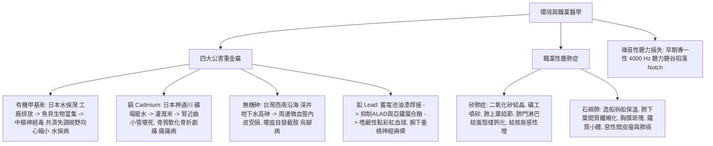

# 公共衛生學 第05章 環境與職業醫學：毒理學、公害病與職業病

## 核心知識體系架構
環境與職業醫學為預防醫學重要防線。涵蓋環境毒理（空氣污染 PM2.5, PM10, AQI；水質加氯三鹵甲烷；酸雨）；歷史四大經典重金屬環境公害病（水俁病甲基汞、痛痛病鎘、烏腳病無機砷、鉛中毒）；職業性塵肺症（矽肺症蛋殼鈣化、石綿肺間皮瘤）；有機溶劑與氣體毒理（苯致白血病、氯乙烯致肝血管肉瘤、一氧化碳）；職業性聽力損失（4000 Hz 聽力陷落）；以及職業危害預防五大控制階層。

---

## 主題一：四大經典重金屬環境公害病病理與毒理

### 1. 水俁病 vs. 痛痛病 vs. 烏腳病 vs. 鉛中毒精準矩陣
| 公害病 / 毒物名稱 | 污染環境來源途徑 | 毒理致病機制與蓄積標靶 | 特異臨床病徵表現（國考必考！） | 特異診斷生物指標 |
| :--- | :--- | :--- | :--- | :--- |
| **水俁病 (Minamata Disease)** 【有機甲基汞 Methylmercury】 | 化學工廠將甲基汞廢水排入海灣，經水生食物鏈**生物濃縮（Biomagnification）** 於大型肉食性魚貝類體內，居民長期食用 | 高脂溶性穿透血腦屏障（BBB）與胎盤，專一性蓄積於大腦大腦皮質（大腦視覺皮質、顆粒細胞層）與小腦 | **神經精神系統重度毀滅三聯徵**： 1. **共濟失調（Ataxia）**、步態蹣跚。 2. **視野向心性縮小（Concentric constriction of visual fields / 管狀視野）**。 3. 感覺異常、構音障礙；胎兒嚴重腦性麻痺。 | 頭髮或血液中**甲基汞濃度** |
| **痛痛病 (Itai-Itai Disease)** 【鎘中毒 Cadmium】 | 鉛鋅礦場含鎘廢水污染神通川流域，居民飲用河水並以受污染河水**灌溉農田食用「含鎘米」** | 經腸道吸收後與金屬硫蛋白（Metallothionein）結合，**長期蓄積於腎臟近曲小管（半衰期長達 10~30 年！）** | 1. **近曲小管功能障礙（Fanconi 症候群）**：尿中流失大量低分子蛋白（$\beta_2$-微球蛋白）、鈣與磷。 2. **重度骨質軟化症（Osteomalacia）與骨質疏鬆**：全身多發性病理性骨折，患者骨痛徹骨呼喊「痛痛（Itai-Itai）」！ | 尿液中 **$\beta_2$-微球蛋白** 顯著升高；尿鎘 |
| **烏腳病 (Blackfoot Disease)** 【無機砷 Inorganic Arsenic】 | **台灣西南沿海地區（台南學甲、北門、嘉義布袋、義竹）**，居民因淺井水質鹹苦而改飲**深水井（深達 100~200 公尺之砷污染地下水）** | 砷與蛋白質硫醇基（-SH）結合抑制丙酮酸脫氫酶；劇烈損傷血管內皮細胞引發微血管病變 | **血栓閉塞性脈管炎（TAO 樣病變）**：下肢遠端微血管內皮增厚閉塞，足趾發黑、劇痛、壞死、乾性壞疽直至自發脫落！皮膚過度角化、雨滴樣色素沉著；**顯著增加膀胱癌、皮膚癌（Bowen 病）與肺癌風險**！ | 尿液無機砷與三價/五價砷代謝物；毛髮與指甲砷含量（米氏線 Mee's lines） |
| **職業性鉛中毒 (Lead Toxicity)** | 鉛蓄電池製造、鉛冶煉、拆船、含鉛油漆噴塗、金屬焊接煙霧吸入 | 1. 抑制血紅素合成關鍵酶：**$\delta$-ALAD** 及 **亞鐵螯合酶（Ferrochelatase）**。 2. 抑制紅血球膜 $Na^+/K^+$-ATPase。 | 1. 血液學：小球低色素性貧血，顯微鏡下見**嗜鹼性點彩紅血球（Basophilic stippling）**。 2. 神經毒：運動神經病變引發**垂腕症（Wrist drop / 橈神經麻痺）**、垂足症；兒童鉛腦病。 3. 消化道：鉛絞痛（嚴重心腹絞痛）；齒齦邊緣藍紫色 **「鉛線（Burton's lead line）」**。 | 血液鉛濃度（BLL）；尿中 $\delta$-ALA 增加；紅血球游離原紫質（FEP / ZPP）增加。解毒劑：**$CaNa_2\text{-EDTA}$, BAL, DMSA**。 |

---

## 主題二：職業性肺病（Pneumoconioses）與化學致癌物

### 1. 矽肺症 vs. 石綿肺病理鑑別
- **矽肺症（Silicosis）**：
  - **暴露職業**：採礦、採石、隧道挖掘、噴砂工人、陶瓷玻璃製造。
  - **病理機制**：吸入微細 **結晶型游離二氧化矽（$\alpha$-Quartz）**，被肺泡巨噬細胞吞噬後破壞溶酶體膜釋放酵素，刺激纖維母細胞分泌膠原蛋白。
  - **X 光影像金標誌**：病變好發於 **兩肺「上葉（Upper lobes）」**，呈現同心圓層狀膠原玻璃樣「矽結節（Silicotic nodules）」；肺門淋巴結周邊鈣化呈現典型 **「蛋殼樣鈣化（Eggshell calcification）」**！
  - **結核併發症**：矽塵破壞巨噬細胞殺菌功能，患者罹患**肺結核（Silicotuberculosis）之風險飆升 30 倍**！
- **石綿肺（Asbestosis）與間皮瘤**：
  - **暴露職業**：拆船業、造船廠隔熱保溫、石綿瓦建材、剎車煞車皮摩擦片。
  - **病理特徵**：好發於 **兩肺「下葉（Lower lobes）」**，引發廣泛瀰漫性間質纖維化；壁層胸膜形成緻密不均勻之 **胸膜斑塊（Pleural plaques，石綿暴露最常見標誌）**。
  - **石綿小體（Asbestos bodies / 鐵質小體 Ferruginous bodies）**：金褐色啞鈴狀或串珠狀纖維，中央為石綿纖維，外被含鐵血黃素與蛋白質包裹。普魯士藍染色（Prussian blue）呈鮮藍色。
  - **惡性腫瘤關聯**：
    1. **支氣管肺癌（Bronchogenic Carcinoma）**：**石綿暴露引發的最常見惡性腫瘤**（抽菸加石綿具強烈協同致癌乘法效應，肺癌風險飆升 60 倍！）。
    2. **惡性間皮瘤（Malignant Mesothelioma）**：**與石綿暴露具高度專一特異性**（但與抽菸無關！），潛伏期長達 25~40 年，預後極度凶險。

---

## 主題三：職業性危害預防五大控制階層（Hierarchy of Controls）

### 1. 職業衛生防護優先順序金字塔（由最有效至最差）
1. **消除（Elimination，最有效！）**：在源頭徹底物理移除危害源（如停止使用劇毒化學品）。
2. **取代（Substitution）**：以低毒性或無毒替代物置換高毒物（如用水性塗料取代含苯有機溶劑油漆）。
3. **工程控制（Engineering Controls）**：隔絕人員與危害源（如製程密閉化、安裝局部排氣通風裝置 LEV、設備消音防護罩）。
4. **行政管理控制（Administrative Controls）**：改變工作方式與排班（如輪班作業限制單人每日暴露時數、標準作業流程 SOP、警示標誌、定期健康檢查）。
5. **個人防護裝備（Personal Protective Equipment, PPE，最末線且最差無奈之防衛！）**：佩戴 N95 口罩、防毒面具、防音耳塞耳罩、防護衣。極度依賴人員遵從度，無法消除環境危害本體。

---

## 歷屆國考核心真題解析

### 【國考經典真題實戰】
**【試題編號】112-第二次-第一階段-med2-047**
> **題目**：關於醫藥分業的敘述，下列何者最不恰當？
- (A) 醫師在醫療急迫情形或無藥事人員執業的偏鄉地區，可以調劑藥品
- (B) 醫藥分業是醫師專司診斷、鑑別診斷、處置、治療及開立處方箋，而不調劑
- (C) 藥事人員調劑應符合優良藥品調劑作業規範，以提供專業藥事調劑服務
- (D) 醫師法中之「交付藥劑」，與藥事法中之「調劑」應等同視之，為醫師調劑權之法源依據

> **標準答案**：`D`
> 
> **【考點深度解析與選項拆解】**：
- **(A) 選項分析**：醫師在醫療急迫情形或無藥事人員執業的偏鄉地區，可以調劑藥品。核對全民健保支付制度特性、職業毒理暴露標誌或衛生法規通報時效，驗證其符合性。
- **(B) 選項分析**：醫藥分業是醫師專司診斷、鑑別診斷、處置、治療及開立處方箋，而不調劑。審查總額預算點值浮動機制、環境重金屬公害病理或病人自主權利法行使門檻，剖析命題陷阱。
- **(C) 選項分析**：藥事人員調劑應符合優良藥品調劑作業規範，以提供專業藥事調劑服務。辨析生命倫理四原則（自主、行善、不傷害、正義）衝突時之裁量優先級，排除混淆選項。
- **(D) 選項分析**：醫師法中之「交付藥劑」，與藥事法中之「調劑」應等同視之，為醫師調劑權之法源依據。綜合傳染病分類法規與醫療經濟學成本效益分析，確認題幹核心命題本旨。
> **【國考核心解題金鑰】**：本題標準答案為 **(D)**。考生須融會貫通台灣全民健保總額與DRG制度、公害重金屬中毒靶器官及醫療法規核心條款，即可秒殺奪冠。

---
### 【國考經典真題實戰】
**【試題編號】112-第二次-第一階段-med2-048**
> **題目**：下列何項呼吸道疾病的防治方法是屬於預防醫學三段預防當中的第二段預防？
- (A) 均衡飲食，規律運動
- (B) 不吸菸或戒菸
- (C) 針對無呼吸道症狀者進行胸部X光檢查
- (D) 接種卡介苗

> **標準答案**：`C`
> 
> **【考點深度解析與選項拆解】**：
- **(A) 選項分析**：均衡飲食，規律運動。核對全民健保支付制度特性、職業毒理暴露標誌或衛生法規通報時效，驗證其符合性。
- **(B) 選項分析**：不吸菸或戒菸。審查總額預算點值浮動機制、環境重金屬公害病理或病人自主權利法行使門檻，剖析命題陷阱。
- **(C) 選項分析**：針對無呼吸道症狀者進行胸部X光檢查。辨析生命倫理四原則（自主、行善、不傷害、正義）衝突時之裁量優先級，排除混淆選項。
- **(D) 選項分析**：接種卡介苗。綜合傳染病分類法規與醫療經濟學成本效益分析，確認題幹核心命題本旨。
> **【國考核心解題金鑰】**：本題標準答案為 **(C)**。考生須融會貫通台灣全民健保總額與DRG制度、公害重金屬中毒靶器官及醫療法規核心條款，即可秒殺奪冠。

---
### 【國考經典真題實戰】
**【試題編號】112-第二次-第一階段-med2-049**
> **題目**：衛生計畫的評估準則中，下列那一個準則最符合「衛生資源的可近性、可用性及民眾對衛生服務的認知」之 說明？
- (A) 衛生計畫的合法性
- (B) 衛生計畫的可接受性
- (C) 衛生計畫的重要性
- (D) 衛生計畫的充分性

> **標準答案**：`B`
> 
> **【考點深度解析與選項拆解】**：
- **(A) 選項分析**：衛生計畫的合法性。核對全民健保支付制度特性、職業毒理暴露標誌或衛生法規通報時效，驗證其符合性。
- **(B) 選項分析**：衛生計畫的可接受性。審查總額預算點值浮動機制、環境重金屬公害病理或病人自主權利法行使門檻，剖析命題陷阱。
- **(C) 選項分析**：衛生計畫的重要性。辨析生命倫理四原則（自主、行善、不傷害、正義）衝突時之裁量優先級，排除混淆選項。
- **(D) 選項分析**：衛生計畫的充分性。綜合傳染病分類法規與醫療經濟學成本效益分析，確認題幹核心命題本旨。
> **【國考核心解題金鑰】**：本題標準答案為 **(B)**。考生須融會貫通台灣全民健保總額與DRG制度、公害重金屬中毒靶器官及醫療法規核心條款，即可秒殺奪冠。
