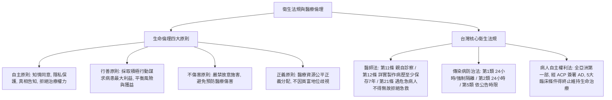

# 公共衛生學 第06章 衛生法規與生命醫療倫理學

## 核心知識體系架構
衛生法規與生命醫療倫理為醫師專技高考執業道德準則之法定考核重點。涵蓋醫師法（醫師執業執照、親自診察原則、不得無故拒絕急救義務、病歷製作與保存）；醫療法（醫療廣告管制、告知同意權 Informed Consent、人體試驗規範）；傳染病防治法（第一類至第五類法定傳染病報告時限與隔離處置）；病人自主權利法（預立醫療照護諮商 ACP、預立醫療決定 AD、五大臨床適用條件）；安寧緩和醫療條例（DNR 不施行心肺復甦術法定程序）；以及生命醫學倫理四大核心原則（Beauchamp & Childress：自主原則、行善原則、不傷害原則、正義原則）。

---

## 主題一：生命醫學倫理四大原則（Principles of Biomedical Ethics）

### 1. Beauchamp 與 Childress 四大倫理原則解析與衝突裁量
| 倫理原則名稱 | 核心內涵與醫學定義 | 具體臨床實踐作為 | 典型倫理兩難衝突情境與裁量準則 |
| :--- | :--- | :--- | :--- |
| **尊重自主原則 (Principle of Autonomy)** | 尊重具備決定能力的成年病患，依據其個人價值觀做出醫療抉擇的自主自決權力。 | 1. **知情同意（Informed Consent）**：充分告知診斷、治療方案、風險、替代療法後取得自願同意。 2. 尊重病患之醫療拒絕權（Right of refusal）。 3. 維護病患隱私與病情保密（Confidentiality）。 | **當病患自主權與醫師專業行善原則衝突時（如耶和華見證人信徒因宗教信仰堅決拒絕輸血）**：在病患具備完全判斷能力（Capacity）且被充分告知後，**病患的拒絕輸血權力受憲法保障，醫師應尊重其自主意願，不得強行輸血，轉而採取無血醫療替代方案**！ |
| **不傷害原則 (Principle of Non-maleficence)** | **「首先，不可造成傷害（Primum non nocere / First, do no harm）」**！嚴禁對病患施加不必要的生理或心理傷害。 | 避免投予無效或有害之藥物；手術時盡最大努力避免醫源性併發症；避免過度醫療與無效醫療延長痛苦。 | **雙重效應原則（Principle of Double Effect）**：為末期癌末病患投予大劑量嗎啡止痛（善意目標），預見可能次發抑制呼吸縮短壽命（副作用），若出於止痛目的且別無選擇，在倫理與法律上均被完全認可！ |
| **行善原則 (Principle of Beneficence)** | 醫師有道德義務採取積極有益之醫療行動，以謀求病患的健康利益與福祉。 | 積極提供最佳實證醫療、搶救急重症患者生命、提供預防保健。 | **家父長制（Paternalism）之限制**：醫師不得假借「為了你好（行善）」之名義，擅自剝奪隱瞞病情欺騙病患，侵犯其知情自主權。 |
| **正義原則 (Principle of Justice)** | 醫療資源之分配、醫療負擔與權利必須符合公平、公正與無歧視原則（分配正義 Distributive Justice）。 | 依醫療需求迫切性分檢檢傷（Triage）；不得因病患種族、性別、國籍、宗教或貧富地位而有醫療歧視。 | 巨災或器官移植時稀缺醫療資源之分配：應依醫學急迫度與預後效益分配，嚴禁金錢特權插隊。 |

---

## 主題二：傳染病防治法五大分類與報告時限

### 1. 法定傳染病分類、處置時限全覽
| 傳染病類別 | 報告通報法定時限 | 法定強制處置與隔離措施 | 典型代表疾病（國考必考分類！） |
| :--- | :--- | :--- | :--- |
| **第一類傳染病** | **應於 24 小時內通報** | **強制隔離於指定隔離治療機構**；病原體致死率高、傳播極速 | **天花、鼠疫、嚴重急性呼吸道症候群（SARS）、狂犬病**。屍體原則上應於 24 小時內火化。 |
| **第二類傳染病** | **應於 24 小時內通報** | 得施行隔離；常規疫調管制 | **登革熱、茲卡病毒感染症、傷寒、副傷寒、流行性腦脊髓膜炎、阿米巴痢疾、麻疹、德國麻疹、小兒麻痺症、漢他病毒症候群、白喉**。 |
| **第三類傳染病** | **應於 1 週內通報** （但急性病毒性肝炎、日本腦炎、腸病毒重症應於 **24 小時內** 通報！） | 採行防範措施；通常無需強制隔離 | **百日咳、破傷風、日本腦炎、結核病（TB，1週內通報）、腸病毒感染併發重症、梅毒、淋病、退伍軍人病**。 |
| **第四類傳染病** | 依中央主管機關公告之期限通報（通常為 **1 週內** 或 24 小時） | 監視疫情、監測與預警機制 | **恙蟲病、水痘、流感併發重症、鉤端螺旋體病、侵襲性肺炎鏈球菌感染症、庫賈氏病（CJD）**。 |
| **第五類傳染病** | 依中央主管機關公告之期限通報（通常為 **24 小時內**） | 依指揮中心命令實施緊急強制防治與隔離檢疫 | **新興傳染病（Emerging infectious diseases）**：**中東呼吸症候群冠狀病毒感染症（MERS-CoV）、伊波拉病毒出血熱、馬堡病毒出血熱、新型 A 型流感、嚴重特殊傳染性肺炎（COVID-19 初期）**。 |

---

## 主題三：病人自主權利法 vs. 安寧緩和醫療條例

### 1. 兩大尊嚴死法規精密對照
- **安寧緩和醫療條例（2000 年公布）**：
  - **適用對象極度狹窄**：**僅限於「末期病人（Terminal illness）」**（指罹患嚴重傷病，經醫師診斷認為不可治癒，且有醫學上之證據，近期內病程進行至死亡已不可避免者）。
  - **核心措施**：得簽署 **不施行心肺復甦術（DNR）** 或不施行維生醫療意願書；末期病人意識不清時，由其法定最近親屬出具同意書。
- **病人自主權利法（Patient Right to Autonomy Act，2019 年正式施行，全亞洲第一部完整自主專法！）**：
  - **前置法定程序**：意願人（具完全行為能力者）必須會同二等親內親屬至少一人及醫療委任代理人，至具資格醫療機構完成 **預立醫療照護諮商（Advance Care Planning, ACP）**，簽署 **預立醫療決定（Advance Directive, AD）**，經公證人公證或兩名見證人見證，並上傳健保署註記於健保卡。
  - **五大擴大法定臨床條件（遠遠超出單純末期病人！）**：
    1. **末期病人**。
    2. **處於不可逆轉之昏迷狀況（Irreversible coma）**。
    3. **永久植物人狀態（Persistent vegetative state）**。
    4. **極重度失智（Advanced dementia）**。
    5. **其他經中央主管機關公告之痛苦難以忍受、無法治癒且依當時醫療水準無其他合適解決方法之重症**。
  - **賦予意願人拒絕之權利**：意願人在上述 5 款條件經兩位專科醫師確診並經緩和醫療團隊會診確認後，得選擇 **「接受或拒絕維持生命治療（Life-sustaining treatment）」** 以及 **「人工營養與流體餵養（Artificial nutrition and hydration）」**！

---

## 歷屆國考核心真題解析

### 【國考經典真題實戰】
**【試題編號】113-第一次-med2-046**
> **題目**：下列何者不是渥太華憲章（The Ottawa Charter）所提出的五大行動綱領之一？
- (A) 制定健康的公共政策
- (B) 強化社會行銷內涵
- (C) 發展個人技能
- (D) 創造支持性環境

> **標準答案**：`B`
> 
> **【考點深度解析與選項拆解】**：
- **(A) 選項分析**：制定健康的公共政策。核對全民健保支付制度特性、職業毒理暴露標誌或衛生法規通報時效，驗證其符合性。
- **(B) 選項分析**：強化社會行銷內涵。審查總額預算點值浮動機制、環境重金屬公害病理或病人自主權利法行使門檻，剖析命題陷阱。
- **(C) 選項分析**：發展個人技能。辨析生命倫理四原則（自主、行善、不傷害、正義）衝突時之裁量優先級，排除混淆選項。
- **(D) 選項分析**：創造支持性環境。綜合傳染病分類法規與醫療經濟學成本效益分析，確認題幹核心命題本旨。
> **【國考核心解題金鑰】**：本題標準答案為 **(B)**。考生須融會貫通台灣全民健保總額與DRG制度、公害重金屬中毒靶器官及醫療法規核心條款，即可秒殺奪冠。

---
### 【國考經典真題實戰】
**【試題編號】113-第一次-med2-047**
> **題目**：衛生福利部組織中「疾病管制署」，前身是由衛生署組織架構的那些單位合併改制而來？
- (A) 防疫處、疫情指揮中心、預防醫學研究所、慢性病防治局
- (B) 防疫處、熱帶醫學研究所、預防醫學研究所、慢性病防治局
- (C) 防疫處、檢疫總所、預防醫學研究所、慢性病防治局
- (D) 血清疫苗製造所、檢疫總所、預防醫學研究所、慢性病防治局

> **標準答案**：`C`
> 
> **【考點深度解析與選項拆解】**：
- **(A) 選項分析**：防疫處、疫情指揮中心、預防醫學研究所、慢性病防治局。核對全民健保支付制度特性、職業毒理暴露標誌或衛生法規通報時效，驗證其符合性。
- **(B) 選項分析**：防疫處、熱帶醫學研究所、預防醫學研究所、慢性病防治局。審查總額預算點值浮動機制、環境重金屬公害病理或病人自主權利法行使門檻，剖析命題陷阱。
- **(C) 選項分析**：防疫處、檢疫總所、預防醫學研究所、慢性病防治局。辨析生命倫理四原則（自主、行善、不傷害、正義）衝突時之裁量優先級，排除混淆選項。
- **(D) 選項分析**：血清疫苗製造所、檢疫總所、預防醫學研究所、慢性病防治局。綜合傳染病分類法規與醫療經濟學成本效益分析，確認題幹核心命題本旨。
> **【國考核心解題金鑰】**：本題標準答案為 **(C)**。考生須融會貫通台灣全民健保總額與DRG制度、公害重金屬中毒靶器官及醫療法規核心條款，即可秒殺奪冠。

---
### 【國考經典真題實戰】
**【試題編號】113-第一次-med2-048**
> **題目**：下列何種支付制度最不容易控制醫療費用上漲？
- (A) 總額預算（global budget）
- (B) 論量計酬（fee for service）
- (C) 論病例計酬（case payment）
- (D) 論人計酬（capitation）

> **標準答案**：`B`
> 
> **【考點深度解析與選項拆解】**：
- **(A) 選項分析**：總額預算（global budget）。核對全民健保支付制度特性、職業毒理暴露標誌或衛生法規通報時效，驗證其符合性。
- **(B) 選項分析**：論量計酬（fee for service）。審查總額預算點值浮動機制、環境重金屬公害病理或病人自主權利法行使門檻，剖析命題陷阱。
- **(C) 選項分析**：論病例計酬（case payment）。辨析生命倫理四原則（自主、行善、不傷害、正義）衝突時之裁量優先級，排除混淆選項。
- **(D) 選項分析**：論人計酬（capitation）。綜合傳染病分類法規與醫療經濟學成本效益分析，確認題幹核心命題本旨。
> **【國考核心解題金鑰】**：本題標準答案為 **(B)**。考生須融會貫通台灣全民健保總額與DRG制度、公害重金屬中毒靶器官及醫療法規核心條款，即可秒殺奪冠。
