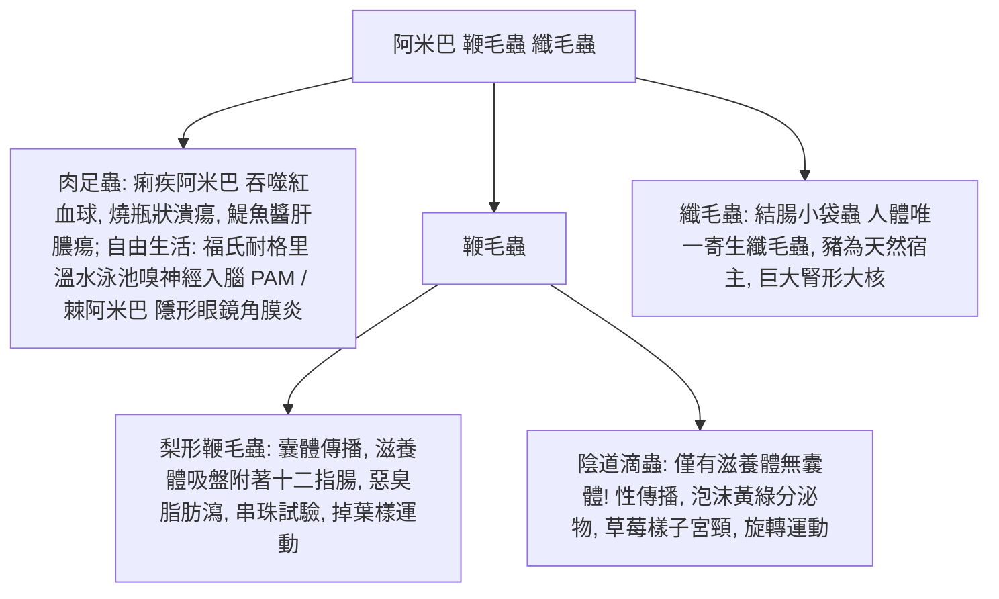

# 寄生蟲學 第01章 醫用原蟲學：阿米巴、鞭毛蟲與纖毛蟲

## 核心知識體系架構
醫用原蟲學（Protozoology）為單細胞真核微生物。本章涵蓋消化道與泌尿生殖道之肉足蟲綱（阿米巴：痢疾阿米巴 Entamoeba histolytica 吞噬紅血球、燒瓶樣潰瘍、鯷魚醬樣肝膿瘍；自由生活阿米巴：福氏耐格里阿米巴 Naegleria fowleri 原發性阿米巴腦膜腦炎 PAM、棘阿米巴 Acanthamoeba 角膜炎）；鞭毛蟲綱（梨形鞭毛蟲 Giardia lamblia 掉葉樣運動、脂肪瀉；陰道滴蟲 Trichomonas vaginalis 旋轉運動、草莓樣宮頸）；以及纖毛蟲綱（結腸小袋纖毛蟲 Balantidium coli 人體唯一寄生纖毛蟲）。

---

## 主題一：阿米巴原蟲（Amebae）致病機轉與臨床病理

### 1. 痢疾阿米巴（Entamoeba histolytica）vs. 同形共生阿米巴（E. dispar）
- **生活史雙型態**：
  - **包囊（Cyst，感染型）**：具堅韌抗胃酸囊壁，成熟包囊含有 **4 個細胞核** 及兩端鈍圓的擬染色體（Chromatoid bodies），經糞口途徑污染食物或水源傳播。
  - **滋養體（Trophozoite，致病與繁殖型）**：單核，核中央具微小圓形核仁，染色質顆粒均勻排列於核膜內側。**顯微鏡下診斷金標準：胞質內吞噬有宿主紅血球（Erythrophagocytosis / Ingested RBCs，為與無害共生的 E. dispar 鑑別之絕對唯一依據！）**。
- **特異組織病理學特徵**：
  1. **腸道病變**：分泌半胱胺酸蛋白酶溶解黏膜上皮，並在黏膜下層向兩側廣泛蔓延侵蝕，形成經典 **「燒瓶樣潰瘍（Flask-shaped ulcers）」**；引發排泄含黏液與血液之阿米巴痢疾（Amebic dysentery）。
  2. **腸外阿米巴病（阿米巴肝膿瘍 Amebic Liver Abscess）**：滋養體侵犯腸繫膜小靜脈，經門脈系統血行播散至肝臟（好發右葉），引起大片液化性壞死，穿刺抽取物呈現特徵性 **「鯷魚醬樣 / 巧克力色濃稠無臭膿液（Anchovy paste-like fluid）」**。
  3. **治療首選**：**甲硝唑（Metronidazole）** 殺滅組織滋養體，接續給予 **巴洛黴素（Paromomycin）** 或碘喹酚清除腸腔內包囊。

### 2. 自由生活阿米巴（Free-Living Amebae）之致命感染
- **福氏耐格里阿米巴（Naegleria fowleri / 「食腦阿米巴」）**：
  - 存在於溫暖的淡水湖泊、溫泉及未加氯消毒的游泳池。
  - **侵入途徑**：跳水或游泳時，阿米巴經鼻腔黏膜穿透**篩骨篩板（Cribriform plate）**，沿嗅神經軸突逆行直衝大腦。
  - **臨床急症**：**原發性阿米巴腦膜腦炎（Primary Amebic Meningoencephalitis, PAM）**，數天內迅猛進展至顱內壓飆升、昏迷與腦疝死亡（死亡率 $> 98\%$）。腦脊髓液（CSF）濕片可見具偽足活動之滋養體。
- **棘阿米巴屬（Acanthamoeba spp.）**：
  - 配戴軟性隱形眼鏡者使用自來水清洗或在泳池配戴，引發劇痛之 **棘阿米巴角膜炎（Acanthamoeba keratitis）**，角膜呈環狀浸潤潰瘍。免疫低下者引發肉芽腫性阿米巴腦炎（GAE）。

---

## 主題二：梨形鞭毛蟲與陰道滴蟲

### 1. 梨形鞭毛蟲（Giardia lamblia / G. duodenalis）
- **形態學特徵**：
  - **滋養體**：呈縱切之半梨形或淚滴狀，背面隆起，腹面具有大型 **吸盤（Ventral sucking disk）**；含 **2 個對稱細胞核**，宛如「戴眼鏡的老爺爺」；具有 4 對鞭毛，在顯微鏡下呈典型 **「落葉樣緩慢搖擺運動（Falling-leaf motility）」**。
  - **成熟包囊**：橢圓形，含 **4 個細胞核**。
- **致病機制與臨床特點**：
  - 滋養體利用腹部吸盤牢固吸附於 **十二指腸與近端空腸黏膜表面**，機械性覆蓋刷狀緣上皮，阻礙脂肪與脂溶性維生素（A, D, E, K）吸收。
  - **排便特徵**：引發惡臭、油膩、漂浮於水面的 **脂肪瀉（Steatorrhea / Malabsorption diarrhea）**，伴隨腹脹腹絞痛與噯氣硫磺味，無紅血球無發燒。
  - **診斷與治療**：糞便鏡檢見包囊或滋養體；十二指腸引流液或腸線試驗（Entero-Test / String test）。治療首選 **Metronidazole**。

### 2. 陰道滴蟲（Trichomonas vaginalis）
- **極關鍵生物學特徵**：**生活史中「僅有滋養體（Trophozoite）期，完全沒有包囊期（No cyst stage！）」**！
- **形態**：梨形，前端具 4 根前鞭毛，體側具波動膜（Undulating membrane），顯微鏡下呈 **「劇烈旋轉擺動運動（Jerky / Twisting motility）」**。
- **傳染與臨床病徵**：
  - **主要經由性接觸直接傳播（STI）**。
  - 男性多為無症狀尿道帶原者；女性陰道感染後陰道分泌物大量增多，呈現 **稀薄泡沫狀、黃綠色、具強烈惡臭魚腥味之白帶**，伴隨嚴重外陰部搔癢與排尿刺痛。
  - **婦科內視鏡經典表徵**：陰道壁與子宮頸黏膜廣泛點狀出血，呈現特徵性 **「草莓樣子宮頸（Strawberry cervix）」**！
  - **治療原則**：**男女雙方性伴侶必須同時接受口服 Metronidazole 治療**，以杜絕乒乓球式反覆交叉感染！

---

## 歷屆國考核心真題解析

### 【國考經典真題實戰】
**【試題編號】111-第一次-med2-028**
> **題目**：T細胞與B細胞都參與氣喘或是異位性皮膚炎等過敏性疾病的病理機制，此類病人體內最常檢測到：
- (A) 高比例可分泌IL-5的T細胞與血清中高濃度IgA
- (B) 高比例可分泌IL-5的T細胞與血清中高濃度IgE
- (C) 高比例可分泌IFN-γ的T細胞與血清中高濃度IgA
- (D) 高比例可分泌IFN-γ的T細胞與血清中高濃度IgE

> **標準答案**：`B`
> 
> **【考點深度解析與選項拆解】**：
- **(A) 選項分析**：高比例可分泌IL-5的T細胞與血清中高濃度IgA。核對寄生蟲生活史感染型（Infective stage）與診斷型（Diagnostic stage）、中間宿主或終宿主歸屬，評估其正確性。
- **(B) 選項分析**：高比例可分泌IL-5的T細胞與血清中高濃度IgE。比對蟲卵顯微鏡特徵（如側刺/末端刺、卵蓋、受精卵厚壁）或滋養體形態，剖析命題陷阱。
- **(C) 選項分析**：高比例可分泌IFN-γ的T細胞與血清中高濃度IgA。檢驗臨床特徵病變（如阿米巴肝膿瘍、微小低色素貧血、巨球性貧血或象皮病），排除干擾選項。
- **(D) 選項分析**：高比例可分泌IFN-γ的T細胞與血清中高濃度IgE。綜合首選驅蟲藥物（Praziquantel, Albendazole, Metronidazole, Primaquine），驗證題幹核心命題本旨。
> **【國考核心解題金鑰】**：本題精準鎖定標準答案 **(B)**。考生須融會貫通原蟲與蠕蟲之傳播媒介（螺類、蚊、黑蠅、采采蠅）、致病機制及典型蟲卵形態，即可秒殺奪冠。

---
### 【國考經典真題實戰】
**【試題編號】111-第一次-med2-029**
> **題目**：林先生之前到中國旅遊時吃了淡水魚的生魚片，不久後出現腹痛，回國後眼眶附近浮腫，很幸運的在浮腫部 位摘除將近4 mm大小的蟲體，林先生最有可能感染下列何種寄生蟲？
- (A) 蟠尾絲蟲（Onchocerca volvulus）
- (B) 有棘頜口線蟲（Gnathostoma spinigerum）
- (C) 東方眼蟲（Thelazia callipaeda）
- (D) 麥地那線蟲 （Dracunculus medinensis）

> **標準答案**：`B`
> 
> **【考點深度解析與選項拆解】**：
- **(A) 選項分析**：蟠尾絲蟲（Onchocerca volvulus）。核對寄生蟲生活史感染型（Infective stage）與診斷型（Diagnostic stage）、中間宿主或終宿主歸屬，評估其正確性。
- **(B) 選項分析**：有棘頜口線蟲（Gnathostoma spinigerum）。比對蟲卵顯微鏡特徵（如側刺/末端刺、卵蓋、受精卵厚壁）或滋養體形態，剖析命題陷阱。
- **(C) 選項分析**：東方眼蟲（Thelazia callipaeda）。檢驗臨床特徵病變（如阿米巴肝膿瘍、微小低色素貧血、巨球性貧血或象皮病），排除干擾選項。
- **(D) 選項分析**：麥地那線蟲 （Dracunculus medinensis）。綜合首選驅蟲藥物（Praziquantel, Albendazole, Metronidazole, Primaquine），驗證題幹核心命題本旨。
> **【國考核心解題金鑰】**：本題精準鎖定標準答案 **(B)**。考生須融會貫通原蟲與蠕蟲之傳播媒介（螺類、蚊、黑蠅、采采蠅）、致病機制及典型蟲卵形態，即可秒殺奪冠。

---
### 【國考經典真題實戰】
**【試題編號】111-第一次-med2-030**
> **題目**：有關鞭蟲（Trichuris trichiura）感染人體的敘述，下列何者錯誤？
- (A) 幼蟲直接在腸道發育為成蟲
- (B) 成蟲主要寄生在大腸
- (C) 會引起自體感染（autoinfection）
- (D) 幼童重度感染可能會引起脫肛（rectum prolapse）

> **標準答案**：`C`
> 
> **【考點深度解析與選項拆解】**：
- **(A) 選項分析**：幼蟲直接在腸道發育為成蟲。核對寄生蟲生活史感染型（Infective stage）與診斷型（Diagnostic stage）、中間宿主或終宿主歸屬，評估其正確性。
- **(B) 選項分析**：成蟲主要寄生在大腸。比對蟲卵顯微鏡特徵（如側刺/末端刺、卵蓋、受精卵厚壁）或滋養體形態，剖析命題陷阱。
- **(C) 選項分析**：會引起自體感染（autoinfection）。檢驗臨床特徵病變（如阿米巴肝膿瘍、微小低色素貧血、巨球性貧血或象皮病），排除干擾選項。
- **(D) 選項分析**：幼童重度感染可能會引起脫肛（rectum prolapse）。綜合首選驅蟲藥物（Praziquantel, Albendazole, Metronidazole, Primaquine），驗證題幹核心命題本旨。
> **【國考核心解題金鑰】**：本題精準鎖定標準答案 **(C)**。考生須融會貫通原蟲與蠕蟲之傳播媒介（螺類、蚊、黑蠅、采采蠅）、致病機制及典型蟲卵形態，即可秒殺奪冠。
