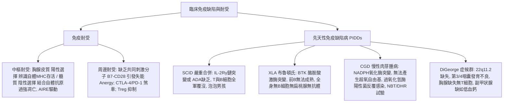

# 微生物與免疫學 第03章 臨床免疫學：免疫耐受、自體免疫與先天免疫缺陷病

## 核心知識體系架構
臨床免疫學為國考必考高難度單元。涵蓋中樞耐受（胸腺陽性與陰性選擇、自體免疫調節因子 AIRE）vs. 周邊耐受（失能 Anergy、Treg 抑制、凋亡）；HLA 與自體免疫疾病強烈關聯（HLA-B27, DR2, DR3, DR4）；以及原發性先天免疫缺陷病（PIDDs：嚴重合併免疫缺陷 SCID、X 性聯無丙種球蛋白血症 XLA、慢性肉芽腫病 CGD、高 IgM 症候群、DiGeorge 症候群）。

---

## 主題一：原發性先天免疫缺陷疾病（PIDDs）精密診斷矩陣

### 1. 國考五大經典免疫缺陷病病因與特徵表
| 疾病名稱 | 遺傳模式與突變分子標靶 | 缺陷免疫細胞族群 | 臨床感染特徵與發病時間 | 實驗室檢查與特異診斷標記 |
| :--- | :--- | :--- | :--- | :--- |
| **嚴重合併免疫缺陷症 (SCID)** | 1. **X 性聯隱性（佔 50%）**：**$IL2RG$ 基因突變**（$\gamma_c$ 共有鏈缺陷，IL-2, 4, 7, 9, 15, 21 受體均失效）。 2. **體染色體隱性**：**腺苷脫氨酶（ADA）缺乏**（毒性 dATP 蓄積毒死淋巴球）。 | **T 細胞與 NK 細胞完全缺失**；B 細胞數目正常或下降但**完全無功能（無抗體）** | 嬰兒出生數月內（母體抗體衰減後）即出現**反覆致死性嚴重全身感染（細菌、病毒、真菌念珠菌、PCP 肺炎）**、頑固性腹瀉、生長遲滯。 | **胸腺影完全缺如（Absent thymic shadow）**、淋巴結無生發中心；血液白血球計數中淋巴球極度低下。需嚴格無菌隔離（泡泡兒），造血幹細胞移植為唯一治癒途徑。 |
| **X 性聯無丙種球蛋白血症 (XLA / Bruton's Disease)** | **X 性聯隱性遺傳**；**$BTK$（布魯頓酪胺酸激酶）基因突變** | **前 B 細胞（Pre-B）無法發育成熟為初始 B 細胞**。T 細胞數目與功能完全正常！ | 男嬰於 6 個月大後反覆發生**有莢膜化膿性細菌（肺炎鏈球菌、流感嗜血桿菌）之呼吸道感染**；對腸病毒易感。 | **血液中所有同種型免疫球蛋白（IgG, A, M, E, D）幾乎為零**！周邊血 **CD19+ / CD20+ B 細胞數目幾乎為 0**！**扁桃腺與周邊淋巴結極度微小發育不全**。 |
| **慢性肉芽腫病 (CGD / Chronic Granulomatous Disease)** | **X 性聯隱性為主（佔 70%）**；**$CYBB$ 突變缺陷導致 $NADPH$ 氧化酶（Phagocyte Oxidase）功能喪失** | 吞噬細胞（嗜中性球與巨噬細胞）數目正常，但**無法產生超氧陰離子（$O_2^-$）與活性氧（ROS），呼吸爆發（Respiratory burst）完全癱瘓**！ | 反覆發生化膿性感染與多器官肉芽腫形成（淋巴結、肝、肺、骨骼）。**專門對 5 大「過氧化氫酶陽性菌（Catalase-positive）」極度易感**！ | **過氧化氫酶陽性菌五天王（國考必考！）**： 1. **金黃色葡萄球菌（S. aureus）** 2. **綠膿桿菌（P. aeruginosa）** 3. **洋蔥伯克氏菌（B. cepacia）** 4. **諾卡氏菌（Nocardia）** 5. **麴菌（Aspergillus）**。 **確診試驗**：二氫羅丹明試驗（DHR 流式細胞儀）無螢光，或四氮唑藍試驗（NBT）不變色。 |
| **高 IgM 症候群 (Hyper-IgM Syndrome)** | **X 性聯隱性**；活化 T 細胞表面之 **$CD40L$（CD154）基因突變** | B 細胞數目正常，但**無法進行免疫球蛋白類別轉換（CSR）與體細胞高頻突變** | 嬰幼兒期反覆嚴重細菌感染與機會性感染（PCP 肺囊蟲肺炎首選好發！）。 | **血清 $IgM$ 濃度正常或顯著異常飆升**；但 **$IgG$、$IgA$、$IgE$ 極度低下甚至測不到**！生發中心缺失。 |
| **迪喬治症候群 (DiGeorge Syndrome)** | **第 22 號染色體長臂微缺失（22q11.2 microdeletion）**；胚胎發育異常 | **第 3 與第 4 咽囊（Pharyngeal pouches）發育不全** $\to$ **胸腺發育不全或缺如（Thymic aplasia）** $\to$ **T 細胞成熟障礙**；B 細胞數目正常但缺乏 T 輔助。 | 易患病毒、真菌與細胞內病原體感染；副甲狀腺缺如導致**嚴重低血鈣與手足抽搐（Tetany）**；伴隨先天性心臟畸形（法洛氏四重症、主動脈弓異常）。 | **X 光下胸腺影完全消失**；CD3+ T 細胞極度低下；血鈣過低、血磷過高、PTH 為零。 |

---

## 主題二：人類白血球抗原（HLA）與自體免疫疾病強烈關聯

### 1. 國考必背 HLA 對偶基因與疾病速查表
- **HLA-B27（Class I 分子，關聯度最高！）**：
  - **血清陰性脊椎關節病變（Seronegative Spondyloarthropathies, PAIR）**：
    - **P**soriatic arthritis（乾癬性關節炎）
    - **A**nkylosing spondylitis（**僵直性脊椎炎，關聯度高達 90~95%！**）
    - **I**BD-associated arthritis（發炎性腸道疾病關節炎）
    - **R**eactive arthritis（反應性關節炎 / Reiter 症候群：尿道炎、結膜炎、關節炎三聯徵）。
- **HLA-DR4（Class II 分子）**：
  - **類風濕性關節炎（Rheumatoid Arthritis, RA）**
  - **第 1 型糖尿病（Type 1 Diabetes Mellitus, T1DM）**。
- **HLA-DR3**：
  - 第 1 型糖尿病（DR3/DR4 雜合子風險最高！）、全身性紅斑狼瘡（SLE）、Hashimoto 甲狀腺炎。
- **HLA-DR2**：
  - 多發性硬化症（Multiple Sclerosis, MS）、古德帕斯徹症候群（Goodpasture syndrome）。
- **HLA-DQ2 / HLA-DQ8**：
  - **乳糜瀉（Celiac Disease / 麩質敏感性腸病）**（陰性預測值幾近 100%）。

---

## 歷屆國考核心真題解析

### 【國考經典真題實戰】
**【試題編號】111-第一次-med2-012**
> **題目**：新型抗流感病毒藥物紓伏效（baloxavir marboxil）抑制對象為何？
- (A) PB2
- (B) M2
- (C) HA
- (D) NA

> **標準答案**：`#`
> 
> **【考點深度解析與選項拆解】**：
- **(A) 選項分析**：PB2。核對免疫細胞表面分子標記（如 CD 分子）、抗體亞型特性或補體途徑活化順序，驗證其符合度。
- **(B) 選項分析**：M2。比對細胞激素（Cytokine）特異性功能、MHC 分子呈遞限制性或免疫缺陷致病基因，剖析誘答盲區。
- **(C) 選項分析**：HA。檢驗中樞與周邊耐受機制（AIRE / FoxP3 Treg）或過敏反應型別，排除干擾選項。
- **(D) 選項分析**：NA。綜合抗原辨識受體重組（RAG1/2）或胞內殺菌活性氧生成，確認題幹命題之免疫學核心。
> **【國考核心解題金鑰】**：本題標準答案為 **(#)**。考生須融會貫通補體三條途徑 C3 轉化酶、Th1/Th2/Th17 細胞因子網絡及原發免疫缺陷病之特徵，即可秒殺奪冠。

---
### 【國考經典真題實戰】
**【試題編號】111-第一次-med2-013**
> **題目**：有關疱疹病毒（Herpesvirus）與其相關疾病之配對，下列何者錯誤？
- (A) 單純疱疹病毒一型（HSV-1）：疱疹性腦炎（herpes encephalitis）
- (B) EB病毒（Epstein-Barr virus）：單核球增多症（mononucleosis）
- (C) 水痘病毒（VZV）：帶狀疱疹
- (D) 人類疱疹病毒六型（HHV-6）：疱疹性咽峽炎（herpangina）

> **標準答案**：`D`
> 
> **【考點深度解析與選項拆解】**：
- **(A) 選項分析**：單純疱疹病毒一型（HSV-1）：疱疹性腦炎（herpes encephalitis）。核對免疫細胞表面分子標記（如 CD 分子）、抗體亞型特性或補體途徑活化順序，驗證其符合度。
- **(B) 選項分析**：EB病毒（Epstein-Barr virus）：單核球增多症（mononucleosis）。比對細胞激素（Cytokine）特異性功能、MHC 分子呈遞限制性或免疫缺陷致病基因，剖析誘答盲區。
- **(C) 選項分析**：水痘病毒（VZV）：帶狀疱疹。檢驗中樞與周邊耐受機制（AIRE / FoxP3 Treg）或過敏反應型別，排除干擾選項。
- **(D) 選項分析**：人類疱疹病毒六型（HHV-6）：疱疹性咽峽炎（herpangina）。綜合抗原辨識受體重組（RAG1/2）或胞內殺菌活性氧生成，確認題幹命題之免疫學核心。
> **【國考核心解題金鑰】**：本題標準答案為 **(D)**。考生須融會貫通補體三條途徑 C3 轉化酶、Th1/Th2/Th17 細胞因子網絡及原發免疫缺陷病之特徵，即可秒殺奪冠。

---
### 【國考經典真題實戰】
**【試題編號】111-第一次-med2-014**
> **題目**：有關伊波拉病毒（Ebola virus）的敘述，下列何者錯誤？
- (A) 病毒穩定，主要透過腸胃道傳染
- (B) 病毒可以感染內皮細胞、單核球（monocyte）和其它細胞，並快速複製，造成多種細胞壞死
- (C) 病毒感染細胞之後，會引起細胞激素風暴（cytokine storm）
- (D) 病毒感染內皮細胞之後，使細胞失去附著性，導致血管通透性增加，造成內出血

> **標準答案**：`A`
> 
> **【考點深度解析與選項拆解】**：
- **(A) 選項分析**：病毒穩定，主要透過腸胃道傳染。核對免疫細胞表面分子標記（如 CD 分子）、抗體亞型特性或補體途徑活化順序，驗證其符合度。
- **(B) 選項分析**：病毒可以感染內皮細胞、單核球（monocyte）和其它細胞，並快速複製，造成多種細胞壞死。比對細胞激素（Cytokine）特異性功能、MHC 分子呈遞限制性或免疫缺陷致病基因，剖析誘答盲區。
- **(C) 選項分析**：病毒感染細胞之後，會引起細胞激素風暴（cytokine storm）。檢驗中樞與周邊耐受機制（AIRE / FoxP3 Treg）或過敏反應型別，排除干擾選項。
- **(D) 選項分析**：病毒感染內皮細胞之後，使細胞失去附著性，導致血管通透性增加，造成內出血。綜合抗原辨識受體重組（RAG1/2）或胞內殺菌活性氧生成，確認題幹命題之免疫學核心。
> **【國考核心解題金鑰】**：本題標準答案為 **(A)**。考生須融會貫通補體三條途徑 C3 轉化酶、Th1/Th2/Th17 細胞因子網絡及原發免疫缺陷病之特徵，即可秒殺奪冠。
