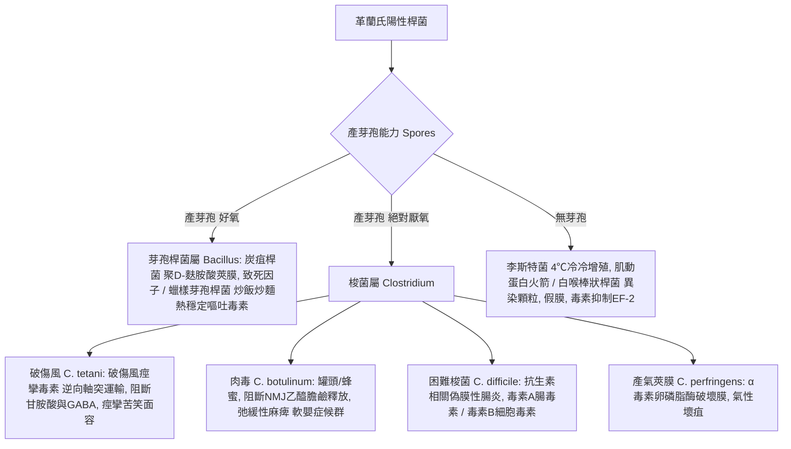

# 微生物與免疫學 第05章 革蘭氏陽性桿菌與厭氧菌

## 核心知識體系架構
本章涵蓋具產芽孢能力之革蘭氏陽性桿菌（Bacillus 炭疽桿菌/蠟樣芽孢桿菌；Clostridium 破傷風梭菌/肉毒桿菌/困難梭菌/產氣莢膜梭菌）；無芽孢革蘭氏陽性桿菌（Listeria monocytogenes 單核球增多性李斯特菌、Corynebacterium diphtheriae 白喉棒狀桿菌）；以及其分泌之強效神經毒素與細胞毒素。

---

## 主題一：梭菌屬（Clostridium）四大致命神經與組織毒素

### 1. 破傷風 vs. 肉毒桿菌 vs. 困難梭菌 vs. 產氣莢膜梭菌
- **破傷風梭菌（Clostridium tetani）**：
  - 顯微形態：端生圓形芽孢，外觀呈典型 **「鼓槌狀（Drumstick appearance）」**，專性厭氧。
  - **破傷風痙攣毒素（Tetanospasmin）**：A-B 型神經外毒素。經創口感染後，由運動神經元軸突末梢吸收，經 **軸突逆行性運輸（Retrograde axonal transport）** 到達脊髓前角和腦幹。專一性剪切抑制性中間神經元（Renshaw 細胞）的 **Synaptobrevin（VAMP / v-SNARE）**，徹底阻斷抑制性神經傳導物質 **甘胺酸（Glycine）與 GABA** 之釋放！失去中樞抑制引發運動神經元持續無阻礙放電，呈現全身肌群強直痙攣：**牙關緊閉（Trismus / Lockjaw）、苦笑面容（Risus sardonicus）、角弓反張（Opisthotonos）**。
- **肉毒桿菌（Clostridium botulinum）**：
  - **肉毒毒素（Botulinum Toxin）**：自然界毒性最強的生物毒素！為**預先形成外毒素（Preformed toxin）**，常存在於未經充分高壓滅菌的家庭自製罐頭醃肉中。
  - **致病機制**：毒素經胃腸吸收進入血液循環，到達周邊神經肌肉交界處（NMJ），重鏈結合受體，輕鏈剪切 SNAP-25 或 Synaptobrevin，**專一性阻斷周邊突觸前釋放「乙醯膽鹼（Ach）」**！
  - **臨床特徵**：引發下行性對稱性 **弛緩性麻痺（Flaccid paralysis）**（複視、視物模糊、上瞼下垂、吞嚥困難，直至呼吸肌麻痺）。
  - **嬰兒肉毒桿菌病（Floppy baby syndrome / 軟嬰症候群）**：嬰兒腸道菌叢尚未發育完全，進食**含肉毒桿菌芽孢的天然蜂蜜（Honey）** 後，芽孢在腸道內萌發並釋放毒素，引發便秘、肌張力極度低下（1歲以下嬰兒絕對嚴禁食用蜂蜜！）。
- **困難梭菌（Clostridioides difficile）**：
  - 長期廣泛使用廣效抗生素（如 Clindamycin, 氟喹諾酮, 3代頭孢）後，腸道正常厭氧菌叢被大舉破壞，C. diff 趁機過度繁殖。
  - **毒素 A（Enterotoxin A）** 損傷黏膜細胞引起腹瀉；**毒素 B（Cytotoxin B）** 解聚肌動蛋白引發上皮細胞壞死脫落，纖維蛋白與發炎細胞在結腸黏膜形成黃白色偽膜，即 **偽膜性結腸炎（Pseudomembranous colitis）**。治療首選口服 Vancomycin 或 Fidaxomicin。

---

## 主題二：李斯特菌與白喉桿菌病理學

### 1. 單核球增多性李斯特菌（Listeria monocytogenes）
- **關鍵微生物特徵**：革蘭氏陽性短桿菌、兼性胞內寄生菌。
  1. **冷增殖特性（Cold growth）**：能在 **$4^\circ\text{C}$ 低溫冰箱中持續繁殖生長**！典型傳染途徑為食用受污染的未殺菌牛奶、軟乾酪、熱狗熟食冷肉。
  2. **翻滾運動（Tumbling motility）**：在室溫 $25^\circ\text{C}$ 表現典型翻滾動力，在 $37^\circ\text{C}$ 則無動力。
  3. **肌動蛋白火箭（Actin rockets）**：被吞噬後釋放溶血素 O 逃出吞噬泡，在宿主細胞質內誘導宿主肌動蛋白重組聚合成「火箭尾推進（Actin polymerization）」，**直接穿透至相鄰細胞，完全無需暴露於細胞外液，完美躲避體液中抗體與補體攻擊**！
- **易感族群與疾病**：孕婦（引發流產早產或死胎）、**新生兒與免疫低下/老年人（化膿性腦膜炎第一位非典型桿菌元兇！）**。經驗性治療必須加用 Ampicillin！

### 2. 白喉棒狀桿菌（Corynebacterium diphtheriae）
- **顯微形態與染色**：呈 V 字形或 Y 字形排列（宛如中文字或排列的火柴棒）。亞甲藍染色或 Albert 染色可見顆粒深染的 **異染顆粒（Metachromatic granules / Babes-Ernst bodies）**。
- **白喉毒素（Diphtheria Toxin）**：由溶原性 $\beta$-噬菌體編碼之 A-B 外毒素。A 活性次單元催化 NAD+ 將 **ADP-核糖轉移至延伸因子-2（EF-2）上（ADP-ribosylation of EF-2）**，徹底阻斷宿主細胞胜肽鏈延伸與蛋白質合成，引發細胞壞死！
- **臨床特徵**：咽喉部形成由壞死組織、纖維蛋白與細菌組成的 **緻密灰白色厚假膜（Pseudomembrane）**，強行剝離會引起劇烈出血；假膜脫落可阻塞氣道窒息；毒素吸收入血可引發致死性 **中毒性心肌炎**。

---

## 歷屆國考核心真題解析

### 【國考經典真題實戰】
**【試題編號】111-第二次-第一階段-med2-005**
> **題目**：當細菌培養液只含有乳糖，此時抑制子（repressor）和代謝基因活化蛋白質（catabolite gene-activator protein , CAP）之活性，以及調節乳糖操縱子（lac operon）表現的敘述，下列何者正確？
- (A) 抑制子的功能被抑制，且CAP 不活化，促使乳糖操縱子表現
- (B) 抑制子的功能被抑制，且CAP 不活化，導致乳糖操縱子不表現
- (C) 抑制子的功能被抑制，且CAP 被活化，導致乳糖操縱子不表現
- (D) 抑制子的功能被抑制，且CAP 被活化，促使乳糖操縱子表現

> **標準答案**：`D`
> 
> **【考點深度解析與選項拆解】**：
- **(A) 選項分析**：抑制子的功能被抑制，且CAP 不活化，促使乳糖操縱子表現。核對細菌染色型態（革蘭陽性/陰性、球菌/桿菌）、培養基特異成分或外毒素分子作用機制，確認其符合性。
- **(B) 選項分析**：抑制子的功能被抑制，且CAP 不活化，導致乳糖操縱子不表現。審查細菌生化鑑定試驗（過氧化氫酶 Catalase、凝固酶 Coagulase、溶血性、膽汁溶解度），拆解考選部常設陷阱。
- **(C) 選項分析**：抑制子的功能被抑制，且CAP 被活化，導致乳糖操縱子不表現。辨析毒素胞內標靶（如 ADP-核糖基化 EF-2 或 Gs 蛋白、破壞 SNARE 蛋白），排除干擾選項。
- **(D) 選項分析**：抑制子的功能被抑制，且CAP 被活化，促使乳糖操縱子表現。綜合臨床症狀表現與傳染流行病學特徵，驗證題幹核心命題本旨。
> **【國考核心解題金鑰】**：本題精準鎖定標準答案 **(D)**。考生須精通葡萄球菌與鏈球菌鑑別流程、厭氧梭菌毒素機制及腸內桿菌抗原分型，即可秒殺奪冠。

---
### 【國考經典真題實戰】
**【試題編號】111-第二次-第一階段-med2-006**
> **題目**：有關無乳鏈球菌（Streptococcus agalactiae）的敘述，下列何者錯誤？
- (A) 屬於B 群鏈球菌（Group B streptococci）
- (B) 血清學鑑定的三個主要標誌為 Lancefield group B 抗原（antigen）、型特異性莢膜多醣體（type-specific capsular polysaccharides）、表面蛋白質（surface proteins）
- (C) 主要棲居在人體上呼吸道
- (D) 此菌可經由產婦生產時感染嬰兒

> **標準答案**：`C`
> 
> **【考點深度解析與選項拆解】**：
- **(A) 選項分析**：屬於B 群鏈球菌（Group B streptococci）。核對細菌染色型態（革蘭陽性/陰性、球菌/桿菌）、培養基特異成分或外毒素分子作用機制，確認其符合性。
- **(B) 選項分析**：血清學鑑定的三個主要標誌為 Lancefield group B 抗原（antigen）、型特異性莢膜多醣體（type-specific capsular polysaccharides）、表面蛋白質（surface proteins）。審查細菌生化鑑定試驗（過氧化氫酶 Catalase、凝固酶 Coagulase、溶血性、膽汁溶解度），拆解考選部常設陷阱。
- **(C) 選項分析**：主要棲居在人體上呼吸道。辨析毒素胞內標靶（如 ADP-核糖基化 EF-2 或 Gs 蛋白、破壞 SNARE 蛋白），排除干擾選項。
- **(D) 選項分析**：此菌可經由產婦生產時感染嬰兒。綜合臨床症狀表現與傳染流行病學特徵，驗證題幹核心命題本旨。
> **【國考核心解題金鑰】**：本題精準鎖定標準答案 **(C)**。考生須精通葡萄球菌與鏈球菌鑑別流程、厭氧梭菌毒素機制及腸內桿菌抗原分型，即可秒殺奪冠。

---
### 【國考經典真題實戰】
**【試題編號】111-第二次-第一階段-med2-007**
> **題目**：關於白喉桿菌（Corynebacterium diphtheriae）的敘述，下列何者錯誤？
- (A) 主要的致病因子為白喉毒素（diptheria toxin），作用於轉譯延長因子（elongation factor-2 , EF-2）
- (B) 造成疾病的主要生物型（biotype）是gravis biotype
- (C) 細胞壁上含有短鏈分枝菌酸（short-chain mycolic acids）
- (D) 主要造成呼吸道或皮膚的疾病

> **標準答案**：`B`
> 
> **【考點深度解析與選項拆解】**：
- **(A) 選項分析**：主要的致病因子為白喉毒素（diptheria toxin），作用於轉譯延長因子（elongation factor-2 , EF-2）。核對細菌染色型態（革蘭陽性/陰性、球菌/桿菌）、培養基特異成分或外毒素分子作用機制，確認其符合性。
- **(B) 選項分析**：造成疾病的主要生物型（biotype）是gravis biotype。審查細菌生化鑑定試驗（過氧化氫酶 Catalase、凝固酶 Coagulase、溶血性、膽汁溶解度），拆解考選部常設陷阱。
- **(C) 選項分析**：細胞壁上含有短鏈分枝菌酸（short-chain mycolic acids）。辨析毒素胞內標靶（如 ADP-核糖基化 EF-2 或 Gs 蛋白、破壞 SNARE 蛋白），排除干擾選項。
- **(D) 選項分析**：主要造成呼吸道或皮膚的疾病。綜合臨床症狀表現與傳染流行病學特徵，驗證題幹核心命題本旨。
> **【國考核心解題金鑰】**：本題精準鎖定標準答案 **(B)**。考生須精通葡萄球菌與鏈球菌鑑別流程、厭氧梭菌毒素機制及腸內桿菌抗原分型，即可秒殺奪冠。
