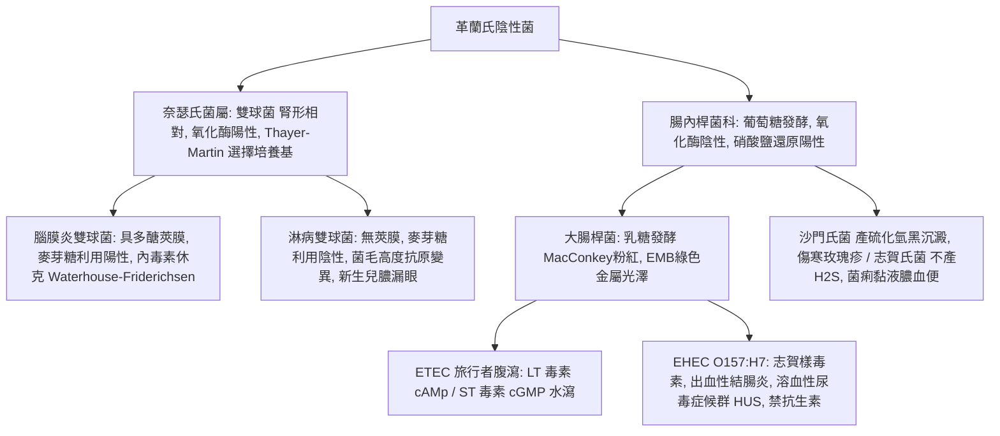

# 微生物與免疫學 第06章 革蘭氏陰性球菌與腸內桿菌科

## 核心知識體系架構
本章統整革蘭氏陰性雙球菌（奈瑟氏菌屬：Neisseria meningitidis 腦膜炎雙球菌 vs. N. gonorrhoeae 淋病雙球菌）；腸內桿菌科（Enterobacteriaceae）抗原系統（O菌體、H鞭毛、K莢膜抗原）；致病性大腸桿菌（ETEC, EHEC O157:H7, EPEC, EIEC）；志賀氏桿菌（Shigella）vs. 沙門氏菌（Salmonella）；以及非發酵菌王牌綠膿桿菌（Pseudomonas aeruginosa）與霍亂弧菌（Vibrio cholerae）。

---

## 主題一：奈瑟氏菌屬（Neisseria：腦膜炎雙球菌 vs. 淋病雙球菌）

### 1. 腦膜炎雙球菌 vs. 淋病雙球菌生物學特性大對決
| 鑑別指標 | 腦膜炎雙球菌（N. meningitidis） | 淋病雙球菌（N. gonorrhoeae） |
| :--- | :--- | :--- |
| **多醣莢膜（Capsule）** | **有莢膜（Capsulated，最強毒力因子）**，具抗吞噬作用（分 A, B, C, Y, W135 亞型；B 亞型弱抗原性） | **無莢膜（Non-capsulated）** |
| **醣類發酵利用特性** | **葡萄糖利用陽性、麥芽糖（Maltose）利用陽性**（口訣：**M**eningitidis 利用 **M**altose） | **葡萄糖利用陽性、麥芽糖利用陰性** |
| **外膜毒素** | 含大量 **脂寡糖（Lipooligosaccharide, LOS）**，無 O 抗原，內毒素活性極強 | 同樣富含 LOS |
| **抗原變異性** | 莢膜多醣型別固定 | **菌毛（Pili）蛋白高頻抗原變異（Antigenic variation）**，機體終生無法產生保護性免疫！ |
| **典型臨床疾病** | 流行性腦脊髓膜炎（青年軍營、宿舍群聚）；**華-佛氏症候群（Waterhouse-Friderichsen syndrome）**：暴發性 LOS 菌血症誘發 DIC 與**雙側腎上腺大出血壞死，急性腎上腺衰竭猝死**！ | 男性化膿性尿道炎（排尿刺痛黃色膿液）；女性子宮頸炎、骨盆腔發炎（PID）；**新生兒淋菌性結膜炎（膿漏眼，出生即點紅黴素眼膏預防）**。 |

---

## 主題二：致病性大腸桿菌（Diarrheagenic E. coli）五大軍團

### 1. 國考五大腸道致病性大腸桿菌機制與特徵
| 菌株類型 | 縮寫 | 致病分子機制與外毒素 | 臨床排便特徵與流行病學 |
| :--- | :--- | :--- | :--- |
| **產腸毒素型大腸桿菌** | **ETEC** | 1. **熱不穩定腸毒素（LT）**：ADP-核糖基化 $G_s$ 蛋白 $\to$ **$cAMP\uparrow$** $\to$ CFTR 氯通道持續開放，水與電解質大量分泌。 2. **熱穩定腸毒素（ST）**：結合鳥苷酸環化酶 C $\to$ **$cGMP\uparrow$** $\to$ 減少腸道吸收水鈉。 | **旅行者腹瀉（Traveler's Diarrhea）最常見病因**！大量水樣便（Watery diarrhea），無血無膿，自限性。 |
| **腸道出血型大腸桿菌** | **EHEC** | **志賀樣毒素（Shiga-like toxin / Stx-1, Stx-2）**：A-B 外毒素，A 鏈裂解宿主核糖體 **28S rRNA**，阻斷蛋白質合成。最常見血清型為 **O157:H7**。 | 進食未煮熟漢堡絞肉引發劇烈腹痛伴**大量鮮紅血便（Hemorrhagic colitis）**。 **溶血性尿毒症候群（HUS 三聯徵：微血管病性溶血性貧血 + 血小板低下 + 急性腎衰竭）**！**絕對禁用抗生素（會誘發噬菌體溶解爆發性釋放大量 Stx 毒素，惡化 HUS 致死！）**。山梨醇 MacConkey 培養基（SMAC）不發酵。 |
| **腸道致病型大腸桿菌** | **EPEC** | 經微纖毛黏附上皮，III 型分泌系統注入 Tir，導致微絨毛脫落、形成肌動蛋白基座（Attaching and effacing lesions） | **開發中國家嬰幼兒嚴重水瀉水便**。 |
| **腸道侵襲型大腸桿菌** | **EIEC** | 侵襲大腸黏膜上皮細胞並在胞質內橫向擴散（似 Shigella） | 黏液膿血便，伴隨發燒與裏急後重。 |

---

## 主題三：綠膿桿菌與霍亂弧菌

### 1. 綠膿桿菌（Pseudomonas aeruginosa）
- **生物學特徵**：專性需氧、革蘭氏陰性桿菌、無芽孢、單端鞭毛、**氧化酶（Oxidase）陽性**。MacConkey 不發酵乳糖（無色）。產生藍綠色水溶性**綠膿素（Pyocyanin）** 及螢光素，培養物具甜水果葡萄香味。
- **外毒素 A（Exotoxin A）**：分子致病機制**與白喉毒素完全相同**！催化 **EF-2 之 ADP-核糖基化**，阻斷宿主蛋白質合成，引發組織廣泛壞死。
- **高危族群與臨床表現（口訣：PSEUDO）**：
  - **P**ulmonary（囊性纖維化 CF 患者慢性肺部反覆感染、呼吸器相關肺炎）
  - **S**epsis（壞疽性臁瘡 Ecthyma gangrenosum，黑色壞疽潰瘍皮膚病變）
  - **E**xternal otitis（惡性外耳炎，糖尿病老人）
  - **U**TI（留置導尿管感染）
  - **D**rug use / **D**iabetic foot
  - **O**steomyelitis（穿球鞋踩到生鏽釘子穿透性刺傷足底骨髓炎）/ 嚴重燒傷創面感染首位。

### 2. 霍亂弧菌（Vibrio cholerae）
- **形態與培養**：革蘭氏陰性逗點狀弧菌，單鞭毛魚群樣極速穿梭運動。嗜鹼性（在鹼性蛋白腖水或 **TCBS 培養基上長出黃色蔗糖發酵菌落**）。
- **霍亂毒素（Cholera Toxin / Choleragen）**：A-B 型腸毒素。A1 次單元將 ADP-核糖共價轉移至 **$G_{\alpha s}$ 蛋白** 上，**鎖死 $G_s$ 於持續活化狀態** $\to$ 腺苷酸環化酶（AC）不可逆狂暴活化 $\to$ 腸黏膜細胞內 **$cAMP$ 暴增數千倍** $\to$ CFTR 氯通道極度開放，大量分泌 $Cl^-$ 與水，超過腸道吸收極限。
- **臨床特徵**：引發無痛性暴發性排便，呈現微腥無臭的典型 **「米泔水樣便（Rice-water stools）」**（每日排水量可高達 10~20 公升！），迅速引發致死性重度脫水與低血容量休克。治療核心為立即**口服或靜脈補液鹽（ORS）**。

---

## 歷屆國考核心真題解析

### 【國考經典真題實戰】
**【試題編號】111-第二次-第一階段-med2-015**
> **題目**：下列那一種藥物，主要抑制C 型肝炎病毒（hepatitis C virus）的聚合酶（polymerase）？
- (A) 索華迪（sofosbuvir）
- (B) 波普瑞韋（boceprevir）
- (C) 拉米夫定（lamivudine）
- (D) 聚乙二醇干擾素（pegylated interferon）

> **標準答案**：`A`
> 
> **【考點深度解析與選項拆解】**：
- **(A) 選項分析**：索華迪（sofosbuvir）。核對細菌染色型態（革蘭陽性/陰性、球菌/桿菌）、培養基特異成分或外毒素分子作用機制，確認其符合性。
- **(B) 選項分析**：波普瑞韋（boceprevir）。審查細菌生化鑑定試驗（過氧化氫酶 Catalase、凝固酶 Coagulase、溶血性、膽汁溶解度），拆解考選部常設陷阱。
- **(C) 選項分析**：拉米夫定（lamivudine）。辨析毒素胞內標靶（如 ADP-核糖基化 EF-2 或 Gs 蛋白、破壞 SNARE 蛋白），排除干擾選項。
- **(D) 選項分析**：聚乙二醇干擾素（pegylated interferon）。綜合臨床症狀表現與傳染流行病學特徵，驗證題幹核心命題本旨。
> **【國考核心解題金鑰】**：本題精準鎖定標準答案 **(A)**。考生須精通葡萄球菌與鏈球菌鑑別流程、厭氧梭菌毒素機制及腸內桿菌抗原分型，即可秒殺奪冠。

---
### 【國考經典真題實戰】
**【試題編號】111-第二次-第一階段-med2-016**
> **題目**：近年來基質輔助雷射脫附飛行時間質譜儀（matrix-assisted laser desorption ionization-time of flight mass spectrometry, MALDI-TOF MS）廣泛應用在微生物的鑑定上，其主要的偵測標的物為何？
- (A) 蛋白質
- (B) 核酸
- (C) 粒線體
- (D) 微量元素

> **標準答案**：`A`
> 
> **【考點深度解析與選項拆解】**：
- **(A) 選項分析**：蛋白質。核對細菌染色型態（革蘭陽性/陰性、球菌/桿菌）、培養基特異成分或外毒素分子作用機制，確認其符合性。
- **(B) 選項分析**：核酸。審查細菌生化鑑定試驗（過氧化氫酶 Catalase、凝固酶 Coagulase、溶血性、膽汁溶解度），拆解考選部常設陷阱。
- **(C) 選項分析**：粒線體。辨析毒素胞內標靶（如 ADP-核糖基化 EF-2 或 Gs 蛋白、破壞 SNARE 蛋白），排除干擾選項。
- **(D) 選項分析**：微量元素。綜合臨床症狀表現與傳染流行病學特徵，驗證題幹核心命題本旨。
> **【國考核心解題金鑰】**：本題精準鎖定標準答案 **(A)**。考生須精通葡萄球菌與鏈球菌鑑別流程、厭氧梭菌毒素機制及腸內桿菌抗原分型，即可秒殺奪冠。

---
### 【國考經典真題實戰】
**【試題編號】111-第二次-第一階段-med2-017**
> **題目**：下列何者具有寬大菌絲，且沒有或較少細胞中隔（septum）？
- (A) Fusarium spp.
- (B) Trichosporon spp.
- (C) Rhizopus spp.
- (D) Scedosporium spp.

> **標準答案**：`C`
> 
> **【考點深度解析與選項拆解】**：
- **(A) 選項分析**：Fusarium spp.。核對細菌染色型態（革蘭陽性/陰性、球菌/桿菌）、培養基特異成分或外毒素分子作用機制，確認其符合性。
- **(B) 選項分析**：Trichosporon spp.。審查細菌生化鑑定試驗（過氧化氫酶 Catalase、凝固酶 Coagulase、溶血性、膽汁溶解度），拆解考選部常設陷阱。
- **(C) 選項分析**：Rhizopus spp.。辨析毒素胞內標靶（如 ADP-核糖基化 EF-2 或 Gs 蛋白、破壞 SNARE 蛋白），排除干擾選項。
- **(D) 選項分析**：Scedosporium spp.。綜合臨床症狀表現與傳染流行病學特徵，驗證題幹核心命題本旨。
> **【國考核心解題金鑰】**：本題精準鎖定標準答案 **(C)**。考生須精通葡萄球菌與鏈球菌鑑別流程、厭氧梭菌毒素機制及腸內桿菌抗原分型，即可秒殺奪冠。
