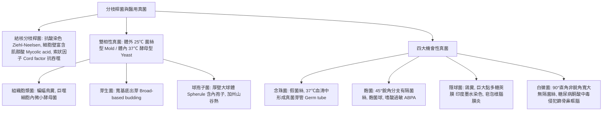

# 微生物與免疫學 第08章 分枝桿菌屬與醫用真菌學

## 核心知識體系架構
本章涵蓋抗酸性分枝桿菌（Mycobacterium tuberculosis 索狀因子、Ghon 氏複合體、原發 vs. 續發性肺結核；M. leprae 痲瘋結核樣型 vs. 瘤腫型）；雙相性真菌（Histoplasma, Blastomyces, Coccidioides）；以及機會致病性真菌（Candida albicans 念珠菌芽管、Aspergillus 麴菌 $45^\circ$ 分叉、Cryptococcus 隱球菌厚莢膜印度墨水染色、Mucor 白黴菌 $90^\circ$ 直角無隔菌絲）。

---

## 主題一：結核分枝桿菌（Mycobacterium tuberculosis）致病機轉

### 1. 細胞壁微細構造與毒力因子
- **抗酸染色（Acid-Fast Stain / Ziehl-Neelsen 染色）**：
  - 細胞壁富含高達 60% 的脂質，核心為 **肌醇酸（Mycolic acid）** 及蠟質脂質。常規革蘭氏染色無法著色；以熱石炭酸複紅染色後，能抵抗 **3% 鹽酸酒精（Acid-alcohol）之強烈脫色**，菌體呈現鮮豔的**纖細紅染桿菌**（背景為亞甲藍複染之藍色）。
- **三大核心毒力因子**：
  1. **索狀因子（Cord Factor / 海藻糖雙肌醇酸酯）**：使結核菌在液體培養基中平行排列成繩索狀。**抑制巨噬細胞移行並破壞粒線體氧化磷酸化**，誘導巨噬細胞分泌 TNF-$\alpha$ 引起惡病質惡瘦（Cachexia）。
  2. **硫脂（Sulfatides）**：抑制吞噬泡（Phagosome）與溶酶體（Lysosome）之融合，確保細菌在巨噬細胞內長期存活繁殖。
  3. **蠟質 D（Wax D）**：弗氏完全佐劑之活性成分，誘導遲發型過敏與肉芽腫。
- **原發性（Primary）vs. 續發性（Secondary / Post-primary）肺結核**：
  - **原發性肺結核**：初次感染，通常發生於**中下肺葉近肋膜處**（原發病灶 Ghon 灶）伴隨同側肺門淋巴結腫大，兩者合稱 **Ghon 氏複合體（Ghon Complex）**。多數纖維化鈣化痊癒（Ranke 複合體）。
  - **續發性肺結核（再活化性）**：當宿主免疫力低下（如高齡、使用抗 TNF 藥物、HIV 感染）時，潛伏於巨噬細胞內的細菌重新甦醒。**好發於「兩側肺尖部（Apex）」（因肺尖高 $V/Q \approx 3.0$、氧分壓最高，最利於好氧之結核菌生長）**！形成大片乾酪樣壞死與空洞，咳血且具強傳染性。

---

## 主題二：四大伺機性真菌（Opportunistic Mycoses）

### 1. 形態學鑑別與高危臨床情境矩陣
| 真菌名稱 | 顯微鏡下組織病理特徵 | 特異診斷染色或試驗 | 易感好發族群與典型臨床病徵 |
| :--- | :--- | :--- | :--- |
| **白色念珠菌 (Candida albicans)** | 卵圓形出芽酵母細胞，在組織中形成**假菌絲（Pseudohyphae）** 與真菌絲 | **芽管試驗（Germ tube test）陽性**（$37^\circ\text{C}$ 血清溫育 2~3 小時即長出真芽管） | 鵝口瘡（Oral thrush，刮除見紅斑基底）、念珠菌食道炎（HIV CD4 $< 100$ 定義疾病）、尿布疹、全身念珠菌血症。 |
| **煙麴黴菌 (Aspergillus fumigatus)** | **具隔膜（Septate）菌絲**，呈典型 **$45^\circ$ 銳角雙叉分支（Dichotomous branching at $45^\circ$）** | 銀染色（GMS）或 PAS 染色陽性 | 1. **麴菌球（Aspergilloma）**：在預存的舊肺空洞（如舊肺結核空洞）內形成重力依賴之真菌球。 2. **過敏性支氣管肺麴菌病（ABPA）**：氣喘或 CF 患者伴隨極高 IgE 與嗜酸性球。 3. 侵襲性麴菌病（嚴重嗜中性球低下者，侵犯血管梗塞出血）。 |
| **新型隱球菌 (Cryptococcus neoformans)** | 圓形窄基底出芽酵母菌，外周包被 **極巨大之黏多糖莢膜（Thick polysaccharide capsule）** | **印度墨水染色（India ink）**：黑色背景中透出透亮透光光暈；**黏液卡紅染色（Mucicarmine）呈鮮紅染** | 存在於**鴿糞（Pigeon droppings）** 與土壤中，經呼吸道吸入。HIV/AIDS 患者（CD4 $< 100$）化膿性腦膜炎首位！腦實質微血管周圍擴張形成典型 **「肥皂泡樣病灶（Soap-bubble lesions）」**。 |
| **白黴菌屬 (Mucor & Rhizopus)** | **寬大無隔膜（Non-septate）或稀疏隔膜菌絲**，呈 **$90^\circ$ 直角粗大不規則分支（Right-angle branching）** | 活檢組織切片迅速確診 | **糖尿病酮酸中毒（DKA）或嚴重白血病患者之致命急症**！吸入孢子在富含酮體與葡萄糖環境中瘋狂繁殖，**親血管性極強（Angioinvasive）**，快速穿透篩骨骨板，引發 **犀牛-眶-腦毛黴菌病（Rhino-orbito-cerebral mucormycosis）**，面部黑痂壞死，死亡率極高！ |

---

## 歷屆國考核心真題解析

### 【國考經典真題實戰】
**【試題編號】112-第一次-med2-008**
> **題目**：有關破傷風桿菌（Clostridium tetani）的敘述，下列何者最不適當？
- (A) 破傷風類毒素（toxoid）可當做有效的疫苗
- (B) 有群體免疫（herd immunity）的現象存在，可降低感染罹病的機會
- (C) 造成痙攣性的肌肉麻痺
- (D) 此菌可產生內孢子（endospore）

> **標準答案**：`B`
> 
> **【考點深度解析與選項拆解】**：
- **(A) 選項分析**：破傷風類毒素（toxoid）可當做有效的疫苗。核對病毒核酸型別（DNA vs. RNA、單股/雙股）、包膜（Envelope）存在與否或真菌形態特徵，評估其正確性。
- **(B) 選項分析**：有群體免疫（herd immunity）的現象存在，可降低感染罹病的機會。比對肝炎血清標記（如 HBsAg, 抗-HBc IgM 空窗期判定）或 HIV 感染 CD4 門檻值，拆解考選部常設陷阱。
- **(C) 選項分析**：造成痙攣性的肌肉麻痺。辨析抗原漂移（Drift）與抗原移型（Shift）之基因重組機制，排除混淆選項。
- **(D) 選項分析**：此菌可產生內孢子（endospore）。綜合特異性染色（抗酸性染色、印度墨水、KOH 鏡檢），確認題幹之核心命題考點。
> **【國考核心解題金鑰】**：本題精準選出標準答案 **(B)**。考生須融會貫通皰疹病毒科潛伏感染部位、B型肝炎五項抗原抗體解讀及流行性感冒基因重排，即可秒殺奪分。

---
### 【國考經典真題實戰】
**【試題編號】112-第一次-med2-009**
> **題目**：下列何者細菌屬於生長緩慢、菌落無色素（nonpigmented colonies），顯微鏡下呈聚集現象（aggregation）的抗 酸性（acid-fast）桿菌？
- (A) 金黃色葡萄球菌（Staphylococcus aureus）
- (B) 結核分枝桿菌（Mycobacterium tuberculosis）
- (C) 綠膿桿菌（Pseudomonas aeruginosa）
- (D) 鬆脆類桿菌（Bacteroides fragilis）

> **標準答案**：`B`
> 
> **【考點深度解析與選項拆解】**：
- **(A) 選項分析**：金黃色葡萄球菌（Staphylococcus aureus）。核對病毒核酸型別（DNA vs. RNA、單股/雙股）、包膜（Envelope）存在與否或真菌形態特徵，評估其正確性。
- **(B) 選項分析**：結核分枝桿菌（Mycobacterium tuberculosis）。比對肝炎血清標記（如 HBsAg, 抗-HBc IgM 空窗期判定）或 HIV 感染 CD4 門檻值，拆解考選部常設陷阱。
- **(C) 選項分析**：綠膿桿菌（Pseudomonas aeruginosa）。辨析抗原漂移（Drift）與抗原移型（Shift）之基因重組機制，排除混淆選項。
- **(D) 選項分析**：鬆脆類桿菌（Bacteroides fragilis）。綜合特異性染色（抗酸性染色、印度墨水、KOH 鏡檢），確認題幹之核心命題考點。
> **【國考核心解題金鑰】**：本題精準選出標準答案 **(B)**。考生須融會貫通皰疹病毒科潛伏感染部位、B型肝炎五項抗原抗體解讀及流行性感冒基因重排，即可秒殺奪分。

---
### 【國考經典真題實戰】
**【試題編號】112-第一次-med2-010**
> **題目**：抗C型肝炎病毒（HCV）的藥物雷巴威林（Ribavirin），是抑制該病毒複製的那一項步驟？
- (A) 接觸（attachment）
- (B) 穿過細胞膜及解散外殼
- (C) 病毒RNA的生合成
- (D) 蛋白質合成

> **標準答案**：`C`
> 
> **【考點深度解析與選項拆解】**：
- **(A) 選項分析**：接觸（attachment）。核對病毒核酸型別（DNA vs. RNA、單股/雙股）、包膜（Envelope）存在與否或真菌形態特徵，評估其正確性。
- **(B) 選項分析**：穿過細胞膜及解散外殼。比對肝炎血清標記（如 HBsAg, 抗-HBc IgM 空窗期判定）或 HIV 感染 CD4 門檻值，拆解考選部常設陷阱。
- **(C) 選項分析**：病毒RNA的生合成。辨析抗原漂移（Drift）與抗原移型（Shift）之基因重組機制，排除混淆選項。
- **(D) 選項分析**：蛋白質合成。綜合特異性染色（抗酸性染色、印度墨水、KOH 鏡檢），確認題幹之核心命題考點。
> **【國考核心解題金鑰】**：本題精準選出標準答案 **(C)**。考生須融會貫通皰疹病毒科潛伏感染部位、B型肝炎五項抗原抗體解讀及流行性感冒基因重排，即可秒殺奪分。
