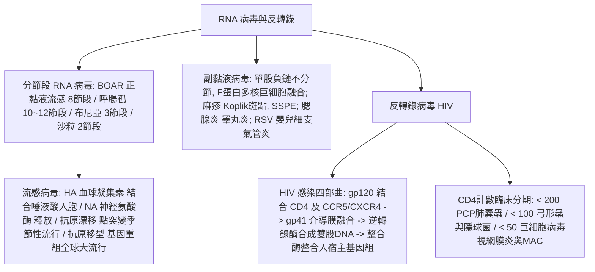

# 微生物與免疫學 第10章 醫用病毒學：RNA 病毒與反轉錄病毒

## 核心知識體系架構
RNA 病毒學涵蓋正鏈 vs. 負鏈 RNA 病毒；分節段 RNA 病毒（BOAR：布尼亞、正黏液、沙粒、呼腸孤）；正黏液病毒科流行性感冒病毒（抗原漂移 Antigenic drift vs. 抗原移型 Antigenic shift）；副黏液病毒科（麻疹、腮腺炎、RSV）；狂犬病毒（Negri 小體）；冠狀病毒；以及反轉錄病毒人類免疫缺乏病毒（HIV-1 複製週期、輔助受體 CCR5/CXCR4、Opportunistic 感染與 CD4 閾值）。

---

## 主題一：流行性感冒病毒（Influenza Virus）與抗原變異

### 1. 病毒構造與分節段基因組特性
- **所屬科別**：正黏液病毒科（Orthomyxoviridae）。
- **核酸特性**：**單股負鏈 RNA（-ssRNA），具有 8 個獨立的分節段（Segmented RNA）**！
- **表面兩大關鍵醣蛋白刺突**：
  1. **血球凝集素（Hemagglutinin, HA）**：專一性結合宿主上皮細胞表面之 **唾液酸（Sialic acid）受體**，介導病毒吸附與穿入；引發紅血球凝集。
  2. **神經氨酸酶（Neuraminidase, NA）**：水解宿主細胞膜上的唾液酸，**促使新生病毒顆粒從感染細胞出芽釋放**；防止病毒自我聚集（抗病毒藥 **Oseltamivir 克流感** 之專一抑制標靶！）。

### 2. 抗原漂移（Antigenic Drift）vs. 抗原移型（Antigenic Shift）大對決
| 變異型態 | 遺傳分子突變機制 | 發生的病毒型別 | 表面抗原改變幅度 | 流行病學臨床結果 |
| :--- | :--- | :--- | :--- | :--- |
| **抗原漂移 (Antigenic Drift)** | 病毒 RNA 聚合酶缺乏校對功能，在複製過程中產生自發性 **隨機點突變（Point mutations）**，導致 HA 或 NA 胺基酸微幅微小改變 | **A 型、B 型、C 型流感病毒均可發生** | **微小漸進改變（Minor change）** | 造成**每年或每幾年的季節性局部小流行（Epidemic）**！這就是為什麼**流感疫苗必須每年重新預測抗原株並每年重新接種**之原因！ |
| **抗原移型 (Antigenic Shift)** | 當**兩種不同來源的流感病毒株（如禽流感與人流感）同時感染同一個宿主細胞（如豬或人體「混合容器」）時，獨立的 RNA 節段發生「隨機基因重組交換（Reassortment of genomic segments）」**！ | **僅發生於 A 型流感病毒（Influenza A only！）**（因 B 型僅感染人類，缺乏動物宿主儲藏庫） | **劇烈突變（Major change）**，出現人類免疫完全空白的全新 HA 或 NA 亞型（如 H1N1 驟變為 H5N1） | 引發**全球性毀滅性大流行（Pandemic）**（如 1918 西班牙大流感、2009 H1N1 新型流感）！致死率極高。 |

---

## 主題二：人類免疫缺乏病毒（HIV）複製週期與伺機感染時序

### 1. HIV 分子結構與感染入侵核心標靶
- **結構蛋白與功能**：
  - **gp120（表面包膜醣蛋白）**：結合宿主細胞表面 **CD4 分子**；隨後與趨化因子輔助受體結合：
    - **CCR5**（主要存在於巨噬細胞上，巨噬細胞嗜性 M-tropic，為 **HIV 早期感染傳播主力**；CCR5 基因 $\Delta 32$ 同型純合突變個體對 HIV 具先天完全免疫抵抗力！）。
    - **CXCR4**（主要存在於 T 細胞上，T-tropic，見於 HIV 晚期惡化階段）。
  - **gp41（跨膜包膜醣蛋白）**：介導病毒包膜與宿主質膜融合穿入。
  - **p24（核衣殼衣殼蛋白）**：血清學早期診斷檢測核心抗原。
  - **三大特異酶類**：逆轉錄酶（Reverse Transcriptase）、整合酶（Integrase）、蛋白酶（Protease）。

### 2. CD4+ T 細胞計數下降與伺機感染疾病分期對照
| CD4+ T 細胞計數 (cells/$\mu$L) | 特異好發之伺機性感染病原體與腫瘤 | 臨床特徵表現 | 預防性投藥建議首選 |
| :--- | :--- | :--- | :--- |
| **CD4 $< 500$** | 口腔白色念珠菌感染（鵝口瘡）、帶狀皰疹（VZV）、子宮頸癌、卡波西肉瘤（HHV-8） | 頻發黏膜感染 | 立即啟動抗反轉錄病毒療法（ART） |
| **CD4 $< 200$（正式定義進入 AIDS 期！）** | **肺囊蟲肺炎（Pneumocystis jirovecii / PCP）**、JC 病毒（進行性多灶性白質腦病 PML） | 呼吸困難、乾咳、胸部 X 光雙側蝴蝶翼對稱間質浸潤；銀染色見壓扁乒乓球樣囊胞 | **第一線預防首選：口服 TMP-SMX (Bactrim)**！ |
| **CD4 $< 100$** | **弓形蟲腦病（Toxoplasma gondii）** **新型隱球菌腦膜炎（Cryptococcus neoformans）** | 弓形蟲引發頭痛發燒神經缺損，**頭部 MRI 見多發性「環狀顯影病灶（Ring-enhancing lesions）」**；隱球菌腦膜炎發熱頭痛 | 弓形蟲預防：**TMP-SMX**；隱球菌治療：Amphotericin B + Flucytosine，維持期 Fluconazole。 |
| **CD4 $< 50$** | **鳥型分枝桿菌複合群（Mycobacterium avium complex, MAC）** **巨細胞病毒（CMV）** | MAC 引發全身消耗高燒貧血肝脾腫大；**CMV 引發壞死性視網膜炎（Retinitis，視野棉絮斑、火焰狀出血，導致永久失明）**、食道線狀潰瘍 | MAC 預防：每週口服 **Azithromycin**；CMV 治療：**Ganciclovir** 或 Foscarnet。 |

---

## 歷屆國考核心真題解析

### 【國考經典真題實戰】
**【試題編號】112-第二次-第一階段-med2-001**
> **題目**：關於類結核型痲瘋病（tuberculoid leprosy）與腫瘤型痲瘋病（lepromatous leprosy）的敘述，下列何者最不適 當？
- (A) 兩種病人都會對痲瘋菌素（lepromin）有高度的免疫反應
- (B) 類結核型痲瘋病體內免疫球蛋白量是正常的
- (C) 腫瘤型痲瘋病會出現結節性紅斑（erythema nodosum）
- (D) 腫瘤型痲瘋病傳染力比較高

> **標準答案**：`A`
> 
> **【考點深度解析與選項拆解】**：
- **(A) 選項分析**：兩種病人都會對痲瘋菌素（lepromin）有高度的免疫反應。核對病毒核酸型別（DNA vs. RNA、單股/雙股）、包膜（Envelope）存在與否或真菌形態特徵，評估其正確性。
- **(B) 選項分析**：類結核型痲瘋病體內免疫球蛋白量是正常的。比對肝炎血清標記（如 HBsAg, 抗-HBc IgM 空窗期判定）或 HIV 感染 CD4 門檻值，拆解考選部常設陷阱。
- **(C) 選項分析**：腫瘤型痲瘋病會出現結節性紅斑（erythema nodosum）。辨析抗原漂移（Drift）與抗原移型（Shift）之基因重組機制，排除混淆選項。
- **(D) 選項分析**：腫瘤型痲瘋病傳染力比較高。綜合特異性染色（抗酸性染色、印度墨水、KOH 鏡檢），確認題幹之核心命題考點。
> **【國考核心解題金鑰】**：本題精準選出標準答案 **(A)**。考生須融會貫通皰疹病毒科潛伏感染部位、B型肝炎五項抗原抗體解讀及流行性感冒基因重排，即可秒殺奪分。

---
### 【國考經典真題實戰】
**【試題編號】112-第二次-第一階段-med2-002**
> **題目**：33歲患者反覆高燒入院，發現有細菌性肝膿瘍（liver abscess），從引流出來組織液培養細菌，在馬康機瓊脂 （MacConkey agar）上產生粉紅色菌落，且表面具有高度黏性的特質。這株菌最有可能是：
- (A) 大腸桿菌（Escherichia coli）
- (B) 創傷弧菌（Vibrio vulnificus）
- (C) 霍亂弧菌（Vibrio cholerae）
- (D) 克雷伯氏菌（Klebsiella pneumoniae）

> **標準答案**：`D`
> 
> **【考點深度解析與選項拆解】**：
- **(A) 選項分析**：大腸桿菌（Escherichia coli）。核對病毒核酸型別（DNA vs. RNA、單股/雙股）、包膜（Envelope）存在與否或真菌形態特徵，評估其正確性。
- **(B) 選項分析**：創傷弧菌（Vibrio vulnificus）。比對肝炎血清標記（如 HBsAg, 抗-HBc IgM 空窗期判定）或 HIV 感染 CD4 門檻值，拆解考選部常設陷阱。
- **(C) 選項分析**：霍亂弧菌（Vibrio cholerae）。辨析抗原漂移（Drift）與抗原移型（Shift）之基因重組機制，排除混淆選項。
- **(D) 選項分析**：克雷伯氏菌（Klebsiella pneumoniae）。綜合特異性染色（抗酸性染色、印度墨水、KOH 鏡檢），確認題幹之核心命題考點。
> **【國考核心解題金鑰】**：本題精準選出標準答案 **(D)**。考生須融會貫通皰疹病毒科潛伏感染部位、B型肝炎五項抗原抗體解讀及流行性感冒基因重排，即可秒殺奪分。

---
### 【國考經典真題實戰】
**【試題編號】112-第二次-第一階段-med2-003**
> **題目**：革蘭氏陰性菌其DNA旋轉酶的A次單元（gyrase-A subunit）出現突變，則此菌株最有可能對何種抗生素降低敏 感性或抗藥性之特性？
- (A) 環丙沙星（ciprofloxacin）
- (B) 安比西林（ampicillin）
- (C) 頭芽孢菌素（cephalosporin）
- (D) 克林黴素（clindamycin）

> **標準答案**：`A`
> 
> **【考點深度解析與選項拆解】**：
- **(A) 選項分析**：環丙沙星（ciprofloxacin）。核對病毒核酸型別（DNA vs. RNA、單股/雙股）、包膜（Envelope）存在與否或真菌形態特徵，評估其正確性。
- **(B) 選項分析**：安比西林（ampicillin）。比對肝炎血清標記（如 HBsAg, 抗-HBc IgM 空窗期判定）或 HIV 感染 CD4 門檻值，拆解考選部常設陷阱。
- **(C) 選項分析**：頭芽孢菌素（cephalosporin）。辨析抗原漂移（Drift）與抗原移型（Shift）之基因重組機制，排除混淆選項。
- **(D) 選項分析**：克林黴素（clindamycin）。綜合特異性染色（抗酸性染色、印度墨水、KOH 鏡檢），確認題幹之核心命題考點。
> **【國考核心解題金鑰】**：本題精準選出標準答案 **(A)**。考生須融會貫通皰疹病毒科潛伏感染部位、B型肝炎五項抗原抗體解讀及流行性感冒基因重排，即可秒殺奪分。
