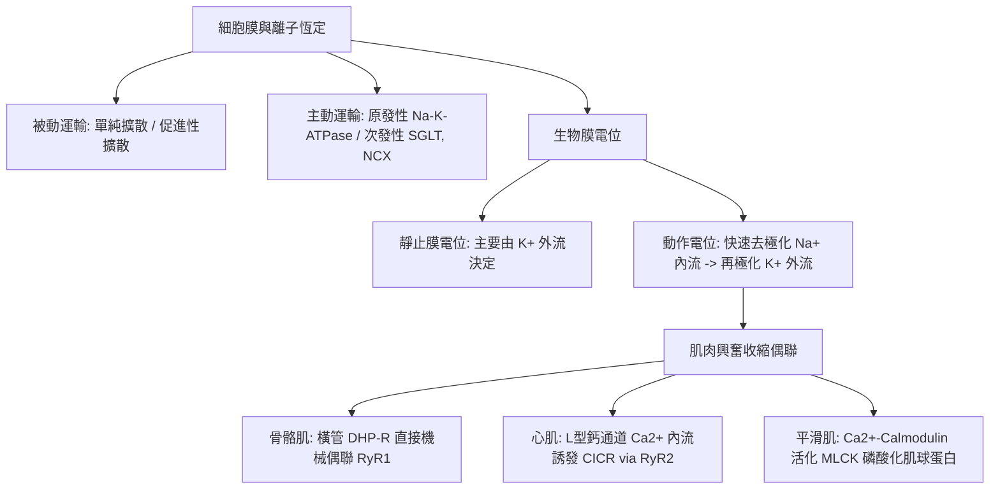

# 生理學 第01章 細胞生理、膜電位與肌肉收縮

## 核心知識體系架構
生理學是探討人體維持內在環境恆定（Homeostasis）之物理與化學機制的學問。細胞生理為全科之基石，涵蓋膜運輸機制、靜止膜電位（RMP）、動作電位（Action Potential, AP）及骨骼肌、心肌與平滑肌的興奮收縮偶聯（Excitation-Contraction Coupling, ECC）。

---

## 主題一：物質跨膜運輸與滲透壓恆定

### 1. 跨膜運輸機制比較矩陣
| 運輸模式 | 能量需求 | 載體蛋白需求 | 飽和性（Tm）與競爭性抑制 | 典型範例與特徵 |
| :--- | :--- | :--- | :--- | :--- |
| **單純擴散 (Simple Diffusion)** | 否（順濃度差） | 否 | 無 | $O_2$、$CO_2$、$N_2$、尿素、水分子、脂溶性氣體與類固醇荷爾蒙。速度遵守 Fick's Law。 |
| **促進性擴散 (Facilitated Diffusion)** | 否（順濃度差） | 是（通道或載體） | 有 | $GLUT$ 葡萄糖轉運蛋白（GLUT1~5），順濃度梯級進入細胞。不消耗 ATP。 |
| **原發性主動運輸 (Primary Active)** | 是（直接水解 ATP） | 是（幫浦 Pump） | 有 | $Na^+/K^+$-ATPase（每消耗 1 ATP 打出 $3 Na^+$、打入 $2 K^+$）、$SERCA$（肌漿網鈣幫浦）、$H^+/K^+$-ATPase（胃壁細胞）。 |
| **次發性主動運輸 (Secondary Active)** | 是（間接依賴 $Na^+$ 梯度） | 是（共轉運 / 反向轉運） | 有 | **同向轉運 (Symport)**：SGLT-1/2（$Na^+$-葡萄糖共轉運）、NKCC2。 **反向轉運 (Antiport)**：$Na^+/Ca^{2+}$ 交換體（NCX）、$Na^+/H^+$ 交換體（NHE）。 |

> [!WARNING]
> **【考選部常考陷阱】**
> 1. **烏巴苷（Ouabain）與毛地黃（Digoxin）**：專一性抑制細胞膜上的 $Na^+/K^+$-ATPase，導致細胞內 $[Na^+]_i$ 上升。進而**減弱 $Na^+/Ca^{2+}$ 反向交換體（NCX）的外排驅動力**，使心肌細胞內 $[Ca^{2+}]_i$ 積聚，產生正性肌力作用（Inotropic effect）。考選部常抽換為「Digoxin 直接活化 NCX」或「增加細胞內鉀離子」，皆為錯誤選項！
> 2. **葡萄糖吸收之載體區別**：腸道與近曲小管上皮頂端膜（Apical membrane）為 **SGLT**（次發性主動運輸，逆濃度差需伴隨 $Na^+$）；基底側膜（Basolateral membrane）則為 **GLUT2**（促進性擴散，順濃度差釋放至組織間液）。

---

## 主題二：靜止膜電位與動作電位傳導

### 1. Nernst 方程式與 Goldman-Hodgkin-Katz (GHK) 方程式
- **Nernst 方程式**：計算單一離子的平衡電位（Equilibrium Potential, $E_{ion}$）：
  $$E_{ion} = \frac{61}{z} \log_{10} \frac{[ion]_{out}}{[ion]_{in}} \quad (\text{在 } 37^\circ\text{C 時, mV})$$
  - 典型哺乳類神經細胞平衡電位：$E_{K^+} \approx -90\text{ mV}$，$E_{Na^+} \approx +65\text{ mV}$，$E_{Cl^-} \approx -70\text{ mV}$，$E_{Ca^{2+}} \approx +120\text{ mV}$。
- **靜止膜電位（RMP $\approx -70\text{ mV}$）**：主要由細胞膜在靜止時對 $K^+$ 的通透性（Leak channels, $K_{ir}$）遠大於 $Na^+$（約 40:1）所決定，因此 RMP 極度貼近 $E_{K^+}$。

### 2. 神經動作電位時序與離子電導（Conductance）變化
1. **去極化相（Depolarization Phase）**：
   - 閾值（Threshold $\approx -55\text{ mV}$）觸發電壓閘門式鈉通道（$Na_v$）活化閘門（m-gate）迅猛開放。
   - $Na^+$ 湧入（Inward current），膜電位呈再生性上升（Regenerative cycle），衝向 $+35\text{ mV}$（Overshoot）。
2. **再極化相（Repolarization Phase）**：
   - $Na_v$ 去活化閘門（h-gate）自動關閉（Inactivation），鈉通道不導電。
   - 延遲整流鉀通道（Voltage-gated $K_v$）慢速開放，$K^+$ 快速外流（Outward current），使膜電位迅速復歸負值。
3. **過極化相（After-hyperpolarization Phase）**：
   - 由於 $K_v$ 關閉緩慢，膜對 $K^+$ 通透性短暫高於靜止狀態，膜電位逼近 $E_{K^+} (-90\text{ mV})$，隨後由鈉鉀幫浦與漏洩通道重置。

### 3. 不反應期（Refractory Period）精析
- **絕對不反應期（Absolute Refractory Period, ARP）**：從閾值開始直至再極化達 1/3。此時**鈉通道去活化閘門（h-gate）全數關閉鎖定**，無論施加多強之刺激皆不可能引發第二次動作電位。其生理意義在於**保證動作電位單向傳導（Unidirectional conduction）並決定最高放電頻率**。
- **相對不反應期（Relative Refractory Period, RRP）**：緊接 ARP 之後。部分鈉通道已恢復至待命閉合狀態（h-gate 重開），但鉀通道仍大量開放（$g_K$ 高）。此時給予**高於正常閾值的超強刺激（Suprathreshold stimulus）**即可誘發動作電位。

> [!TIP]
> **【動作電位神經毒素必背口訣】**
> - **河豚毒素（Tetrodotoxin, TTX）與蛤蚌毒素（Saxitoxin, STX）**：專一性阻斷電壓閘門式 $Na^+$ 通道的外側孔道，**完全壓制去極化相**，導致肌肉癱瘓與窒息。
> - **四乙基銨（Tetraethylammonium, TEA）**：專一性阻斷電壓閘門式 $K^+$ 通道，**選擇性阻斷再極化相**，使動作電位持續時間（Duration）大幅延長。

---

## 主題三：骨骼肌、心肌與平滑肌興奮收縮偶聯（ECC）大對決

### 1. 三大肌型微細結構與分子機制橫向對比表
| 比較項目 | 骨骼肌（Skeletal Muscle） | 心室肌（Cardiac Muscle） | 平滑肌（Smooth Muscle） |
| :--- | :--- | :--- | :--- |
| **外觀與調控** | 橫紋、多核周邊、隨意神經 | 橫紋、單核中央、閏盤、自主神經 | 無橫紋、梭形單核、自主神經/荷爾蒙 |
| **動作電位時程** | 短（1~5 ms） | 極長（200~300 ms，具 Plateau） | 慢波（Slow wave）或尖峰波 |
| **細胞外 $Ca^{2+}$ 依賴性** | **極低**（幾乎完全依賴 SR 內存鈣） | **高度依賴**（需外鈣內流誘發內鈣釋放） | **高度依賴**（外鈣經 L型/VOC/ROC 進入） |
| **鈣離子感應受體** | 橫管之 **DHP 受體**（電壓感應器） | 橫管之 **L 型鈣通道**（Cav1.2） | 膜受體（Gq-PLC-IP3）或電壓通道 |
| **肌漿網鈣釋放通道** | **RyR1**（與 DHP-R 直接**機械性構形偶聯**） | **RyR2**（**Ca2+-induced Ca2+ release, CICR**） | **IP3 受體（IP3R）** 及 RyR3 |
| **鈣結合標靶** | **Troponin C (TnC)** | **Troponin C (TnC)** | **Calmodulin（鈣調蛋白）** |
| **肌球蛋白活化機制** | 鈣與 TnC 結合 $\to$ 帶動 Tropomyosin 移位 $\to$ 暴露 Actin 結合位 | 鈣與 TnC 結合 $\to$ 帶動 Tropomyosin 移位 $\to$ 暴露 Actin 結合位 | 鈣-Calmodulin 複合物 $\to$ 活化 **MLCK** $\to$ 磷酸化肌球蛋白輕鏈 |
| **舒張機制** | SERCA1 將鈣泵回 SR；Calsequestrin 儲存 | SERCA2a（受 **Phospholamban** 調控）+ NCX | **MLCP**（肌球蛋白輕鏈磷酸酶）去磷酸化 + SERCA/PMCA |
| **強直收縮（Tetanus）** | **可產生**（不反應期遠短於收縮期） | **絕對不可**（ARP 與機械收縮期等長，保護心臟射血） | 可維持持久張力（Latch-state 閂鎖狀態，低耗能） |

> [!WARNING]
> **【考選部常考陷阱】**
> 1. **骨骼肌與心肌 RyR 亞型與觸發源**：骨骼肌為 **RyR1**，其開放是 DHP 受體之電壓感應結構「直接以物理拉栓方式」拉開，**即使將細胞外置於無鈣溶液中，骨骼肌在數次刺激內仍可收縮**；心肌為 **RyR2**，必須依靠橫管 L 型鈣通道流入的少量外鈣觸發 RyR2 大量放鈣（CICR），**在無鈣溶液中，心肌動作電位雖能產生但立即喪失收縮力（興奮收縮脫偶聯）**！
> 2. **平滑肌的鬆弛調控**：NO（一氧化氮）活化可溶性鳥苷酸環化酶（sGC）$\to$ 增加 **cGMP** $\to$ 活化 PKG $\to$ **刺激 MLCP** 並抑制鈣內流 $\to$ 平滑肌舒張。cGMP 被 PDE5 水解（威而鋼 Sildenafil 抑制 PDE5 延長舒張）。

---

## 歷屆國考核心真題解析

### 【國考經典真題實戰】
**【試題編號】110-第二次-第一階段-med1-045**
> **題目**：下列何者為子宮內膜（endometrium）在增生期（proliferative phase）的特徵？
- (A) 基質細胞（stromal cells）不進行分裂，而是儲存大量膠原（collagen）與基質（ground substance）
- (B) 螺旋動脈（spiral artery）已經延伸至子宮內膜（endometrium）的頂部
- (C) 上皮細胞肥大（hypertrophy），子宮內膜（endometrium）出現水腫（edema）
- (D) 子宮腺（uterine gland）基部的上皮細胞開始進行腺體重建

> **標準答案**：`D`
> 
> **【考點深度解析與選項拆解】**：
- **(A) 選項分析**：基質細胞（stromal cells）不進行分裂，而是儲存大量膠原（collagen）與基質（ground substance）。評估其在生理反應中的離子流向或分子標靶特性，符合生理學恆定準則。
- **(B) 選項分析**：螺旋動脈（spiral artery）已經延伸至子宮內膜（endometrium）的頂部。分析其電化學驅動力或受體亞型調控，確認其正確性或抽換陷阱。
- **(C) 選項分析**：上皮細胞肥大（hypertrophy），子宮內膜（endometrium）出現水腫（edema）。剖析其動力學參數或回饋抑制迴路，掌握考選部常設之逆向干擾。
- **(D) 選項分析**：子宮腺（uterine gland）基部的上皮細胞開始進行腺體重建。比對細胞膜通透性或器官特異性，確認其是否符合題幹所詢之核心生理機制。
> **【國考核心解題金鑰】**：本題精準鎖定標準答案 **(D)**。考生須牢記受體分型、離子通道電導與次發性信差之級聯放大路徑，即可於 10 秒內秒殺此類題型。

---
### 【國考經典真題實戰】
**【試題編號】110-第二次-第一階段-med1-047**
> **題目**：下列何種細胞膜結合（membrane junctions）可最嚴格管控正常消化道上皮細胞對管腔內胺基酸、 葡萄糖等物質的吸收？
- (A) 緊密結合（tight junction）
- (B) 間隙結合（gap junction）
- (C) 胞橋體（desmosome）
- (D) 接合子（connexin）

> **標準答案**：`A`
> 
> **【考點深度解析與選項拆解】**：
- **(A) 選項分析**：緊密結合（tight junction）。評估其在生理反應中的離子流向或分子標靶特性，符合生理學恆定準則。
- **(B) 選項分析**：間隙結合（gap junction）。分析其電化學驅動力或受體亞型調控，確認其正確性或抽換陷阱。
- **(C) 選項分析**：胞橋體（desmosome）。剖析其動力學參數或回饋抑制迴路，掌握考選部常設之逆向干擾。
- **(D) 選項分析**：接合子（connexin）。比對細胞膜通透性或器官特異性，確認其是否符合題幹所詢之核心生理機制。
> **【國考核心解題金鑰】**：本題精準鎖定標準答案 **(A)**。考生須牢記受體分型、離子通道電導與次發性信差之級聯放大路徑，即可於 10 秒內秒殺此類題型。

---
### 【國考經典真題實戰】
**【試題編號】110-第二次-第一階段-med1-051**
> **題目**：關於rapid eye movement（REM）sleep 的敘述，下列何者最不適當？
- (A) REM sleep 期和正常清醒期腦波之差異程度，大於non-REM sleep 期和正常清醒期腦波之差異 程度
- (B) 個體處於REM sleep 期比處於清醒時或其他期睡眠時，更可能出現pontogeniculo-occipital （PGO）spikes
- (C) 個體處於REM sleep 期，其頸部骨骼肌的肌肉張力（muscle tone）常較警醒時的張力為低
- (D) 個體處於REM sleep 期，其局部身體的活動和出現可回憶夢境的機率較其他睡眠期為高

> **標準答案**：`A`
> 
> **【考點深度解析與選項拆解】**：
- **(A) 選項分析**：REM sleep 期和正常清醒期腦波之差異程度，大於non-REM sleep 期和正常清醒期腦波之差異 程度。評估其在生理反應中的離子流向或分子標靶特性，符合生理學恆定準則。
- **(B) 選項分析**：個體處於REM sleep 期比處於清醒時或其他期睡眠時，更可能出現pontogeniculo-occipital （PGO）spikes。分析其電化學驅動力或受體亞型調控，確認其正確性或抽換陷阱。
- **(C) 選項分析**：個體處於REM sleep 期，其頸部骨骼肌的肌肉張力（muscle tone）常較警醒時的張力為低。剖析其動力學參數或回饋抑制迴路，掌握考選部常設之逆向干擾。
- **(D) 選項分析**：個體處於REM sleep 期，其局部身體的活動和出現可回憶夢境的機率較其他睡眠期為高。比對細胞膜通透性或器官特異性，確認其是否符合題幹所詢之核心生理機制。
> **【國考核心解題金鑰】**：本題精準鎖定標準答案 **(A)**。考生須牢記受體分型、離子通道電導與次發性信差之級聯放大路徑，即可於 10 秒內秒殺此類題型。
