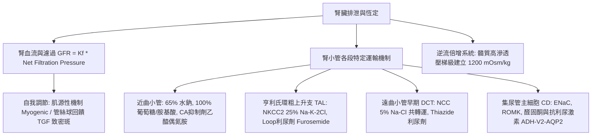

# 生理學 第05章 腎臟生理、腎絲球過濾與管腔再吸收排泄

## 核心知識體系架構
腎臟生理學為內在環境恆定之核心，涵蓋腎血流量（RBF）與腎絲球過濾率（GFR）之自我調節、各段腎小管之溶質與水再吸收運輸蛋白（SGLT2, NKCC2, NCC, ENaC, AQP2），以及髓質逆流倍增系統。

---

## 主題一：腎血流量（RBF）與腎絲球過濾率（GFR）測定與調控

### 1. 腎清除率（Renal Clearance, $C_x$）與生理常數計算
$$C_x = \frac{U_x \times V}{P_x} \quad (\text{單位: mL/min})$$
- **測定 GFR 之黃金標準：菊糖清除率（Inulin Clearance）**
  - 菊糖（Inulin）具理想特性：**自由濾過、腎小管不吸收、不分泌、不代謝、無毒性**。因此 $GFR = C_{Inulin} \approx 125\text{ mL/min}$。
  - 臨床常用替代物為**內生性肌酸酐（Creatinine）**，雖有約 10% 經近曲小管微量分泌（使估算值微幅高估），但無需外源輸注，操作便捷。
- **測定腎有效血漿流量（RPF）：對胺馬尿酸清除率（PAH Clearance）**
  - PAH 於低濃度下，除自由濾過外，幾近 100% 經近曲小管有機陰離子轉運體（OAT）主動分泌至管腔中。血液單次流經腎臟即可完全清除，故 $RPF = C_{PAH} \approx 600\text{--}650\text{ mL/min}$。
- **腎血流量（Renal Blood Flow, RBF）**：
  $$RBF = \frac{RPF}{1 - \text{Hematocrit (Hct)}} \approx \frac{625}{1 - 0.45} \approx 1100\text{--}1200\text{ mL/min} \quad (\text{佔全身體心輸出量之 } 20\text{--}25\%)$$
- **濾過分數（Filtration Fraction, FF）**：
  $$FF = \frac{GFR}{RPF} \approx \frac{125}{625} = 0.20 \quad (20\%)$$

### 2. 入球小動脈與出球小動脈阻力對 GFR、RPF 與 FF 之調控影響
| 血流動力學變動因素 | 入球小動脈（Afferent）阻力 | 出球小動脈（Efferent）阻力 | 腎血漿流量（RPF） | 腎絲球過濾率（GFR） | 濾過分數（$FF = GFR/RPF$） |
| :--- | :--- | :--- | :--- | :--- | :--- |
| **入球小動脈收縮**（如高劑量交感、NE、NSAIDs） | **$\uparrow$ 上升** | 不變 | **$\downarrow$ 顯著下降** | **$\downarrow$ 下降** | **不變** |
| **出球小動脈收縮**（如低/中濃度 Angiotensin II） | 不變 | **$\uparrow$ 上升** | **$\downarrow$ 下降** | **$\uparrow$ 增加**（或維持） | **$\uparrow\uparrow$ 顯著上升** |
| **入球小動脈舒張**（如前列腺素 $PGE_2 / PGI_2$、NO） | **$\downarrow$ 下降** | 不變 | **$\uparrow$ 顯著增加** | **$\uparrow$ 增加** | **不變** |
| **出球小動脈舒張**（如 ACEI / ARB） | 不變 | **$\downarrow$ 下降** | **$\uparrow$ 增加** | **$\downarrow$ 下降** | **$\downarrow\downarrow$ 顯著下降** |

!!! warning "高頻陷阱重點防護（考試最易混淆點）"

    **【考選部常考陷阱】**
        - **NSAIDs 造成急性腎損傷之機制**：NSAIDs 抑制 COX，阻斷具有舒張入球小動脈功效之前列腺素（$PGE_2$），造成**入球小動脈強烈痙攣收縮，GFR 斷崖式暴跌**。
        - **ACEI/ARB 於雙側腎動脈狹窄病人之致命禁忌**：嚴重狹窄時，GFR 極度仰賴 Angiotensin II 收縮出球小動脈以強行維持腎絲球毛細血管靜水壓（$P_{GC}$）。若投予 ACEI/ARB，出球小動脈擴張，$P_{GC}$ 驟降，導致**急性腎衰竭**！

---

## 主題二：各段腎小管轉運機制與利尿劑作用靶點

### 1. 腎小管運輸蛋白與利尿劑全景圖
| 腎小管分段 | 關鍵膜轉運蛋白（Apical Membrane） | 溶質與水再吸收比例 | 專一性作用利尿劑與機轉 | 臨床特徵與副作用 |
| :--- | :--- | :--- | :--- | :--- |
| **近曲小管 (PT)** | - SGLT2（$Na^+$-葡萄糖共轉運） - NHE3（$Na^+/H^+$ 交換） - 碳酸酐酶（CA-IV / CA-II） | - 再吸收 65% $Na^+, Cl^-, H_2O$ - 100% 葡萄糖與胺基酸 - 85% $HCO_3^-$ | **Acetazolamide**（抑制碳酸酐酶） **Empagliflozin**（SGLT2 抑制劑） | 抑制 $HCO_3^-$ 再吸收，引起**高氯性正常陰離子間隙代謝性酸中毒**；SGLT2i 降血糖並促進尿糖排泄。 |
| **亨利氏環粗上升支 (TAL)** | **NKCC2**（$1Na^+-1K^+-2Cl^-$ 同向轉運體） ROMK 通道（$K^+$ 回漏管腔建立 $+8\text{ mV}$ 正電位） | - 25% $Na^+, K^+, Cl^-$ - **對水完全不通透（Diluting segment）** - 經細胞旁路驅動 $Ca^{2+}, Mg^{2+}$ 再吸收 | **Furosemide / Bumetanide (Loop利尿劑)** 專一性可逆阻斷 NKCC2 之 $Cl^-$ 結合位 | **最強利尿劑**。破壞髓質高滲透壓梯度。導致**低血鉀、低血鈣、低血鎂、代謝性鹼中毒**與耳毒性。 |
| **遠曲小管早期 (DCT)** | **NCC**（$Na^+-Cl^-$ 共轉運體） TRPV5 通道（受 PTH 活化促進鈣吸收） | - 5% $Na^+, Cl^-$ - 對水不通透 - 主動再吸收 $Ca^{2+}$ | **Thiazides**（氫氯噻嗪 Hydrochlorothiazide） 抑制 NCC | **高血鈣（與 Loop 劑相反！）**、**低血鉀**、低血鈉、高尿酸血症、高血糖。 |
| **皮質集尿管主細胞 (CCT Principal cells)** | **ENaC**（上皮鈉通道） ROMK（管腔排鉀） **AQP2**（受 ADH-V2-cAMP 驅動嵌入膜） | - 2~3% $Na^+$ - 水通透性受 **ADH** 調控 - $Na^+$ 吸收受 **Aldosterone** 調控 | **Spironolactone**（醛固酮受體拮抗劑） **Amiloride / Triamterene**（直接阻斷 ENaC） | **保鉀型利尿劑（Potassium-sparing）**。導致**高血鉀（Hyperkalemia）** 與正常或低陰離子間隙酸中毒。 |

---

## 主題三：髓質逆流倍增系統（Countercurrent Multiplier System）

### 1. 建立與維持腎髓質高滲透壓梯級（1200 mOsm/kg）三大支柱
1. **逆流倍增器（Countercurrent Multiplier）：亨利氏環（Loop of Henle）**：
   - **降支細部（Thin Descending Limb）**：富含 AQP1，**對水高度通透，對溶質幾乎不通透**。管內液向下流動時水分不斷被高滲組織間液吸出，管腔滲透壓至環尖達到頂峰（$1200\text{ mOsm/kg}$）。
   - **粗上升支（Thick Ascending Limb, TAL）**：**對水完全不通透**，NKCC2 主動將大量 $Na^+, K^+, 2Cl^-$ 泵入髓質組織間液，向外提供溶質。
2. **逆流交換器（Countercurrent Exchanger）：直小血管（Vasa Recta）**：
   - 呈 U 型髮夾狀，血流極其緩慢。直小血管降支溶質進入、水分移出；升支溶質擴散回組織、水分回收進血管。**只被動維持梯級，不消耗能量破壞梯級**。
3. **尿素循環（Urea Recycling）**：
   - 內髓集尿管（IMCD）在 ADH 刺激下活化 **UT-A1 / UT-A3** 尿素轉運蛋白，將高濃度尿素排入深層髓質，**佔深層髓質滲透壓的 50%（約 600 mOsm/kg）**！

---

## 歷屆國考核心真題解析

### 【國考經典真題實戰】
**【試題編號】110-第二次-第一階段-med1-044**
> **題目**：下列何種構造的上皮，不是移形上皮（transitional epithelium）？
- (A) 腎盂（renal pelvis）
- (B) 尿道近端（proximal part of the urethra）
- (C) 膀胱（urinary bladder）
- (D) 尿道外口（external urethral orifice） 高 點 醫 護 【版權所有，翻印必究】 110高點醫護｜第二次醫師考試 ‧ 高分詳解 -- -- 6

> **標準答案**：`D`
> 
> **【考點深度解析與選項拆解】**：
- **(A) 選項分析**：腎盂（renal pelvis）。審視其在呼吸換氣力學、腎小管轉運或酸鹼恆定中之生理參數，精準定位其作用環節。
- **(B) 選項分析**：尿道近端（proximal part of the urethra）。比對離子通道電阻、分室滲透壓或化學感受器反射之代償極限，剖析考選部命題核心。
- **(C) 選項分析**：膀胱（urinary bladder）。辨析各段腎小管特異性運輸蛋白或肺泡氣體交換分壓差，釐清易混淆之干擾項目。
- **(D) 選項分析**：尿道外口（external urethral orifice） 高 點 醫 護 【版權所有，翻印必究】 110高點醫護｜第二次醫師考試 ‧ 高分詳解 -- -- 6。綜合代償公式或化學平衡常數計算，確認題幹命題意圖與生理機制吻合度。
> **【國考核心解題金鑰】**：本題標準答案為 **(D)**。牢記腎小管各段利尿劑標靶阻斷效應與呼吸力學容積變動，即可秒殺奪分。

---
### 【國考經典真題實戰】
**【試題編號】111-第一次-med1-067**
> **題目**：下列何種情況，最可能會造成遠端腎小管的鉀離子分泌減少？
- (A) 血漿總量減少
- (B) 腎小管管腔液的鈉離子增加
- (C) 醛固酮（aldosterone）降低
- (D) 飲食中的鉀離子增加

> **標準答案**：`C`
> 
> **【考點深度解析與選項拆解】**：
- **(A) 選項分析**：血漿總量減少。審視其在呼吸換氣力學、腎小管轉運或酸鹼恆定中之生理參數，精準定位其作用環節。
- **(B) 選項分析**：腎小管管腔液的鈉離子增加。比對離子通道電阻、分室滲透壓或化學感受器反射之代償極限，剖析考選部命題核心。
- **(C) 選項分析**：醛固酮（aldosterone）降低。辨析各段腎小管特異性運輸蛋白或肺泡氣體交換分壓差，釐清易混淆之干擾項目。
- **(D) 選項分析**：飲食中的鉀離子增加。綜合代償公式或化學平衡常數計算，確認題幹命題意圖與生理機制吻合度。
> **【國考核心解題金鑰】**：本題標準答案為 **(C)**。牢記腎小管各段利尿劑標靶阻斷效應與呼吸力學容積變動，即可秒殺奪分。

---
### 【國考經典真題實戰】
**【試題編號】111-第一次-med1-068**
> **題目**：成年男性之血漿中菊糖（inulin）濃度為0.25 mg/mL、尿液流量為0.6 mL/min、尿液中菊糖濃度為35 mg/mL， 則此人之菊糖清除率為多少mL/min？
- (A) 84
- (B) 106
- (C) 116
- (D) 126

> **標準答案**：`A`
> 
> **【考點深度解析與選項拆解】**：
- **(A) 選項分析**：84。審視其在呼吸換氣力學、腎小管轉運或酸鹼恆定中之生理參數，精準定位其作用環節。
- **(B) 選項分析**：106。比對離子通道電阻、分室滲透壓或化學感受器反射之代償極限，剖析考選部命題核心。
- **(C) 選項分析**：116。辨析各段腎小管特異性運輸蛋白或肺泡氣體交換分壓差，釐清易混淆之干擾項目。
- **(D) 選項分析**：126。綜合代償公式或化學平衡常數計算，確認題幹命題意圖與生理機制吻合度。
> **【國考核心解題金鑰】**：本題標準答案為 **(A)**。牢記腎小管各段利尿劑標靶阻斷效應與呼吸力學容積變動，即可秒殺奪分。
