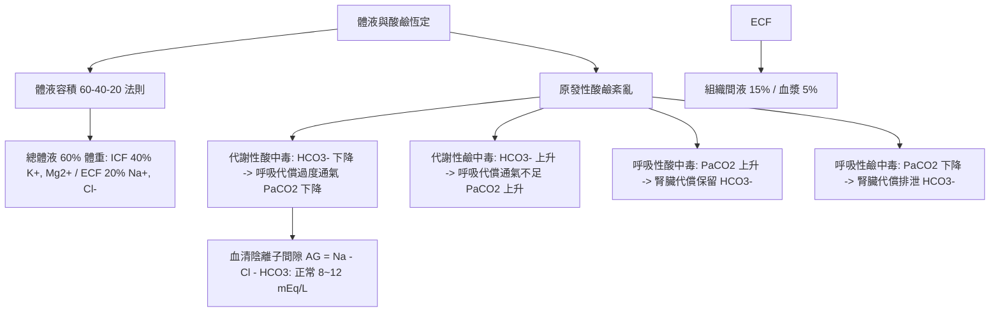

# 生理學 第06章 酸鹼平衡與體液電解質調控

## 核心知識體系架構
體液與酸鹼平衡為臨床醫學重中之重，涵蓋細胞內外體液分佈、血漿滲透壓調節、Henderson-Hasselbalch 方程式、代謝性與呼吸性酸鹼紊亂及其代償極限、血清陰離子間隙（Anion Gap, AG）。

---

## 主題一：體液隔室（Fluid Compartments）與滲透壓平衡

### 1. 體液分佈「60-40-20 原則」
- 正常成年男性總體液量（Total Body Water, TBW）約佔體重之 **60%**（女性約 50%）。
  - **細胞內液（Intracellular Fluid, ICF）**：佔體重之 **40%**（約佔 TBW 的 2/3）。主要陽離子為 **$K^+$**（$\approx 140\text{ mEq/L}$）與 **$Mg^{2+}$**；主要陰離子為蛋白質與有機磷酸鹽。
  - **細胞外液（Extracellular Fluid, ECF）**：佔體重之 **20%**（約佔 TBW 的 1/3）。主要陽離子為 **$Na^+$**（$\approx 140\text{ mEq/L}$）；主要陰離子為 **$Cl^-$**（$\approx 100\text{ mEq/L}$）與 **$HCO_3^-$**（$\approx 24\text{ mEq/L}$）。
    - **組織間液（Interstitial Fluid, ISF）**：佔體重之 **15%**（佔 ECF 的 3/4）。
    - **血漿（Plasma）**：佔體重之 **5%**（佔 ECF 的 1/4）。含高濃度血漿白蛋白（Albumin），形成血漿膠體滲透壓（Colloid Oncotic Pressure $\approx 25\text{--}28\text{ mmHg}$）。

### 2. 體液隔室容量與滲透壓測定標記物
| 測量體液分室 | 理想測定物質（Marker）特性 | 常用指示劑 / 示蹤劑 |
| :--- | :--- | :--- |
| **總體液量 (TBW)** | 能自由穿透微血管壁及所有細胞膜，均勻分佈 | **重水（$D_2O$）**、氚水（$THO$）、**安替比林（Antipyrine）** |
| **細胞外液量 (ECF)** | 可自由穿透微血管壁，但**絕對無法穿透細胞膜進入 ICF** | **菊糖（Inulin）**、硫氰酸鹽、放射性鈉（$^{22}Na$）、甘露醇（Mannitol） |
| **血漿容積 (Plasma)** | 分子極大，**無法穿透毛細血管內皮細胞孔隙**，滯留於血管內 | **伊文氏藍（Evans Blue）**、$^{131}I$-標記人血清白蛋白（RISA） |
| **細胞內液量 (ICF)** | 無法直接測量 | **間接相減法**：$ICF = TBW - ECF$ |
| **組織間液量 (ISF)** | 無法直接測量 | **間接相減法**：$ISF = ECF - \text{Plasma Volume}$ |

---

## 主題二：酸鹼平衡評估與四原發性失衡代償公式

### 1. Henderson-Hasselbalch 方程式與生理常數
$$pH = 6.1 + \log_{10} \frac{[HCO_3^-]}{0.03 \times P_a CO_2}$$
- 正常生理值：$pH = 7.40$（7.35~7.45），$[HCO_3^-] = 24\text{ mEq/L}$，$P_a CO_2 = 40\text{ mmHg}$。

### 2. 四大原發性酸鹼紊亂與預期代償公式矩陣
| 原發性紊亂 | 原發病理化學改變 | 代償器官與方向 | 預期代償公式（Expected Compensation） | 常見臨床病因 |
| :--- | :--- | :--- | :--- | :--- |
| **代謝性酸中毒 (Metabolic Acidosis)** | **$[HCO_3^-] \downarrow$ 下降** | 呼吸代償：過度通氣驅動 **$P_a CO_2 \downarrow$** | **Winter 方程式**： $\text{Expected } P_a CO_2 = (1.5 \times [HCO_3^-]) + 8 \pm 2$ | 糖尿病酮酸中毒（DKA）、乳酸中毒、腎衰竭尿毒症、嚴重腹瀉。 |
| **代謝性鹼中毒 (Metabolic Alkalosis)** | **$[HCO_3^-] \uparrow$ 上升** | 呼吸代償：呼吸抑制使 **$P_a CO_2 \uparrow$** | $[HCO_3^-]$ 每增加 $1\text{ mEq/L}$， $P_a CO_2$ 增加約 $0.7\text{ mmHg}$（上限約 $55\text{ mmHg}$） | 劇烈嘔吐（流失胃酸 HCl）、大量使用利尿劑、原發性醛固酮增多症。 |
| **急性呼吸性酸中毒 (Acute Resp Acidosis)** | **$P_a CO_2 \uparrow$ 上升** | 腎臟代償（急性細胞內緩衝）：$[HCO_3^-] \uparrow$ | $P_a CO_2$ 每上升 $10\text{ mmHg}$， $[HCO_3^-]$ 增加 **$1\text{ mEq/L}$** | 鴉片類藥物過量、急性呼吸道窒息、重症肌無力急性發作。 |
| **慢性呼吸性酸中毒 (Chronic Resp Acidosis)** | **$P_a CO_2 \uparrow$ 上升** | 腎臟代償（腎小管分泌 $H^+$、保留重碳酸）：$[HCO_3^-] \uparrow$ | $P_a CO_2$ 每上升 $10\text{ mmHg}$， $[HCO_3^-]$ 增加 **$3.5\text{--}4\text{ mEq/L}$** | 慢性阻塞性肺疾病（COPD）、極度肥胖低通氣綜合徵。 |
| **急性呼吸性鹼中毒 (Acute Resp Alkalosis)** | **$P_a CO_2 \downarrow$ 下降** | 腎臟代償（急性細胞釋放 $H^+$）：$[HCO_3^-] \downarrow$ | $P_a CO_2$ 每下降 $10\text{ mmHg}$， $[HCO_3^-]$ 減少 **$2\text{ mEq/L}$** | 換氣過度症候群（恐慌發作）、高山急症缺氧、早期敗血症。 |
| **慢性呼吸性鹼中毒 (Chronic Resp Alkalosis)** | **$P_a CO_2 \downarrow$ 下降** | 腎臟代償（腎小管減少 $H^+$ 分泌、排泄重碳酸）：$[HCO_3^-] \downarrow$ | $P_a CO_2$ 每下降 $10\text{ mmHg}$， $[HCO_3^-]$ 減少 **$4\text{--}5\text{ mEq/L}$** | 長期居住高海拔高原、慢性肝病肝硬化。 |

---

## 主題三：血清陰離子間隙（Serum Anion Gap, AG）與鑑別診斷

### 1. 陰離子間隙計算與黃金病因口訣
$$AG = [Na^+] - ([Cl^-] + [HCO_3^-]) \quad (\text{正常參考值: } 8\text{--}12\text{ mEq/L})$$
- **高陰離子間隙代謝性酸中毒（High AG Metabolic Acidosis, HAGMA $> 12\text{ mEq/L}$）**：
  體內蓄積未測量之固定酸陰離子（如乳酸根、乙醯乙酸、硫酸根等），消耗血中 $HCO_3^-$，但 $Cl^-$ 濃度正常。
  > [!TIP]
  > **【HAGMA 經典英文速記口訣：MUDPILES】**
  > - **M**ethanol（甲醇中毒，產甲酸）
  > - **U**remia（尿毒症，硫酸鹽與磷酸鹽滯留）
  > - **D**KA（糖尿病酮酸中毒，$\beta$-羥丁酸）
  > - **P**ropylene glycol（丙二醇）
  > - **I**ron / INH（鐵劑 / 異煙肼中毒）
  > - **L**actic acidosis（乳酸中毒，組織缺氧）
  > - **E**thylene glycol（乙二醇中毒，產草酸致腎結石與腎衰竭）
  > - **S**alicylates（阿斯匹靈中毒，晚期酸中毒）

- **正常陰離子間隙代謝性酸中毒（Normal AG / 高氯性代謝性酸中毒 Hyperchloremic）**：
  直接流失大量 $HCO_3^-$，腎小管為維持電中性而代償性增加再吸收 $Cl^-$，使 $[Cl^-]$ 上升補足陰離子缺口，故 $AG$ 維持正常：
  - **腸道流失 $HCO_3^-$**：嚴重腹瀉（Diarrhea，腸液含大量重碳酸根）。
  - **腎臟流失 $HCO_3^-$**：腎小管酸中毒（Renal Tubular Acidosis, RTA Type 1, 2, 4）。
  - **外源性鹽水**：輸注大量生理食鹽水（$0.9\%\ NaCl$，含 $154\text{ mEq/L } Cl^-$）。

---

## 歷屆國考核心真題解析

### 【國考經典真題實戰】
**【試題編號】112-第一次-med1-046**
> **題目**：關於腦下腺的生長激素細胞（somatotropes）之敘述，下列何者正確？
- (A) 位於腦下腺後葉
- (B) 在腦下腺的內分泌細胞中的數目比例最高
- (C) 細胞質內含有許多嗜鹼性囊泡（basophilic vesicles），屬於嗜鹼性細胞
- (D) 屬於厭色性細胞（chromophobes）

> **標準答案**：`B`
> 
> **【考點深度解析與選項拆解】**：
- **(A) 選項分析**：位於腦下腺後葉。審視其在呼吸換氣力學、腎小管轉運或酸鹼恆定中之生理參數，精準定位其作用環節。
- **(B) 選項分析**：在腦下腺的內分泌細胞中的數目比例最高。比對離子通道電阻、分室滲透壓或化學感受器反射之代償極限，剖析考選部命題核心。
- **(C) 選項分析**：細胞質內含有許多嗜鹼性囊泡（basophilic vesicles），屬於嗜鹼性細胞。辨析各段腎小管特異性運輸蛋白或肺泡氣體交換分壓差，釐清易混淆之干擾項目。
- **(D) 選項分析**：屬於厭色性細胞（chromophobes）。綜合代償公式或化學平衡常數計算，確認題幹命題意圖與生理機制吻合度。
> **【國考核心解題金鑰】**：本題標準答案為 **(B)**。牢記腎小管各段利尿劑標靶阻斷效應與呼吸力學容積變動，即可秒殺奪分。

---
### 【國考經典真題實戰】
**【試題編號】113-第一次-med1-052**
> **題目**：下列何項缺損，最不可能影響人類在進入缺乏光源的暗周期期間，血液中褪黑激素（melatonin）濃度先升 後降的現象？
- (A) retinohypothalamic tract的神經束因缺血而萎縮（atrophy）
- (B) geniculate ganglion中的神經細胞因缺血而凋亡
- (C) 松果體（pineal gland）嚴重鈣化結石造成分泌細胞凋亡
- (D) 因持續服用抗癌藥物，使N-acetyltransferase活性受到強烈的抑制

> **標準答案**：`B`
> 
> **【考點深度解析與選項拆解】**：
- **(A) 選項分析**：retinohypothalamic tract的神經束因缺血而萎縮（atrophy）。審視其在呼吸換氣力學、腎小管轉運或酸鹼恆定中之生理參數，精準定位其作用環節。
- **(B) 選項分析**：geniculate ganglion中的神經細胞因缺血而凋亡。比對離子通道電阻、分室滲透壓或化學感受器反射之代償極限，剖析考選部命題核心。
- **(C) 選項分析**：松果體（pineal gland）嚴重鈣化結石造成分泌細胞凋亡。辨析各段腎小管特異性運輸蛋白或肺泡氣體交換分壓差，釐清易混淆之干擾項目。
- **(D) 選項分析**：因持續服用抗癌藥物，使N-acetyltransferase活性受到強烈的抑制。綜合代償公式或化學平衡常數計算，確認題幹命題意圖與生理機制吻合度。
> **【國考核心解題金鑰】**：本題標準答案為 **(B)**。牢記腎小管各段利尿劑標靶阻斷效應與呼吸力學容積變動，即可秒殺奪分。

---
### 【國考經典真題實戰】
**【試題編號】113-第二次-第一階段-med1-049**
> **題目**：下列關於語言優勢腦半球（dominant hemisphere）或語言互補式特化（complementary specialization） 半球的描述，下列何項最適當？
- (A) 多數人負責語言理解和製造的語言優勢腦半球皆位於右腦半球
- (B) 語言優勢腦半球和人臉及負向表情辨識的優勢腦半球通常位於不同半球
- (C) 語言優勢腦半球是一個將語言的視空間化表徵特性轉化為時間表徵特性的腦半球
- (D) Wernicke's aphasia是專指語言優勢腦半球的Wernicke's area受損，使語言的製造上出現問題，但語言理 解是正常的

> **標準答案**：`B`
> 
> **【考點深度解析與選項拆解】**：
- **(A) 選項分析**：多數人負責語言理解和製造的語言優勢腦半球皆位於右腦半球。審視其在呼吸換氣力學、腎小管轉運或酸鹼恆定中之生理參數，精準定位其作用環節。
- **(B) 選項分析**：語言優勢腦半球和人臉及負向表情辨識的優勢腦半球通常位於不同半球。比對離子通道電阻、分室滲透壓或化學感受器反射之代償極限，剖析考選部命題核心。
- **(C) 選項分析**：語言優勢腦半球是一個將語言的視空間化表徵特性轉化為時間表徵特性的腦半球。辨析各段腎小管特異性運輸蛋白或肺泡氣體交換分壓差，釐清易混淆之干擾項目。
- **(D) 選項分析**：Wernicke's aphasia是專指語言優勢腦半球的Wernicke's area受損，使語言的製造上出現問題，但語言理 解是正常的。綜合代償公式或化學平衡常數計算，確認題幹命題意圖與生理機制吻合度。
> **【國考核心解題金鑰】**：本題標準答案為 **(B)**。牢記腎小管各段利尿劑標靶阻斷效應與呼吸力學容積變動，即可秒殺奪分。
