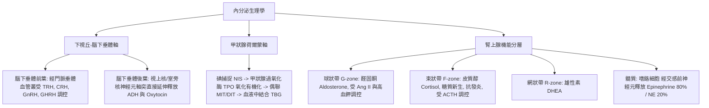

# 生理學 第08章 內分泌生理、下丘腦腦垂腺甲狀腺與腎上腺

## 核心知識體系架構
內分泌系統生理學涵蓋荷爾蒙之化學分類與訊息傳遞機制（GPCR-cAMP, GPCR-IP3, 酪胺酸激酶 RTK, 核內受體）、下視丘-腦下垂體前葉/後葉軸、生長激素（GH）與 IGF-1、甲狀腺素（T3/T4）合成步驟與生理調控，以及腎上腺皮質（球狀帶醛固酮、束狀帶皮質醇、網狀帶雄素）與髓質（兒茶酚胺）。

---

## 主題一：荷爾蒙訊息傳遞受體與途徑分類表

### 1. 國考必背四大訊息路徑矩陣
| 傳遞途徑機制 | 關鍵細胞內次級信差（Second Messenger） | 典型代表荷爾蒙（國考必考分類） |
| :--- | :--- | :--- |
| **$G_s$ 蛋白 $\to$ 腺苷酸環化酶（AC） $\to$ cAMP $\uparrow$** | **cAMP / PKA** | **FLAT ChAMP**： **F**SH、**L**H、**A**CTH、**T**SH、**C**RH、**h**CG、**A**DH（$V_2$ 受體）、**M**SH、**P**TH，以及 **Calcitonin**、**Glucagon**、$\beta_1, \beta_2$ 腎上腺素受體。 |
| **$G_q$ 蛋白 $\to$ 磷脂酶 C（PLC） $\to$ IP3 / DAG $\uparrow$** | **$IP_3$（釋放內鈣）/ DAG（活化 PKC）** | **GOAT HAG**： **G**nRH、**O**xytocin、**A**ngiotensin II、**T**RH、**H**istamine（$H_1$）、**A**DH（$V_1$ 受體）、**G**astrin，以及 $\alpha_1$ 腎上腺素受體。 |
| **受體酪胺酸激酶（Receptor Tyrosine Kinase, RTK）** | **受體自身自體磷酸化（Autophosphorylation）** | **生長因子類**：**Insulin**、**IGF-1**、EGF、PDGF、FGF、VEGF。 |
| **細胞質 / 核內受體（Nuclear Receptors, 轉錄因子）** | **荷爾蒙-受體複合物直接結合 DNA 啟動子反應元件（HRE）** | **脂溶性荷爾蒙**： **VETTT CAP**：**V**itamin D、**E**strogen、**T**estosterone、**T**hyroid hormone（$T_3/T_4$）、**C**ortisol、**A**ldosterone、**P**rogesterone。 |

---

## 主題二：甲狀腺素（T3 / T4）生合成步驟與甲狀腺過氧化酶（TPO）

### 1. 甲狀腺濾泡細胞生合成七部曲
1. **碘離子捕捉（Iodide Trapping）**：基底側膜的 **$Na^+/I^-$ 同向轉運體（NIS）** 逆極高濃度差（30:1）主動將 $I^-$ 打入細胞內。NIS 受 **高氯酸鹽（Perchlorate, $ClO_4^-$）與硫氰酸鹽（Thiocyanate, $SCN^-$）競爭性抑制**。
2. **碘外排至膠體**：經由頂端膜轉運蛋白 **Pendrin** 運入濾泡腔膠體中。
3. **碘氧化（Oxidation）**：在頂端膜由 **甲狀腺過氧化酶（Thyroid Peroxidase, TPO）** 與 $H_2O_2$ 將 $I^-$ 氧化成活性碘（$I_2$ 或 $I^\circ$）。
4. **有機化（Organification / Iodination）**：TPO 催化活性碘結合至甲狀腺球蛋白（Tg）上的酪胺酸殘基，生成**單碘酪胺酸（MIT）** 與 **雙碘酪胺酸（DIT）**。
5. **偶聯反應（Coupling）**：TPO 催化偶聯：
   - $MIT + DIT \to \mathbf{T_3}$（三碘甲狀腺原氨酸，約佔 10%）。
   - $DIT + DIT \to \mathbf{T_4}$（甲狀腺素，約佔 90%）。
6. **胞飲與水解（Endocytosis & Proteolysis）**：TSH 刺激濾泡細胞吞飲膠體小滴，溶酶體水解 Tg，釋放游離 $T_3$ 與 $T_4$ 入血。
7. **周邊去碘轉化**：$T_4$ 活性極弱（主要為前驅物），在周邊組織經 **$5'$-去碘酶（5'-deiodinase）** 脫去外環碘，轉化為具高度生物活性之 **$T_3$**（親和力高 10 倍）。若脫去內環碘則生成無活性之 **$reverse\ T_3\ (rT_3)$**。

> [!TIP]
> **【抗甲狀腺藥物作用標靶速記】**
> - **丙基硫氧嘧啶（Propylthiouracil, PTU）**：**雙重阻斷**！既抑制甲狀腺內 **TPO**（阻斷氧化、有機化與偶聯），又專一性**抑制周邊組織之 $5'$-去碘酶**（阻斷 $T_4$ 轉化為 $T_3$），為甲狀腺風暴（Thyroid storm）之首選藥物！
> - **甲硫咪唑（Methimazole / MMI）**：專一性抑制甲狀腺內 **TPO**，不影響周邊 $5'$-去碘酶。

---

## 主題三：腎上腺皮質機能與皮質醇（Cortisol）生理效應

### 1. 腎上腺皮質三層解剖分區與合成酵素缺陷
- **球狀帶（Zona Glomerulosa, 15%）**：富含醛固酮合成酶（Aldosterone synthase），合成 **醛固酮（Mineralocorticoid）**。主要受 **Angiotensin II 與血清高 $[K^+]$** 調控，幾乎不受 ACTH 支配。
- **束狀帶（Zona Fasciculata, 75%）**：含 $17\alpha$-羥化酶與 $11\beta$-羥化酶，合成 **皮質醇（Glucocorticoid）**。受 **ACTH** 絕對調控。
- **網狀帶（Zona Reticularis, 10%）**：合成腎上腺雄性素（**DHEA**、Androstenedione）。受 ACTH 調控。

### 2. 皮質醇（Cortisol）核心生理效應：抗壓力與抗發炎
1. **提升血糖與抗胰島素作用**：刺激肝臟**糖質新生（Gluconeogenesis）**、抑制周邊骨骼肌與脂肪組織吸收葡萄糖（抗胰島素），刺激蛋白質分解與脂肪分解。
2. **抗發炎與免疫抑制**：
   - 誘導合成 **Lipocortin-1（Annexin A1）**，直接**抑制磷脂酶 $A_2$（$PLA_2$）**，從源頭阻斷花生四烯酸釋放，使前列腺素與白三烯素完全無法生成！
   - 抑制 **NF-$\kappa$B** 轉錄因子，阻斷 IL-1、IL-2、TNF-$\alpha$ 生成，誘導嗜酸性球與淋巴球凋亡。
3. **維持血管張力之容許作用（Permissive Action）**：增強小動脈對兒茶酚胺（$\alpha_1$ 受體）的敏感度，維持正常血壓。

---

## 歷屆國考核心真題解析

### 【國考經典真題實戰】
**【試題編號】111-第一次-med1-058**
> **題目**：某病人患有B細胞無法形成漿細胞（plasma cells）之罕見免疫疾病，則其最有可能缺乏下列那一個細胞激素 （cytokine）？
- (A) type 1 interferons
- (B) type 2 interferons
- (C) interleukin 2
- (D) colony-stimulating factors

> **標準答案**：`C`
> 
> **【考點深度解析與選項拆解】**：
- **(A) 選項分析**：type 1 interferons。對照內分泌荷爾蒙軸線、胃腸道神經傳導或感光細胞生物化學信號串聯，判定其正誤性。
- **(B) 選項分析**：type 2 interferons。檢驗其第二信差生成路徑、受體亞型偶聯或離子驅動方向，辨析考選部經典抽換標靶。
- **(C) 選項分析**：interleukin 2。評估負回饋閾值、轉運體親和力動力學或器官微環境特性，確認其是否符合生理恆定。
- **(D) 選項分析**：colony-stimulating factors。綜合反饋調節迴路或突觸釋放機制，比對題幹核心詢問重點。
> **【國考核心解題金鑰】**：本題標準答案為 **(C)**。牢記荷爾蒙第二信差歸類（cAMP vs. IP3）、GLUT轉運體組織專一性及視聽轉導離子流向，即可秒殺奪分。

---
### 【國考經典真題實戰】
**【試題編號】111-第二次-第一階段-med1-071**
> **題目**：有關甲狀腺素功能異常的敘述，下列何者最為適當？
- (A) 甲狀腺功能低下和生長激素分泌不足，在新生兒都可造成身材矮小
- (B) 甲狀腺功能低下的病人，血中促甲狀腺素（TSH）濃度都會升高
- (C) 甲狀腺功能亢進的病人，血中T3、T4和TSH濃度都會升高
- (D) 甲狀腺功能低下和生長激素分泌不足，在新生兒都可造成智能障礙

> **標準答案**：`A`
> 
> **【考點深度解析與選項拆解】**：
- **(A) 選項分析**：甲狀腺功能低下和生長激素分泌不足，在新生兒都可造成身材矮小。對照內分泌荷爾蒙軸線、胃腸道神經傳導或感光細胞生物化學信號串聯，判定其正誤性。
- **(B) 選項分析**：甲狀腺功能低下的病人，血中促甲狀腺素（TSH）濃度都會升高。檢驗其第二信差生成路徑、受體亞型偶聯或離子驅動方向，辨析考選部經典抽換標靶。
- **(C) 選項分析**：甲狀腺功能亢進的病人，血中T3、T4和TSH濃度都會升高。評估負回饋閾值、轉運體親和力動力學或器官微環境特性，確認其是否符合生理恆定。
- **(D) 選項分析**：甲狀腺功能低下和生長激素分泌不足，在新生兒都可造成智能障礙。綜合反饋調節迴路或突觸釋放機制，比對題幹核心詢問重點。
> **【國考核心解題金鑰】**：本題標準答案為 **(A)**。牢記荷爾蒙第二信差歸類（cAMP vs. IP3）、GLUT轉運體組織專一性及視聽轉導離子流向，即可秒殺奪分。

---
### 【國考經典真題實戰】
**【試題編號】112-第一次-med1-071**
> **題目**：下列有關甲狀腺荷爾蒙生物活性（biological activity）高低之順序，何者正確？
- (A) 三碘甲狀腺素（T3）＞甲狀腺素（T4）＞逆三碘甲狀腺素（RT3）
- (B) 甲狀腺素（T4）＞三碘甲狀腺素（T3）＞逆三碘甲狀腺素（RT3）
- (C) 三碘甲狀腺素（T3）＞逆三碘甲狀腺素（RT3）＞甲狀腺素（T4）
- (D) 逆三碘甲狀腺素（RT3）＞三碘甲狀腺素（T3）＞甲狀腺素（T4）

> **標準答案**：`A`
> 
> **【考點深度解析與選項拆解】**：
- **(A) 選項分析**：三碘甲狀腺素（T3）＞甲狀腺素（T4）＞逆三碘甲狀腺素（RT3）。對照內分泌荷爾蒙軸線、胃腸道神經傳導或感光細胞生物化學信號串聯，判定其正誤性。
- **(B) 選項分析**：甲狀腺素（T4）＞三碘甲狀腺素（T3）＞逆三碘甲狀腺素（RT3）。檢驗其第二信差生成路徑、受體亞型偶聯或離子驅動方向，辨析考選部經典抽換標靶。
- **(C) 選項分析**：三碘甲狀腺素（T3）＞逆三碘甲狀腺素（RT3）＞甲狀腺素（T4）。評估負回饋閾值、轉運體親和力動力學或器官微環境特性，確認其是否符合生理恆定。
- **(D) 選項分析**：逆三碘甲狀腺素（RT3）＞三碘甲狀腺素（T3）＞甲狀腺素（T4）。綜合反饋調節迴路或突觸釋放機制，比對題幹核心詢問重點。
> **【國考核心解題金鑰】**：本題標準答案為 **(A)**。牢記荷爾蒙第二信差歸類（cAMP vs. IP3）、GLUT轉運體組織專一性及視聽轉導離子流向，即可秒殺奪分。
