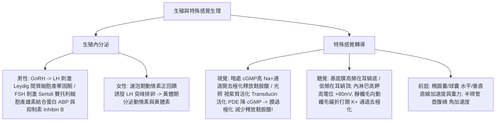

# 生理學 第10章 生殖生理與特殊感覺神經生理

## 核心知識體系架構
本章統整男女生殖內分泌調控（下視丘-腦下垂體-性腺軸 HPG axis、精子生成、卵巢月經週期與排卵、妊娠內分泌 hCG），以及視覺、聽覺與前庭平衡之特殊感覺器官微細信號轉導機制。

---

## 主題一：男性與女性生殖內分泌調控

### 1. 男性睪丸雙細胞調控系統（Leydig vs. Sertoli）
- **間質細胞（Leydig cells）**：
  - 受腦下垂體前葉 **LH（黃體生成素）** 刺激。
  - 核心功能：合成並分泌 **睪固酮（Testosterone）**。睪固酮進入血液對下視丘 GnRH 及腦下垂體 LH 產生負回饋抑制。
- **賽托利細胞（Sertoli cells / 支持細胞）**：
  - 受腦下垂體前葉 **FSH（濾泡刺激素）** 刺激。
  - 核心功能：
    1. 構成**血-睪屏障（Blood-Testis Barrier）** 之緊密連接，保護單倍體生殖細胞。
    2. 分泌 **雄素結合蛋白（Androgen-Binding Protein, ABP）**，將細精管管腔內睪固酮維持於高濃度（為血漿之 100 倍），保障**精子生成（Spermatogenesis）**。
    3. 分泌 **抑制素 B（Inhibin B）**，專一性**負回饋抑制腦下垂體分泌 FSH**。

### 2. 女性月經週期荷爾蒙動力學與 LH 突峰（LH Surge）
1. **濾泡期（Follicular Phase, Day 1~14）**：
   - 早期：FSH 刺激一群濾泡發育。濾泡顆粒細胞（Granulosa cells）在 FSH 驅動下合成芳香酶（Aromatase），將內膜細胞（Theca cells，受 LH 刺激）生成的雄烯二酮轉化為 **動情素（Estradiol, $E_2$）**。
   - 晚期（排卵前 24~36 小時）：優勢濾泡分泌極高濃度之動情素（$> 200\text{ pg/mL}$ 持續 48 小時以上）。此時動情素對下視丘/垂體之回饋由抑制轉變為**罕見之正回饋（Positive Feedback）**，誘發腦下垂體釋放爆發性之 **LH 突峰（LH surge）**。
   - **LH 突峰之關鍵結果**：促成初級卵母細胞完成第一次減數分裂，並於 36 小時後誘發**排卵（Ovulation）**！
2. **黃體期（Luteal Phase, Day 15~28）**：
   - 排卵後萎縮之濾泡壁細胞轉化為**黃體（Corpus Luteum）**。
   - 黃體大量分泌 **黃體素（Progesterone）** 與動情素。高濃度黃體素對 GnRH、LH、FSH 產生強烈負回饋抑制，防止新濾泡發育。同時使子宮內膜由增生期進入**分泌期（Secretory Phase）**，富含肝醣腺體利於胚胎著床。
   - **黃體素之中樞致熱作用**：黃體素直接作用於下視丘體溫調節中樞，使排卵後**基礎體溫升高 $0.3\text{--}0.5^\circ\text{C}$**！

---

## 主題二：特殊感覺信號轉導機制（視、聽、前庭）

### 1. 視網膜光轉導（Visual Phototransduction）之「過極化」逆向奇蹟
- **黑暗狀態（Dark state）**：
  感光細胞（桿細胞 Rods / 錐細胞 Cones）內鳥苷酸環化酶活性高，**$cGMP$ 濃度極高** $\to$ 打開外節質膜的 cGMP 閘門式非選擇性陽離子通道 $\to Na^+$ 與 $Ca^{2+}$ 持續湧入（**暗電流 Dark current**） $\to$ 細胞膜處於**去極化狀態（$-40\text{ mV}$）** $\to$ 突觸末梢持續大量釋放神經傳導物質 **Glutamate（麩胺酸）**！
- **光照刺激（Light exposure）**：
  1. 光子擊中視紫質（Rhodopsin），使 **11-順式視黃醛（11-cis retinal）** 光異構化為 **全反式視黃醛（all-trans retinal）**。
  2. 視紫質活化 G 蛋白 **Transducin（$G_t$）**。
  3. $G_t$ 活化 **磷酸二酯酶（PDE）**，快速將 cGMP 水解為 5'-GMP。
  4. cGMP 濃度暴跌 $\to$ 陽離子通道關閉 $\to$ 暗電流中斷，而內節 $K^+$ 仍持續外流 $\to$ **感光細胞膜產生「過極化（Hyperpolarization）」**！
  5. 電壓 $Ca^{2+}$ 通道關閉 $\to$ **減少釋放神經傳導物質 Glutamate**！

> [!WARNING]
> **【考選部常考陷阱】**
> - 多數人直覺認為「神經受器受刺激應去極化」，但**感光細胞接受光照時的反應是「膜過極化」且「減少釋放神經傳導物質」**！考選部常以此逆向思維設下陷阱。

### 2. 聽覺內耳柯蒂氏器（Organ of Corti）與前庭平衡系統
- **內淋巴液（Endolymph）之奇異高鉀環境**：
  - 骨迷路之外淋巴液似細胞外液（高 $Na^+$、低 $K^+$）；而膜迷路之內淋巴液由血管紋（Stria vascularis）主動分泌，**富含極高濃度 $K^+$（$\approx 150\text{ mM}$）且電位高達 $+80\text{ mV}$（內耳電位 Endocochlear potential）**！
  - **毛細胞去極化機制**：當基底膜震動導致毛細胞之靜纖毛（Stereocilia）朝向最高之動纖毛（Kinocilium）偏折時，頂端連接絲（Tip link）拉開陽離子通道，**高電位內淋巴液中的 $K^+$ 順電化學梯度奔湧流入毛細胞內引發去極化**（絕非 $Na^+$ 內流！）。
- **耳蝸頻率編碼（Tonotopic Organization）**：
  - **卵圓窗/耳蝸底部（Base）**：基底膜**窄而僵硬（Narrow and stiff）**，專門響應**高頻聲音（High frequency）**。
  - **耳蝸頂部（Apex / Helicotrema）**：基底膜**寬而柔軟（Wide and compliant）**，專門響應**低頻聲音（Low frequency）**。
- **前庭重力與加速度感受器分工**：
  - **半規管（Semicircular canals）壺腹嵴（Crista ampullaris）**：感受**旋轉角加速度（Rotational / Angular acceleration）**。
  - **耳石器官（Otolithic organs：橢圓囊 Utricle / 球囊 Saccule）之斑（Macula）**：內含碳酸鈣耳石，感受**重力與直線加速度（Linear acceleration）**（橢圓囊主司水平方向，球囊主司垂直方向如搭電梯）。

---

## 歷屆國考核心真題解析

### 【國考經典真題實戰】
**【試題編號】110-第二次-第一階段-med1-046**
> **題目**：細精管（seminiferous tubules）中的細胞，下列何者最靠近管腔底部？
- (A) 精原細胞（spermatogonium）
- (B) 精母細胞（spermatocyte）
- (C) 精細胞（spermatid）
- (D) 睪丸間質細胞（Leydig cell）

> **標準答案**：`A`
> 
> **【考點深度解析與選項拆解】**：
- **(A) 選項分析**：精原細胞（spermatogonium）。對照內分泌荷爾蒙軸線、胃腸道神經傳導或感光細胞生物化學信號串聯，判定其正誤性。
- **(B) 選項分析**：精母細胞（spermatocyte）。檢驗其第二信差生成路徑、受體亞型偶聯或離子驅動方向，辨析考選部經典抽換標靶。
- **(C) 選項分析**：精細胞（spermatid）。評估負回饋閾值、轉運體親和力動力學或器官微環境特性，確認其是否符合生理恆定。
- **(D) 選項分析**：睪丸間質細胞（Leydig cell）。綜合反饋調節迴路或突觸釋放機制，比對題幹核心詢問重點。
> **【國考核心解題金鑰】**：本題標準答案為 **(A)**。牢記荷爾蒙第二信差歸類（cAMP vs. IP3）、GLUT轉運體組織專一性及視聽轉導離子流向，即可秒殺奪分。

---
### 【國考經典真題實戰】
**【試題編號】111-第一次-med1-052**
> **題目**：個案因長期酗酒而出現有突然想不起來本來計畫好要做的事情、想不起來一個名字熟識的人其臉孔的特徵、 想用過去學過的詞彙來進行溝通，卻怎麼也想不起來那些詞彙要怎麼說等症狀的Korsakoff syndrome，但該個 案長久以來所建立的聽覺相關記憶卻無明顯缺損。下列何項腦區和該個案之功能缺損症狀最不相關？
- (A) prefrontal cortex
- (B) parahippocampal cortex
- (C) mammillary body
- (D) planum temporale

> **標準答案**：`D`
> 
> **【考點深度解析與選項拆解】**：
- **(A) 選項分析**：prefrontal cortex。對照內分泌荷爾蒙軸線、胃腸道神經傳導或感光細胞生物化學信號串聯，判定其正誤性。
- **(B) 選項分析**：parahippocampal cortex。檢驗其第二信差生成路徑、受體亞型偶聯或離子驅動方向，辨析考選部經典抽換標靶。
- **(C) 選項分析**：mammillary body。評估負回饋閾值、轉運體親和力動力學或器官微環境特性，確認其是否符合生理恆定。
- **(D) 選項分析**：planum temporale。綜合反饋調節迴路或突觸釋放機制，比對題幹核心詢問重點。
> **【國考核心解題金鑰】**：本題標準答案為 **(D)**。牢記荷爾蒙第二信差歸類（cAMP vs. IP3）、GLUT轉運體組織專一性及視聽轉導離子流向，即可秒殺奪分。

---
### 【國考經典真題實戰】
**【試題編號】111-第二次-第一階段-med1-045**
> **題目**：下列有關黃體（corpus luteum）的敘述，何者錯誤？
- (A) 顆粒層黃體細胞（granulosa lutein cells）的直徑，比卵泡鞘黃體細胞（theca lutein cells）為長
- (B) 若無受精發生，則黃體逐漸退化而成白體（corpus albicans）
- (C) 若有受精及著床發生，黃體在懷孕初期時會持續生長且變大
- (D) 次級卵泡（secondary follicle）之顆粒層細胞（granulosa cells）及內鞘層（theca interna）細胞在排卵前已完 全分化為黃體細胞（luteal cells）

> **標準答案**：`D`
> 
> **【考點深度解析與選項拆解】**：
- **(A) 選項分析**：顆粒層黃體細胞（granulosa lutein cells）的直徑，比卵泡鞘黃體細胞（theca lutein cells）為長。對照內分泌荷爾蒙軸線、胃腸道神經傳導或感光細胞生物化學信號串聯，判定其正誤性。
- **(B) 選項分析**：若無受精發生，則黃體逐漸退化而成白體（corpus albicans）。檢驗其第二信差生成路徑、受體亞型偶聯或離子驅動方向，辨析考選部經典抽換標靶。
- **(C) 選項分析**：若有受精及著床發生，黃體在懷孕初期時會持續生長且變大。評估負回饋閾值、轉運體親和力動力學或器官微環境特性，確認其是否符合生理恆定。
- **(D) 選項分析**：次級卵泡（secondary follicle）之顆粒層細胞（granulosa cells）及內鞘層（theca interna）細胞在排卵前已完 全分化為黃體細胞（luteal cells）。綜合反饋調節迴路或突觸釋放機制，比對題幹核心詢問重點。
> **【國考核心解題金鑰】**：本題標準答案為 **(D)**。牢記荷爾蒙第二信差歸類（cAMP vs. IP3）、GLUT轉運體組織專一性及視聽轉導離子流向，即可秒殺奪分。
