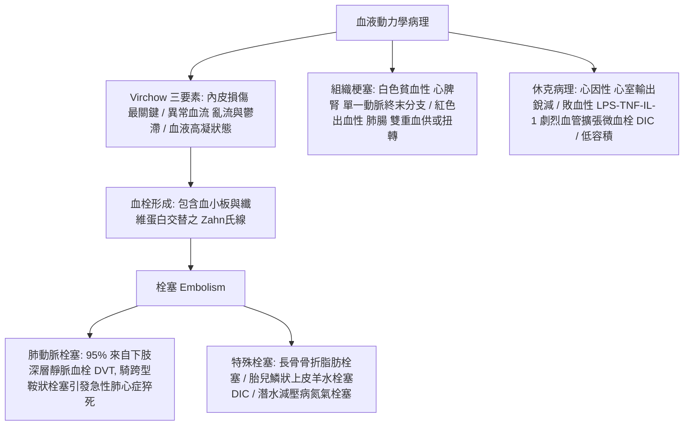

# 病理學 第03章 血液動力學障礙、血栓形成與休克

## 核心知識體系架構
血液動力學病理涵蓋水腫（充血性心衰竭、腎病症候群之 Starling 平衡被破壞）；出血與淤血（肉豆蔻肝 Nutmeg liver）；血栓形成之三大病因（Virchow's Triad：內皮受損、血流異常、高凝狀態）；動脈血栓 vs. 靜脈血栓（Zahn 氏線 Lines of Zahn）；各型栓塞（肺栓塞、脂肪栓塞、羊水栓塞、減壓病氣體栓塞）；梗塞型態（白色梗塞 vs. 紅色出血性梗塞）；以及休克（低血容量、心因性、感染性敗血性休克）之病理階段。

---

## 主題一：血栓形成（Thrombosis）與 Virchow 三要素

### 1. Virchow 氏三要素（Virchow's Triad）
1. **內皮細胞損傷（Endothelial Injury）**：**最關鍵也是單獨即可引發血栓形成之要素**！暴露內皮下膠原蛋白與馮維勒布蘭德因子（vWF），啟動血小板黏附與外在凝血途徑。見於動脈粥狀硬化潰瘍、心肌梗塞後心內膜壞死、嚴重高血壓、血管炎。
2. **血流動力學異常（Abnormal Blood Flow）**：
   - **亂流（Turbulence）**：造成局部內皮損傷與逆流渦流，見於動脈瘤、動脈粥狀硬化斑塊分叉處。
   - **血流鬱滯（Stasis）**：使血小板與內皮接觸時間增加，阻礙凝血因子被稀釋或清除。見於心房顫動（心房淤血栓塞）、長時間臥床、長途搭機（經濟艙症候群下肢靜脈血栓）。
3. **血液高凝狀態（Hypercoagulability）**：
   - **遺傳原發性**：**第 V 因子萊頓突變（Factor V Leiden，最常見遺傳性血栓成因！）**，使 Factor Va 無法被活性蛋白質 C（APC）裂解阻斷；凝血酶原 G20210A 基因突變；抗凝血酶 III（AT-III）缺乏；Protein C / Protein S 缺乏。
   - **後天次發性**：長期口服避孕藥（動情素刺激肝臟合成凝血因子）、惡性腫瘤（Trousseau 症候群遊走性血栓性靜脈炎）、抗磷脂質症候群（APS：抗心磷脂抗體、狼瘡抗凝物，假性 aPTT 延長但體內高血栓！）。

### 2. 動脈血栓 vs. 靜脈血栓精密對比
- **動脈血栓（Arterial Thrombi）**：
  - 常發生於內皮損傷或動脈粥狀硬化處（冠狀動脈、腦動脈、大腿動脈）。
  - **白血栓（White thrombi）**：以血小板和網狀纖維蛋白為主，含少量紅血球。生長方向朝向**心臟方向逆血流延伸**。
  - **Zahn 氏線（Lines of Zahn）**：顯微鏡下可見淡粉紅色血小板-纖維蛋白層與暗紅色富含紅血球層**交替排列之微細條紋，為「生前形成血栓」與「死後血液凝塊（Postmortem clot）」鑑別之黃金標誌**！
- **靜脈血栓（Venous Thrombi / 靜脈炎性血栓 Phlebothrombosis）**：
  - 常發生於下肢深層靜脈（膕靜脈、股靜脈、髂靜脈），血流鬱滯為主要誘因。
  - **紅血栓（Red thrombi / 停滯血栓）**：含極大量紅血球，質地軟如凝膠。順著**血流方向朝心臟延伸**。

---

## 主題二：各類栓塞（Embolism）與梗塞（Infarction）型態學

### 1. 致命栓塞四大類型比較表
| 栓塞類型 | 來源栓子物質構成 | 典型誘發病史情境 | 臨床表徵與組織病理特徵 |
| :--- | :--- | :--- | :--- |
| **肺動脈栓塞 (PTE)** | **$> 95\%$ 源自下肢深層靜脈血栓（DVT）** | 長期臥床手術後、骨科髖膝關節手術、長途飛行 | 突發胸痛、呼吸急促、咳血；大型**鞍狀栓塞（Saddle embolus）** 卡在肺動脈分叉處，引發**急性右心衰竭（急性肺心症 Cor pulmonale）與猝死**！ |
| **脂肪栓塞 (Fat Embolism)** | 骨髓破裂之脂肪球進入靜脈竇 | **長骨骨折（股骨或脛骨骨折）**、嚴重骨盆骨折後 24~72 小時 | **經典三聯徵（Triad）**： 1. **神經精神症狀（神智不清、昏迷）** 2. **進行性低血氧呼吸窘迫** 3. **上胸部與頸部皮膚瘀點（Petechial rash）**。冷凍切片油紅 O 染色陽性。 |
| **羊水栓塞 (Amniotic Embolism)** | 胎兒鱗狀上皮、胎毛、胎脂、黏蛋白進入母體子宮靜脈 | 困難分娩、胎盤早期剝離、子宮破裂破水時 | 突發嚴重低血壓休克、發紺、昏迷；羊水富含組織因子誘發**猛爆性瀰漫性血管內凝血（DIC）**，母體大出血死亡（死亡率 $> 60\%$）。肺微血管見胎兒鱗狀上皮細胞。 |
| **氣體栓塞 / 減壓病 (Decompression Sickness)** | 血液中溶解的**氮氣（$N_2$）** 因驟然減壓析出形成氣泡 | 深海潛水員過快上浮（**潛水夫病 The Bends**）；高空無加壓座艙急速爬升 | 氣泡阻塞肌肉關節引發劇痛（The Bends）；阻塞肺微血管引發氣梗與胸痛（The Chokes）；慢性反覆缺血引發長骨頭骨壞死（沉箱病 Caisson disease）。高壓氧艙治療。 |

### 2. 白色貧血性梗塞 vs. 紅色出血性梗塞
- **白色（貧血性）梗塞（White / Anemic Infarcts）**：
  - 發生於**組織緻密且為「終末動脈供血（End-arterial circulation）」之實質器官**。
  - 代表器官：**心臟（心肌）、脾臟、腎臟**。
  - 組織學：典型凝固性壞死，梗塞灶呈現界限清楚之三角形楔形（頂點指向血管阻塞處）。
- **紅色（出血性）梗塞（Red / Hemorrhagic Infarcts）**：
  - 發生於**具有「雙重血液供應（Dual blood supply）」、組織疏鬆鬆軟**、或**靜脈阻塞扭轉**、或**血流重新灌注（Reperfusion）** 之器官。
  - 代表器官：
    1. **肺臟（雙重血供：肺動脈 + 支氣管動脈）**。
    2. **小腸與大腸（雙重血供、組織疏鬆易積血；或腸扭轉引發靜脈回流受阻）**。
    3. **卵巢或睪丸扭轉**（靜脈先受壓閉塞，動脈仍持續泵入血液引發大量出血性壞死）。
    4. 缺血性腦中風溶解血栓後出血性轉化。

---

## 歷屆國考核心真題解析

### 【國考經典真題實戰】
**【試題編號】111-第一次-med2-084**
> **題目**：最常見的全身性血栓栓塞（systemic thromboembolism）栓子來源為：
- (A) 下肢深層靜脈
- (B) 左心室壁梗塞處
- (C) 主動脈動脈瘤
- (D) 下肢淺層靜脈

> **標準答案**：`B`
> 
> **【考點深度解析與選項拆解】**：
- **(A) 選項分析**：下肢深層靜脈。核對細胞病理形態學變化（如嗜酸性增加、核碎裂或組織間質沉積），驗證其病理診斷符合性。
- **(B) 選項分析**：左心室壁梗塞處。比對發炎化學介質、自體抗體專一性或血栓形成 Virchow 三要素，剖析考選部常見陷阱。
- **(C) 選項分析**：主動脈動脈瘤。辨析壞死亞型（凝固性 vs. 液化性）或過敏反應型別（Type I~IV），排除干擾選項。
- **(D) 選項分析**：下肢淺層靜脈。綜合顯微鏡下特徵或器官代償極限，確認題幹命題之病理學核心機制。
> **【國考核心解題金鑰】**：本題精確選出 **(B)**。考生須精通細胞凋亡內在/外在路徑、六大壞死型態之組織學判讀及各型過敏反應分子媒介，即可秒殺破題。

---
### 【國考經典真題實戰】
**【試題編號】111-第二次-第一階段-med2-082**
> **題目**：一個過去身體健康的25 歲女性，懷孕在某醫院婦產科定期接受產前檢查，檢查結果都正常，她後來自然產生 出一個足月男嬰，但在生產後她很快出現呼吸急促、心跳加快、發紺（cyanosis）與血壓下降，接著出現痙攣 與失去意識，請問下列情形是最可能出現在此病人的情況？
- (A) 肺動脈血管管腔出現空氣阻塞
- (B) 肺動脈血管管腔出現骨髓（bone marrow）
- (C) 肺動脈血管管腔中出現鱗狀上皮細胞（squamous epithelial cells）
- (D) 肺動脈血管管腔出現血栓栓塞（thromboembolism ）

> **標準答案**：`C`
> 
> **【考點深度解析與選項拆解】**：
- **(A) 選項分析**：肺動脈血管管腔出現空氣阻塞。核對細胞病理形態學變化（如嗜酸性增加、核碎裂或組織間質沉積），驗證其病理診斷符合性。
- **(B) 選項分析**：肺動脈血管管腔出現骨髓（bone marrow）。比對發炎化學介質、自體抗體專一性或血栓形成 Virchow 三要素，剖析考選部常見陷阱。
- **(C) 選項分析**：肺動脈血管管腔中出現鱗狀上皮細胞（squamous epithelial cells）。辨析壞死亞型（凝固性 vs. 液化性）或過敏反應型別（Type I~IV），排除干擾選項。
- **(D) 選項分析**：肺動脈血管管腔出現血栓栓塞（thromboembolism ）。綜合顯微鏡下特徵或器官代償極限，確認題幹命題之病理學核心機制。
> **【國考核心解題金鑰】**：本題精確選出 **(C)**。考生須精通細胞凋亡內在/外在路徑、六大壞死型態之組織學判讀及各型過敏反應分子媒介，即可秒殺破題。

---
### 【國考經典真題實戰】
**【試題編號】111-第二次-第一階段-med2-084**
> **題目**：下列何種出血性疾病，最可能造成微血管病性溶血性貧血（microangiopathic hemolytic anemia）？
- (A) 血栓性血小板減少性紫斑症（thrombotic thrombocytopenic purpura）
- (B) 馮維勒布蘭德病（von Willebrand disease）
- (C) 慢性免疫性血小板減少性紫斑症（chronic immune thrombocytopenic purpura）
- (D) 急性免疫性血小板減少性紫斑症（acute immune thrombocytopenic purpura）

> **標準答案**：`A`
> 
> **【考點深度解析與選項拆解】**：
- **(A) 選項分析**：血栓性血小板減少性紫斑症（thrombotic thrombocytopenic purpura）。核對細胞病理形態學變化（如嗜酸性增加、核碎裂或組織間質沉積），驗證其病理診斷符合性。
- **(B) 選項分析**：馮維勒布蘭德病（von Willebrand disease）。比對發炎化學介質、自體抗體專一性或血栓形成 Virchow 三要素，剖析考選部常見陷阱。
- **(C) 選項分析**：慢性免疫性血小板減少性紫斑症（chronic immune thrombocytopenic purpura）。辨析壞死亞型（凝固性 vs. 液化性）或過敏反應型別（Type I~IV），排除干擾選項。
- **(D) 選項分析**：急性免疫性血小板減少性紫斑症（acute immune thrombocytopenic purpura）。綜合顯微鏡下特徵或器官代償極限，確認題幹命題之病理學核心機制。
> **【國考核心解題金鑰】**：本題精確選出 **(A)**。考生須精通細胞凋亡內在/外在路徑、六大壞死型態之組織學判讀及各型過敏反應分子媒介，即可秒殺破題。
