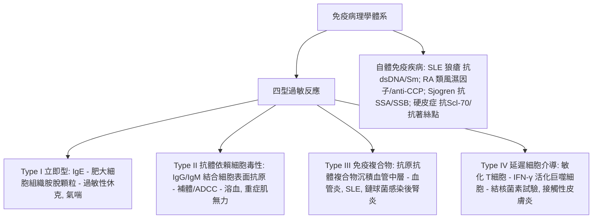

# 病理學 第04章 免疫病理學：自體免疫與過敏反應

## 核心知識體系架構
免疫病理學涵蓋四型過敏反應（Gell & Coombs Types I~IV）；全身性自體免疫疾病（全身性紅斑狼瘡 SLE、類風濕性關節炎 RA、修格連氏症候群 Sjogren、全身性硬化症 Scleroderma）；器官移植排斥（超急性、急性細胞/體液、慢性排斥）；以及澱粉樣變性（Amyloidosis）。

---

## 主題一：Gell & Coombs 四型過敏反應大對決

### 1. 四大過敏型態免疫機轉與代表疾病矩陣
| 過敏反應類型 | 主要免疫球蛋白 / 免疫效應細胞 | 核心致病分子病理機制 | 起效時間 | 典型代表性疾病（國考必考歸類） |
| :--- | :--- | :--- | :--- | :--- |
| **Type I：立即型過敏（Immediate / Anaphylactic）** | **$IgE$ 抗體**、肥大細胞（Mast cells）、嗜鹼性球、嗜酸性球 | 抗原與結合在肥大細胞高親和力 $Fc\epsilon RI$ 受體上的 IgE 發生交聯，觸發脫顆粒釋放組織胺、白三烯素（$LTC_4, LTD_4$） | 數秒至數分鐘 | **全身性過敏性休克（Anaphylaxis，蜂螫、盤尼西林）**、過敏性氣喘、過敏性鼻炎、蕁麻疹、食物過敏。 |
| **Type II：抗體介導細胞毒型（Antibody-mediated）** | **$IgG$ 或 $IgM$ 抗體**、補體 MAC、巨噬細胞（ADCC） | 抗體專一性結合於**細胞表面或組織固定抗原**，透過三大機制致病： 1. 補體調理吞噬或溶解。 2. 補體與 Fc 受體介導發炎。 3. 抗體直接干擾受體功能。 | 數小時至數天 | 1. 補體溶解：**急性溶血性輸血反應**、新生兒溶血症、自體免疫溶血性貧血（AIHA）。 2. 基底膜損傷：**古德帕斯徹症候群（Goodpasture syndrome，抗 IV 型膠原蛋白 $\alpha_3$ 鏈抗體）**、尋常天皰瘡（Pemphigus vulgaris，抗 Desmoglein-3）。 3. 受體干擾：**Graves 病（抗 TSH 受體刺激抗體）**、**重症肌無力（抗 Ach 受體阻斷抗體）**。 |
| **Type III：免疫複合物型（Immune Complex-mediated）** | **循環抗原-抗體（$IgG/IgM$）複合物**、補體系統、嗜中性球 | **可溶性抗原與抗體在血流中形成中等大小複合物**，沉澱於毛細血管基底膜（血管壁、腎絲球、關節滑膜），活化補體釋放 $C5a$，招募嗜中性球釋放溶酶體酵素引發**纖維素樣壞死**。 | 數小時至數天 | 1. **全身性紅斑狼瘡（SLE）**。 2. **急性鏈球菌感染後腎絲球腎炎（PSGN）**。 3. **血清病（Serum sickness）**。 4. **阿圖斯反應（Arthus reaction，局部皮下免疫複合物性壞死）**。 |
| **Type IV：延遲型細胞介導過敏（Cell-mediated / Delayed）** | **敏化 T 淋巴球（CD4+ Th1/Th17 或 CD8+ CTL）**、活化巨噬細胞 | **無抗體參與！** 1. **CD4+ 延遲過敏**：Th1 釋放 IFN-$\gamma$ 活化巨噬細胞。 2. **CD8+ 直接細胞毒性**：穿孔素（Perforin）與顆粒酶（Granzyme）直接裂解標靶細胞。 | **24 至 72 小時（最慢！）** | 1. **結核菌素皮膚試驗（PPD / Mantoux test）**。 2. **接觸性皮膚炎（Contact dermatitis：毒藤、鎳金屬首飾手錶）**。 3. **多發性硬化症（MS）**、**第 1 型糖尿病（T1DM，胰島 $\beta$ 細胞破壞）**、Hashimoto 甲狀腺炎。 4. 急性細胞型移植排斥。 |

---

## 主題二：全身性紅斑狼瘡（SLE）自體抗體與病理表現

### 1. SLE 特異性自體抗體譜
- **抗核抗體（ANA）**：敏感度最高（$> 95\%$），為最佳**篩檢指標**，但特異度低（陰性可高度排除 SLE）。
- **抗雙股 DNA 抗體（Anti-dsDNA）**：**特異度極高（$> 95\%$）**！抗體力價與**狼瘡性腎炎（Lupus nephritis）活動度及病情嚴重度高度平行正相關**。
- **抗 Sm 抗體（Anti-Smith）**：對小核核糖核蛋白（snRNPs）之抗體，**特異度最高（幾乎 100% 確診標誌）**，但不隨疾病活動度波動。
- **抗組蛋白抗體（Anti-histone antibody）**：**藥物誘發型紅斑狼瘡（DILE）特異性抗體（陽性率 $> 95\%$）**（引發藥物首選記憶：**Hydralazine, Procainamide, Isoniazid**）。

### 2. 狼瘡性腎炎（Lupus Nephritis）組織病理分型
- **Class I**：微小間質性狼瘡腎炎。
- **Class II**：系膜增生性狼瘡腎炎。
- **Class III**：局部增生性狼瘡腎炎（受累腎絲球 $< 50\%$）。
- **Class IV：瀰漫增生性狼瘡腎炎（Diffuse Proliferative, DPN，受累 $> 50\%$）**：**最常見（佔 50%）且預後最差、最致命之類型**！毛細血管壁因大量內皮下免疫複合物沉積而呈顯微鏡下典型 **「金屬線圈環（Wire-loop lesions）」**；免疫螢光顯微鏡呈現 IgG, IgA, IgM, C3, C1q 全陽性之 **「滿堂彩（Full house pattern）」**！
- **Class V**：膜性狼瘡腎炎（表現為典型腎病症候群）。
- **Class VI**：晚期硬化性狼瘡腎炎。

---

## 主題三：器官移植排斥（Graft Rejection）時序分類

### 1. 超急性 vs. 急性 vs. 慢性排斥反應矩陣
| 排斥反應分類 | 起效時間範圍 | 核心致病免疫病理機制 | 組織病理學特徵 | 臨床對策與預防 |
| :--- | :--- | :--- | :--- | :--- |
| **超急性排斥 (Hyperacute)** | **數分鐘至數小時（術中吻合放血時即可見）** | **受體體內預先存在對抗供體抗原之預存抗體（Preformed antibodies）**（如 ABO 血型不合或抗 HLA 抗體）。抗體與移植血管內皮抗原結合，猛烈活化補體系統。 | 廣泛毛細血管微血栓形成、內皮壞死、**急性纖維素樣壞死伴隨瀰漫性移植物缺血變紫發黑壞死**。 | **不可逆轉！必須立即手術切除移植物**。術前常規進行 ABO 血型比對及交叉淋巴球毒性試驗（Cross-match）預防。 |
| **急性細胞型排斥 (Acute Cellular)** | **數天至數個月內** | **受體 CD4+ 及 CD8+ T 細胞介導（Type IV 過敏）**：受體 T 細胞受供體同種異型 MHC 分子（HLA）活化，CD8+ CTL 直接攻擊供體實質細胞與小管內皮。 | 腎間質大量單核細胞/淋巴球浸潤、**腎小管炎（Tubulitis）** 及內皮炎（Endothelitis）。 | **可逆！加大免疫抑制劑劑量（高劑量皮質類固醇脈衝治療 Pulse steroid 或抗 T 細胞抗體）多能逆轉。** |
| **急性體液/抗體型排斥 (Acute Humoral)** | 數天至數週內 | 受體新產生的同種異型抗體（Donor-specific antibodies, DSA），結合於移植血管內皮活化補體。 | 血管內皮炎，**毛細血管壁 C4d 補體沉澱強陽性（診斷標誌！）**。 | 血漿置換（Plasmapheresis）、靜脈注射免疫球蛋白（IVIG）、Rituximab。 |
| **慢性排斥 (Chronic Rejection)** | **數月至數年** | 混合性體液與細胞免疫反應，慢性間質纖維化。分泌生長因子刺激血管平滑肌增生。 | **血管壁同心性內膜纖維化增厚（加速性動脈硬化 Arteriosclerosis）、管腔嚴重狹窄、間質纖維化伴萎縮**。 | **不可逆！藥物治療反應極差，最終移植物衰竭，需重新登記換腎。** |

---

## 歷屆國考核心真題解析

### 【國考經典真題實戰】
**【試題編號】111-第一次-med2-081**
> **題目**：一般而言，下列那些腫瘤與DNA病毒有關，且被認為在愛滋病（acquired immune deficiency syndrome）患者 比在正常人容易得到？①腦部原發性B細胞淋巴癌 ②子宮頸鱗狀上皮細胞癌 ③卡波西氏肉瘤（Kaposi sarcoma）
- (A) ①②③
- (B) 僅①②
- (C) 僅②③
- (D) 僅①③

> **標準答案**：`A`
> 
> **【考點深度解析與選項拆解】**：
- **(A) 選項分析**：①②③。核對細胞病理形態學變化（如嗜酸性增加、核碎裂或組織間質沉積），驗證其病理診斷符合性。
- **(B) 選項分析**：僅①②。比對發炎化學介質、自體抗體專一性或血栓形成 Virchow 三要素，剖析考選部常見陷阱。
- **(C) 選項分析**：僅②③。辨析壞死亞型（凝固性 vs. 液化性）或過敏反應型別（Type I~IV），排除干擾選項。
- **(D) 選項分析**：僅①③。綜合顯微鏡下特徵或器官代償極限，確認題幹命題之病理學核心機制。
> **【國考核心解題金鑰】**：本題精確選出 **(A)**。考生須精通細胞凋亡內在/外在路徑、六大壞死型態之組織學判讀及各型過敏反應分子媒介，即可秒殺破題。

---
### 【國考經典真題實戰】
**【試題編號】112-第二次-第一階段-med2-081**
> **題目**：在心肌病變（cardiomyopathy）以心臟收縮功能障礙（systolic dysfunction）為主要致病機制的疾病中，下列何 者是可能的致病原因？①酒精成癮 ②doxorubicin 治療 ③TTN基因突變 ④類澱粉沉積（amyloidosis）
- (A) 僅①②
- (B) ①②③
- (C) 僅②③
- (D) 僅③④

> **標準答案**：`B`
> 
> **【考點深度解析與選項拆解】**：
- **(A) 選項分析**：僅①②。核對細胞病理形態學變化（如嗜酸性增加、核碎裂或組織間質沉積），驗證其病理診斷符合性。
- **(B) 選項分析**：①②③。比對發炎化學介質、自體抗體專一性或血栓形成 Virchow 三要素，剖析考選部常見陷阱。
- **(C) 選項分析**：僅②③。辨析壞死亞型（凝固性 vs. 液化性）或過敏反應型別（Type I~IV），排除干擾選項。
- **(D) 選項分析**：僅③④。綜合顯微鏡下特徵或器官代償極限，確認題幹命題之病理學核心機制。
> **【國考核心解題金鑰】**：本題精確選出 **(B)**。考生須精通細胞凋亡內在/外在路徑、六大壞死型態之組織學判讀及各型過敏反應分子媒介，即可秒殺破題。

---
### 【國考經典真題實戰】
**【試題編號】112-第二次-第一階段-med2-088**
> **題目**：下列有關氣喘的敘述，何者最不適當？
- (A) 與第二型輔助T細胞（TH2 cells）活化有關
- (B) 屬於第二型過敏反應
- (C) 可見到嗜酸性白血球增加
- (D) 支氣管黏液中有Curschmann spirals

> **標準答案**：`B`
> 
> **【考點深度解析與選項拆解】**：
- **(A) 選項分析**：與第二型輔助T細胞（TH2 cells）活化有關。核對細胞病理形態學變化（如嗜酸性增加、核碎裂或組織間質沉積），驗證其病理診斷符合性。
- **(B) 選項分析**：屬於第二型過敏反應。比對發炎化學介質、自體抗體專一性或血栓形成 Virchow 三要素，剖析考選部常見陷阱。
- **(C) 選項分析**：可見到嗜酸性白血球增加。辨析壞死亞型（凝固性 vs. 液化性）或過敏反應型別（Type I~IV），排除干擾選項。
- **(D) 選項分析**：支氣管黏液中有Curschmann spirals。綜合顯微鏡下特徵或器官代償極限，確認題幹命題之病理學核心機制。
> **【國考核心解題金鑰】**：本題精確選出 **(B)**。考生須精通細胞凋亡內在/外在路徑、六大壞死型態之組織學判讀及各型過敏反應分子媒介，即可秒殺破題。
