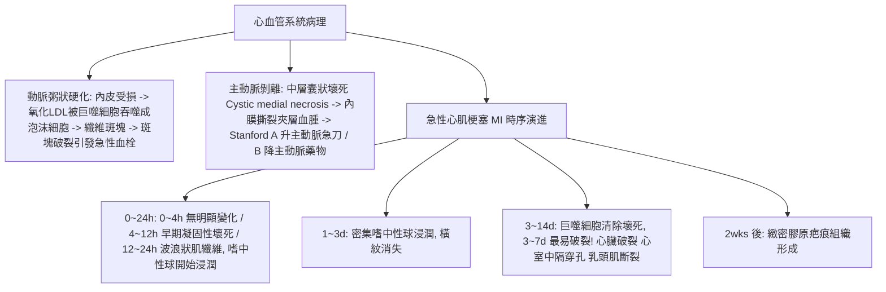

# 病理學 第06章 心血管系統病理學：動脈粥狀硬化、心肌梗塞與心臟病

## 核心知識體系架構
心血管病理學為臨床死亡率最高之大宗。涵蓋動脈粥狀硬化（Atherosclerosis）致病機轉（內皮損傷、脂質氧化、泡沫細胞 Foam cells、纖維帽破裂）；主動脈瘤與主動脈剝離（Stanford A vs. B）；缺血性心臟病與心肌梗塞（MI）之肉眼與顯微病理時序演進表（0h~2wks）；梗塞致命併發症之發生時間窗口；風濕熱（Aschoff 小體）與感染性心內膜炎；以及三大心肌病變。

---

## 主題一：急性心肌梗塞（MI）肉眼與顯微鏡下時序病理演進表

### 1. 國考最高頻「心肌梗塞病理時序黃金對照表」
| 梗塞後時間 (Time) | 肉眼病理所見 (Gross Features) | 顯微鏡下組織學特徵 (Microscopic Features) | 臨床血清標記與致命併發症 |
| :--- | :--- | :--- | :--- |
| **0 ~ 30 分鐘** | 無任何肉眼可見改變 | 電鏡下可見糖醣顆粒耗竭、粒線體水腫（可逆邊界） | 室顫猝死（VF）高危期 |
| **30 分鐘 ~ 4 小時** | 肉眼完全正常 | 光鏡下幾無可見改變；極罕見邊緣**波浪狀肌纖維（Wavy fibers）** | **心肌肌鈣蛋白（cTnI / cTnT）** 於 2~4 小時開始入血升高 |
| **4 ~ 12 小時** | 暗色斑駁斑（Dark mottling） | **早期凝固性壞死**：心肌細胞質**嗜酸性紅染（Hypereosinophilia）**、核固縮、微血管充血 | cTnI/cTnT 明顯升高；CK-MB 上升 |
| **12 ~ 24 小時** | 梗塞區暗紅伴蒼白邊緣 | 典型凝固性壞死：心肌細胞核溶解消失、**嗜中性球（Neutrophils）開始由周邊浸潤** | 心律不整高峰期 |
| **1 ~ 3 天** | 梗塞核心變軟、呈**黃褐色斑駁**伴周圍充血充血紅暈 | **嗜中性球大量密集浸潤達高峰**、心肌細胞完全壞死橫紋消失 | 心包膜炎（梗塞後心包摩擦音，壁層纖維素滲出） |
| **3 ~ 7 天** | **中心黃褐色極度軟化崩解**、邊緣充血肉芽組織長入 | 嗜中性球凋亡消失，**巨噬細胞（Macrophages）大量進駐**，全力吞噬清除壞死心肌殘屑 | **【最致命心臟機械破裂高峰期（3~7天）】**： 1. **心室游離壁破裂（Free wall rupture）** $\to$ 急性心包填塞（Cardiac tamponade）電機械分離猝死。 2. **心室中隔穿孔（VSR）** $\to$ 突發收縮期全心雜音、急性右心衰竭。 3. **乳頭肌斷裂（Papillary muscle rupture）** $\to$ 急性重度二尖瓣逆流、急性肺水腫休克。 |
| **7 ~ 14 天** | 梗塞區邊緣呈現顯著之**鮮紅色、微細顆粒狀帶** | **肉芽組織（Granulation tissue）發育成熟**：大量新生微血管增生、纖維母細胞分泌膠原蛋白 | 心室破裂風險逐漸下降 |
| **2 週 ~ 2 個月** | 梗塞區轉為灰白色堅硬凹陷 | 膠原蛋白持續交聯沉積，微血管減少，轉化為**無細胞之緻密膠原疤痕（Dense collagenous scar）** | **心室真性室壁瘤（True Ventricular Aneurysm）**（晚期收縮期膨出，好發左心室前壁心尖部，易附壁血栓形成及心衰竭）；**Dressler 症候群（梗塞後數週發生的自體免疫心包膜炎）**。 |

---

## 主題二：主動脈剝離（Aortic Dissection）病理學

### 1. 組織病理基礎與 Stanford 分型
- **致病病理基礎**：**主動脈中層退化 / 囊性中層壞死（Cystic Medial Necrosis）**。彈性纖維斷裂、平滑肌細胞喪失、細胞外基質黏多糖沉積。
- **高危危險因子**：
  1. **長期未控制之高血壓（Hypertension，最常見病因，佔 80%）**。
  2. **遺傳結締組織疾患**：**馬凡氏症候群（Marfan syndrome，FBN1 基因突變缺陷導致 Fibrillin-1 異常）**、Ehlers-Danlos 症候群。
  3. 主動脈二葉瓣畸形（Bicuspid aortic valve）、主動脈縮窄。
- **Stanford 分型與手術抉擇**：
  - **Stanford Type A（近端型，佔 65%）**：**撕裂口累及升主動脈（Ascending aorta）**（不論是否累及降主動脈）。
    - 致命威脅：逆向逆流破入心包腔導致急性心包填塞、撕裂冠狀動脈開口導致急性心肌梗塞、撕裂二尖/主動脈瓣環導致急性主動脈瓣逆流。
    - **處置：外科心臟急診開胸換血管（Emergency Surgery）**！
  - **Stanford Type B（遠端型，佔 35%）**：**撕裂口僅局限於左鎖骨下動脈遠端之降主動脈（Descending aorta）**。
    - **處置：優先以藥物嚴格控制血壓與心率（IV $\beta$ 阻斷劑 Esmolol/Labetalol 降 SBP $< 120\text{ mmHg}$）**，若有器官缺血則採動脈腔內覆膜支架置入術（TEVAR）。

---

## 主題三：風濕熱（Rheumatic Fever）與感染性心內膜炎

### 1. 風濕熱病理組織學特徵
- **致病機轉**：A 群 $\beta$ 溶血性鏈球菌（GAS / S. pyogenes）咽喉炎後 2~3 週，鏈球菌 **M 蛋白抗原與人體心肌肌凝蛋白產生「抗原分子擬態（Molecular mimicry）」** 引發之 Type II 自體免疫全心炎（Pancarditis）。
- **特異組織病理標誌（國考必考！）**：
  - **阿少夫小體（Aschoff Bodies）**：心肌間質周圍的肉芽腫樣病灶，中央為纖維素樣壞死，周圍環繞淋巴球、漿細胞及特異變性巨噬細胞。
  - **阿尼契科夫細胞（Anitschkow Cells / 毛毛蟲細胞 Caterpillar cells）**：活化的巨噬細胞，胞核內染色質濃縮成細長條狀，橫切面宛如貓眼（Owl-eye），縱切面呈波浪狀毛毛蟲樣。
- **瓣膜病變後遺症**：慢性風濕性心臟病最常侵犯 **二尖瓣（Mitral valve，佔 70%）**，其次為合併主動脈瓣。瓣膜邊緣增厚纖維化、腱索融合縮短，形成典型 **「魚嘴樣狹窄（Fish-mouth / Buttonhole stenosis）」**！

---

## 歷屆國考核心真題解析

### 【國考經典真題實戰】
**【試題編號】111-第一次-med2-085**
> **題目**：10歲男童，三週前發生咽炎，實驗室檢查發現anti-streptolysin O的效價升高，臨床表現為發燒、心臟炎、關節 痛及四肢有皮下結節；在此病患的心臟病灶中的那一種細胞對此病的診斷最具特異性？
- (A) Anitschkow細胞
- (B) Reed-Sternberg細胞
- (C) Cajal細胞
- (D) Purkinje細胞

> **標準答案**：`A`
> 
> **【考點深度解析與選項拆解】**：
- **(A) 選項分析**：Anitschkow細胞。核對腫瘤免疫組化染色（IHC）、心肌梗塞時序病理變化或胃腸道發炎組織切片特徵，審定其符合度。
- **(B) 選項分析**：Reed-Sternberg細胞。審查致癌基因（Oncogene）與抑癌基因（TSG）突變模式、或克隆氏症與潰瘍性結腸炎之病變深度，剖析誘答陷阱。
- **(C) 選項分析**：Cajal細胞。檢驗微細組織學標誌（如印戒細胞、Aschoff小體、Charcot-Leyden結晶），排除干擾選項。
- **(D) 選項分析**：Purkinje細胞。綜合腫瘤TNM分期或併發症時間窗口，驗證題幹核心命題本意。
> **【國考核心解題金鑰】**：本題精準鎖定標準答案 **(A)**。考生須融會貫通心肌梗塞 24小時至2週之顯微鏡與破裂併發症演進、肺癌與胃腸道腫瘤之分子病理標誌，即可十拿九穩。

---
### 【國考經典真題實戰】
**【試題編號】111-第一次-med2-086**
> **題目**：48歲男性因進展性心臟衰竭接受換心手術，切除下來的心臟呈擴大狀且重達600公克，病理檢查發現心臟四個 腔室都擴大，但兩側心室並無特別肥厚，冠狀動脈亦無狹窄。下列病理組織變化中，何者最不常見於此類心 臟中？
- (A) myocyte hypertrophy
- (B) interstitial fibrosis
- (C) small subendocardial scars
- (D) myofiber disarray

> **標準答案**：`D`
> 
> **【考點深度解析與選項拆解】**：
- **(A) 選項分析**：myocyte hypertrophy。核對腫瘤免疫組化染色（IHC）、心肌梗塞時序病理變化或胃腸道發炎組織切片特徵，審定其符合度。
- **(B) 選項分析**：interstitial fibrosis。審查致癌基因（Oncogene）與抑癌基因（TSG）突變模式、或克隆氏症與潰瘍性結腸炎之病變深度，剖析誘答陷阱。
- **(C) 選項分析**：small subendocardial scars。檢驗微細組織學標誌（如印戒細胞、Aschoff小體、Charcot-Leyden結晶），排除干擾選項。
- **(D) 選項分析**：myofiber disarray。綜合腫瘤TNM分期或併發症時間窗口，驗證題幹核心命題本意。
> **【國考核心解題金鑰】**：本題精準鎖定標準答案 **(D)**。考生須融會貫通心肌梗塞 24小時至2週之顯微鏡與破裂併發症演進、肺癌與胃腸道腫瘤之分子病理標誌，即可十拿九穩。

---
### 【國考經典真題實戰】
**【試題編號】114-第二次-第一階段-med2-082**
> **題目**：先天性心臟病中，長期處於下列何種狀況最容易造成肺高壓？
- (A) 明顯的心室中隔缺損（ventricular septal defect）
- (B) 典型的Fallot 氏四合症（classic tetralogy of Fallot）
- (C) 成人型導管後主動脈狹窄（adult form postductal coarctation of aorta）
- (D) 單獨的肺動脈瓣狹窄（isolated pulmonary stenosis）

> **標準答案**：`A`
> 
> **【考點深度解析與選項拆解】**：
- **(A) 選項分析**：明顯的心室中隔缺損（ventricular septal defect）。核對腫瘤免疫組化染色（IHC）、心肌梗塞時序病理變化或胃腸道發炎組織切片特徵，審定其符合度。
- **(B) 選項分析**：典型的Fallot 氏四合症（classic tetralogy of Fallot）。審查致癌基因（Oncogene）與抑癌基因（TSG）突變模式、或克隆氏症與潰瘍性結腸炎之病變深度，剖析誘答陷阱。
- **(C) 選項分析**：成人型導管後主動脈狹窄（adult form postductal coarctation of aorta）。檢驗微細組織學標誌（如印戒細胞、Aschoff小體、Charcot-Leyden結晶），排除干擾選項。
- **(D) 選項分析**：單獨的肺動脈瓣狹窄（isolated pulmonary stenosis）。綜合腫瘤TNM分期或併發症時間窗口，驗證題幹核心命題本意。
> **【國考核心解題金鑰】**：本題精準鎖定標準答案 **(A)**。考生須融會貫通心肌梗塞 24小時至2週之顯微鏡與破裂併發症演進、肺癌與胃腸道腫瘤之分子病理標誌，即可十拿九穩。
