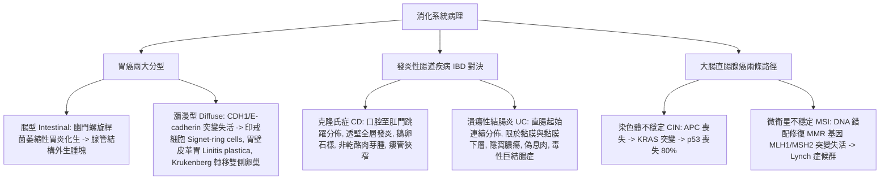

# 病理學 第08章 消化系統病理學：胃腸、肝膽、胰臟腫瘤與發炎

## 核心知識體系架構
消化系統病理涵蓋胃腸腫瘤（Barrett 食道腺癌、胃癌兩大分類 Laurén 腸型 vs. 瀰漫型、發炎性腸道疾病 IBD 克隆氏症 vs. 潰瘍性結腸炎、大腸腺癌經典 APC-KRAS-p53 腺瘤-腺癌演進序列 vs. 微衛星不穩定性 MSI/Lynch 症候群）；肝膽疾病（病毒性肝炎、酒精性肝病 Mallory-Denk 小體、肝硬化門脈高壓、肝細胞癌 HCC）；以及急性/慢性胰臟炎與胰臟腺癌（Trousseau 症候群）。

---

## 主題一：發炎性腸道疾病（IBD：Crohn's Disease vs. Ulcerative Colitis）

### 1. 克隆氏症（CD）vs. 潰瘍性結腸炎（UC）黃金鑑別矩陣
| 組織病理與臨床比較維度 | 克隆氏症（Crohn's Disease, CD） | 潰瘍性結腸炎（Ulcerative Colitis, UC） |
| :--- | :--- | :--- |
| **病灶解剖分佈範圍** | **消化道任何部位（從口腔到肛門均可發生）**，最常侵犯**末端迴腸與迴盲部（Terminal ileum）**。**直腸常被豁免（Rectal sparing）**。 | **完全局限於大腸（結腸與直腸）**。**100% 必然累及直腸**，並逆行向近端連續蔓延。 |
| **分佈模式（Distribution）** | **跳躍性分佈（Skip lesions）**，病變腸段與正常腸段相間。 | **完全連續性瀰漫分佈（Continuous lesions）**，無跳躍性病灶。 |
| **腸壁受累深度** | **透壁性全層發炎（Transmural inflammation）**（波及黏膜、黏膜下層、肌肉層至漿膜層）。 | **僅局限於黏膜層與黏膜下層（Mucosa & Submucosa）**，肌層與漿膜層正常。 |
| **內視鏡與肉眼病理** | 1. 深度縱向裂隙狀潰瘍（Knife-like fissures）。 2. 黏膜呈**鵝卵石鋪路樣外觀（Cobblestone appearance）**。 3. 腸壁肥厚纖維化狹窄（鉛管樣、線徵 String sign）。 4. 腸繫膜脂肪爬升包裹腸壁（**爬行脂肪 Creeping fat**）。 | 1. 廣泛淺表糜爛性黏膜潰瘍，易出血。 2. 殘存再生黏膜凸起形成大量**發炎性偽息肉（Pseudopolyps）**。 3. 腸壁通常變薄，無顯著纖維化狹窄。 |
| **顯微鏡下特徵病理** | **非乾酪性肉芽腫（Non-caseating granulomas，診斷特異性 50%）**、全層淋巴濾泡聚積。 | **隱窩膿瘍（Crypt abscesses，嗜中性球浸潤腺體管腔）**、隱窩結構扭曲萎縮。**無肉芽腫！** |
| **主要腸道併發症** | 腸道狹窄阻塞、**瘻管形成（Fistulas：腸-腸、腸-膀胱、腸-皮膚）**、腹腔膿瘍、肛周膿瘍與肛裂。 | **毒性巨結腸症（Toxic megacolon，肌層神經叢麻痺穿孔）**、急性大出血。 |
| **癌變風險（Colorectal Cancer）** | 有中度增加。 | **顯著高度增加（隨病程超過 8~10 年呈指數型上升，需定期結腸鏡篩檢）**！ |
| **血清自體抗體** | **ASCA（抗釀酒酵母抗體）陽性**。 | **p-ANCA（抗嗜中性球細胞質抗體）陽性（高達 70%）**。 |

---

## 主題二：胃癌（Gastric Cancer）Laurén 分型

### 1. 腸型胃癌（Intestinal-type）vs. 瀰漫型胃癌（Diffuse-type）
- **腸型胃癌（Intestinal Type）**：
  - **致病病因**：高度與 **幽門螺旋桿菌（H. pylori）慢性感染**、抽菸、飲食高鹽與亞硝酸鹽相關。
  - **病理演進路徑**：慢性表淺性胃炎 $\to$ 萎縮性胃炎 $\to$ **腸化生（Intestinal metaplasia）** $\to$ 異生（Dysplasia） $\to$ 浸潤癌。
  - **顯微病理**：形成明確的**腺管構造（Glands）**，腫瘤細胞黏附緊密，肉眼常呈隆起蕈狀潰瘍外生型腫塊。好發於胃竇部與胃小彎。
- **瀰漫型胃癌（Diffuse Type）**：
  - **致病病因**：與 H. pylori 無必然關聯！主要源自 **$CDH1$ 基因突變缺陷**，導致鈣黏蛋白 **E-cadherin（上皮細胞間黏附分子）喪失**！
  - **顯微病理**：癌細胞喪失細胞間黏附力，成單個或小簇瀰漫浸潤於胃壁全層。細胞內富含大量黏蛋白小滴，將細胞核推向質膜周邊壓扁，呈現顯微鏡下經典 **印戒細胞（Signet-ring cells）**！
  - **皮革胃（Linitis Plastica）**：腫瘤引發劇烈之促結締組織增生反應（Desmoplasia），胃壁廣泛增厚變硬如皮革囊袋，胃蠕動完全喪失。
  - **遠端特異轉移模式**：
    - **Krukenberg 腫瘤**：胃癌（尤以印戒細胞癌）經腹腔種植轉移至**雙側卵巢**，卵巢間質內見大量產黏液印戒細胞。
    - **Virchow 淋巴結**：經胸導管轉移至**左鎖骨上淋巴結**。
    - **Sister Mary Joseph 結節**：經淋巴轉移至**肚臍周圍皮下結節**。

---

## 主題三：大腸直腸腺癌（CRC）兩條經典分子致癌路徑

### 1. 染色體不穩定路徑（CIN）vs. 微衛星不穩定路徑（MSI）
- **路徑一：染色體不穩定性腺瘤-腺癌序列（Adenoma-Carcinoma Sequence / CIN，佔 80%）**：
  - **Step 1（啟動 Initiation）**：第 5 號染色體長臂上的 **$APC$ 抑癌基因雙等位基因失活突變**（或家族性大腸息肉症 FAP 的胚系遺傳） $\to$ $\beta$-catenin 降解受阻，轉位入核啟動增殖，正常黏膜出現**早期腺瘤（Early adenoma）**。
  - **Step 2（生長）**：原致癌基因 **$KRAS$ 活化突變**，細胞生長失控，發展為**大型腺瘤（Late adenoma）**。
  - **Step 3（惡性轉化）**：**$TP53$ 抑癌基因雙打擊失活**及 DCC 缺失，細胞獲得浸潤與轉移能力，演變為**浸潤性大腸腺癌（Invasive carcinoma）**！
  - 腫瘤多見於遠端乙狀結腸與直腸，呈環狀「蘋果核樣（Apple-core sign）」狹窄阻塞。
- **路徑二：微衛星不穩定性路徑（Microsatellite Instability / MSI，佔 15~20%）**：
  - **分子機制**：**DNA 錯配修復（Mismatch Repair, MMR）系統基因失活**（$MLH1, MSH2, MSH6, PMS2$）。
  - **遺傳型：Lynch 症候群（遺傳性非息肉病性結直腸癌 HNPCC）**：體染色體顯性遺傳 MSH2 或 MLH1 胚系突變。
  - **散發型**：$MLH1$ 啟動子發生高甲基化修飾（Epigenetic silencing / CpG island methylator phenotype, CIMP）。
  - 腫瘤好發於**近端右側結腸（升結腸、盲腸）**，外觀呈息肉樣外生隆起，組織學常伴隨大量腫瘤浸潤淋巴球（TILs），預後相對較 CIN 路徑佳。

---

## 歷屆國考核心真題解析

### 【國考經典真題實戰】
**【試題編號】111-第二次-第一階段-med2-078**
> **題目**：關於體染色體遺傳疾病（autosomal inheritable disease）的敘述，下列何者正確？
- (A) 酵素蛋白缺陷所引起的遺傳性疾病以顯性遺傳疾病（autosomal dominant disease）為主
- (B) 家族性高膽固醇血症（familial hypercholesterolemia）為LDL 蛋白結構異常所致，以顯性遺傳疾病為主
- (C) 高雪氏症（Gaucher disease）以隱性（recessive）遺傳為主，為葡萄糖腦苷脂（glucocerebroside）接受器 （receptor）蛋白結構異常所致
- (D) 埃勒斯–丹洛斯症候群（Ehlers-Danlos syndromes）因是纖維性膠原蛋白（fibrillar collagen）結構或合成異常所 致，所以顯性或隱性遺傳兼具

> **標準答案**：`D`
> 
> **【考點深度解析與選項拆解】**：
- **(A) 選項分析**：酵素蛋白缺陷所引起的遺傳性疾病以顯性遺傳疾病（autosomal dominant disease）為主。核對腫瘤免疫組化染色（IHC）、心肌梗塞時序病理變化或胃腸道發炎組織切片特徵，審定其符合度。
- **(B) 選項分析**：家族性高膽固醇血症（familial hypercholesterolemia）為LDL 蛋白結構異常所致，以顯性遺傳疾病為主。審查致癌基因（Oncogene）與抑癌基因（TSG）突變模式、或克隆氏症與潰瘍性結腸炎之病變深度，剖析誘答陷阱。
- **(C) 選項分析**：高雪氏症（Gaucher disease）以隱性（recessive）遺傳為主，為葡萄糖腦苷脂（glucocerebroside）接受器 （receptor）蛋白結構異常所致。檢驗微細組織學標誌（如印戒細胞、Aschoff小體、Charcot-Leyden結晶），排除干擾選項。
- **(D) 選項分析**：埃勒斯–丹洛斯症候群（Ehlers-Danlos syndromes）因是纖維性膠原蛋白（fibrillar collagen）結構或合成異常所 致，所以顯性或隱性遺傳兼具。綜合腫瘤TNM分期或併發症時間窗口，驗證題幹核心命題本意。
> **【國考核心解題金鑰】**：本題精準鎖定標準答案 **(D)**。考生須融會貫通心肌梗塞 24小時至2週之顯微鏡與破裂併發症演進、肺癌與胃腸道腫瘤之分子病理標誌，即可十拿九穩。

---
### 【國考經典真題實戰】
**【試題編號】112-第一次-med2-081**
> **題目**：下列造成腹水（ascites）的原因中，何種原因的積液所含的蛋白質濃度最高？
- (A) 細菌性腹膜炎（peritonitis）
- (B) 腎病症候群（nephrotic syndrome）
- (C) 肝硬化（liver cirrhosis）
- (D) 營養不良（malnutrition）

> **標準答案**：`A`
> 
> **【考點深度解析與選項拆解】**：
- **(A) 選項分析**：細菌性腹膜炎（peritonitis）。核對腫瘤免疫組化染色（IHC）、心肌梗塞時序病理變化或胃腸道發炎組織切片特徵，審定其符合度。
- **(B) 選項分析**：腎病症候群（nephrotic syndrome）。審查致癌基因（Oncogene）與抑癌基因（TSG）突變模式、或克隆氏症與潰瘍性結腸炎之病變深度，剖析誘答陷阱。
- **(C) 選項分析**：肝硬化（liver cirrhosis）。檢驗微細組織學標誌（如印戒細胞、Aschoff小體、Charcot-Leyden結晶），排除干擾選項。
- **(D) 選項分析**：營養不良（malnutrition）。綜合腫瘤TNM分期或併發症時間窗口，驗證題幹核心命題本意。
> **【國考核心解題金鑰】**：本題精準鎖定標準答案 **(A)**。考生須融會貫通心肌梗塞 24小時至2週之顯微鏡與破裂併發症演進、肺癌與胃腸道腫瘤之分子病理標誌，即可十拿九穩。

---
### 【國考經典真題實戰】
**【試題編號】112-第一次-med2-091**
> **題目**：有關肝臟的威爾森氏病（Wilson disease），下列何種生化檢查的診斷價值最低？
- (A) 血清的銅離子濃度
- (B) 血清的銅藍蛋白（ceruloplasmin）濃度
- (C) 肝臟的銅離子濃度
- (D) 尿液的銅離子濃度

> **標準答案**：`A`
> 
> **【考點深度解析與選項拆解】**：
- **(A) 選項分析**：血清的銅離子濃度。核對腫瘤免疫組化染色（IHC）、心肌梗塞時序病理變化或胃腸道發炎組織切片特徵，審定其符合度。
- **(B) 選項分析**：血清的銅藍蛋白（ceruloplasmin）濃度。審查致癌基因（Oncogene）與抑癌基因（TSG）突變模式、或克隆氏症與潰瘍性結腸炎之病變深度，剖析誘答陷阱。
- **(C) 選項分析**：肝臟的銅離子濃度。檢驗微細組織學標誌（如印戒細胞、Aschoff小體、Charcot-Leyden結晶），排除干擾選項。
- **(D) 選項分析**：尿液的銅離子濃度。綜合腫瘤TNM分期或併發症時間窗口，驗證題幹核心命題本意。
> **【國考核心解題金鑰】**：本題精準鎖定標準答案 **(A)**。考生須融會貫通心肌梗塞 24小時至2週之顯微鏡與破裂併發症演進、肺癌與胃腸道腫瘤之分子病理標誌，即可十拿九穩。
