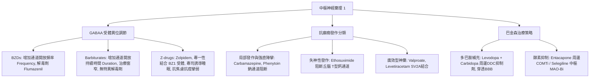

# 藥理學 第05章 中樞神經藥理學：鎮靜安眠、抗癲癇與巴金森藥物

## 核心知識體系架構
中樞神經系統（CNS）藥理涵蓋 $GABA_A$ 氯離子通道之同構異位調節劑（苯二氮䓬類 BZDs、巴比妥類 Barbiturates、非 BZD 類 Z-drugs）；抗癲癇藥物（鈉通道阻斷劑、鈣通道阻斷劑、GABA 增強劑）；以及巴金森氏症多巴胺能補充與乙醯膽鹼平衡策略。

---

## 主題一：$GABA_A$ 調節劑（BZD vs. Barbiturate vs. Z-drugs）

### 1. 作用機轉與劑量反應曲線大對決
- **苯二氮䓬類（Benzodiazepines, BZDs：Diazepam, Lorazepam, Midazolam）**：
  - 結合於 $GABA_A$ 受體之 $\alpha$ 與 $\gamma$ 次單元交界面之異位調節位點（BZD 結合位）。
  - **分子機制：增加 $Cl^-$ 通道開放的「頻率（Frequency）」**（口訣：**B**enzodiazepines increase **F**requency - **B-F**）。
  - **安全性高**：劑量反應曲線具顯著平台期（Ceiling effect），單純過量不易引發致死性呼吸抑制（除非合併酒精或鴉片類）。
  - **特異解毒劑：氟馬西尼（Flumazenil）**：BZD 受體競爭性拮抗劑，能迅速逆轉 BZD 鎮靜，但可能誘發成癮者之急性戒斷性癲癇發作。
- **巴比妥類（Barbiturates：Phenobarbital, Thiopental）**：
  - 結合於 $GABA_A$ 受體之 $\beta$ 次單元不同位點。
  - **分子機制：延長 $Cl^-$ 通道開放的「持續時間（Duration）」**（口訣：**B**arbiturates increase **D**uration - **B-D**）。高劑量下甚至可直接打開氯通道（擬 GABA 作用）並抑制 AMPA 受體。
  - **危險性極高**：劑量反應曲線呈線性上升，極易引發昏迷、嚴重呼吸抑制與心血管休克。**無特異解毒劑**（僅能鹼化尿液促進 Phenobarbital 排泄）。強烈誘導肝臟 CYP450 酵素與 ALA 合成酶（**急性間歇性紫質症 AIP 絕對禁用！**）。
- **非 BZD 類助眠藥（Z-drugs：Zolpidem, Zaleplon, Eszopiclone）**：
  - 高選擇性結合於含 $\alpha_1$ 次單元之 **$BZ_1$ 受體**。
  - **純粹誘導快速入睡**，耐受性與成癮性較低，無抗焦慮、抗癲癇與肌肉鬆弛作用。同樣可被 Flumazenil 逆轉。

---

## 主題二：抗癲癇藥物（Antiseizure Drugs）分類與臨床首選

### 1. 抗癲癇發作型態首選用藥精準矩陣
| 癲癇發作型態 | 臨床特徵與腦電圖（EEG） | 第一線首選用藥 | 作用分子機轉 | 國考必背特徵副作用 |
| :--- | :--- | :--- | :--- | :--- |
| **失神性發作（Absence Seizures）** | 兒童短暫意識喪失（數秒凝視），**EEG 呈現典型 3 Hz 棘慢波複合波** | **乙琥胺（Ethosuximide）** | **專一性阻斷視丘神經元之 T 型電壓鈣通道（$I_{Ca,T}$）** | 腸胃不適、嗜睡、頭痛。**對其他型態癲癇無效！** |
| **局部發作（Focal / Partial）** | 單側大腦半球起源，可演變為雙側強直陣攣 | **卡馬西平（Carbamazepine）** 或 **拉莫三嗪（Lamotrigine）** | 延長電壓閘門式 $Na^+$ 通道失活狀態，抑制高頻重複放電 | **Carbamazepine**：**HLA-B*1502 基因陽性者誘發史蒂芬強生症候群（SJS/TEN，致死性表皮溶解）**、低血鈉（SIADH）、白血球減少、肝毒性。 |
| **全身強直陣攣發作（Tonic-Clonic）** | 全身對稱性肢體強直伴隨陣攣抽搐 | **丙戊酸鈉（Valproate）** 或 **Levetiracetam** | 多重機轉：阻斷鈉通道、弱化 T 型鈣、增加 GABA 合成 | **Valproate**：**致畸胎性最高（胎兒神經管缺陷 Neural tube defects）**、致死性肝毒性、急性胰臟炎、掉髮、體重增加。 |
| **肌陣攣發作（Myoclonic）** | 突發短暫肌肉抽動，無意識喪失 | **Valproate** 或 **Levetiracetam** | 增強 GABA / 結合突觸囊泡蛋白 **SV2A** | Levetiracetam 副作用主要為神經精神症狀（焦慮、激動）。 |
| **癲癇重積狀態（Status Epilepticus）** | 持續抽搐 $> 5$ 分鐘或連續發作未清醒 | **第一步：IV Lorazepam / Diazepam** **第二步：IV Fosphenytoin / Levetiracetam** **第三步：IV Propofol / Midazolam 全麻** | 快速終止大腦過度同步放電 | **苯妥英（Phenytoin）**：**零級消除動力學（飽和動力學）**！特徵副作用：**牙齦增生（Gingival hyperplasia）**、多毛症、畸胎（胎兒腙綜合徵）、眼球震顫共濟失調。 |

---

## 主題三：巴金森氏症（Parkinson's Disease）多巴胺替代策略

### 1. 抗巴金森藥物分子靶點全景圖
- **左旋多巴（Levodopa, L-DOPA）**：多巴胺代謝前驅物，**能穿透血腦屏障（BBB）**（多巴胺本身無法穿透 BBB）。
- **周邊多巴脫羧酶抑制劑（Carbidopa / Benserazide）**：
  - **無法穿透 BBB**，專一性抑制周邊組織之芳香族 L-胺基酸脫羧酶（DADC）。
  - **與 L-DOPA 合用（Sinemet）之關鍵意義**：阻斷 L-DOPA 在周邊轉化為多巴胺，使進入中樞大腦的 L-DOPA 比例由 1~3% 大幅提升至 10%，同時**消除周邊多巴胺引發的劇烈心律不整與噁心嘔吐**！
- **COMT 抑制劑：恩他卡朋（Entacapone）vs. 托卡朋（Tolcapone）**：
  - **Entacapone**：**純周邊 COMT 抑制劑**，抑制 L-DOPA 轉化為 3-OMD，延長 L-DOPA 半衰期，改善「藥效消退現象（Wearing-off）」。
  - **Tolcapone**：兼具周邊與中樞 COMT 抑制，但因具致死性猛爆性肝毒性已極少使用。
- **MAO-B 抑制劑：司來吉蘭（Selegiline）與雷沙吉蘭（Rasagiline）**：
  - 選擇性不可逆抑制中樞 **MAO-B**，阻斷大腦內多巴胺分解。高劑量下喪失選擇性會抑制 MAO-A，需警惕與富含酪胺（Tyramine）乳酪合用時之高血壓危象（Cheese reaction）。
- **多巴胺受體促效劑（Dopamine Agonists）**：
  - **非麥角類（Non-ergot：Pramipexole, Ropinirole）**：直接活化紋狀體 $D_2 / D_3$ 受體，為年輕患者初始治療首選（減少運動併發症）。副作用為突發睡眠發作（Sleep attacks）與衝動控制障礙（病態賭博、性慾過盛）。
  - **麥角類（Bromocriptine）**：可能引起心臟瓣膜纖維化。
- **抗膽鹼藥物：苯海索（Trihexyphenidyl）與苯扎托品（Benztropine）**：
  - 阻斷紋狀體蕈毒鹼受體，恢復多巴胺與乙醯膽鹼之動態平衡，**專門改善巴金森氏症之靜止性震顫（Tremor）**。青光眼與攝護腺肥大禁用。

---

## 歷屆國考核心真題解析

### 【國考經典真題實戰】
**【試題編號】111-第一次-med2-073**
> **題目**：下列那一個抗帕金森氏症藥物，不適合用於排尿不順的老年患者？
- (A) benztropine
- (B) ropinirole
- (C) selegiline
- (D) levodopa

> **標準答案**：`A`
> 
> **【考點深度解析與選項拆解】**：
- **(A) 選項分析**：benztropine。對照中樞受體調控、抗生素抗菌光譜或抗結核抗病毒之分子標靶，驗證其正誤性。
- **(B) 選項分析**：ropinirole。審查細胞壁生合成阻斷、核糖體 30S/50S 次單元抑制或 CYP450 酵素誘導/抑制特性，拆解命題陷阱。
- **(C) 選項分析**：selegiline。檢驗臨床特異性不良反應（如椎體外系反應 EPS、紅人症候群、視神經炎或骨髓抑制），確認干擾選項。
- **(D) 選項分析**：levodopa。綜合抗癲癇發作型態或抗黴菌作用機轉，比對題幹之核心考查重點。
> **【國考核心解題金鑰】**：本題精確選出 **(A)**。考生須融會貫通 GABA 受體異位調節、抗生素核糖體標靶與第一線抗結核 RIPE 之副作用，即可十拿九穩。

---
### 【國考經典真題實戰】
**【試題編號】111-第一次-med2-075**
> **題目**：下列安眠藥物，何者作用迅速且半衰期最短，用於改善入睡困難？
- (A) zaleplon
- (B) flurazepam
- (C) diazepam
- (D) chlordiazepoxide

> **標準答案**：`A`
> 
> **【考點深度解析與選項拆解】**：
- **(A) 選項分析**：zaleplon。對照中樞受體調控、抗生素抗菌光譜或抗結核抗病毒之分子標靶，驗證其正誤性。
- **(B) 選項分析**：flurazepam。審查細胞壁生合成阻斷、核糖體 30S/50S 次單元抑制或 CYP450 酵素誘導/抑制特性，拆解命題陷阱。
- **(C) 選項分析**：diazepam。檢驗臨床特異性不良反應（如椎體外系反應 EPS、紅人症候群、視神經炎或骨髓抑制），確認干擾選項。
- **(D) 選項分析**：chlordiazepoxide。綜合抗癲癇發作型態或抗黴菌作用機轉，比對題幹之核心考查重點。
> **【國考核心解題金鑰】**：本題精確選出 **(A)**。考生須融會貫通 GABA 受體異位調節、抗生素核糖體標靶與第一線抗結核 RIPE 之副作用，即可十拿九穩。

---
### 【國考經典真題實戰】
**【試題編號】111-第二次-第一階段-med2-074**
> **題目**：服用下列那一個藥物後，飲酒時會導致皮膚潮紅、噁心、嘔吐及劇烈頭痛等身體不適的反應？
- (A) disulfiram
- (B) acamprosate
- (C) naltrexone
- (D) lorazepam

> **標準答案**：`A`
> 
> **【考點深度解析與選項拆解】**：
- **(A) 選項分析**：disulfiram。對照中樞受體調控、抗生素抗菌光譜或抗結核抗病毒之分子標靶，驗證其正誤性。
- **(B) 選項分析**：acamprosate。審查細胞壁生合成阻斷、核糖體 30S/50S 次單元抑制或 CYP450 酵素誘導/抑制特性，拆解命題陷阱。
- **(C) 選項分析**：naltrexone。檢驗臨床特異性不良反應（如椎體外系反應 EPS、紅人症候群、視神經炎或骨髓抑制），確認干擾選項。
- **(D) 選項分析**：lorazepam。綜合抗癲癇發作型態或抗黴菌作用機轉，比對題幹之核心考查重點。
> **【國考核心解題金鑰】**：本題精確選出 **(A)**。考生須融會貫通 GABA 受體異位調節、抗生素核糖體標靶與第一線抗結核 RIPE 之副作用，即可十拿九穩。
